# [LLM] Gemma 4 Technical Report

- paper: https://arxiv.org/pdf/2607.02770
- Google DeepMind (Gemma Team), 2026-06-19 (arXiv v2: 2026-07-24)
- license: Apache 2.0 (open-weight)
- 저자: Gemma Team, Google DeepMind (core contributor 약 70명, 전체 contributor 300명 이상)
- downstream task: text / image / audio를 모두 네이티브로 받는 범용 LLM
  - reasoning (math, code), multimodal 이해, long-context, agentic tool use, ASR / S2TT
- 주요 용어
  - **thinking mode**: 응답 전에 reasoning trace를 먼저 출력하는 모드. `<|think|>` 토큰을 leading system turn에 넣어 활성화하고, trace는 `<|channel|>thought ...<|channel|>`로 감쌈
  - **per-layer embeddings (PLE)**: Gemma 3n에서 가져온 기법. 레이어별 embedding 파라미터를 분리해 **total 파라미터는 크지만 effective(실제 상주) 파라미터는 작게** 유지. E2B는 total 5B / effective 2.3B, E4B는 total 8B / effective 4.5B
  - **$p$-RoPE**: RoPE 주파수 중 일부($p$ 비율)만 회전시키고 나머지는 NoPE처럼 두는 positional encoding. Gemma 4는 global attention에 $p = 0.25$ 적용
  - **keys-as-values**: global attention layer에서 value projection을 없애고 $V = K$로 공유. $p$-RoPE와 합쳐 global KV cache를 **최대 37.5%** 절감
  - **encoder-free architecture**: 별도 vision / audio encoder 없이 raw image patch와 raw audio chunk를 **선형 projection만 거쳐** LLM embedding space에 직접 꽂는 구조. 12B 모델에만 적용
  - **MTP drafter**: speculative decoding용 multi-token prediction head. 본체의 last-layer activation과 KV를 cross-attend 하는 4-layer Transformer

# 1. Motivation

- open-weight 모델에 요구되는 것이 **"reasoning 성능"과 "on-device로 돌아가는 효율" 두 가지로 동시에 갈라짐**
  - frontier급 reasoning은 수백 B~T 규모 MoE가 독점 (DeepSeek V4 1.6T, Kimi K2.6 1T, GLM 5 744B 등)
  - 반면 edge 배포에는 수 GB 메모리 안에 들어가는 모델이 필요
- Gemma 3 세대의 한계
  - thinking mode가 없어 math / code 같은 reasoning-heavy 도메인에서 격차가 큼 (AIME 2026 **20.8**, LiveCodeBench v6 **29.1**)
  - long-context에서 KV cache가 메모리를 폭발시킴
  - vision / audio encoder가 별도 모듈이라 **메모리 파편화(memory fragmentation)** 와 on-disk footprint를 키움
- $\to$ (연구 질문) 하나의 모델 패밀리 안에서 2.3B edge 모델부터 31B dense까지, **native multimodal + thinking + long-context**를 모두 유지하면서 추론 속도 / 메모리 / 컴퓨트를 동시에 잡을 수 있을까

# 2. Contribution

- **Gemma 4 모델 suite 공개** (Apache 2.0)
  - dense: **2.3B (E2B) / 4.5B (E4B) / 12B / 31B**, MoE: **26B-A4B** (total 26B, activated 3.8B)
  - E2B / E4B는 per-layer embeddings로 total 5B / 8B를 effective 2.3B / 4.5B로 압축
- **thinking mode 도입**: 응답 전 reasoning trace 생성 $\to$ math / code 도메인에서 Gemma 3 대비 도약
  - AIME 2026(no tools): 31B **89.2** vs Gemma 3 27B **20.8**
  - LiveCodeBench v6: 31B **80.0** vs **29.1**
- **long-context 효율 설계**: local:global = 5:1 (2.3B는 4:1) + $p$-RoPE + keys-as-values $\to$ global KV cache **-37.5%**
- **compute 효율**: autoregressive MTP drafter head를 함께 공개해 speculative decoding 지원
- **memory 효율**: QAT 기반 양자화 체크포인트 제공 (int2/int4 mobile quant, Q4\_0)
  - 31B bf16 64.0GB $\to$ Q4\_0 **19.2GB**, E2B 4.6GB $\to$ **0.8GB**
- **encoder-free 12B**: 550M vision encoder를 35M matmul 하나로 대체하고, 305M audio conformer는 **완전히 제거**
- 성능: **Gemma 4 31B는 Arena 리더보드 dense open model 1위** (Elo 1451), 수십 배 큰 MoE들과 동급

# 3. Model Architecture

- 공통: decoder-only Transformer, pre-norm + post-norm **RMSNorm**, **QKNorm**
- vocabulary는 Gemini와 동일한 SentencePiece tokenizer, **262k entries** (split digits, whitespace 보존, byte-level fallback)

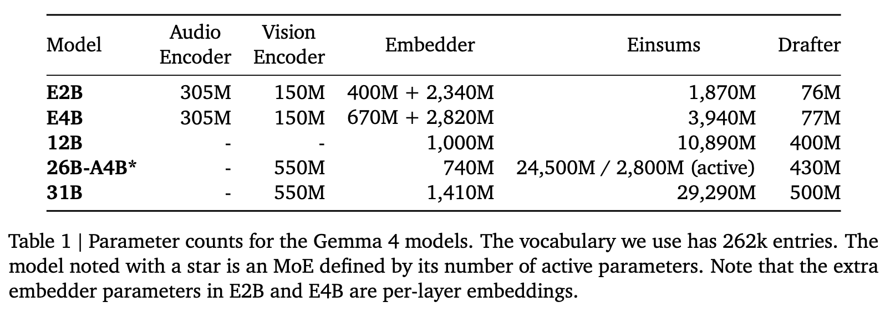

모델별 audio/vision encoder, embedder, einsum, drafter 파라미터 수

## 3.1 Long-context efficiency

- **local:global attention ratio**
  
  - E2B: **4:1**, 나머지 전부 **5:1** (Gemma 3와 동일 계열 설계)
- **keys-as-values**: global attention layer에서 $V = K$로 재사용 (단, E2B / E4B는 제외)
- **positional encoding**
  - global layer: $p$-RoPE with $p = 0.25$, RoPE frequency **1M**
  
    - **$p=0.25$의 의미:** 글로벌 어텐션 헤드 차원 중 주파수가 가장 낮은 **하위 25%의 차원에는 회전 위치 인코딩(RoPE)을 적용하지 않고 순수한 NoPE 상태로 두며**, 나머지 75%의 차원에만 1M 주파수의 RoPE를 적용했다는 뜻입니다 [cite: 1.3.1].
  
    **$p$ 값에 따라 달라지는 점:**
  
    - **$p$ 값이 커질 경우 (위치 정보 차원 감소):** 더 많은 차원이 NoPE로 대체됩니다 [cite: 1.1.2]. 모델은 토큰의 절대적/상대적 위치보다 문맥의 의미적 연관성(semantic relationships)에 더 강하게 의존하게 됩니다. 너무 크면 위치 정보가 부족해져 순서가 중요한 작업에서 성능이 떨어질 수 있습니다.   
    - **$p$ 값이 작을 경우 (위치 정보 차원 증가):** 기존의 표준 RoPE에 가까워집니다 [cite: 1.1.2]. 위치 정보에 대한 민감도는 높아지지만, 매우 긴 문맥(long-context)이 주어졌을 때 저주파수 차원의 한계로 인해 문맥의 길이 일반화(length generalization) 성능이 저하될 위험이 있습니다 [cite: 1.1.1].   
  - local layer: 일반 RoPE, frequency **10k**
  - $\to$ 두 설계를 합쳐 global KV cache **37.5% 감소**
- **KV cache sharing**: E2B는 20/35, E4B는 18/42 비율로 공유

## 3.2 Vision modality

- E2B / E4B: **150M ViT**, 그 외 (unified 12B 제외): **550M ViT**
- patch size 16, **axial 2D-RoPE** + 2D absolute positional embedding, **non-causal attention**
- variable aspect ratio 지원, max token 수 $N_{max} \in \{70, 140, 280, 560, 1120\}$
- pre-training 중 vision encoder weight는 **frozen**

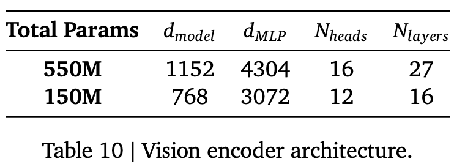 

vision encoder 구조: 550M은 $d_{model}$ 1152 / 27 layers, 150M은 768 / 16 layers

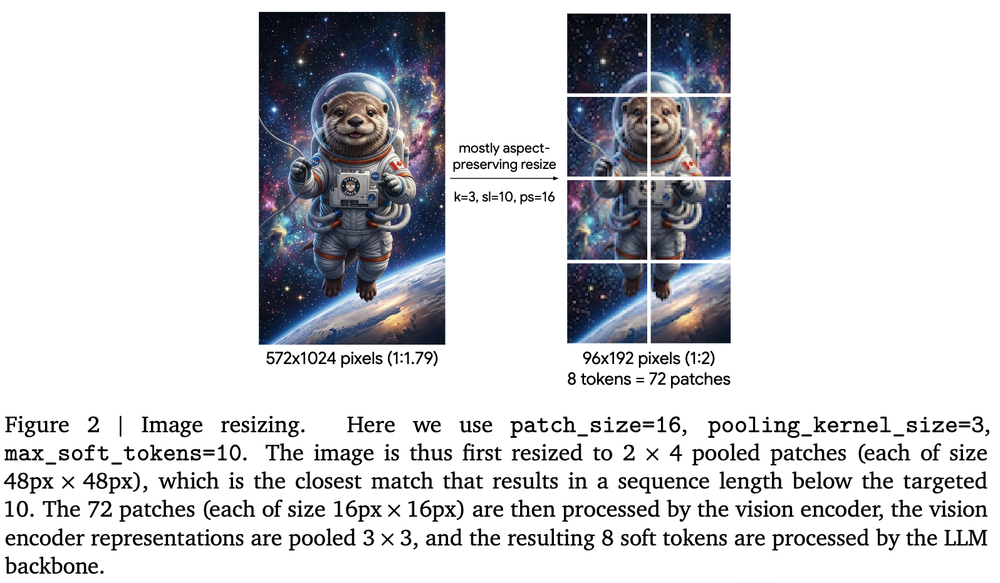

aspect-ratio preserving image resizing 예시: 572×1024 → 96×192, 72 patches → 8 soft tokens

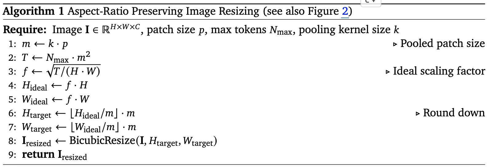

Aspect-Ratio Preserving Image Resizing 의사코드

## 3.3 Audio modality

- E2B / E4B: **305M USM 기반 encoder**. 40ms chunk, Mel filterbank 입력
  - 2개의 downsampling conv layer + **12개 Conformer layer**
  - Gemma 3n 대비 파라미터 **55% 감소** (680M $\to$ 305M)
  - **vector quantization 미사용** — LLM이 encoder의 continuous representation을 직접 받음
  - vision과 마찬가지로 pre-training 중 **frozen**

## 3.4 Encoder-free architecture (12B)

- 12B는 처음부터 **encoder 없이** scratch 학습. 별도 encoder를 경량 projection 모듈로 대체
- **vision**: $48 \times 48 \times 3$ RGB patch를 입력받아, 550M encoder를 **단 하나의 큰 matmul (35M params)** 로 대체
  - 공간 정보는 patch representation에 **2D coordinate 기반 positional embedding**을 더한 뒤 LayerNorm으로 유지
- **audio**: 305M USM conformer encoder를 **전부 폐기**
  - 16kHz raw audio를 40ms chunk로 잘라 **640-dim 벡터**로 만들고 LLM embedding space에 바로 projection
  - audio는 본래 temporal sequence이므로 **별도 positional encoding 불필요**
- 효과: encoder가 없으니 메모리 파편화가 사라지고 모델이 단일 스택으로 단순화됨

## 3.5 Quantization-Aware Training

- 두 가지 weight representation을 타깃 (llama.cpp 등 주류 추론 엔진 기준)
  - **mobile quantization**: per-channel low-bitwidth weight (int2 / int4 혼합) + activation int8
  - **Q4\_0 quantization**: blockwise quantization
- fp16 안정성을 위해 **block마다 scalar scale**을 도입해 activation range를 fp16 안에 bound
- encoder에도 QAT 적용
  - 150M vision encoder: **W8A8** $\to$ forward-pass 메모리 **2배 절감** (400MB $\to$ 200MB), Gemma 3n 대비 on-device latency **44% 감소**
  - audio encoder: activation 8bit, weight는 layer cluster별로 $\{2, 4, 8\}$ bit $\to$ on-disk **78% 감소** (390MB $\to$ 87MB)

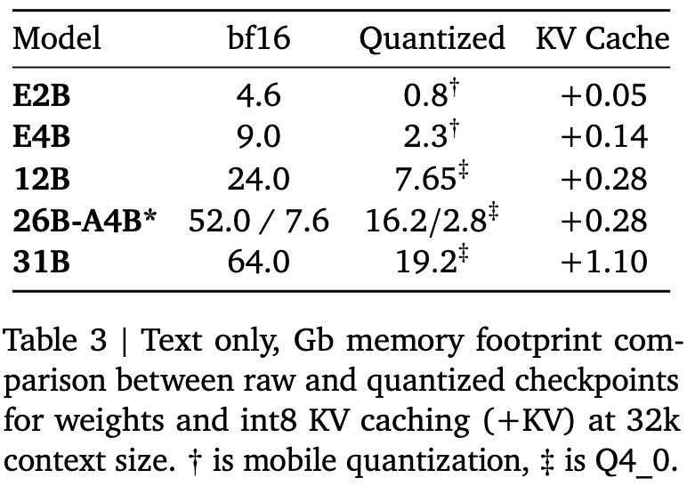

32k context 기준 bf16 vs quantized 메모리 footprint, GB

## 3.6 Multi-Token Prediction Drafter

- speculative decoding용 **autoregressive MTP drafter head**를 모델과 함께 학습 / 공개
- 동작: 이전 스텝의 **last-layer activation + token embedding**을 MTP head에 투입
  - MTP head는 별도 embedder + **4-layer Transformer block**으로, **본체의 KV에 cross-attend**
  - $\to$ MTP 전용 prefill이 불필요하고 임의의 draft length 지원
- 구성: model dim **256** (E2B / E4B), **1024** (26B-A4B / 31B), local attention 3개 + global 1개
- **Efficient MTP decoding**: 전체 vocabulary projection 대신 token cluster 위에서 top-k 연산
  - 최종 matmul이 $d \times 262{,}000 \to d \times 4096$ 으로 축소되면서 acceptance rate는 유지

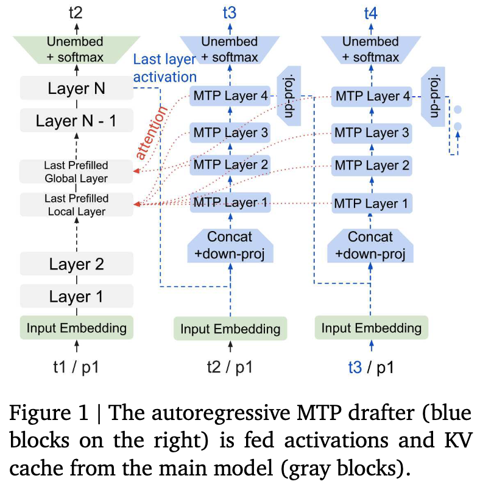

MTP drafter가 본체의 activation과 KV cache를 받아 t2/t3/t4를 생성하는 구조도

## 3.7 Compute Infrastructure

- TPUv4 / TPUv6e 사용. optimizer state는 **ZeRO-3** 구현으로 sharding
- multi-pod은 Pathways의 data replica reduction, JAX single-controller + GSPMD partitioner + MegaScale XLA 컴파일러
- **Slice-Granularity Elasticity**: 국소 장애 시 TPU chip "slice" 단위로 연속 학습 $\to$ 복구 지연이 **수 분에서 수 초로** 단축

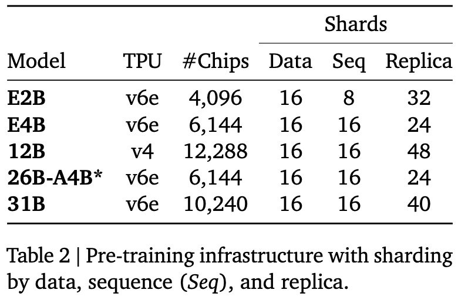

모델별 TPU 종류 / chip 수 / data·seq·replica sharding 구성

# 4. Instruction Tuning

- 사후 학습은 Gemma 3와 유사하되, **thinking mode 추가**가 핵심 차이
- **data filtering**: 개인정보 / unsafe·toxic output / 잘못된 self-identification 데이터 / 중복 예시를 제거
  - in-context attribution, hedging, refusal을 장려하는 subset을 포함시키면 **다른 지표 저하 없이 factuality가 개선**됨
- **PT vs IT formatting**: tokenizer는 동일하되 PT는 생성 끝에 `<eos>`, IT는 `<turn|>`를 출력
  - 따라서 파인튜닝 시 각 모델 타입에 맞는 end token을 반드시 붙여야 함

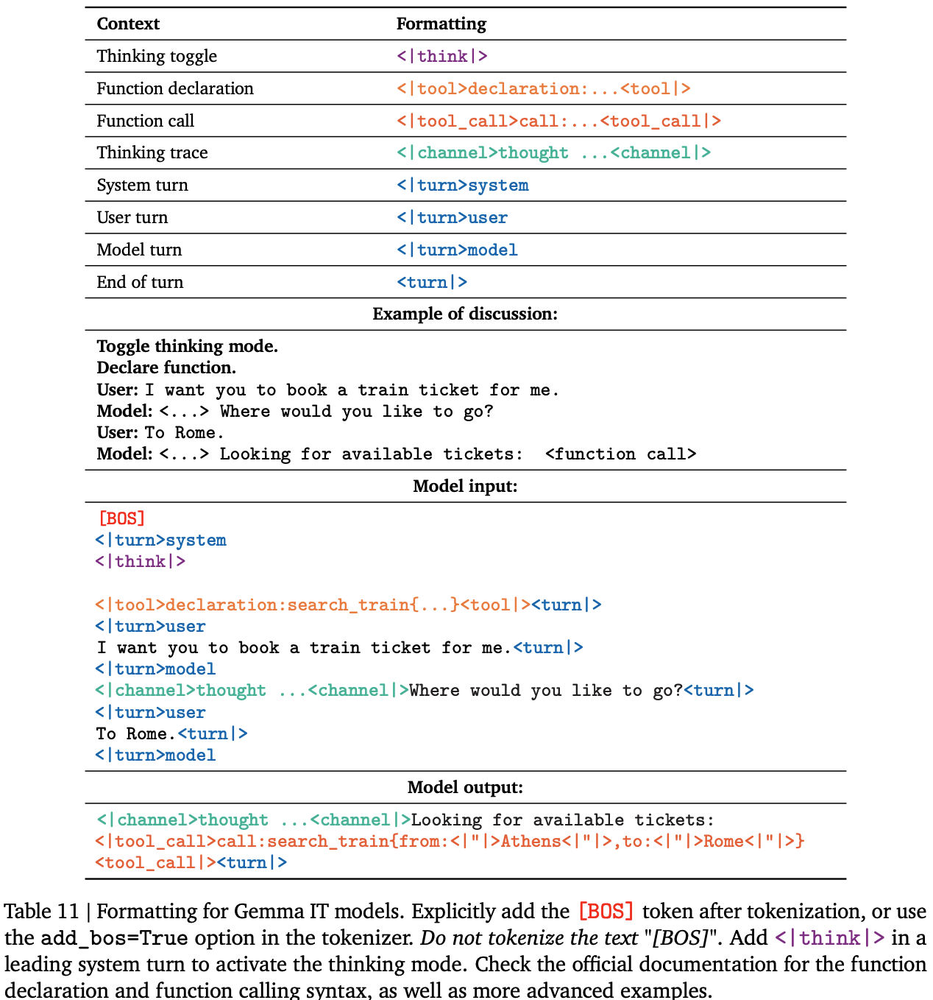

IT 모델의 conversation format: thinking toggle, function declaration / call, channel 토큰 예시

# 5. Experiments

## 5.1 Human evaluation (Arena)

- Arena에서 blind side-by-side 평가, Elo 기준 (2026-06-19 시점)

- **Gemma 4 31B는 open dense 모델 중 리더보드 1위**이며, 1T급 MoE들과 Elo 차이가 한 자릿수 수준
- Gemma 3 27B 대비 **+85 Elo**

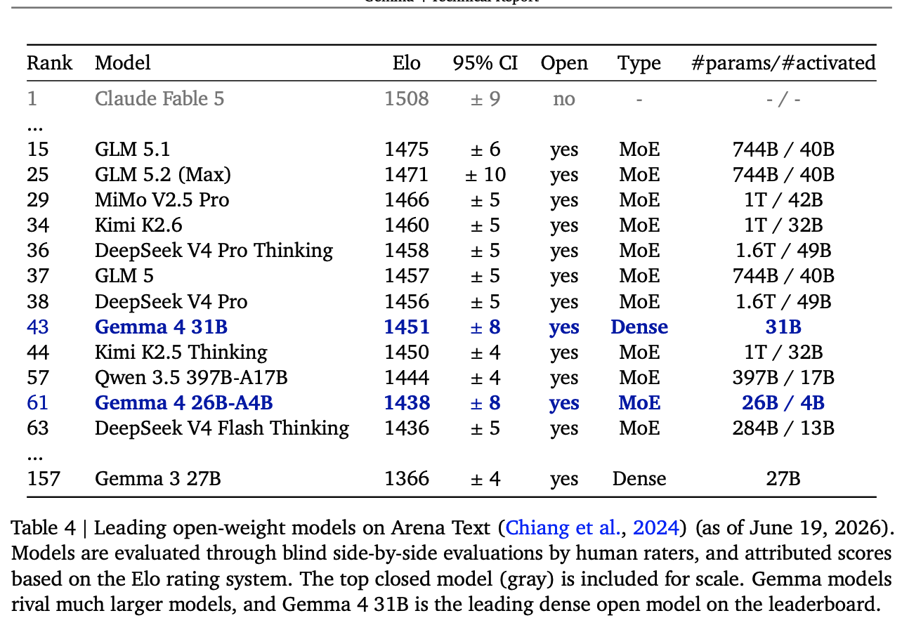

## 5.2 Static benchmarks

- 명시하지 않는 한 모두 thinking mode 기준. Gemma 3 27B는 non-thinking

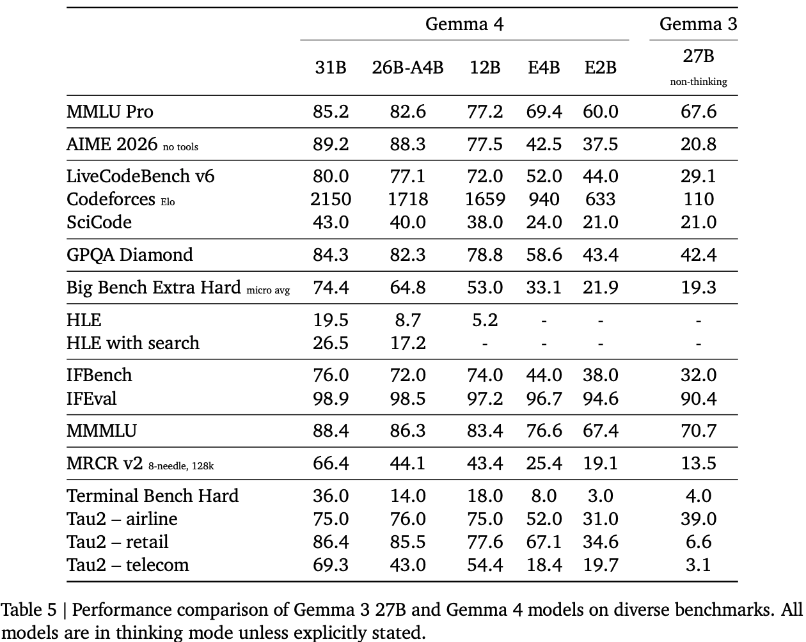

- **reasoning 도메인의 도약이 가장 큼**: AIME **20.8 $\to$ 89.2** (+68.4pp), Codeforces Elo **110 $\to$ 2150**
- **E2B가 Gemma 3 27B와 대략 동급** (MMLU Pro 60.0 vs 67.6은 낮지만, AIME 37.5 vs 20.8, LiveCodeBench 44.0 vs 29.1 등 reasoning은 압도) — **파라미터 10배 차이**
- agentic (Tau2 / Terminal Bench)에서 Gemma 3 대비 차이가 극단적 (retail 6.6 $\to$ 86.4)
- 다만 **HLE는 31B도 19.5** (search 사용 시 26.5)로 frontier 난이도에서는 여전히 한계

## 5.3 Vision

| Benchmark | 31B | 26B-A4B | 12B | E4B | E2B | Gemma 3 27B |
|---|---|---|---|---|---|---|
| MMMU Pro | 76.9 | 73.8 | 69.1 | 52.6 | 44.2 | 49.7 |
| MATH-Vision | 85.6 | 82.4 | 79.7 | 59.5 | 52.4 | 46.0 |
| MedXPertQA MM | 61.3 | 58.1 | 48.7 | 28.7 | 23.5 | - |
| InfographicVQA | 92.0 | 89.3 | 88.4 | 70.0 | 63.9 | 70.6 |
| OmniDocBench 1.5 $\downarrow$ | 0.131 | 0.149 | 0.164 | 0.181 | 0.290 | 0.365 |

- 최대 해상도(1120 vision token) 기준. **E4B가 Gemma 3 27B와 동급 이상**
- **encoder-free 12B가 MATH-Vision 79.7 / InfographicVQA 88.4** 로, 550M encoder를 쓰는 26B-A4B(82.4 / 89.3)에 근접 $\to$ encoder 제거의 비용이 생각보다 작음
- 저해상도($N_{max}=280$)에서는 전반적으로 하락 (31B MMMU Pro 76.9 $\to$ 75.8, OmniDocBench 0.131 $\to$ 0.201)

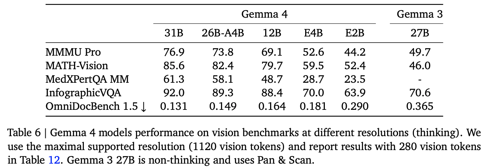

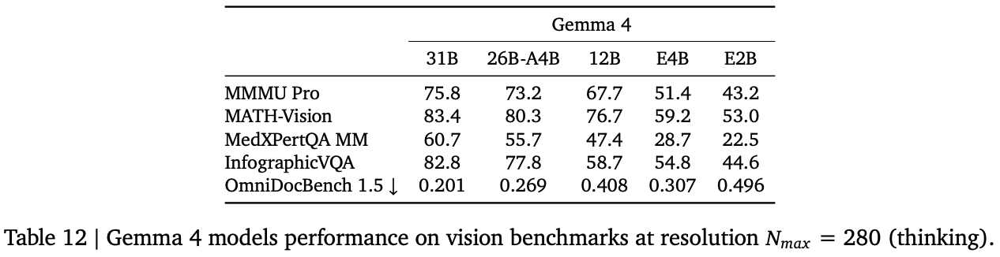

## 5.4 Audio

- E2B / E4B (305M encoder, 양자화 후 87MB) vs Gemma 3n (680M encoder, 390MB)

| | CoVoST AVG (BLEU $\uparrow$) | FLEURS ASR AVG (WER $\downarrow$) |
|---|---|---|
| Gemma 4 E2B | 35.4 | 0.090 |
| Gemma 4 E4B | **38.2** | **0.075** |
| Gemma 3n E2B | 31.6 | 0.108 |
| Gemma 3n E4B | 34.7 | 0.085 |

- translation 상대 개선 **+12% (E2B) / +10% (E4B)**, transcription 상대 개선 **+17% (E2B) / +12% (E4B)**
- 동시에 on-disk encoder footprint는 **78% 감소** (390MB $\to$ 87MB)
- **encoder-free 12B도 경쟁력 있는 audio 성능**: FLEURS en WER 0.063, ko CER 0.057, ja CER 0.080 / CoVoST de→en 41.9, ru→en 50.5
  - 전용 audio encoder 없이도 이 수준이 나온다는 것이 encoder-free 설계의 핵심 근거

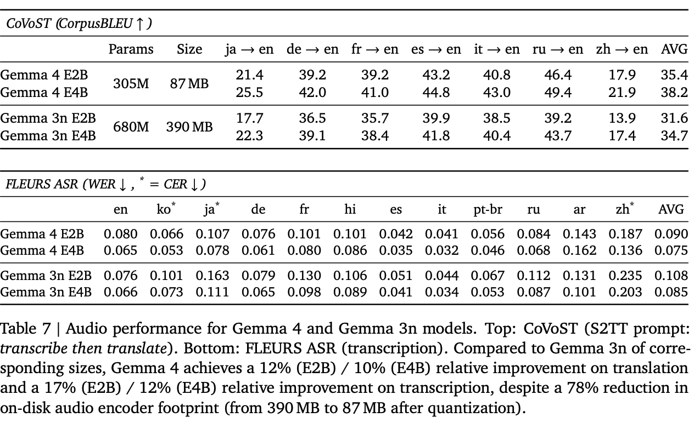

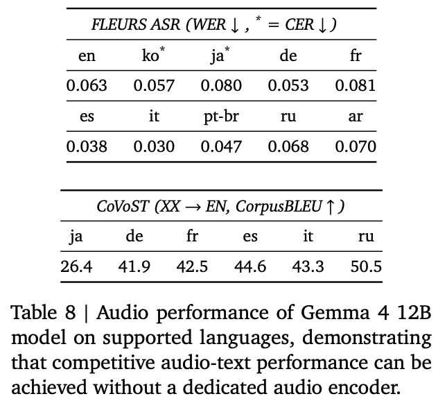

## 5.5 Long context

- thinking 미사용 기준

| Benchmark | Context | 31B | 26B-A4B | 12B | E4B | E2B | Gemma 3 27B |
|---|---|---|---|---|---|---|---|
| RULER (Acc) | 32k | 96.8 | 97.3 | 96.4 | 95.2 | 83.0 | 91.1 |
| RULER (Acc) | 128k | 96.4 | 89.8 | 91.2 | 86.6 | 70.4 | 66.0 |
| LOFT Text Retrieval (Recall@k) | 128k | 79.5 | 66.3 | 66.4 | 58.5 | 50.5 | 8.6 |
| GraphWalks (F1) | <128k | 82.3 | 72.6 | 71.0 | 50.9 | 4.1 | 32.8 |
| MTOB eng→kgv (chrF) | ~128k | 52.9 | 50.0 | 45.1 | 37.8 | 15.4 | 41.0 |
| MTOB kgv→eng (chrF) | ~128k | 48.6 | 45.0 | 37.3 | 34.6 | 28.2 | 31.2 |

- **LOFT 128k에서 8.6 $\to$ 79.5 (+70.9pp)** 로 격차가 가장 큼 — Gemma 3는 사실상 long-context retrieval이 동작하지 않았음
- RULER 128k에서 32k 대비 하락폭이 작음 (31B: 96.8 $\to$ 96.4)
- MTOB는 **256k full book**까지 처리 가능 (31B eng→kgv 54.3으로 half book 52.9보다 오히려 상승)
- 단, **E2B는 GraphWalks 4.1**로 small model의 long-context multi-hop reasoning은 거의 붕괴

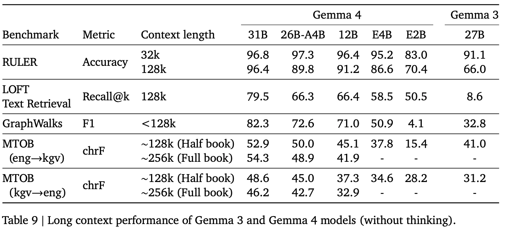

# 6. Responsibility, Safety, Security

- Gemini와 동일한 안전성 평가 절차를 적용. CSAM, dangerous content, sexually explicit, hate speech, harassment를 정책 대상으로 명시
- 학습 데이터에서 개인정보 / 민감정보 필터링, post-training 평가와 train-time mitigation 병행
- **safety filter를 끈 상태로 평가**해 모델 자체 behavior를 측정 $\to$ 모든 모델 크기 / text·image 모달리티에서 policy violation이 minimal
- Gemma 3 / 3n 대비 모든 content safety 카테고리에서 개선, 동시에 **unjustified refusal은 낮게 유지**

# 7. Conclusion & Limitations

- **정리**: thinking mode + 효율 설계(local:global, $p$-RoPE, keys-as-values, QAT, MTP drafter) + encoder-free 통합 구조로, edge(2.3B)부터 31B dense까지 한 패밀리로 커버
- 저자들이 밝히거나 결과에서 드러나는 한계
  - **HLE 19.5 (31B)** — frontier 난이도 academic reasoning은 여전히 큰 폭으로 부족
  - **Terminal Bench Hard는 31B도 36.0**, 26B-A4B는 14.0으로 **MoE가 dense보다 크게 떨어짐**. agentic long-horizon은 미해결
  - small model(E2B)의 **long-context multi-hop reasoning 붕괴** (GraphWalks F1 4.1)
  - encoder-free는 **12B 한 모델에만 적용**되었고 다른 사이즈로의 일반화는 미검증
  - pre-training data cutoff가 **2025년 1월** — 최신성 요구 태스크에는 제약
  - bias/fairness, misinformation 위험은 완화만 했을 뿐 해소되지 않았음을 명시하고 downstream 개발자의 모니터링을 요구

## Takeaways

- **thinking mode 하나가 벌어준 폭이 압도적**이다. 동일 계열 27B 대비 AIME +68.4pp, Codeforces Elo 110 $\to$ 2150. 구조 개선보다 reasoning trace 학습의 기여가 크다고 읽힌다.
- **"effective 파라미터"가 open model의 실질 지표로 자리잡는 중**이다. PLE로 total 5B를 effective 2.3B로 만들고, QAT로 4.6GB를 0.8GB까지 내린다 — 벤치마크 점수만큼 메모리 테이블(table3)이 중요한 결과물이다.
- **encoder-free가 공짜에 가깝다**는 점이 가장 흥미롭다. 550M ViT $\to$ 35M matmul, 305M conformer $\to$ 완전 삭제인데 vision/audio 성능이 encoder 쓰는 동급 모델과 큰 차이가 없다. 다만 12B 단일 사례라 일반화 주장은 아직 이르다.
- **long-context는 "되냐 안 되냐"의 문제였다.** LOFT 128k에서 8.6 $\to$ 79.5는 점진 개선이 아니라 기능 자체가 새로 생긴 수준이다. KV cache 37.5% 절감이 여기에 직접 기여한다.
- **dense가 MoE를 이기는 구간이 있다.** Arena에서 31B dense(1451)가 26B-A4B MoE(1438)보다 높고, Terminal Bench Hard는 36.0 vs 14.0으로 격차가 크다. 같은 메모리 예산이면 activated 파라미터가 많은 쪽이 agentic 태스크에 유리하다는 신호.
