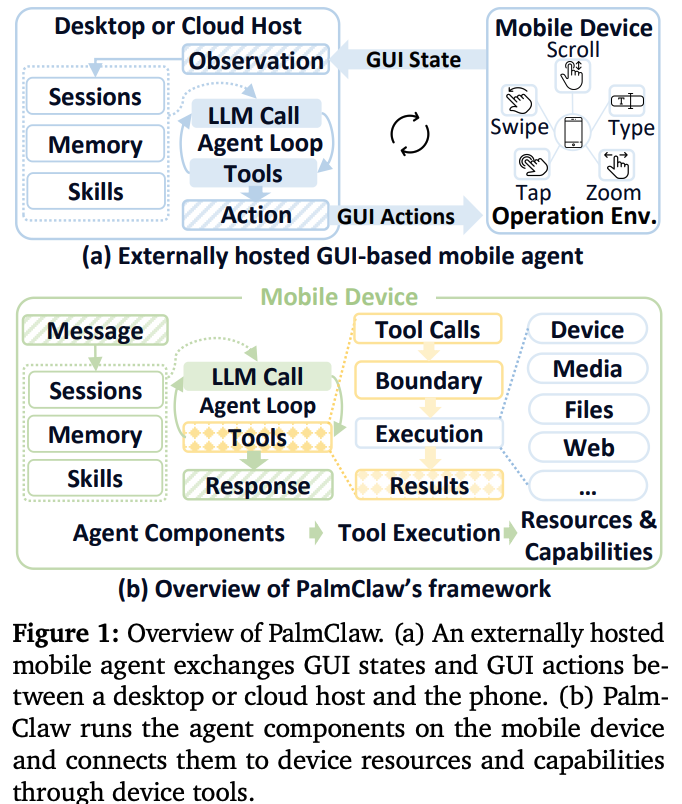
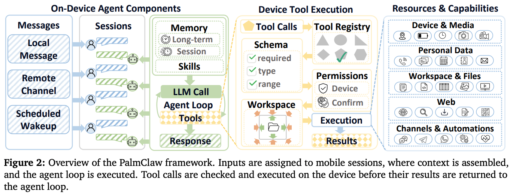
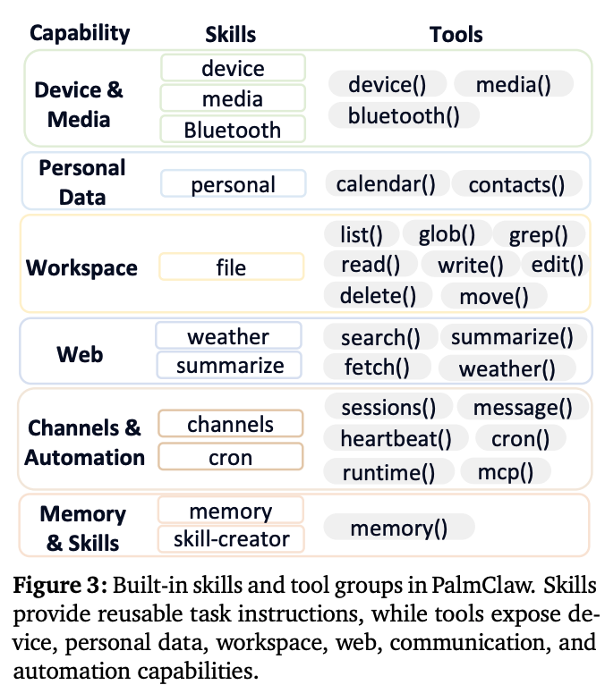
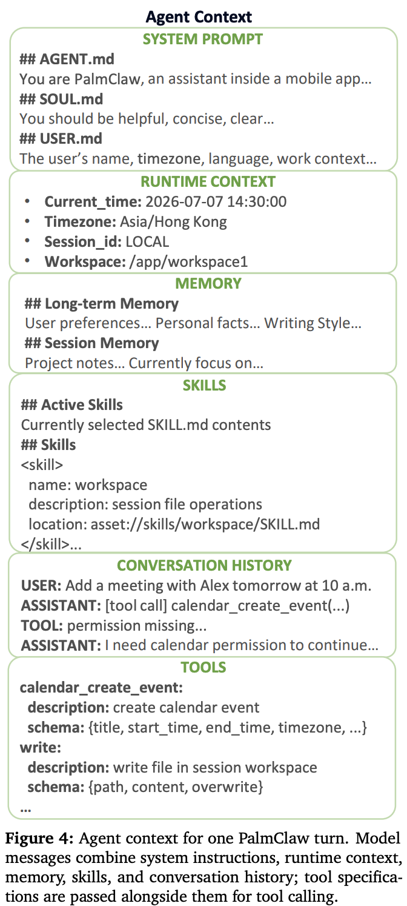
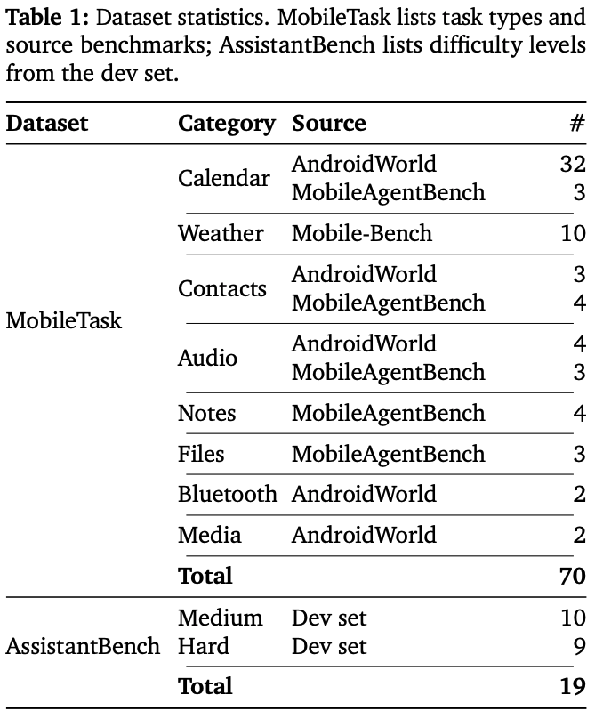
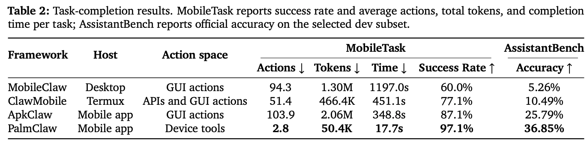
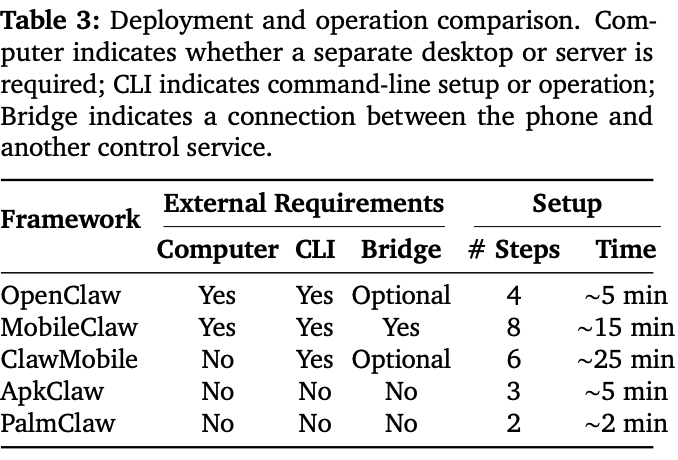
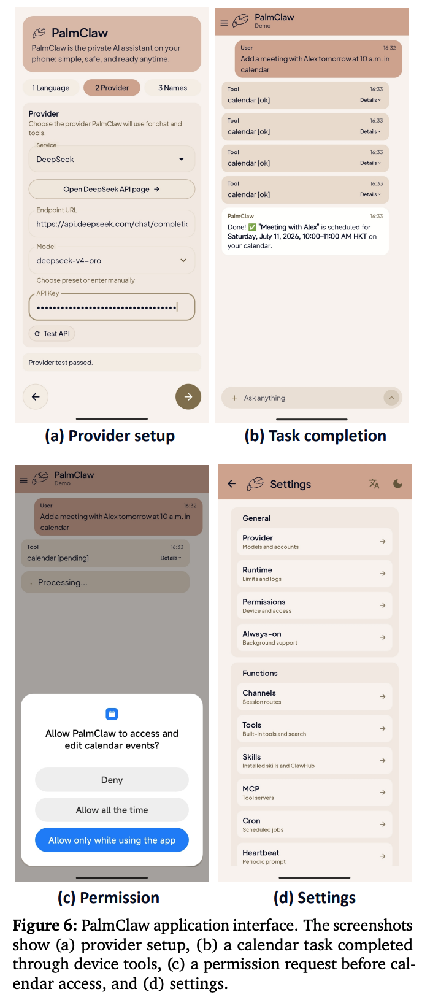
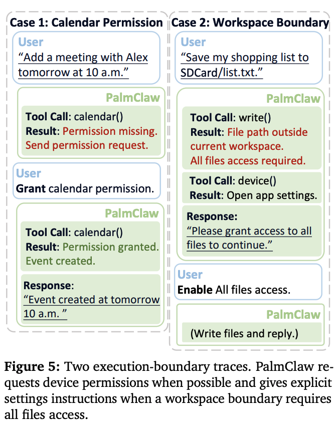
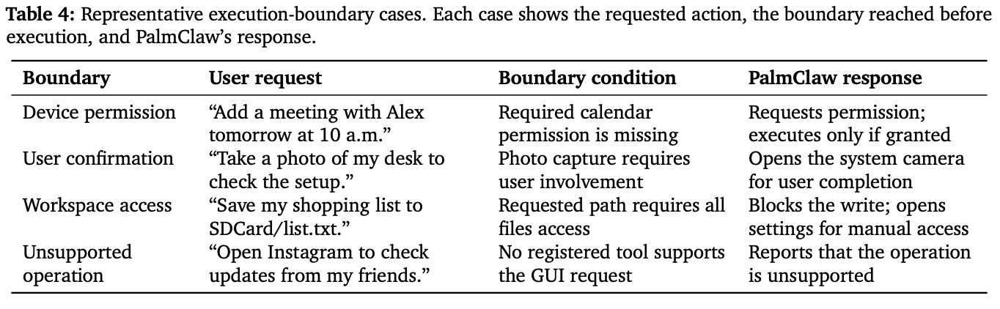

# [Agent] PalmClaw: A Native On-Device Agent Framework for Mobile Phones

- paper: https://arxiv.org/pdf/2607.13027 (arXiv:2607.13027v2, cs.CL)
- github: https://github.com/ModalityDance/PalmClaw (AGPLv3, 설치 패키지는 `releases/latest`)
- preprint, '26-09-03 (인용수: 1회, '26-10-15 기준)
- 저자: The Hong Kong Polytechnic University (Hongru Cai, Yongqi Li†, Wenjie Li), Hangzhou Diagens Biotechnology (Ran Wei)
- downstream task: Mobile Agent (on-device task automation)
  - "내일 오전 10시에 Alex와 미팅 잡아줘" 같은 자연어 지시를 폰에서 끝까지 실행하는 테스크
- 주요 용어
  - **native on-device framework**: session / memory / skill / tool / agent loop를 전부 모바일 앱 안에서 돌리는 구조. LLM 추론만 remote API로 나가고, context 조립 · tool 실행 · session state는 폰에 남음
  - **device tool**: 폰의 자원·기능을 명시적 argument / JSON schema / structured result를 가진 함수로 노출한 것. GUI의 tap·swipe·type을 대체하는 action space
  - **execution boundary**: tool call이 실제 device 연산이 되기 전에 통과해야 하는 경계. schema · permission · workspace 3종 체크로 구성되며, 막히면 open command channel 대신 structured failure가 agent loop로 돌아옴
  - **workspace**: session마다 할당된 문서·임시파일·생성물 전용 디렉토리. 다른 session의 workspace와 승인되지 않은 global path는 거부됨
  - **MobileTask**: 저자들이 AndroidWorld / MobileAgentBench / Mobile-Bench에서 재작성한 70개 모바일 태스크 집합

((a) desktop/cloud에 호스팅된 GUI 기반 mobile agent vs (b) 폰 안에서 도는 PalmClaw)

# 1. Motivation

- LLM agent는 tool을 호출하고 결과를 관찰하며 다음 행동을 정하는 multi-step 실행기로 이동했지만, 대표 프레임워크(AutoGen, AgentScope, OpenClaw)는 전부 **desktop 또는 cloud server에 호스팅**됨

- 저자들은 모바일이 agent 환경으로서 중요하다고 주장함

  - 10세 이상 세계 인구 5명 중 4명이 폰을 소유 $\to$ PC가 없는 사용자까지 도달 가능
  - 폰에는 개인 데이터, 센서(카메라 · 마이크 · 위치), 일상 앱이 모여 있음

- 그런데 기존 mobile agent는 거의 전부 **GUI action(tap / swipe / type)으로 폰을 조작**함. 저자들이 짚는 한계 3가지

  1. 고수준 태스크가 **길고 layout에 민감한 action sequence**로 전개됨 (레이아웃·복잡한 인터페이스 변화에 취약)
  2. local file, sensor data 같은 **device 자원에 직접 접근 불가**
  3. GUI 제어 권한은 "도달 가능한 모든 화면"에 대한 광범위 접근을 주는 것이라 **태스크별 접근 한계나 execution boundary를 정의하기 어려움**

- 한편 Codex CLI, Claude Code, Gemini CLI 같은 terminal-native agent의 부상은 **명시적이고 실행 가능한 tool 기반 상호작용**으로의 전환을 보여줌

  $\to$ (Research Question) GUI를 유일한 action space로 쓰지 말고, agent framework 자체를 폰 안으로 옮기면서 device 기능을 explicit tool로 노출하면 어떨까?

# 2. Contribution

- **PalmClaw** 제안: session / memory / skill / tool / agent loop를 모바일 디바이스 위에서 직접 호스팅하는 오픈소스 mobile-native agent framework
- **device tool** 설계: 모바일 자원·기능을 explicit argument, structured result, tool-specific execution boundary로 노출
- 모바일 태스크 평가에서 최강 베이스라인 대비 **task success +11.5% (relative)**, **평균 완료 시간 −94.9%**, 더 낮은 setup 부담, execution boundary에 대한 trace 기반 분석 제공

# 3. Related Works

- **General agent frameworks**: ReAct(reasoning trace + action), Toolformer(API call을 language modeling에 포함), AutoGen / AgentScope / OpenClaw가 이를 시스템으로 패키징. 단 전부 컴퓨터 또는 클라우드 서버에 호스팅됨
- **Mobile agents**: AndroidWorld, MobileAgentBench, Mobile-Bench, AgentCPM-GUI, Mobile-Agent-v3.5 등이 벤치마크·에이전트를 개발. ApkClaw / MobileClaw / ClawMobile은 phone-side 실행을 탐색하지만 **여전히 GUI action 중심**
- PalmClaw의 차별점: agent framework를 폰에 올리고(framework placement), device capability를 device tool로 노출(action space) — 두 축을 동시에 바꿈

# 4. Framework

 (PalmClaw 전체 구조: 입력 → session 할당 → context 조립 → agent loop → tool call 체크 → 실행 → 결과 반환)

## 4.1 Agent Components

**Sessions.** persistent agent interaction을 3종 입력 소스로부터 조직함

- local chat message / 연결된 remote channel의 message / scheduled wakeup이 만든 자동 message
- 각 session은 대화 기록, tool trace, 첨부파일, 그리고 **전용 workspace**를 보유
- 입력은 기존 또는 신규 session으로 라우팅 $\to$ 여러 태스크를 분리 유지한 채 multi-turn 지속

**Memory.** 2계층 persistent memory

1. **shared long-term memory**: session 간 공유, 매 turn의 context에 포함
2. **per-session summary**: 태스크 진행·결론의 압축 기록

- 미정리 message가 설정된 window에 도달하면 **별도 LLM call이 오래된 message를 요약**하고 두 계층을 갱신
- memory tool로 long-term memory read/update, 특정 session history read/search 가능

**Skills.** `SKILL.md` 파일로 저장되는 재사용 가능한 task instruction

- 매 turn마다 (1) 사용 가능한 skill 요약을 context에 추가, (2) always-active로 표시된 skill은 전문 로드, (3) 나머지는 최근 user message를 name·description·keyword와 매칭해 선택
- **always-active + 선택된 skill만 전문 로드** $\to$ 모든 skill을 context에 올리지 않고 태스크별 가이드를 제공

**Tools.** model-generated tool call을 폰의 자원·기능에 연결

- 각 tool = (name, description, JSON argument schema)의 model-facing spec + 모바일 서비스/앱 관리 연산을 호출하는 device-facing function
- spec을 LLM에 보내고, 호출되면 함수를 실행하고, **structured result 또는 error**를 반환

 (built-in skill과 tool group: Device & Media / Personal Data / Workspace / Web / Channels & Automation / Memory & Skills)

| Capability | Skills | Tools |
|---|---|---|
| Device & Media | device, media, Bluetooth | `device()`, `media()`, `bluetooth()` |
| Personal Data | personal | `calendar()`, `contacts()` |
| Workspace | file | `list()`, `glob()`, `grep()`, `read()`, `write()`, `edit()`, `delete()`, `move()` |
| Web | weather, summarize | `search()`, `summarize()`, `fetch()`, `weather()` |
| Channels & Automation | channels, cron | `sessions()`, `message()`, `heartbeat()`, `cron()`, `runtime()`, `mcp()` |
| Memory & Skills | memory, skill-creator | `memory()` |

## 4.2 Agent Execution

**Context assembly.** 입력이 session에 할당되면 6개 소스로 context를 조립함

1. `AGENT.md` / `SOUL.md` / `USER.md`의 system instruction
2. runtime context (현재 시각, timezone, session ID, workspace path)
3. shared long-term memory
4. active skill instruction + 사용 가능한 skill 요약
5. 최근 대화 기록, 첨부, tool trace
6. 사용 가능한 tool spec (name / description / argument schema)

- 1~5는 model message를 이루고, **6은 tool specification으로 별도 전달**됨

(한 turn의 agent context 구성 예시: SYSTEM PROMPT / RUNTIME CONTEXT / MEMORY / SKILLS / CONVERSATION HISTORY / TOOLS)

**Agent loop.** 각 turn은 **bounded multi-round loop**

- 매 round: 현재 session state로 context 재구성 $\to$ model message + tool spec을 remote LLM API로 전송 $\to$ 반환된 assistant message를 session에 저장
- tool call이 있으면 실행하고 결과를 session에 append, 갱신된 context로 다음 round
- tool call이 없으면 그것이 final reply. **model이 완료를 선언하거나 round limit에 도달하면 종료**

**Tool execution.** tool call은 tool registry에 매칭된 뒤 **3단계 체크**를 통과해야 실행됨

1. **Schema**: 필수 argument, 타입, 허용 범위 검증
2. **Permissions**: device 권한 + 사용자 확인. 권한이 없으면 system permission/settings flow를 띄우고, 사용자 개입이 필요한 action은 사용자가 확인·완료한 뒤에만 진행
3. **Workspace**: 현재 session workspace 또는 승인된 공유 저장소 내로 path를 resolve. **다른 session의 workspace와 미승인 global path는 거부**하고, 외부 쓰기는 확인을 요구

- 통과하면 해당 device 자원에 실행되고 structured result가 다음 round로 반환. 실패하거나 사용자가 거부하면 **structured error**가 반환됨

# 5. Experiments

## 5.1 Setup

- **RQ1**: on-device framework + device tool로 모바일 태스크를 실제로 완수하는가?
- **RQ2**: framework를 폰에 올리면 외부 배포·운영 요구가 줄어드는가?
- **RQ3**: device tool 실행 시 execution boundary가 어떻게 적용되는가?

**Datasets.**

 (MobileTask 70 / AssistantBench 19의 구성)

- **MobileTask**: AndroidWorld, MobileAgentBench, Mobile-Bench에서 후보를 가져와 (task identifier, source label, expected artifact, evaluation note)를 갖춘 **user-goal instruction으로 재작성**
  - 유지 기준: (1) 고정 GUI path 없이 시도 가능, (2) third-party app state에 의존하지 않음, (3) GUI-only agent에 유리하지 않음
  - 상대 날짜·실시간 날씨 등 unstable case와 중복 calendar variant는 제거
  - 평가: 가능하면 deterministic final-state check, answer 기반은 **DeepSeek-V4-Flash를 judge**로 쓴 evidence-grounded judging, permission/device-state 태스크는 manual review
- **AssistantBench**: 33-task dev set 중 **answer가 사후에도 검증 가능한 19개**만 사용 (local test split에 gold answer가 없고 일부 dev task는 실시간 값이 불안정하기 때문). 공식 accuracy metric 사용 (string은 word-level F1, numeric은 log-distance, list는 aligned mean F1)

**Baselines.** 오픈소스 mobile-agent 3종

- **ApkClaw**: 자연어 device control용 Android 앱, GUI 조작(tap/swipe/type/앱 열기)으로 행동
- **MobileClaw**: phone-side client + **외부 Python runtime**, 화면 관찰 + GUI action으로 폰 제어
- **ClawMobile**: **Termux**(폰 위의 Linux 유사 환경)에 agent runtime을 두고 phone API / shell command / GUI control로 실행

**Implementation.** Android (Xiaomi Redmi 2312DRAABC, Android 13 / SDK 33). LLM backbone은 전 시스템 공통 `DeepSeek-V4-Flash`. MobileClaw는 screenshot grounding용 visual GUI model이 추가로 필요해 `qwen3.7-plus` 사용. AssistantBench에서 **PalmClaw는 30-round limit, screen 기반 베이스라인은 100-round limit** (GUI agent는 관찰·네비게이션에 round를 더 쓰기 때문)

## 5.2 Task Completion (RQ1)

(MobileTask의 action 수 / token / 시간 / success rate 및 AssistantBench accuracy)

- MobileTask success: 87.1% (ApkClaw) $\to$ **97.1%**, relative **+11.5%**
- 평균 완료 시간: 348.8s $\to$ **17.7s**, **−94.9%**
- action 수는 103.9 $\to$ **2.8** (약 37배 감소), token은 2.06M $\to$ **50.4K** (약 41배 감소)
- AssistantBench도 25.79% $\to$ **36.85%**로 최고
- 저자 해석: 효율 이득의 대부분은 **device tool**에서 옴. 모바일 기능을 structured operation으로 노출해서 **화면 관찰 → 네비게이션 → GUI action의 긴 시퀀스를 회피**함
  - 참고로 action은 LLM API call 1회를 1 action으로, token은 input+output 전부를 셈

## 5.3 Deployment and Operation (RQ2)

(외부 요구사항 및 setup 부담 비교)

- Computer = 별도 데스크톱/서버 필요 여부, CLI = command-line 설정/운영 여부, Bridge = 폰과 다른 런타임·제어 서비스 간 연결 필요 여부
- PalmClaw는 **셋 다 불필요**, 첫 지시까지 **2 step / 약 2분**
  - 사용자 진입점과 agent framework가 **같은 모바일 앱 안**에 있기 때문
- 비교군 중 ClawMobile은 컴퓨터는 불필요하지만 Termux 환경 구성 때문에 setup이 가장 오래 걸림(~25분)

(PalmClaw 앱 UI: (a) provider setup, (b) calendar 태스크 완료, (c) 권한 요청, (d) settings)

## 5.4 Execution Boundaries (RQ3)

- trace 기반 case 분석. PalmClaw가 permission / confirmation / workspace / unsupported 경계에 닿아 **멈추거나, 사용자 개입을 요청하거나, failure를 반환한 기록**을 수집

(두 execution-boundary trace: calendar permission, workspace boundary)

**Case 1: Calendar permission.** "내일 오전 10시 Alex와 미팅 추가"

- `calendar()` tool이 권한 확인 $\to$ 없음 $\to$ **미확인 상태로 진행하지 않고** permission request 전송
- 사용자가 승인하면 같은 태스크 계속, 거부하면 **"미팅을 만들었다"고 주장하지 않고** 권한 문제와 필요한 조치를 보고

**Case 2: Workspace boundary.** "쇼핑 리스트를 SDCard/list.txt에 저장"

- `write()`가 **파일 연산 완료 전에 path를 resolve** $\to$ `/sdcard/list.txt`는 현재 workspace 밖이고 all files access가 필요한 public path $\to$ boundary result 반환
- calendar 권한과 달리 **일반 모바일 permission prompt로는 승인 불가** $\to$ `device()`로 앱 설정 페이지를 열고 수동으로 all files access를 켜라고 안내

(대표적인 execution-boundary 4종과 PalmClaw의 대응)

- 세 경계 모두 공통 구조: **요청된 연산이 실행되기 전에 경계가 적용되고, 결과가 agent loop로 돌아와 다음 결정의 입력이 됨**
- 즉 agent는 폰에 대한 **open command channel을 받지 않음**

# 6. Conclusion & Limitations

- 핵심 주장: mobile-agent 설계는 **agent framework가 어디서 도는가(placement)** 와 **device 기능에 어떻게 접근하는가(action space)** 를 함께 고려해야 함
- 폰을 "조작 대상 인터페이스"가 아니라 **agent execution environment**로 보면, 연구 범위가 screen-control policy에서 complete on-device framework로 넓어진다고 주장

**저자들이 명시한 limitation**

- MobileTask는 **device-level capability로 완결되는 태스크**만 다룸 $\to$ **third-party GUI workflow는 커버하지 않음**. 태스크 수도 적고(70) 카테고리 분포가 고르지 않음 (calendar가 35/70으로 절반)
- **LLM backbone 1종, 태스크당 1 run**. 더 넓은 카테고리 / 추가 모델 / 반복 실행이 있어야 generality와 robustness를 제대로 측정 가능
- Ethics: tool 등록 · argument 검증 · Android permission · workspace boundary로 action을 explicit·bounded하게 유지하지만, **remote LLM provider가 prompt / tool result / task context를 수신**한다는 점은 배포 시 사용자에게 명확히 밝혀야 함

# Takeaways

- **action space를 바꾼 것이 성능 이득의 본체**다. GUI tap/swipe 대신 schema를 가진 device tool을 쓰자 action 103.9 $\to$ 2.8, token 2.06M $\to$ 50.4K, 시간 348.8s $\to$ 17.7s로 한 자릿수가 아니라 자릿수 자체가 바뀜. success +10pp는 오히려 부차적 효과
- **"on-device"라는 표현의 범위를 정확히 읽어야 한다.** LLM 추론은 여전히 remote API(DeepSeek-V4-Flash)로 나간다. 폰에 있는 것은 session / memory / skill / tool registry / agent loop. 즉 privacy·offline이 아니라 **orchestration 의존성 제거와 setup 부담 감소**가 실제 기여
- **execution boundary를 tool 실행 경로의 1급 구성요소로 승격**시킨 설계가 흥미롭다. schema → permission → workspace 순서로 체크하고, 실패를 structured error로 agent loop에 돌려주니 agent가 "했다고 주장"하는 hallucinated completion을 구조적으로 막음
- 다만 **평가의 범위가 좁다**. 70개 중 35개가 calendar이고 third-party 앱 워크플로가 통째로 빠져 있어, "GUI는 불충분하다"는 주장이 정작 GUI가 필요한 영역에서는 검증되지 않았다. device tool로 커버되는 영역에서 device tool이 빠르다는 결과이므로, 베이스라인 비교는 다소 유리하게 설계된 면이 있음
- Claude Code / Codex CLI 류의 `SKILL.md` + tool registry + bounded loop 패턴을 모바일 앱에 거의 그대로 이식한 사례로 읽힌다. `AGENT.md` / `SOUL.md` / `USER.md` 분리, skill의 always-active vs keyword-selected 로딩 전략은 context 예산이 빡빡한 환경에서 참고할 만함
