# [LLM] RULER: Instance-aware Rubric Rewards for SVG Generation

- paper: https://arxiv.org/pdf/2609.25270
- webpage: https://hangyuran.github.io/RULER/
- EMNLP 2026, '26-09-21 (인용수: 1회, '26-10-26 기준)
- 저자: Ant Group / HKUST(GZ) / University of Oxford (Hangyu Ran, Yuhao Zheng, Yingying Zhang, Kevin Qinghong Lin, Han Peng)
- downstream task: Text-to-SVG code generation (open-ended visual code generation)
  - 자연어 instruction $\to$ SVG 코드 생성. 정답 SVG가 존재하지 않는 open-ended 생성 과제
- 주요 용어
  - **instance-aware rubric**: 각 instruction $\mathcal{Q}$마다 frontier model이 생성하는 6개 항목 채점표. $C_\mathcal{Q} = \{(c_k, w_k)\}_{k=1}^{6}$, $c_k$는 항목 제목·설명·연속 채점 가이드, $w_k$는 가중치
  - **three rubric axes**: rubric 6항목을 묶는 3개 축 — *Semantic Fidelity* ($c_1, c_2$) / *Visual Quality* ($c_3, c_4$) / *Rendering Style* ($c_5, c_6$)
  - **universal (shared) rubric**: 모든 query에 동일하게 적용되는 범용 채점표. 평가 메트릭(Rubric score)으로는 쓰이되, 학습 보상으로 쓰면 instance-level granularity가 부족함
  - **reward hacking**: scalar 다중 메트릭(CLIP+Aesthetic+HPS)을 합쳐 보상으로 쓸 때, 가장 부풀리기 쉬운 신호에 확률질량이 몰리는 현상. 겹치는 stroke 남발 $\to$ Aesthetic만 폭등
  - **text-hint hacking**: 본 논문이 ablation에서 새로 관측한 degenerate 행동. prompt 단어 자체를 렌더링된 이미지 안에 글자로 그려 넣어 semantic 항목을 만족시키는 shortcut

# 1. Motivation

- SVG는 structured / executable / controllable한 "렌더링되는 텍스트"라서 frontier model의 visual code 능력을 보여주는 대표 과제로 부상함

- 그런데 하나의 instruction에 대응되는 **semantically valid한 렌더링이 무수히 많음** $\to$ absolute visual ground truth가 없음. 이로 인해 두 축이 동시에 막힘

  1. **평가가 불신됨**: CLIPScore, aesthetic classifier, HPS 모두 photorealistic natural image로 calibration된 메트릭임. stylized vector content로 도메인이 바뀌면 전이가 안 됨
     - Figure 1에서 보듯 **깨진 SVG에 오히려 더 높은 점수**를 주는 경우가 빈번함 (파란 원 하나만 덩그러니 있는 결과가 CLIP 0.23 > 제대로 된 카메라 이모지 0.18)
  2. **학습 신호가 불충실함**: instruction-SVG pair로 SFT하면 dataset template의 behavioral cloning으로 수렴함. RL이 자연스러운 대안이지만, 쓸 수 있는 보상이 위의 불신 메트릭이라 policy가 **부풀리기 쉬운 신호 쪽으로 drift**함

  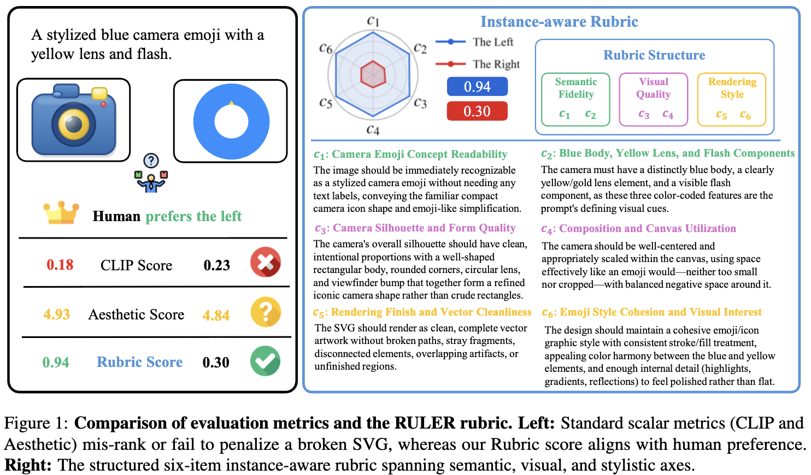

  CLIP/Aesthetic은 깨진 SVG를 선호하지만 Rubric score는 human preference와 일치

- 기존 reward paradigm들은 다섯 가지 요건(visual granularity / semantic granularity / GT-free / multi-axis / instance-aware) 중 최소 하나씩을 못 채움

  - pixel-based (SSIM, PSNR): paired reference 필요, 단일 scalar
  - rule-based (code length): 렌더 결과를 안 봄
  - embedding-based (CLIPScore): reference-free지만 coarse-grained, RL에서 reward hacking하기 쉬움
  - universal rubric: multi-dimensional이지만 inst**ruction별 correctness 개념**을 못 담음

  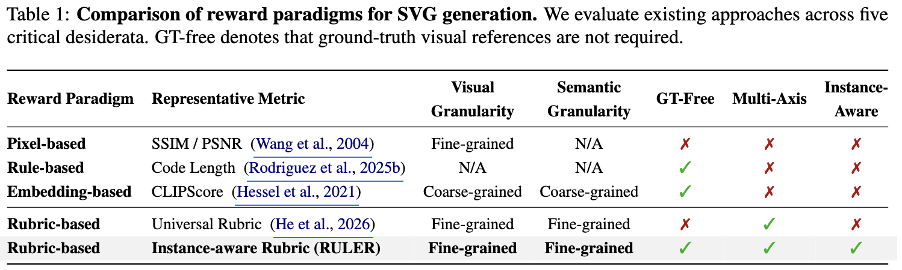

  reward paradigm 5개 요건 비교 — RULER만 전부 충족
  
  $\to$ (Research Question) ground truth 없이, instruction마다 다른 "무엇이 맞는 그림인가"를 명시적 sub-goal로 바꿔 dense reward로 쓸 수 있을까

# 2. Contribution

- **Rubric-based evaluation 검증**: 900개 human-annotated SVG 샘플로 scalar 메트릭의 도메인 shift 취약성을 정량화하고, rubric score가 human preference와 훨씬 잘 맞음을 보임
  - sample-level Spearman $\rho$ = **0.7929** (Aesthetic 0.6051, CLIP 0.5518)
  - pairwise ranking agreement Goodman-Kruskal $\gamma$ = **0.7574** (Aesthetic 0.5465, CLIP 0.5295)
- **RULER** (Instance-aware **Ru**bric Rewards for Reinforcement **LEaR**ning) 제안: 텍스트 instruction만으로 6항목 rubric을 생성 $\to$ judge VLM이 렌더링된 rollout을 항목별 채점 $\to$ 가중평균을 GRPO 보상으로 사용
  - rubric이 **텍스트에서만** 유도되므로 paired SVG GT도, human preference label도 불필요. unannotated instruction set 어디에나 확장 가능
- **SOTA 성능**: MMSVG-Illustration / MMSVG-Icon에서 Rubric score를 Qwen3-8B 백본 대비 0.432/0.395 $\to$ **0.693/0.683**으로 끌어올림
  - 전용 SVG specialist 전부를 상회하고, 훨씬 큰 DeepSeek-V3(0.686/0.673)와 동급 이상
  - blinded human preference에서 모든 baseline 대비 win rate 50% 초과

# 3. Related Works

## 3.1 SVG Code Generation

- optimization-based path tracing (VectorFusion, SVGDreamer 계열) $\to$ autoregressive primitive-aware generation (OmniSVG, IconShop) $\to$ rendering-aware RL 순으로 발전
- 공통 미해결 질문: **paired GT가 없을 때 생성된 SVG를 어떻게 채점할 것인가**

## 3.2 Rubric-Based Evaluation and Rewards

- LLM-Rubric: multi-aspect calibrated evaluation
- RaR, RGR-GRPO: rubric 점수를 RL reward로 직접 사용 (instruction following, reasoning 등 **text domain**)
- RULER의 차별점 2가지
  1. rubric 보상을 **visual code**로 확장 — VLM judge가 *렌더링된* SVG를 채점
  2. GT SVG 없이 rubric을 구성 — 단일 reference SVG로 생성을 가두지 않으면서 case-specific supervision 제공

# 4. Method: RULER

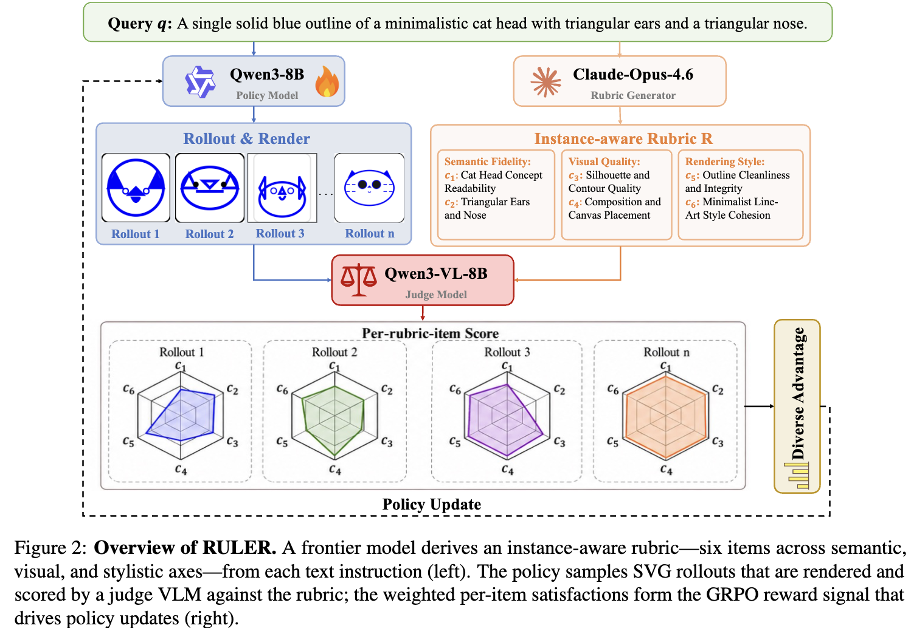

RULER 전체 구조 — rubric 생성 / rollout 렌더 / judge 채점 / GRPO 업데이트

## 4.1 Task Definition

- open-ended SVG generation을 token-level MDP로 정식화
  - state $s_t = (\mathcal{Q}, y_{<t})$, action $a_t = y_t$, transition $s_{t+1} = s_t \oplus a_t$ (deterministic)
  - 종료 시 결정적 렌더링 엔진 $\mathcal{E}$가 $\mathcal{I}_{\text{gen}} = \mathcal{E}(\mathcal{Y})$를 만들고 그 위에서 $\mathcal{R}(\cdot)$ 계산
- 핵심 주장: absolute visual GT가 없으므로 **optimization machinery가 아니라 $\mathcal{R}(\cdot)$의 설계가 병목**임

## 4.2 Human Assessment of Existing Metrics

- Claude-Opus-4.6 / Qwen3-32B / Qwen3-8B 각 300개씩 총 **900개** 렌더 샘플에 human quality rating 수집
- 두 관점으로 평가
  - **score correlation**: 900 케이스 Spearman $\rho$ $\to$ Rubric 0.7929 vs Aesthetic 0.6051 vs CLIP 0.5518
  - **pairwise ranking agreement**: 300 triple(= 900 pair)에서 Goodman-Kruskal $\gamma$ $\to$ Rubric 0.7574 vs Aesthetic 0.5465 vs CLIP 0.5295

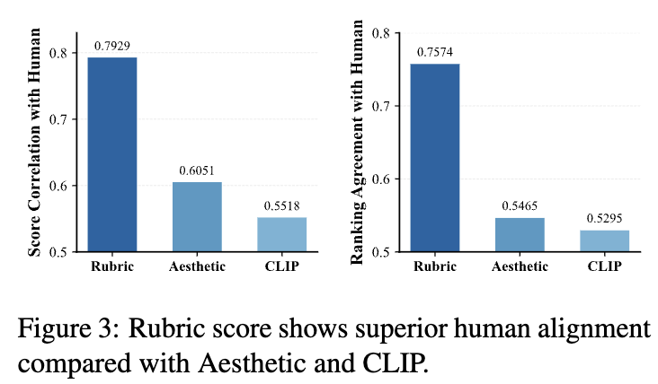

Rubric vs Aesthetic vs CLIP의 human alignment 비교 — score correlation / ranking agreement

## 4.3 Instance-Aware Rubric Generation

- frontier model $\mathcal{M}_{\text{rub}}$ (Claude-Opus-4.6)에 **unannotated instruction $\mathcal{Q}$만** 주고 6항목 rubric 생성
- 항목은 **design intention 수준**으로 기술 — 정확한 pixel/path 제약으로 쓰면 reconstruction checklist로 퇴화해 open-ended solution space가 사라짐
- 각 항목은 (a) 단일 관찰 가능 축을 겨냥하고 (b) 렌더 이미지만 보고 독립 판정 가능하며 (c) 서로 다른 failure type에 벌점 $\to$ redundancy 없이 다차원 커버
- 3개 축
  - **Semantic Fidelity**: high-level concept readability, 주요 구성요소의 시각적 존재, distinctive cue, prompt-specific relation
  - **Visual Quality**: silhouette/form refinement + composition & canvas design
  - **Rendering Style**: rendering finish, execution cleanliness + style cohesion, designed visual interest

$$C_\mathcal{Q} = \{(c_k, w_k)\}_{k=1}^{6}$$

## 4.4 Policy Optimization

- **Reward**: judge VLM $\mathcal{M}_{\text{judge}}$ (Qwen3-VL-8B)가 holistic scalar 대신 항목별 continuous satisfaction $s_k \in [0,1]$을 매김

$$\mathcal{R}(\mathcal{I}_{\text{gen}}) = \frac{\sum_{k=1}^{6} w_k s_k}{\sum_{k=1}^{6} w_k}$$

- **Group Relative Advantage**: 다축 피드백이라 같은 group 내 rollout들이 항목별로 **고르지 않게** 성공 $\to$ 자연스럽게 다양한 보상 분포가 생김. 이 within-group diversity가 GRPO와 잘 맞음

$$A_i = \frac{\mathcal{R}_i - \text{mean}(\{\mathcal{R}_j\}_{j=1}^{G})}{\text{std}(\{\mathcal{R}_j\}_{j=1}^{G}) + \epsilon}$$

- clipped surrogate objective (sequence-level importance ratio $\rho_i = \pi_\theta(\mathcal{Y}_i|\mathcal{Q}) / \pi_{\theta_{\text{old}}}(\mathcal{Y}_i|\mathcal{Q})$)로 업데이트

# 5. Experiments

## 5.1 Setup

- **Baselines** 3계열
  - diffusion-optimized: VectorFusion, SVGDreamer
  - foundation LLM: Qwen3-8B, Qwen3-32B, DeepSeek-V3
  - SVG specialist: IconShop, JanusCoder-8B, OmniSVG-8B
- **Benchmarks**: MMSVG-Illustration(풍부한 illustration) / MMSVG-Icon(compact icon)
- **Metrics**: tokens per sample, CLIP, Aesthetic, HPS + **Rubric score**(GPT-5-mini가 *shared universal rubric*으로 채점하는 독립 VLM-as-Judge). Rubric score를 주 지표로 사용

## 5.2 Main Results (RQ1)

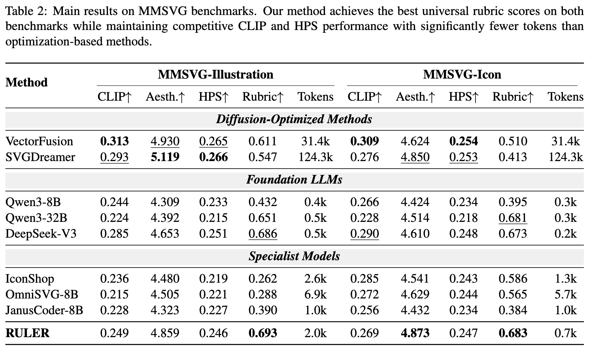

MMSVG 두 벤치마크 전체 비교 — Rubric score 및 token 수

- 세 계열 전부를 Rubric 기준으로 상회
  - optimization-based 대비: per-prompt iterative optimization 없이 end-to-end 생성인데도 더 높음 (토큰도 31.4k $\to$ 2.0k)
  - specialist 대비: Illustration 0.390 $\to$ 0.693, Icon 0.586 $\to$ 0.683 $\to$ **open-ended quality gap은 SVG-specific pretraining 확대만으로 안 메워짐**
  - 백본 대비: 0.432 $\to$ 0.693 (Illustration), 0.395 $\to$ 0.683 (Icon). 8B가 DeepSeek-V3급 visual quality에 도달
- CLIP/Aesthetic/HPS도 competitive하게 유지 $\to$ rubric 이득이 conventional 메트릭 희생으로 얻어진 게 아님
- **blinded human preference** (150 MMSVG-Bench prompt, tie 제외 win rate)

  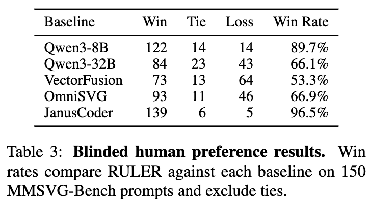
  
  RULER vs 5개 baseline blinded human preference win rate

## 5.3 Reward Design Analysis (RQ2)

- base model(Qwen3-8B)과 GRPO optimizer를 고정하고 **보상만** 4가지로 바꿔 비교

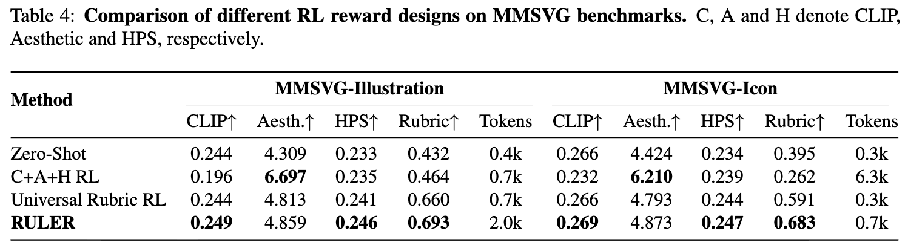

RL reward design 4종 비교

- **C+A+H RL은 전형적인 reward hacking으로 붕괴**함
  - Aesthetic만 6.697 / 6.210으로 폭등하는 대신 CLIP은 0.244 $\to$ 0.196, Icon Rubric은 0.395 $\to$ **0.262**로 zero-shot보다도 떨어짐
  - Icon에서 특히 심각: aesthetic classifier를 속이려고 겹치는 stroke와 장식 path를 빽빽이 생성 $\to$ 평균 길이가 **6.3k token** (zero-shot 0.3k)으로 폭증
  - dimension-aware decomposition 없는 scalar multi-metric 보상의 특징적 failure mode
- **Universal Rubric RL은 안정적으로 개선되지만 granularity가 부족**
  - Rubric 0.660 / 0.591까지 올리고 CLIP·HPS도 건강하게 유지 (multi-axis feedback의 효과 입증)
  - 다만 모든 query에 동일 checklist $\to$ "미니멀 아이콘"과 "디테일한 일러스트"를 구분하는 prompt-specific correctness를 못 담음
  - RULER 대비 gap: Illustration **+0.033**, Icon **+0.092**

## 5.4 Ablation (RQ3)

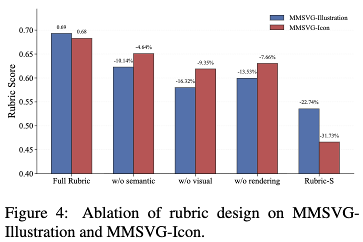

rubric 축별 ablation 및 Rubric-S 변형의 Rubric score

- 세 축 각각의 2개 항목을 reward aggregation에서 0으로 만드는 ablation (base model / optimizer / hparam 동일)

- **Visual Quality 제거가 최대 하락** $\to$ silhouette·form·composition 항목이 RL이 가장 크게 기여하는 non-trivial 학습 신호
- **Rendering 제거가 두번째** $\to$ craftsmanship 항목이 다른 축이 못 잡는 보완적 진단 신호
- **Semantic 제거가 최소** $\to$ Qwen3-8B가 pretraining에서 이미 text-image alignment를 갖춰 추가 보상의 marginal gain이 작음. pretraining이 덜 커버하는 visual/stylistic 축의 가치가 상대적으로 큼
- **Rubric-S (rubric 생성 prompt 변형)**: stylistic 축을 빼고 structurally focused한 5항목 + 고정 text-hint penalty 항목 = 총 6항목
  - 더 엄격한 채점 기준인데도 Rubric이 **0.536**으로 단일 축 ablation보다 더 크게 하락
  - 원인: 명시적 text-hint penalty가 있음에도 policy가 prompt 단어를 stylized label로 렌더 안에 그려 넣는 **text-hint hacking**이 새로 발생
  - 시사점: *complementary axes가 scoring strictness만큼 중요*하며, rubric 생성 명세를 바꾸면 기준이 더 엄격해져도 degenerate optimization channel이 다시 열릴 수 있음

## 5.5 Robustness (RQ4)

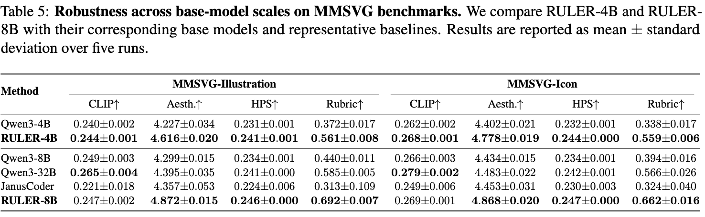

base model scale별 robustness, 5회 반복 mean ± std

- RULER-4B가 Qwen3-4B를 전 메트릭에서 일관 개선하고, RULER-8B는 **4배 큰 Qwen3-32B를 상회** (0.692 vs 0.585, 0.662 vs 0.566)
- 5회 반복 std가 작아 안정적

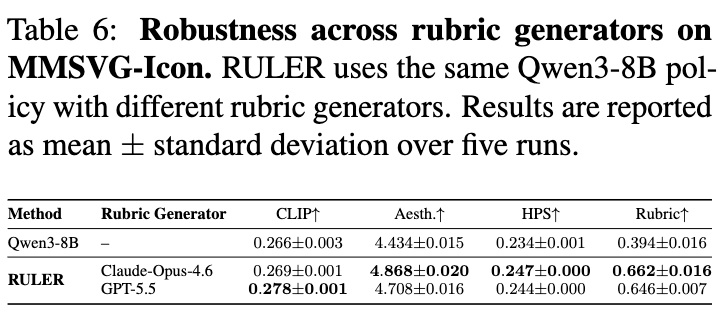

rubric generator 교체 robustness — MMSVG-Icon

- rubric generator를 Claude-Opus-4.6 $\to$ GPT-5.5로 바꿔도 0.646으로 base(0.394) 대비 큰 폭 개선 $\to$ **특정 rubric generator에 의존하지 않음**

## 5.6 Qualitative (RQ5)

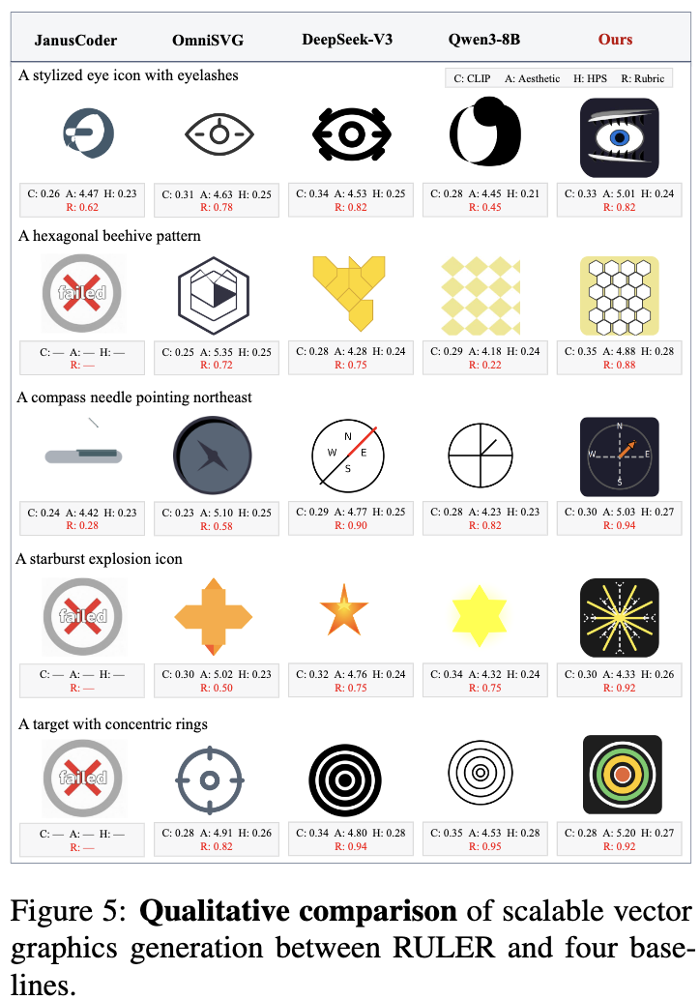

icon-style prompt 5개에 대한 RULER vs 4개 baseline 정성 비교

- eyelash, honeycomb 구조, 북동 방향 compass needle, starburst 형태, concentric ring 같은 **prompt-specific detail을 더 잘 보존**
- 색채가 풍부하고 composition이 더 일관됨. 여러 baseline은 핵심 디테일을 렌더하지 못하거나 누락
- 정성적으로 DeepSeek-V3와 비슷한 수준의 visual quality

# 6. Conclusion & Limitations

- multi-axis rubric이 open-ended SVG 평가에서 human judgment와 강하게 align함을 먼저 입증하고, 이를 instance-aware rubric $\to$ dense GRPO reward로 전환
- reward hacking을 완화하면서 scalar-reward RL baseline과 전용 SVG specialist를 모두 상회, base model/rubric generator 교체에도 일관됨

저자들이 밝힌 한계

1. **외부 모델 2개에 의존**: rubric 생성용 frontier model + 채점용 judge VLM. 두 모델의 bias·preference·failure mode를 그대로 상속함. judge가 superficial cue를 과대평가하거나 미묘한 stylistic quality를 과소평가할 수 있고, 학습 분포 밖 prompt에서 특히 그러함
2. **RL 계산비용 증가**: 매 step마다 sampled SVG를 렌더링하고 judge VLM에 instance-specific rubric으로 질의해야 함. CLIP이나 heuristic code 기반 scalar 보상보다 훨씬 비쌈 $\to$ 더 큰 모델·긴 rollout·넓은 hparam search로의 확장성 제약
3. **고정된 품질 분해**: instance-aware rubric이 paired-reference objective보다 open-endedness를 잘 보존하긴 하나, 여전히 semantic/visual/stylistic이라는 **특정 분해를 강제**함. 모든 valid artistic intent나 domain-specific preference를 담지는 못함. interactive / human-steerable / domain-adaptive rubric 설계는 future work

# Takeaways

- **"정답이 없는 생성"의 보상 설계는 optimizer가 아니라 reward decomposition 문제다.** 같은 GRPO에서 보상만 바꿨을 때 Icon Rubric이 0.262(C+A+H) ~ 0.683(RULER)으로 2.6배 갈림
- scalar multi-metric 보상을 그대로 RL에 꽂으면 **가장 부풀리기 쉬운 메트릭 하나만** 올라간다 (Aesthetic 6.21 ↑, Rubric 0.262 ↓, 토큰 0.3k $\to$ 6.3k). 메트릭 상승이 품질 상승이 아님을 보여주는 깔끔한 반례
- universal rubric만으로도 상당히 개선되지만 (0.591), instance 단위로 내려가야 나머지 +0.092가 나옴. **"어떤 축으로 평가할까"보다 "이 query에서 무엇이 맞는가"가 추가 신호**
- rubric 항목은 design intention 수준으로 써야 함. 더 엄격하고 구조적으로 쓴 Rubric-S가 오히려 text-hint hacking을 유발하며 −22.74% $\to$ **축의 상보성 > 채점의 엄격함**
- GT도 human label도 없이 텍스트 instruction만으로 보상이 만들어지므로, 같은 레시피를 다른 open-ended visual code 도메인(diagram, chart, UI code)으로 옮기기 쉬움. 대신 judge VLM 호출 비용이 학습 루프에 상주하는 것이 실무 도입의 실제 병목
