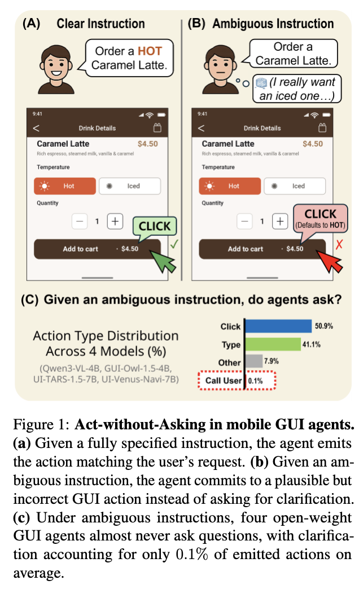
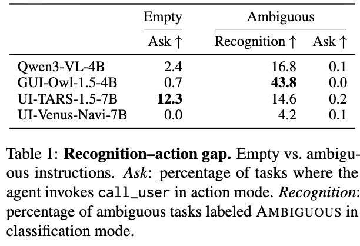
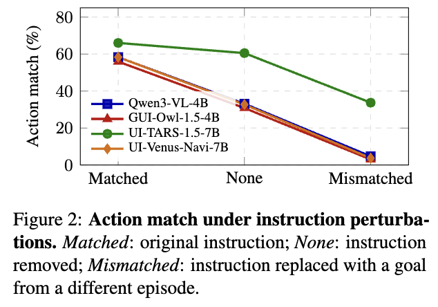

# [Agent] Why Act Without Asking? Evaluating Mobile GUI Agents under Ambiguous Instructions

- paper: https://aclanthology.org/2026.emnlp-main.1236.pdf
- EMNLP 2026 (Main) accepted, pages 28189–28210
- 저자: Samsung Research (Yeongjae Cho, Jungwuk Park, Tae-Min Choi, Chiyoun Park, Mincheol Kim, Kookhoi Kim)
- downstream task: Mobile GUI Agent의 step-level clarification (모호한 지시 앞에서 행동 대신 질문하기)
  - ex. "Order a Caramel Latte" 라는 지시에서 Hot/Iced이 지정 안 됨 $\to$ 에이전트가 임의로 Hot을 눌러 장바구니에 담지 말고 `call_user`로 되물어야 함
- 주요 용어
  - **Act-without-Asking**: 모호한 지시 앞에서 에이전트가 되묻지 않고 그럴듯한 GUI action을 그냥 실행해버리는 실패 모드. 핵심 측정 대상
  - **action-blocking ambiguity**: 지시의 모호함이 "다음 action을 확정할 수 없는" 지점까지 치명적이 된 상태. 이 step에서 질문이 반드시 필요
  - **Recognition–action gap**: 모호함을 classification 모드에서는 인식(Recognition)하면서도, action 생성 시에는 `call_user`를 거의 안 부르는 괴리. 인식 신호가 행동으로 전파되지 않음
  - **Ask+Match**: step이 성공하려면 (1) 적절한 clarification 질문을 하고 (2) 시뮬레이터 응답을 받아 올바른 final action을 내야 둘 다 만족해야 크레딧을 주는 scoring rule. 질문 없이 맞춘 action은 0점
  - **Match-Only**: `call_user` 여부 무시하고 GT와 일치하는 action이면 크레딧. 기존 step-level 벤치마크가 쓰던 완화된 rule (Act-without-Asking을 측정 못 함)

# 1. Motivation

- 모바일 GUI 에이전트는 화면 상태 + 사용자 지시로부터 UI action을 예측함. 기존 벤치마크는 대부분 **지시가 완전히 명세되어 있다고 가정**함

- 그러나 실제 사용에서 지시는 자주 모호하거나 불완전함. 이때 에이전트가 의도를 잘못 해석하고 행동하면:
  - 엉뚱한 상대에게 메시지 전송, 잘못된 설정 변경, 의도치 않은 품목 구매 등 돌이키기 어려운 결과 발생

- 신뢰할 수 있는 에이전트라면 지시가 underspecified임을 인식하고 **행동을 멈추고 되물어야** 함. 그런데 현재 에이전트는 거의 그러지 않음

  - 명시적으로 `call_user` action을 주고 "되물어도 된다"고 프롬프트해도, open-weight 에이전트는 평균 **0.1%** 의 경우에만 clarification을 함 (나머지는 의도를 추측하고 행동)

  

  Act-without-Asking 개념도: (a) 명확한 지시 → 올바른 action, (b) 모호한 지시 → 그럴듯하지만 틀린 action, (c) 4개 모델이 모호한 지시 아래 call_user를 0.1%만 사용

- **원인**: 기존 GUI 에이전트 학습 데이터에 clarification 예시가 거의 없음. clarification 행동을 내장한 모델(UI-Venus 등)조차 "언제 되물어야 하는지" 신호가 약함 $\to$ 학습 분포를 따라 그냥 plausible action을 계속 냄

- **측정의 공백**: 기존 step-level 벤치마크는 GT와 일치하는 action이면 "묻지 않고 맞춰도" 크레딧을 줌(Match-Only). 그래서 Act-without-Asking을 포착하지 못함. clarification은 trajectory/dialogue 레벨에서만 평가되어 왔음

  $\to$ (Research Question) step 단위로 "지금 멈추고 물어야 하는가"를 직접 평가하는 벤치마크를 만들고, 학습 없이도 clarification을 유도할 수 있는 방법을 찾자

# 2. Contribution

- **MID-Bench (Mobile Instruction Disambiguation Benchmark)** 제안: 900개 모호-지시 step (Base 600 / Hard 300)
  - 명확한 지시를 4가지 모호성 유형으로 rewrite하고, 엄격한 user simulator + Ask+Match scoring으로 step-level clarification을 평가
  - **Hard subset**: action에 결정적인 텍스트를 지시에서 verbatim으로 제거해, 묻지 않고는 성공하기 어렵게 만듦

- **Motivating Observations**: 4개 open-weight 에이전트에서 Recognition–action gap을 정량화. 모호함을 인식해도 `call_user`를 거의 안 부름을 보임

- **Train-free clarification cascades** 제안: frozen 에이전트를 감싸, 각 step에서 "행동 vs 질문"을 gate가 결정하는 3가지 방식 (PGC / SGC / LGC). 학습 없이 모호-태스크 성능을 크게 올리면서 명확-지시 정확도는 유지

- **LoRA SFT**: MID-Bench로 가벼운 fine-tuning을 하면 clarification이 개선되고, train-free cascade와 **결합 시 추가 상승** 함을 보임

# 3. Related Work

- **GUI 에이전트 벤치마크 & 모호성**: 대부분 지시가 완전하다고 가정. 최근 AmbiBench(모호성 레벨 분류), MobileWorld(`ask_user` action), Fairy(사용자 요구 충족) 등이 모호성을 다루기 시작했으나 **trajectory/dialogue 레벨** 평가에 머묾. 본 연구는 "지금 이 step에서 멈추고 물어야 하는가"라는 step-level 결정에 집중

- **불확실성 하의 clarification 완화책**: clarification question elicitation, learned ambiguity detector, 샘플 간 불일치(semantic entropy), forward-pass 기반 confidence 추정 등. GUI 에이전트에도 post-training으로 질문을 유도하거나 reasoning 모듈을 붙이는 시도가 있었음. 본 연구는 **frozen 에이전트를 감싸는 경량 train-free gate**에 집중해 서로 다른 clarification 신호를 공통 벤치마크에서 직접 비교

# 4. Motivating Observations

- 4개 open-weight 에이전트 평가: **Qwen3-VL-4B, GUI-Owl-1.5-4B, UI-TARS-1.5-7B, UI-Venus-Navi-7B**. 모두 모호성 하에서 clarification 하도록 명시적으로 지시하고, action space에 `call_user`를 포함

## 4.1 최대 불확실성에서도 행동을 멈추지 않음

- 극단 실험: 사용자 지시 필드를 **빈 문자열**로 바꿈 (나머지 setup 동일). 그래도 `call_user` 호출(ask rate)은:
  - Qwen3-VL-4B 2.4%, GUI-Owl-1.5-4B 0.7%, UI-TARS-1.5-7B 12.3%, UI-Venus-Navi-7B 0.0%

  

  Empty vs Ambiguous 조건의 Ask / Recognition rate
  
  $\to$ 질문이 가장 정당한 상황에서조차 모델은 GUI action을 계속 냄. 행동 지속에 대한 강한 prior

## 4.2 모호함을 인식해도 clarification으로 이어지지 않음

- 각 모델을 두 모드로 평가:
  - **Recognition 모드**: (screen, instruction)을 CLEAR / AMBIGUOUS / NO_TASK로 분류만 함
  - **Action 모드**: 같은 입력에서 다음 GUI action을 생성

- 결과: GUI-Owl-1.5-4B는 모호 태스크의 **43.8%** 를 AMBIGUOUS로 라벨하면서도 action 모드에서는 `call_user`를 **0%** 사용 → **43.8 pp gap**
  - Qwen3-VL-4B: 인식 16.8% / ask 0.1%, UI-TARS-1.5-7B: 14.6% / 0.2%, UI-Venus-Navi-7B: 4.2% / 0.1%

  $\to$ 모호함 신호가 action 생성으로 전파되지 않음 (Recognition–action gap)

## 4.3 Action이 지시에 약하게 조건화됨

- 같은 스크린샷에 지시를 3가지로 바꿔 action match 측정: **matched**(원래 goal), **none**(빈 지시), **mismatched**(다른 episode의 goal)

  

  Matched/None/Mismatched 세 조건의 action match rate

- 지시를 완전히 제거(none)해도 action match가 놀랍도록 높게 유지: Qwen3-VL-4B 33.1%, GUI-Owl 30.8%, UI-TARS-1.5-7B 60.5%, UI-Venus 32.7%
- mismatched에서도 UI-TARS-1.5-7B는 33.7%가 원래 action과 일치 (다른 task의 지시를 받고도)
  - 반면 Qwen3-VL-4B / GUI-Owl / UI-Venus는 4.7% / 3.0% / 3.7%로 급락

  $\to$ 에이전트가 지시 의미보다 **현재 화면이 시사하는 plausible action**에 더 의존 → 모호한 지시가 `call_user`를 trigger 못 하고 계속 행동하는 메커니즘

# 5. MID-Bench

## 5.1 Dataset

- **소스**: AndroidControl(AC), GUI-Odyssey(Ody)의 test trajectory
- **Splits**:
  - **Base** (n=600): AC 400 + Ody 200. 명확한 지시를 모호하게 rewrite
  - **Hard** (n=300, 1:1): action에 결정적인 텍스트를 masking한 더 엄격한 subset
  - **Clear** (n=300): 같은 trajectory의 모호하지 않은 지시 + GT action. 표준 action accuracy 측정용

- **4가지 모호성 유형** (1:1:1:1 균형 목표):
  - **Referential**: 모호한 지칭 (ex. "send a message to my friend")
  - **Underspecified**: 파라미터 누락 (ex. 특정 문자열 대신 "type my home address")
  - **Preference-dependent**: 주관적 기준 (ex. "order something healthy")
  - **Contextual**: 암묵적 사전 맥락 (ex. "continue where we left off")

- **구성 파이프라인** (3단계):
  figure3 첨부 (MID-Bench 데이터 생성 + Single Round-Trip 평가 파이프라인)
  1. **Instruction rewriting**: 4가지 유형으로 rewrite (GT action 보존), 모든 LLM 호출은 GPT-4o
  2. **Pivot-step identification**: masking된 디테일이 action-critical이 되는 첫 step을 LLM이 식별. 해당 step이 없는 trajectory는 제거
  3. **Rule-based filtering**: 프로토콜을 교란하는 후보 제거 — (R1) GT action이 {scroll, long_press, wait, navigate_back}, (R2/R3) rewrite가 GT 텍스트(typed-full-leak)나 app 이름(app-name-leak)을 substring으로 포함 → Base split

- **Hard subset**: type-action step 중 typed text가 지시에 verbatim 등장하는 것만 대상. rewrite가 그 텍스트를 verbatim 제거하도록 하고, 길이 ≥4의 typed-text token이 rewrite에 없음을 auto-verify
  - ex. "type 'molenstraat'" $\to$ "type my home address" → action-critical 텍스트가 검증 가능하게 부재 → 묻지 않고 맞추기 어려움

## 5.2 Validation & 구성

- 내부 validation: 주석자에게 스크린샷 + rewrite + GT next action 반투명 overlay 제시
  - **Q1 (모호성 유효성)**: 92.2% (830/900)가 genuine ambiguous로 확인
  - confirmed-ambiguous subset에서 **Underspecified가 의도한 1:1:1:1보다 많음** (value 37.8%, Contextual 18.0%, Underspec target 15.2%, Preference 13.6%, Underspec mixed 8.2%, Referential 7.1%)

  figure4 첨부 (confirmed-ambiguous subset의 모호성 카테고리 구성 파이 차트)

## 5.3 Protocol, Simulator, Metrics

- **Single round-trip** 평가 (현실적 배포 근사: `call_user`는 1회만 허용, 이후 호출은 0점):
  figure5 첨부 (Base/Hard 예시의 ask → answer → final action 상호작용)
  1. 모델이 action $a$ 또는 `call_user(q)` 방출
  2. $a$면 GT와 scoring 후 stop
  3. `call_user(q)`면 strict simulator가 답 $r$ 반환
  4. 모델이 `call_user(q)/User: r`을 history에 붙이고 final action $a'$ 방출 → GT와 scoring

- **Strict simulator**: 기존 시뮬레이터는 질문의 구체성과 무관하게 on-task 질문에 다 답함. 본 연구는 **원래 goal의 단일 조각으로 매핑될 만큼 구체적인 질문에만** 답함 (ex. "Which book?" → "The Queen's Gambit."). underspecified한 질문엔 non-informative 응답

- **Metrics**:
  - **Clear**: Clear split에서의 action accuracy (ask 여부 무관). 기본 action 역량
  - **Ask+Match** (주요 지표): 적절히 묻고 → 올바른 final action까지 둘 다 맞아야 크레딧. 묻지 않고 맞춘 action은 0점
  - **Match-Only** (완화된 대조): `call_user` 여부 무시, GT 일치하면 크레딧. 기존 벤치마크를 모사 → Act-without-Asking을 측정 못 함

# 6. Train-Free Clarification Cascades

- frozen 에이전트를 ask→answer→final-action 프로토콜로 감쌈. 각 step에서 **gate**가 "baseline action 실행 vs 사용자에게 clarification"을 결정. gate 신호만 다르고 나머지는 고정 → gate 효과만 분리

- **PGC (Prompted-Gate Cascade)**: 별도 프롬프트로 "현재 지시가 행동하기에 충분히 명확한가"를 base 모델에 물음. verbalized yes/no → threshold tuning 불필요. 응답이 negative면 gate fire(질문)

- **SGC (Sampling-Gate Cascade)**: baseline action을 $k$=5번 stochastic decode → action-equivalence class로 묶어 semantic entropy 계산 (click은 공간 bucket으로, typed text는 normalize, swipe 등 low-level은 동치). entropy > $\tau_{SGC}$면 gate fire

- **LGC (Logit-Gated Cascade)**: baseline action의 mean token log-prob가 $\tau_{LGC}$ 미만이면 gate fire. **추가 forward pass 불필요** (가장 저렴)

## 6.1 Setup

- 4개 frozen greedy base (Qwen3-VL-4B, GUI-Owl-1.5-4B, UI-TARS-1.5-7B, UI-Venus-Navi-7B)를 각각 3가지 cascade로 감쌈
- baseline row = 동일 frozen base (gate 신호만 차이). SGC/LGC threshold는 held-out validation split에서 F1 최적화
- Qwen3-VL-4B엔 **LoRA SFT** row와 train-free gate와의 결합도 추가 측정

## 6.2 Main Results

table2 첨부 (MID-Bench 메인 결과: Clear / Base Ambig(Match-Only, Ask+Match) / Hard Ambig(Match-Only, Ask+Match))

- **기존 평가는 Act-without-Asking을 숨긴다**: Match-Only에서 baseline은 Base Ambig .30–.42 (Clear .42–.52 대비 낮지만 0보다 훨씬 위). 기존 벤치마크라면 "유능하다"고 읽음
  - 그러나 실제 `call_user` 방출은 Base/Hard 전체에서 최대 2/900, Clear에서 0/300 → 이 크레딧은 **묻지 않고 우연히 GT와 일치**해서 받은 것
  - Hard에서 명확해짐: typed string이 masking되자 같은 baseline이 Match-Only .08–.11로 붕괴

- **Ask+Match는 baseline 붕괴와 cascade 상승을 드러냄**: `call_user`를 요구하도록 rule을 tightening하면 **모든 baseline의 Ask+Match = 0**
  - 각 baseline의 Match-Only − Ask+Match gap = Act-without-Asking으로 받은 크레딧. Base→Hard로 약 **4배** 축소되지만 0보다 큼
  - Cascade는 Ask+Match를 Base .134–.536, Hard .150–.563까지 끌어올림 (0 floor 대비)

- **gate 3종은 호환되지 않음 (상호 교체 불가)**:
  - PGC는 4B base에서 뒤처짐
  - SGC는 GUI-Owl-1.5-4B에서 잘 작동하나 UI-Venus-Navi-7B에서 급락 (.051/.037)
  - **LGC가 가장 강한 action selection**: 4B 모델에서 PGC를 일관되게 능가, UI-TARS-1.5-7B에선 3종 수렴
  - Hard에서 LGC는 Base .447 / Hard .423 (Qwen3-VL-4B), UI-Venus는 Base/Hard .536/.563 등 최상위

- **LoRA SFT는 도움 되고 cascade와 결합 시 더 좋음**:
  - LoRA 단독으로 Qwen3-VL-4B Ask+Match를 Base 0→.333, Hard 0→.230으로 올림 (Clear는 .493로 거의 보존, frozen .468)
  - 하지만 train-free LGC(Hard .423)에는 못 미침 → 지도 학습만으로는 더 어려운 모호성에서 부족
  - **결합**: LoRA+LGC가 Ask+Match **Hard .573** (표 전체 최고), LoRA+SGC가 .490
  - $\to$ LoRA는 모호성 민감도를 높이고, 명시적 gating은 더 어려운 설정에서 여전히 중요하며 Clear 성능을 대체로 보존

- 참고: closed-source GPT-5.4(App. O)는 open-weight baseline보다 강한 native clarification을 보이나 여전히 explicit gating에서 이득을 봄

# 7. Further Analysis

## 7.1 어디서 실패하는가: detection / asking / final action

figure6 첨부 (Per-stage outcome decomposition: Detect-fail / Ask-fail / Execute-fail / Success)

- Qwen3-VL-4B의 각 모호 step을 4개 outcome으로 분해:
  - **Detect-fail**: gate가 clarification을 trigger 안 함
  - **Ask-fail**: 질문했으나 simulator가 거부 (충분히 구체적이지 않음)
  - **Execute-fail**: clarification 성공했으나 final action이 틀림
  - **Success**: clarification + 실행 모두 성공

- 지배적 실패 모드가 방법마다 크게 다름:
  - frozen base의 PGC/SGC는 주로 **Detect-fail** (Base/Hard 전체 모호 step의 57–71%)
  - **LGC는 Detect-fail을 크게 감소** (Base/Hard 19%/28%) → 실패를 post-clarification 실행 쪽으로 이동, success 상승
  - LoRA는 프로파일을 근본적으로 바꿈: Base Ambig에서 잔여 실패가 Detect-fail보다 **Execute-fail**이 됨 → 모호성 detection은 대체로 회복. Hard에선 잔여 Detect-fail 억제에 추가 gating이 여전히 중요

## 7.2 모호성 카테고리별 성능

table3 첨부 (Ask+Match를 Referential/Underspecified/Preference/Contextual로 분해한 breakdown)

- 카테고리별 편차가 큼:
  - **LoRA는 Referential Base에서 최고** (.570) → 가벼운 지도 학습이 short-horizon reference grounding으로 풀리는 모호성에 효과적. 그러나 Hard에서 크게 저하 (action-critical 텍스트가 제거되므로)
  - **LGC가 전반적으로 가장 robust**: 나머지 7개 cell에서 top, Preference Hard에서 .586 peak → explicit gating이 카테고리 전반에 더 일관되게 일반화
  - **Underspecified가 가장 어려움**: LoRA의 Base 최약 카테고리(.227), LGC의 Hard 최약(.383). typed value가 검증 가능하게 masking되고, 다음 action을 추론할 제약이 부족해 **실제로 새 사용자 정보 획득이 필요** → 단순 모호성 인식/로컬 reference 해소를 넘는 근본적 한계

# 8. Conclusion & Limitations

- **Conclusion**: MID-Bench로 모바일 GUI 에이전트의 ambiguity-aware acting과 Act-without-Asking 실패 모드를 평가. 4개 open-weight 에이전트에서 일관된 recognition–action gap을 확인했고, train-free clarification gate가 표준 GUI action 손실을 최소화하면서 모호-태스크 성능을 크게 개선

- **Limitations** (저자 명시):
  - MID-Bench는 **단일 라운드** clarification 프로토콜 + action-blocking ambiguity 지점에 집중. Web/desktop 에이전트, dialogue history가 누적되는 longer-horizon, 더 넓은 에이전트 계열로의 확장은 future work
  - ambiguity-aware 에이전트도 clarification이 실패하거나 의도가 여전히 underspecified면 unintended action 가능
  - 기존 모바일 GUI 벤치마크의 스크린샷/trajectory를 상속 → redistribution, licensing, privacy 고려 필요

## Takeaways

- 모바일 GUI 에이전트는 명시적으로 "되물어도 된다"고 해도 평균 0.1%만 질문함. 모호함을 인식(최대 43.8%)해도 action으로 안 이어지는 **recognition–action gap**이 핵심 문제
- 기존 step-level 벤치마크의 Match-Only scoring은 "묻지 않고 우연히 맞춘" 크레딧을 줘서 이 실패를 숨김. **Ask+Match**로 tightening하면 모든 baseline이 0으로 붕괴
- 학습 없이 frozen 에이전트를 gate로 감싸는 것만으로 큰 개선이 가능하며, **LGC(logit 기반, 추가 forward pass 불필요)가 가장 저렴하면서도 가장 robust**
- LoRA SFT는 reference-grounding류 모호성에 강하나 action-critical 텍스트가 제거된 Hard에선 약함. LoRA+LGC 결합이 Hard Ask+Match .573로 최고 → 학습과 explicit gating은 상보적
- **Underspecified ambiguity**는 실제 새 정보 획득이 필요해 가장 어려움. 단순 모호성 인식을 넘어서는 과제로 남음
