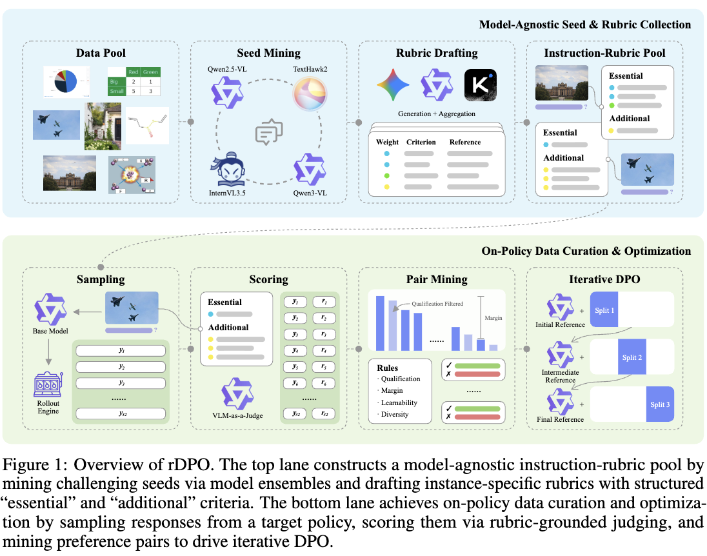
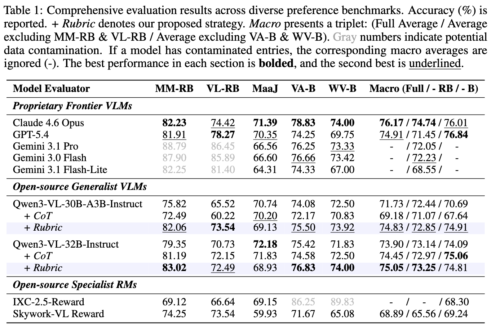
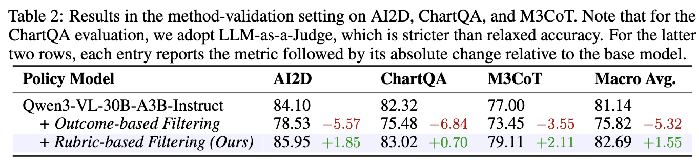
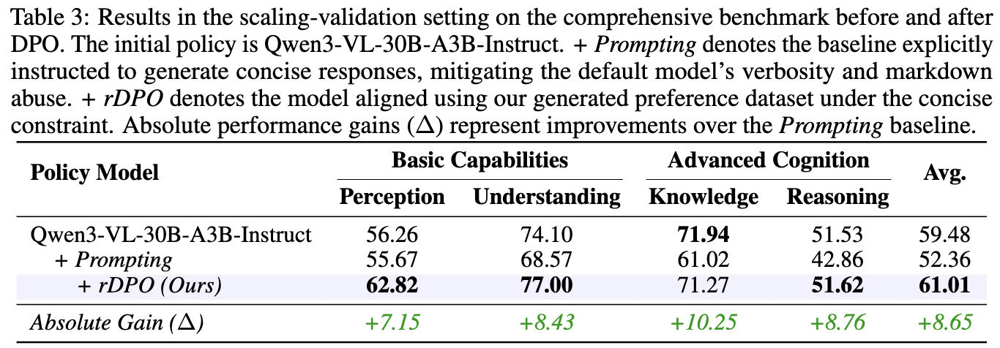
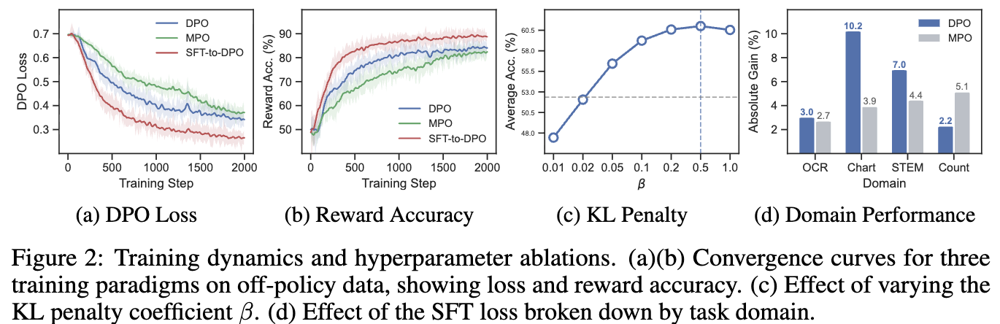
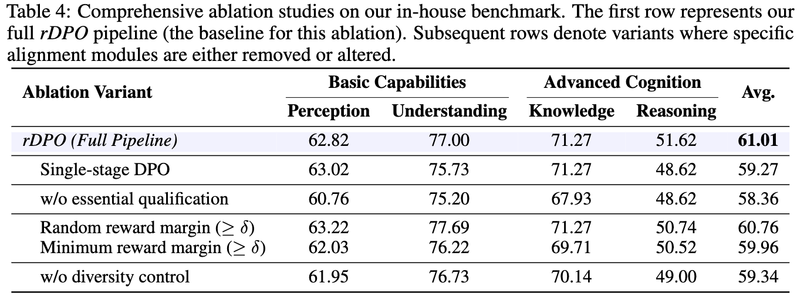

# [VLM] Visual Preference Optimization with Rubric Rewards

- paper: https://arxiv.org/abs/2604.13029
- Celia — Technical Report on Rubric-Based Post-Training I: Preference Optimization
- EMNLP 2026 Main (인용수: 5회, 26-10-27 기준)
- 저자: Ya-Qi Yu, Fangyu Hong, Xiangyang Qu, Hao Wang 외 (Huawei Technologies Co., Ltd.)
- downstream task: Vision-Language Model(VLM)의 preference optimization (on-policy DPO)
  - image-instruction 쌍마다 instance-specific rubric을 만들어 응답을 채점하고, 선호쌍 $(y_c, y_r)$을 구성해 DPO 학습
- 주요 용어
  - **rDPO**: instance-specific rubric 기반 reward modeling으로 선호쌍을 만드는 visual preference optimization 프레임워크. template 기반이 아닌 **인스턴스별 criterion**을 생성하는 것이 핵심
  - **instruction-rubric pool**: image-instruction마다 checklist 형태의 rubric을 붙여 offline으로 구축·재사용하는 풀 (300K 규모). model-agnostic이라 여러 target model에 재사용 가능
  - **essential vs additional criteria**: rubric의 criterion을 두 유형으로 구분. **essential**은 질의의 핵심정보(미충족 시 치명적 오류), **additional**은 보조 사실·중간 단계
  - **criterion triplet $(criterion, reference, weight)$**: 각 체크항목은 검증대상 assertion(criterion), 정답근거(reference), 중요도 weight($1$ Auxiliary / $2$ Important / $3$ Key)로 구성
  - **rubric-grounded VLM-as-a-Judge**: 각 criterion을 $s\in\{0, 0.5, 1\}$(no/partial/full credit)로 채점하고 weight로 가중합해 reward 산출

# 1. Motivation

- DPO는 VLM 정렬(응답 품질 향상, hallucination 감소)의 표준이 되었으나, **선호 데이터 품질**에 크게 의존함
- 기존 선호쌍 구성은 두 갈래 모두 한계가 있음
  - **response-oriented**: 모델 출력에 hallucination을 주입하거나 "strong-weak" 출력을 이용 → off-policy
  - **vision-oriented**: diffusion noise/image editing으로 시각 입력을 교란 → off-policy
  - 두 방식 모두 target model의 실제 생성 행동과 **분포가 어긋남(distribution mismatch)**
- 최근 on-policy/self-improving 파이프라인(RLAIF-V, MMPR, OPA-DPO 등)이 등장했으나, 여전히 **granularity가 낮은 reward 신호**에 의존 → grounding·completeness·reasoning 차이를 놓침
- VLM-as-a-Judge/Reward Model을 쓰면 대규모 필터링이 가능하나, judge 품질이 병목
  - 독점 모델은 강하지만 비싸고, 오픈소스 judge는 fixed template로 coarse score만 내 reasoning error/hallucination을 벌주기 어려움
- LLM에서는 rubric 기반 평가가 품질을 차원별로 분해해 큰 개선을 줬지만, **멀티모달에서는 미탐색**. 동시기 Omni-RRM은 fixed combination의 predefined criteria에 의존

rDPO 전체 개요: 상단 model-agnostic seed·rubric 수집 / 하단 on-policy 데이터 큐레이션·최적화

$\to$ (Research Question) image-instruction마다 **instance-specific rubric**을 만들어 fine-grained criterion-level 피드백을 주고, 이를 **on-policy 데이터 구성**과 결합하면 시각 선호 최적화가 개선되는가?

# 2. Contribution

- **rDPO 제안**: instance-specific rubric 기반 reward modeling을 쓰는 visual preference optimization 프레임워크. template 기반 rubric 구성과 달리 **per-instance criteria를 생성**함
- **Judge 품질 향상**: public reward-modeling 벤치마크에서, instance-specific rubric이 중간 규모(30B-A3B) 오픈소스 judge의 판정 품질을 추가 학습 없이 개선 → GPT-5.4에 근접(74.83 vs 74.91)
- **데이터·파이프라인 공개**: 300K instruction-rubric pool 구축 + target-policy별 on-policy 선호 데이터 자동 생성 파이프라인
- **검증 결과**:
  - method-validation: outcome-based filtering은 macro average를 81.14 $\to$ 75.82로 떨어뜨리나, rubric-based filtering은 82.69로 끌어올림
  - scaling-validation: rDPO가 61.01 달성, style-constrained baseline(52.36)을 크게 상회하고 base model(59.48)도 초과

# 3. Related Works

- **Reward Models for Multimodal Alignment**: LLaVA-RLHF, RLHF-V, MM-RLHF 등 대규모 선호 데이터와 VLFeedback, RLAIF-V 같은 AI feedback, 그리고 전용 visual RM(CAREVL, MM-RLHF-Reward, Skywork-VL Reward 등)으로 발전. 그러나 대부분 scalar score나 rigid template에 의존해 transparency·multi-dimensional granularity 부족
- **Rubric-Grounded Evaluation and Alignment**: LLM에서는 Rubrics-as-Rewards, Rubicon, CARMO, RLCF, OpenRubrics, RuscaRL 등으로 rubric 기반 평가·정렬이 성과를 냄. 멀티모달은 초기 단계이며, 동시기 Omni-RRM은 fixed predefined rubric template 조합에 의존 → 본 연구는 **데이터 구성 단계에서 instance-specific criteria를 생성**한다는 점이 차별점

# 4. Preliminaries

## 4.1 DPO
- 선호 triplet $(x, y_c, y_r)$에 대한 표준 DPO 목표:
$$\mathcal{L}_{\text{DPO}}(\pi_\theta;\pi_0)=-\log\sigma\Big(\beta\log\tfrac{\pi_\theta(y_c|x)}{\pi_0(y_c|x)}-\beta\log\tfrac{\pi_\theta(y_r|x)}{\pi_0(y_r|x)}\Big)$$
- gradient는 reward margin $\sigma(\hat r_\theta(x,y_r)-\hat r_\theta(x,y_c))$로 업데이트를 scaling (Eq. 2)

## 4.2 MPO
- SFT 안정성을 결합하기 위해 간소화된 MPO 도입: $\mathcal{L}_{\text{MPO}}=\mathcal{L}_{\text{DPO}}+\mathcal{L}_{\text{SFT}}$
- SFT 항은 chosen 응답 $y_c$를 강화하는 rejection sampling 역할: $\mathcal{L}_{\text{SFT}}=-\alpha\log\sigma(\log\pi_\theta(y_c|x))$
  - DPO 항과 magnitude를 맞추기 위해 **length normalization을 제외** → policy collapse 방지

## 4.3 Rubric
- on-policy 응답 $y\sim\pi_0(\cdot|x)$을 샘플링하고, structured·instance-specific checklist로 평가하는 Generative RM(GenRM) 채택
- 입력 $x$마다 $K$개 criteria로 된 localized rubric $C^x=\{c_1^x, \dots, c_K^x\}$ 정의 (Eq. 6)
- reward model $r_\phi$는 $(x, y, C^x)$를 받아 multi-dimensional feedback vector $s\in\mathbb{R}^K$ 산출 → scalar reward보다 transparent하고 fine-grained filtering 가능

# 5. Methodology

- 데이터 구성 파이프라인 3단계: (1) Seed Mining, (2) Rubric Drafting, (3) Preference Data Curation
- 앞 두 단계는 **model-agnostic** → 만들어진 instruction-rubric pool은 여러 target model에 재사용 가능

## 5.1 Seed Mining
- **Large-Scale Rollout**: dense + MoE를 아우르는 중간 규모 모델 앙상블(TextHawk2-7B, Qwen2.5-VL-7B, InternVL3.5-30B-A3B, Qwen3-VL-30B-A3B)로 대규모 병렬 rollout
- **Disagreement-based Filtering**: reference-free로, 앙상블 모델들이 **합의에 도달하지 못한** 인스턴스만 유지 → 복잡·모호·edge case가 선호 최적화에 informative. 이후 도메인 균형 위해 원본 소스별 uniform sampling

## 5.2 Rubric Drafting
- criterion 구성 4원칙: **Atomic**(단일·분해불가 key point), **Comprehensive**(핵심 차원 모두 커버), **Precise**(중복·불필요 제거), **Objective**(관찰가능 사실 근거)
- criterion을 **essential**(핵심정보, 미충족 시 치명적) / **additional**(보조 사실·중간 단계)로 구분
- 각 항목 = triplet $(criterion, reference, weight)$, weight는 $1$(Auxiliary)/$2$(Important)/$3$(Key)
- frontier reasoning 모델로 JSON checklist 생성. 데이터 품질에 따라 전략 분기:
  - **Expert-Grounded Generation**: 신뢰도 높은 human annotation이 있으면 ground truth에 조건화
  - **Answer-Agnostic Generation**: noisy/missing annotation이면 원 정답을 일부러 제외해 오염 방지
  - 단일 모델 bias 완화 위해 **다중 모델로 생성 후 secondary aggregation prompt로 통합**

## 5.3 Preference Data Curation
- **Scoring**: rubric-grounded VLM-as-a-Judge를 zero-shot으로, 각 criterion을 $s\in\{0, 0.5, 1\}$로 채점(JSON 출력)
- **Voting**: 응답당 3회 독립 채점 후 criterion별 **median** 채택 → variance·hallucination 감소
- **Aggregation**: $r_\phi(x, y, C^x)=\sum_k w_k^x\cdot s_\phi(x, y, c_k^x, a_k^x)$ (weight 가중합)
- **Pair Mining 규칙 5개**:
  - Rule 1 (Chosen Qualification): $y_c$는 대부분 essential에서 full credit($s=1$), 최대 1개만 partial 허용. repetition loop/language mixing은 폐기
  - Rule 2 (Rejected Qualification): $y_r$는 명백한 결함 — essential 1개 이상 fail($s=0$)이거나 2개 이상 partial($s=0.5$)
  - Rule 3 (Margin Constraint): reward 차이 $r_\phi(x,y_c,C^x)-r_\phi(x,y_r,C^x)\geq\delta$
  - Rule 4 (Maximum Learning Capacity): 유효쌍 중 reward margin 최대인 top-4 pair 선택
  - Rule 5 (Diversity Control): 각 고유 응답은 전체 선호쌍에서 최대 2회만 등장 → overfitting 방지

# 6. Experiments

## 6.1 Reward Modeling 평가 (rubric이 judge 품질을 올리는가)
- 벤치마크: MM-RewardBench(MM-RB), VL-RewardBench(VL-RB), MLLM-as-a-Judge(MaaJ), VisionArena-Battle(VA-B), WildVision-Battle(WV-B). VA-B/WV-B는 1,200쌍 서브샘플
- 핵심 결과: rubric prompting은 Qwen3-VL judge를 vanilla 대비 일관되게 개선, 반면 **CoT prompting은 일관된 도움이 안 됨**
  - Qwen3-VL-30B-A3B: macro 71.73 $\to$ **74.83** (+Rubric), GPT-5.4(74.91)에 근접
  - Qwen3-VL-32B: macro 73.90 $\to$ **75.05** (+Rubric)

여러 preference 벤치마크 종합 평가: Proprietary/Open-source Generalist/Specialist RM과 +CoT, +Rubric 비교. Macro는 Full/-RB 제외/-B 제외 triplet

## 6.2 Preference Optimization 평가
- 초기 policy: Qwen3-VL-30B-A3B-Instruct. AdamW, lr $1\times10^{-6}$, $\beta=0.5$, $\alpha=0$. method-validation은 batch 128, scaling-validation은 512(+iterative DPO, 3 split). prompt당 32 응답 샘플링

**method-validation (AI2D, ChartQA, M3CoT)** — rubric vs outcome filtering을 동일 recipe에서 비교
- outcome-based filtering은 세 태스크 모두 base보다 **하락**: macro 81.14 $\to$ 75.82 (−5.32)
- rubric-based filtering은 모두 **개선**: macro **82.69** (+1.55), AI2D 85.95, ChartQA 83.02, M3CoT 79.11
  - $\to$ on-policy 데이터만으로는 부족하고, instance-specific criterion-level 채점으로 쌍을 만드는 것이 관건

method-validation: AI2D/ChartQA/M3CoT에서 base vs Outcome-based vs Rubric-based filtering

**scaling-validation (comprehensive in-house benchmark, concise 제약)**
- base 59.48 → concise system prompt로 verbosity 억제 시 오히려 **52.36으로 하락**
- rDPO는 conciseness-constrained on-policy 데이터로 학습해 **61.01** 달성 (+Prompting 대비 +8.65)
  - Perception +7.15, Understanding +8.43, Knowledge +10.25, Reasoning +8.76

scaling-validation: Qwen3-VL-30B-A3B / +Prompting / +rDPO의 Perception·Understanding·Knowledge·Reasoning·Avg와 Δ

## 6.3 Ablation
- **Policy Alignment (MMPR, Fig. 2a/b)**: DPO(off-policy)는 분포 불일치로 수렴 느리고 불안정, MPO는 uneven, **SFT-to-DPO(on-policy 근사)가 가장 안정** — 최저 loss·최고 reward accuracy
  - DPO는 distribution shift에 민감해 implicit reward 정확도가 떨어짐을 분석
- **KL Penalty (Fig. 2c)**: 선행연구와 달리 $\beta=0.5$에서 최적 trade-off — 큰 penalty가 policy를 reference에 묶어 collapse·reward overfitting 방지
- **SFT Scaling Coefficient (Fig. 2d)**: SFT loss 효과는 태스크 의존적. 대부분 MPO가 더 나쁘지만, base에 undesirable prior가 있는 **counting** 등에서는 SFT가 rejection-sampling distribution으로 정렬시켜 유효

training dynamics·하이퍼파라미터 ablation: (a) DPO Loss (b) Reward Accuracy (c) KL Penalty (d) 도메인별 성능

- **In-house benchmark ablation (Table 4)**: full rDPO(61.01)가 variant들보다 우수
  - Single-stage DPO 59.27 (iterative가 더 좋음)
  - w/o essential qualification 58.36 (essential/additional 구분이 +2.65)
  - Random margin 60.76 / Minimum margin 59.96 (max margin이 최선)
  - w/o diversity control 59.34

in-house benchmark ablation: Single-stage DPO, w/o essential qualification, random/min margin, w/o diversity control 변형 비교

# 7. Conclusion & Limitations

- **결론**: rDPO는 instance-specific rubric 기반 reward modeling으로 선호쌍을 만드는 프레임워크. offline instruction-rubric pool 구축과 on-policy rollout·scoring·curation을 분리
  - public RM 벤치마크에서 rubric prompting이 judge 품질을 개선(30B-A3B를 GPT-5.4에 근접), method-validation에서 rubric filtering이 outcome filtering을 능가(82.69 vs 75.82), scaling에서 61.01 달성
  - $\to$ 효과적 시각 선호 최적화는 **on-policy 데이터만이 아니라 instance-specific criterion-level 피드백**을 함께 요구
- **Limitations & future work (저자 언급)**:
  - 현 파이프라인은 rubric 피드백을 **간접적으로만** 소비 — criterion이 선호쌍 구성에만 쓰이고 policy는 iterative DPO로 최적화됨. criterion-level 신호가 최적화 loop 바깥에 있음
  - 더 online한 학습(rubric reward가 policy와 함께 진화)으로 확장 필요. 특히 **GRPO로의 통합**이 structured criteria에 대해 그룹 응답을 직접 최적화하는 더 직접적 경로가 될 수 있음 → follow-up으로 남김

# Takeaways

- **핵심 통찰**: 시각 선호 최적화에서 "on-policy 데이터"는 필요조건일 뿐이고, **instance-specific rubric으로 fine-grained하게 채점해 쌍을 거르는 것**이 성능을 가른다 (outcome filtering은 오히려 base보다 성능을 떨어뜨림)
- **Rubric 설계가 구체적**: criterion을 $(criterion, reference, weight)$ triplet으로, essential/additional로 구분하고, 다중 모델 생성 + aggregation으로 bias를 줄임. judge는 $\{0, 0.5, 1\}$ 3단계 채점을 3회 voting(median)
- **Pair Mining 규칙이 실무적**: chosen은 essential 거의 만점, rejected는 essential에 명확한 결함, margin $\geq\delta$, max-margin top-4, 응답 재사용 최대 2회 — 재현 시 그대로 참고할 만함
- **학습 안정성**: off-policy DPO는 distribution shift로 불안정 → SFT-to-DPO(on-policy 근사)가 안정적이고, $\beta=0.5$라는 큰 KL penalty가 collapse를 막음 (통념과 반대)
- **model-agnostic pool**: rubric pool을 offline으로 한 번 만들면 여러 target policy에 재사용 가능 — 데이터 구축 비용 측면에서 매력적
- **한계의 솔직함**: rubric 신호가 최적화 loop 밖에 있다는 점을 인정하고 GRPO 통합을 다음 과제로 제시 (제목의 "Post-Training I"이 시리즈 암시)
