# [Agent] IterCAD: An Iterative Multimodal Agent for Visually-Grounded CAD Generation and Editing

- paper: https://arxiv.org/pdf/2606.13368 (arXiv:2606.13368v3, '26-08-31)
- github: https://github.com/KnowledgeXLab/IterCAD
- models: https://huggingface.co/KnowledgeXLab/IterCAD-RL
- data: https://huggingface.co/datasets/KnowledgeXLab/IterCAD_Data
- EMNLP 2026 accepted(인용수: 11회, 26-11-04 기준)
- 저자: Shanghai AI Laboratory 외 (Tao Hu, Jiaxin Ai, Licheng Wen, Xueheng Li 등 공동 1저자 4인 / 교신 Xuemeng Yang)
  - 협력기관: USTC, Shanghai Innovation Institute, 武漢大, ANU, 浙江大, 復旦大
- downstream task: multi-turn CAD program synthesis & editing
  - 다면 투상 **engineering drawing**(치수 주석 포함) 또는 자연어 지시를 받아 실행 가능한 **CadQuery** Python 코드를 생성/수정하는 테스크
  - 3가지 모달리티: Drawing-to-Code / Text-to-Code / Interactive Editing
- 주요 용어
  - **Look and Loop**: 논문의 설계 철학. *Look* = 치수가 박힌 multi-view engineering drawing을 매 턴 persistent reference로 유지하여 결함을 국소화 / *Loop* = compiler + execution + visual feedback을 묶은 다차원 피드백으로 "generate–verify–refine" 사이클을 돌림
  - **survivor bias**: 기존 CAD 평가가 **실행 성공한 코드에 대해서만** Chamfer Distance를 평균 내는 관행. 실행 실패($CD \to \infty$) 샘플이 분모에서 사라지므로, 잘 깨지는 모델일수록 Mean CD가 좋아 보이는 역설이 생김
  - **CD-TR Curve / AUC-TR**: survivor bias를 제거한 통합 지표. tolerance $\tau$에 대해 $R(\tau) = \frac{1}{M}\sum_{i=1}^{M} \mathbb{I}\big[\mathrm{Valid}(y_i) \wedge \mathrm{CD}(y_i) \le \tau\big]$ 로 정의하고($M$ = 실패 포함 **전체** 평가 샘플 수), $x = -\log_{10}\tau \in [1,5]$ 구간에서 적분·정규화한 값이 AUC-TR $\in [0,1]$
  - **GVPM (Geometry-Viable Prefix Masking)**: multi-turn trajectory에서 "아직 멀쩡했던 앞부분"과 "망가진 뒷부분"을 가르는 경계 $f = \min(f_{exec}, f_{stall})$ 을 찾아, 경계 이후 토큰을 policy loss에서 마스킹하는 credit assignment 기법
  - **Invalid Ratio (IR)**: syntax exception 또는 geometric anomaly(자기교차 등)를 일으킨 프로그램의 비율. 논문의 1차 지표

# 1. Motivation

- CAD는 제조업의 핵심이지만 parametric model을 손으로 만드는 건 여전히 노동집약적임

  - MLLM + 프로그래밍형 CAD 프레임워크(CadQuery, build123d)로 "실행 가능한 파라메트릭 코드를 생성"하는 패러다임이 열림 (CAD-Coder, CADrille 등)
  - 그런데 이 코드들은 미세한 기하 불일치나 topological defect를 자주 만들어 runtime error / visual artifact로 이어짐

- **근본 문제: 사람의 작업 방식과 모델의 작업 방식이 어긋남**

  - 실무 엔지니어는 "generate – verify – refine"을 반복함
  - 반면 기존 방법은 **open-loop, one-shot** — 중간 자기수정 없이 완성 프로그램을 한 방에 뽑음

- multi-turn 프레임워크(CADReasoner, CAD-Judge, GIFT 등)가 나왔지만 **피드백 신호가 너무 거칠다**는 게 저자들의 진단

  - **point-cloud 지표**(Chamfer Distance): 전역 형상 오차만 알려줌 $\to$ *어느 파라미터가 틀렸는지* 를 국소화하지 못함
  - **compiler feedback**: 문법적 실행 여부만 확인 $\to$ 코드가 안 터지기만 하면 topological logic 오류에는 완전히 눈이 멂
  - 결과적으로 multi-turn이 **unguided blind search**로 퇴화함

- **벤치마크/평가의 공백**

  - 기존 벤치마크(DeepCAD, Text2CAD)는 단순 "sketch-and-extrude" 패턴에 과대표집되어 fillet / chamfer / shell / pattern array 같은 실제 제조 피처가 거의 없음
  - 정적 생성 위주라 iterative editing을 평가하지 못함
  - 결정적으로 **survivor bias**: 실행 성공한 코드만 평균 내므로, 에이전트의 진짜 error recovery 능력과 robustness를 측정하지 못함

  $\to$ (Research Question) 도면을 anchor로 삼아 sandbox와 closed-loop로 상호작용하는 CAD 에이전트를 만들고, 실행 실패까지 포함해 정직하게 재는 평가 체계를 세우자

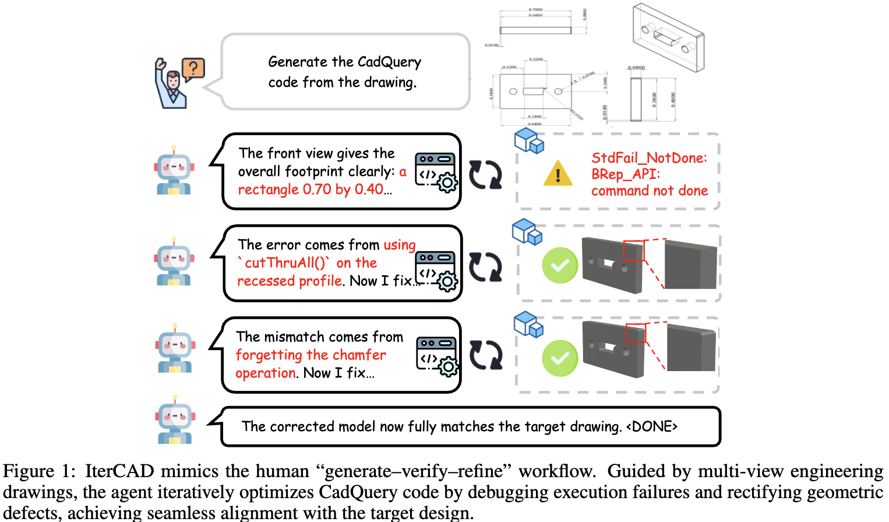

IterCAD의 generate–verify–refine 워크플로우 개념도: 도면을 보며 CadQuery 코드를 턴마다 디버깅·수정

# 2. Contribution

- **IterCAD 프레임워크** 제안: multi-view engineering drawing을 spatial anchor로 쓰는 drawing-driven agent. CAD 생성과 편집을 하나의 closed-loop multi-turn 프로세스로 통합
  - sandbox가 **OCCT 커널**로 생성된 solid를 표준 정투상 뷰로 직접 투영하고, 기하로부터 치수 주석(선형 치수·호 반지름)을 계산해 visual feedback으로 돌려줌 — 단순 렌더 이미지가 아님
- **2-stage 학습 레시피**: progressive cold-start SFT $\to$ geometry-aware RL (GSPO + GVPM)
  - GVPM으로 multi-turn credit assignment 문제를 완화
- **IterCAD-Bench + CD-TR/AUC-TR 지표**: 고급 제조 피처를 포함한 멀티모달 벤치마크(Draw 1,000 / Edit 200)와, 실행 실패를 0 recall로 자연스럽게 벌주는 survivor-bias-free 지표
- 주요 수치 (IterCAD-Draw, Agentic Workflow)
  - IR **64.60% $\to$ 0.30%** (Qwen3.5-4B 백본 대비 **−64.30pp**)
  - AUC-TR **0.24 $\to$ 0.61** (GPT-5의 0.51 상회)
  - Mean CD **10.48 $\to$ 5.09**, 평균 턴 4.56 $\to$ 2.97

# 3. Related Works

## 3.1 CAD 표현 패러다임

학습 기반 3D CAD 생성은 데이터 표현에 따라 5가지로 나뉨:

1. **CSG-based** (InverseCSG, CAPRI-Net): Boolean 연산 조합

   1. CSG: Constructive Solid Geometry. 기본 입체 도형(예: 직육면체, 원기둥, 구)을 합집합·차집합·교집합 같은 불리언 연산으로 조합해 복잡한 형상을 만드는 방식

      (ex. 원기둥을 직육면체에서 빼 구멍을 표현)

2. **B-rep** (SolidGen, BrepGen): boundary network 직접 예측
3. **Sequence-based** (DeepCAD, Text2CAD, SkexGen): 토큰화된 command line
4. **Structured-text** (CAD-LLaMA, Seek-CAD): 경량 커스텀 문법
5. **Code-based** (CAD-Coder, CADrille): CadQuery 같은 완전 파라메트릭 스크립트 $\to$ 편집 유연성과 LLM 호환성 최대

IterCAD는 (5)를 택함.

## 3.2 Multi-turn CAD Agent

- CAD-Editor / PR-CAD: 텍스트 가이드 스크립트 편집, progressive sequence infilling
- CADDesigner / TOOLCAD: 멀티모달 대화 + RL 기반 상호작용 모델링
- 피드백 신호는 결국 두 종류로 수렴함
  - **environment-based compiler feedback** (CAD-Judge): 문법만 검증, 의미/기하 오류에 맹목
  - **distance-based spatial feedback** (CADReasoner): point cloud/렌더 이미지 차이 $\to$ 전역·비구조적 오차만 포착
- 공통 한계: **2D sketch 치수, geometric constraint, local topological entity로 오류를 귀속시키지 못함**

# 4. Task Formulation & Interaction Protocol

## 4.1 3가지 설계 모달리티

실행 가능한 CadQuery 프로그램 생산을 목표로 셋을 통합:

1. **Drawing-to-Code**: 정투상 + 치수를 담은 도면 $V_{ref}$ 조건
2. **Text-to-Code**: 자연어 요구사항 $T_{ref}$ 조건
3. **Interactive Editing**: 원본 프로그램 $C_{src}$ 에 증분 지시로 국소 수정

## 4.2 Observation & Action Space

- 턴 $t$에서 에이전트는 전체 히스토리를 관측
  $$O_t = \{S,\ X_{ref},\ (C_1, F_1), \dots, (C_{t-1}, F_{t-1})\}$$
  
  - $S$ = 시스템 프롬프트, $X_{ref}$ = 초기 레퍼런스($V_{ref}$ / $T_{ref}$ / $C_{src}$), $F_t$ = sandbox의 멀티모달 피드백 튜플
    - CAD Generation (Engineering Drawing): $V_{ref}$
    - CAD Generation (Text Instruction): $T_{ref}$
    - CAD Editing: $C_{src} + T_{ref}$ 
  - 과거 코드와 피드백을 모두 보존하므로 **evidence-based revision**이 가능함
  - $X_{ref}$: 초기 참조 맥락
- action $a_t$는 **엄격한 schema**를 따라야 함
  1. `<thinking>...</thinking>` 로 감싼 Reasoning Trace (피드백 진단 + 계획)
  2. Execution Block: fenced CadQuery 코드 블록 **또는** `<DONE>` 토큰
  - 턴마다 정확히 1개의 reasoning + 1개의 block. 위반 시 **즉시 trajectory 무효화 + 세션 종료**
- 종료 조건: `<DONE>` 방출 또는 최대 턴 도달

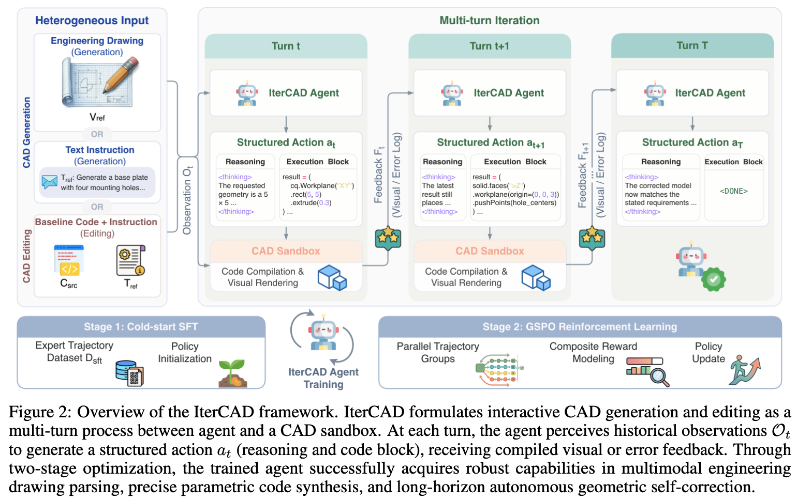

IterCAD 프레임워크 개요: agent ↔ CAD sandbox의 multi-turn 상호작용과 2-stage 최적화

# 5. Data Curation

## 5.1 CAD Pair 구성

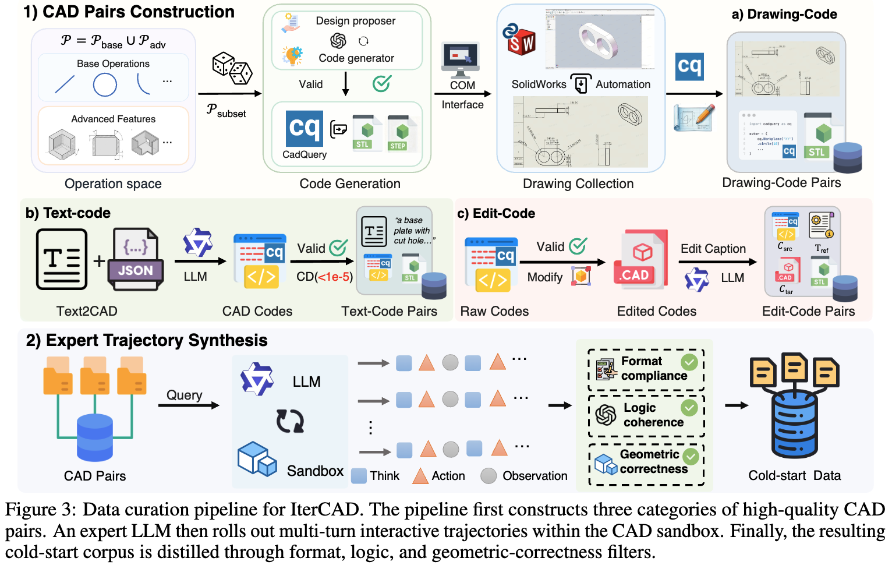

데이터 큐레이션 파이프라인: 3종 CAD pair 구성 → expert LLM rollout → 3중 필터

**1) Drawing-Code Pairs** — 기존 데이터셋의 기하 빈곤을 정면으로 해결

- 연산 공간을 $P = P_{base} \cup P_{adv}$ 로 정의
  - $P_{base}$: sketch primitive + 기본 extrusion constraint
  - $P_{adv}$: **fillet, chamfer, shell, pattern array** 등 실무 피처
- 엔진이 이종 연산 부분집합 $P_{sub} \subset P$ 를 랜덤 샘플링하여 **GPT-5에 강제 제약으로 주입** $\to$ 지정된 조합으로 복잡한 CAD plan을 짜게 함
- headless sandbox에서 문법·기하 유효성(자기교차 제거) 검증 후 STL/STEP export
- **SolidWorks COM 인터페이스**로 STEP $\to$ 표준 준수 multi-view engineering drawing 변환 (정투상 + 명시적 치수 주석)
  - 단순 렌더 이미지 대신 **치수 추론을 위한 신뢰 가능한 물리적 anchor**를 제공한다는 게 핵심 주장
- 자동 품질 검사로 invalid geometry / non-manifold / 주석 불일치 제거

**2) Text-Code Pairs**

- Text2CAD의 raw description을 LLM으로 표준화 $\to$ $T_{ref}$
- $T_{ref}$ + 구조화 파라메트릭 주석을 CadQuery 코드로 번역
- sandbox 실행 성공 **AND** $CD < 10^{-5}$ 인 것만 $C_{tgt}$ 로 채택

**3) Edit-Code Pairs**

- 검증된 스크립트에 **controlled degradation**(파라미터 섭동, 정점 오배치, feature 치환)을 가해 imperfect $C_{src}$ 생성
- 간결한 design-change 지시 $T_{ref}$ 를 붙이고, 원본 무결 프로그램을 $C_{tgt}$ 로 둠
- 결과: $(C_{src}, T_{ref}, C_{tgt})$ triplet — "지정된 기하 불일치만 고치고 나머지는 보존"하는 능력을 평가

## 5.2 Expert Trajectory 합성

- 각 instance에 대해 **Qwen3-VL-235B-A22B-Instruct**로 IterCAD 프로토콜 하의 multi-turn trajectory를 rollout
- 3중 필터
  1. **format compliance**: reasoning-code schema 위반 폐기
  2. **logic coherence**: LLM(GPT-5)이 "reasoning이 실제 실행된 action/피드백과 모순되는" trajectory를 기각
  3. **geometric correctness**: 최종 프로그램이 실행 성공 + $CD < 10^{-5}$ 인 것만 유지

# 6. Agent Training

## 6.1 Progressive Cold-start SFT

- **Phase 1** ($D_{S1}$, 20K): expert trajectory로 "명세 $\to$ 실행 가능한 CadQuery" 기본 매핑 확립
- **Phase 2** ($D_{S2}$, 8K): $D_{S1}$로 학습한 policy $\pi_\theta$ 를 sandbox 안에서 **on-policy rollout** $\to$ 실제로 터지는 실행 실패와 기하 불일치를 수집 $\to$ 더 강한 teacher가 이를 진단해 corrective action을 합성
  - 즉 "자기가 낼 법한 실수"에 대한 교정 데이터를 커리큘럼으로 주입
  - on-policy rollout으로 student의 오류 분포를 포착한 뒤, teacher가 만든 수정 데이터를 이용해 offline SFT한다
- 목적함수는 표준 cross-entropy
  $$\mathcal{L}_{SFT}(\theta) = -\mathbb{E}_{(x_i, y_i) \sim (D_{S1} \cup D_{S2})} \big[\log \pi_\theta(y_i \mid x_i)\big]$$

## 6.2 GSPO 기반 Geometry-aware RL

- multi-turn trajectory는 reasoning / 코드 / 실행 피드백이 뒤섞이므로 **sequence-level** 최적화인 **GSPO**를 채택
- group $G$개 trajectory의 sequence-level reward로 advantage 표준화
  $$\hat{A}_g = \frac{r_g - \mathrm{mean}(\{r_{g'}\}_{g'=1}^{G})}{\mathrm{std}(\{r_{g'}\}_{g'=1}^{G})}$$
- 턴 수에 따라 길이 편차가 크므로 **length-normalized importance ratio** $\rho_g(\theta)$ 를 씀 (긴 trajectory가 gradient를 지배하는 것 방지)
  $$J(\theta) = \mathbb{E}_{x \sim D}\Big[\frac{1}{G}\sum_{g=1}^{G} \min\big(\rho_g(\theta)\hat{A}_g,\ \mathrm{clip}_g(\theta)\hat{A}_g\big)\Big]$$
  - **비대칭 clipping** $\epsilon_l < \epsilon_h$: 고advantage 방향으로는 더 큰 업데이트를 허용하되 반대쪽은 더 조임

### Reward 설계

$$R(y) = R_{CD}(y) + \lambda_f R_{fmt}(y) + \lambda_p R_{prog}(y), \quad \lambda_f = 0.5,\ \lambda_p = 0.2$$

- **Geometric reward** $R_{CD} \in [0,1]$ — CD를 구간선형으로 bounded 매핑 (분산 제어)
  $$R_{CD}(y) = \begin{cases} 1, & CD \le \delta_{min} \\ \frac{\delta_{max} - CD}{\delta_{max} - \delta_{min}}, & \delta_{min} < CD < \delta_{max} \\ 0, & CD \ge \delta_{max}\ \text{or Fail} \end{cases}$$
- **Format reward** $R_{fmt} \in \{0,1\}$ — 모든 중간 턴이 reasoning + 실행 가능 코드 쌍을 내고, 명시적 완료 마커로 끝날 때만 1
- **Progress reward** $R_{prog}$ — **reward hacking 방지용 sparse bonus**. 세 조건 동시 충족 시에만 지급
  1. 실행 가능한 턴이 2개 이상
  2. 첫 턴에서 유효한 geometry 산출
  3. CD가 **단조 감소**하며 quality gate $\eta$ 아래로 수렴

## 6.3 GVPM: multi-turn credit assignment

**문제**: GSPO는 sequence 단위로 동작하는데, 한 번 코드가 연속 runtime error를 내거나 기하 개선이 멈추면 **이후 모든 턴이 오염된 context를 상속**받음. 그런데 이 토큰들이 앞쪽 멀쩡한 턴과 **동일한 $\hat{A}_g$ 를 공유** $\to$ 책임 없는 초기 턴이 하류 실패 때문에 벌을 받음

**해법**: 두 신호로 prefix 경계 $f = \min(f_{exec}, f_{stall})$ 결정

- $f_{exec}$ (**Execution Cascade**): $K$회 연속 runtime error $\to$ 회복 불능 루프로 플래그
- $f_{stall}$ (**Geometry Stall**): $K$개의 유효 턴 동안 CD가 **엄격히 감소하지 않으면서** quality gate $\eta$ 위에 머무름

토큰별 loss mask:
$$m_u = \mathbb{I}\big[\tau(u) < f\big]$$
($\tau(u)$ = 토큰 $u$의 턴 인덱스. $m_u = 0$ 인 토큰은 policy loss에서 제외)

- 추가로 마스킹된 trajectory에는 **one-sided advantage clamp** $\hat{A}_g \leftarrow \max(\hat{A}_g, 0)$ 적용
  - 즉 유효 prefix는 **강화될 수는 있어도 하류 실패로 처벌받지는 않음**

# 7. IterCAD-Bench & CD-TR 지표

## 7.1 두 트랙

- **IterCAD-Draw** (1,000): 치수가 박힌 multi-view 도면을 closed-loop로 역설계하여 CadQuery 코드 복원
  - **Easy 500**: 단순 평면 프로파일(사각/원/다각형)의 sketch-and-extrude 위주
  - **Hard 500**: hole, blind cut, Boolean 조합 + shell / fillet / chamfer / through-cut 및 그 합성
  - 각 샘플에 GT CadQuery 프로그램 + 정규화 STL + STEP solid + SolidWorks COM 렌더 도면이 붙음
- **IterCAD-Edit** (200): 베이스 스크립트 + 자연어 지시로 국소 수정. 평가 초점이 **파라미터 튜닝과 topology 보존**으로 이동
  - **Fusion 360 데이터셋**에서 소싱 — 단계별 중간 construction history가 있어 중간 상태 $C_{src}$ 를 추출 가능
  - 지시는 정확한 공간 좌표/치수 제약으로 작성되어 모호성 없이 기하 평가 가능

figure5 첨부 (IterCAD-Draw Easy/Hard 난이도별 대표 샘플: 도면 ↔ GT 3D geometry)

figure6 첨부 (IterCAD-Edit 대표 샘플: source code / edit instruction / target code 3단 구성)

figure7 첨부 (IterCAD-Draw의 Top-20 CadQuery API 연산 분포 — extrude 지배적, shell/fillet/chamfer는 long-tail)

## 7.2 CD-TR Curve / AUC-TR

- 기존 프로토콜은 실행 실패 샘플($CD \to \infty$)을 평균에서 빼버림 $\to$ **survivor bias**
- tolerance $\tau$에서의 recall
  $$R(\tau) = \frac{1}{M}\sum_{i=1}^{M} \mathbb{I}\big[\mathrm{Valid}(y_i) \wedge \mathrm{CD}(y_i) \le \tau\big]$$
  - $M$ = **실패 포함** 전체 평가 레코드 수. 실패 sentinel(`final_cd = -1`)·non-finite 값은 **분모에는 남되 절대 카운트되지 않음**
  - $\tau$를 쓸어가면 실패 샘플은 모든 threshold에서 recall 0으로 자연 패널티
- $x = -\log_{10}\tau \in [1,5]$ 구간(401 포인트)에서 사다리꼴 적분 후 구간 길이로 정규화 $\to$ AUC-TR $\in [0,1]$
- CD는 **원점 중심 unit-diagonal bounding box**로 정규화된 모델 기준이며, 본문 표의 모든 CD 값은 $\times 10^3$ 임

# 8. Experiments

## 8.1 Implementation

- 백본: **Qwen3.5-4B**, 프레임워크: Swift, 하드웨어: **A100 × 8**
- SFT: 28K trajectory ($D_{S1}$ 20K + $D_{S2}$ 8K), LR $1\times10^{-5}$, 3 epoch
- RL: **2K hard Drawing-to-Code 샘플**만 사용 (멀티뷰 추론과 자기수정 요구가 가장 큰 태스크라 closed-loop 피드백 이득이 제일 큼)
  - GSPO, $G=8$, LR $1\times10^{-6}$, 최대 $T=5$ 턴, GVPM trigger window $K=2$
- **데이터 누수 검증**: Draw 1,000 / Edit 200 테스트 인스턴스는 학습에서 완전 배제. cross-split 기하 검사 결과 정확/근사 중복 0건, train-test 간 최소 정규화 CD = **1.10**
- **공정 비교 프로토콜**: 모든 비교 모델(상용 포함)이 동일 시스템 프롬프트 / 동일 sandbox / 동일 피드백 포맷 / 최대 $T=5$ / 동일 evaluator로 평가됨. IterCAD-Draw는 **pass@2**

## 8.2 Drawing-to-Code (IterCAD-Draw)

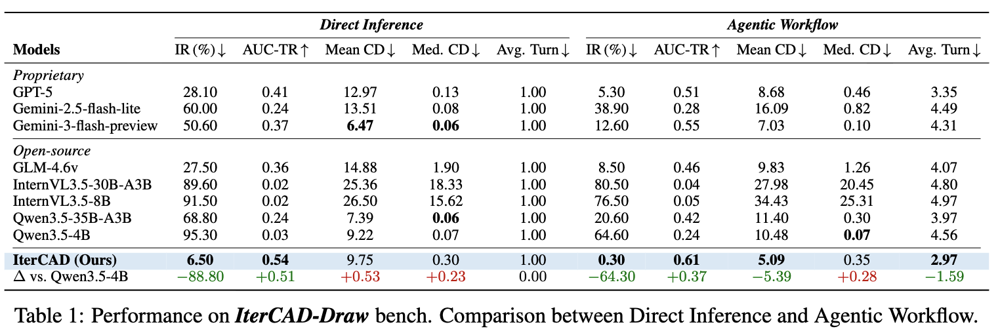

IterCAD-Draw 메인 결과: Direct Inference vs Agentic Workflow, IR/AUC-TR/Mean CD/Med. CD/Avg. Turn

- **Direct Inference**(1턴)에서도 IR 6.50%로 최저 — GPT-5(28.10%), GLM-4.6v(27.50%)를 크게 앞섬
  - 백본 대비 IR **−88.80pp**, AUC-TR **+0.51** $\to$ interactive refinement 이전에 이미 single-pass 코드 유효성이 심어졌음
- **Agentic Workflow**에서 격차가 더 벌어짐: IR **0.30%**, AUC-TR **0.61**, Mean CD **5.09**, 그것도 평균 **2.97턴**만에
  - 평균 턴이 낮다는 건 대부분 1패스에 성공하고 다음 턴은 **검증용**으로 쓴다는 뜻
  - 대조적으로 백본 Qwen3.5-4B는 4.56턴을 다 쓰고도 IR 64.60%
  - 한 자릿수 배 큰 Qwen3.5-35B-A3B, InternVL3.5-30B-A3B도 joint robustness에서 한참 뒤짐

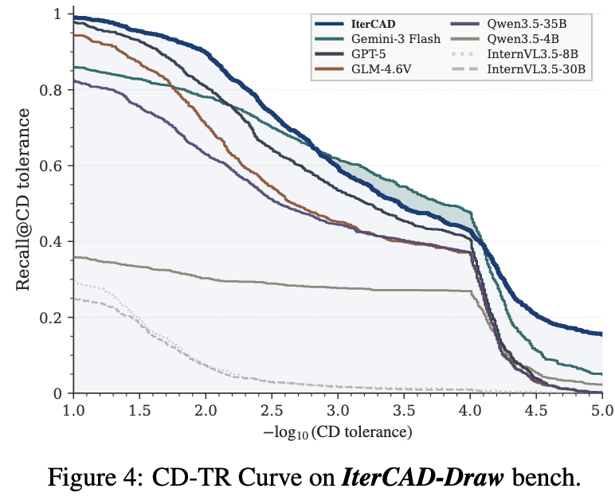

IterCAD-Draw의 CD-TR Curve — 전 tolerance 구간에서 IterCAD가 상단 유지

**주의해서 볼 지점**: Direct Inference에서 IterCAD의 Mean CD(9.75)와 Med. CD(0.30)는 백본(9.22 / 0.07)보다 **오히려 나쁨**($\Delta$ +0.53 / +0.23). 이건 survivor bias의 교과서적 사례임 — 백본은 95.30%를 실행 실패로 날려먹고 살아남은 소수에 대해서만 CD를 재니까 평균이 좋아 보이는 것. AUC-TR이 0.03 vs 0.54로 갈리는 이유가 정확히 여기 있음.

## 8.3 Instruction-based Editing (IterCAD-Edit)

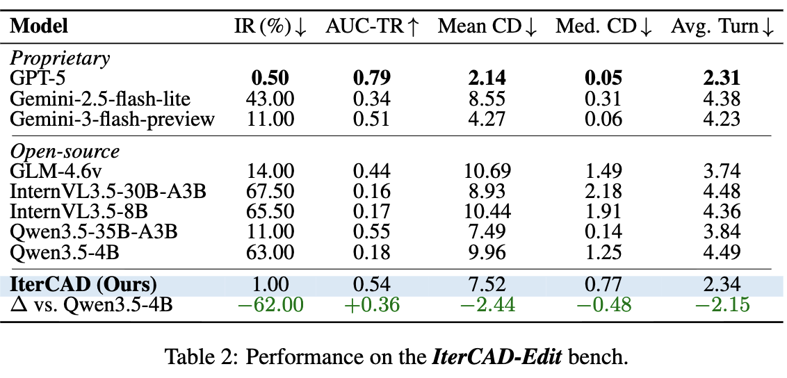

- 백본 대비 IR **−62.00pp**, AUC-TR **+0.36**, 수렴 턴 **−2.15**
- 다만 **GPT-5가 이 트랙은 전 지표에서 우위** (AUC-TR 0.79 vs 0.54). 저자들도 "text-to-code reasoning과 복잡한 program refactoring에서의 frontier scaling 우위" 때문이라고 인정함
  - IterCAD가 GPT-5에 근접하는 건 IR(1.00% vs 0.50%)과 효율(2.34턴 vs 2.31턴) 두 축뿐임. 4B 모델이라는 점을 감안하면 의미 있지만, "editing은 아직 못 이겼다"가 정확한 요약임

## 8.4 외부 Text-to-Code 벤치마크

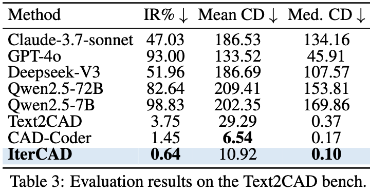

- Text2CAD Bench(8,046 parts): IR **0.64%**, Med. CD **0.10** — GPT-4o/DeepSeek-V3는 IR 50% 이상으로 붕괴
  - 도메인 특화 CAD-Coder 대비 **IR과 Med. CD는 이기지만 Mean CD는 짐**(10.92 vs 6.54). 저자들은 "code validity와 median 정밀도 사이의 더 나은 균형"으로 표현함 — 소수의 큰 실패 케이스가 평균을 끌어올린다는 뜻으로 읽힘

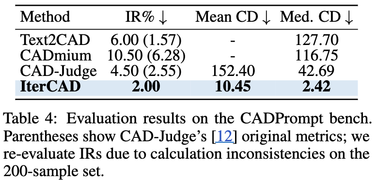

- CADPrompt Bench(200 expert instruction): Mean CD 10.45, Med. CD 2.42로 CAD-Judge를 **한 자릿수 배 상회**, IR 2.00%
  - 단, 200샘플 집합에서 계산 불일치가 있어 저자들이 IR을 **재계산**했다고 명시 (괄호 안이 원 수치)

## 8.5 Ablation

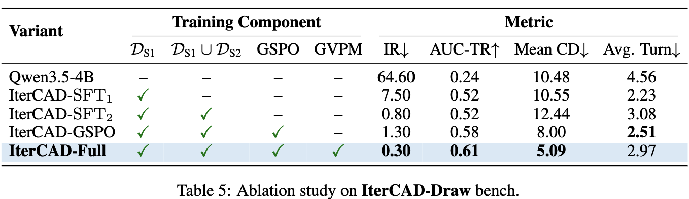

- **cold-start SFT($D_{S1}$)가 실행 유효성의 대부분을 가져옴**: IR 64.60 $\to$ 7.50, AUC-TR 0.24 $\to$ 0.52
- **on-policy refinement($D_{S2}$) 추가**로 IR 0.80까지 하락 — teacher 교정 trajectory가 iterative debugging 습관을 심음
  - 그런데 Mean CD는 **10.55 $\to$ 12.44로 악화**. 모방만으로는 fine-grained 기하 최적화가 안 된다는 증거
- **GSPO RL**이 이걸 해결: Mean CD 8.00, AUC-TR 0.58
  - 단 평균 턴이 2.51로 줄어드는데, 이건 효율이 아니라 **premature termination**(조기 포기)임
- **GVPM 추가**가 full model: IR 0.30, AUC-TR 0.61, Mean CD **5.09**. 평균 턴이 2.97로 **되레 늘어나는 게 정상 신호** — 생산적인 초기 action이 하류 실패로 처벌받지 않으니 에이전트가 실질적 refinement를 더 하게 됨

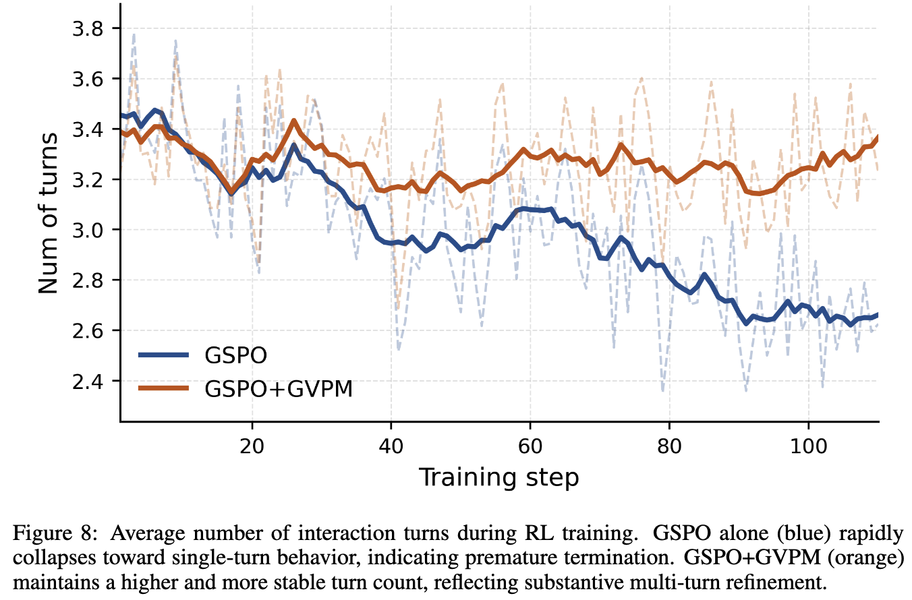

RL 학습 중 평균 턴 수 추이: GSPO 단독은 single-turn으로 붕괴, GSPO+GVPM은 안정적으로 높은 턴 유지

### 난이도 분해 / visual feedback ablation

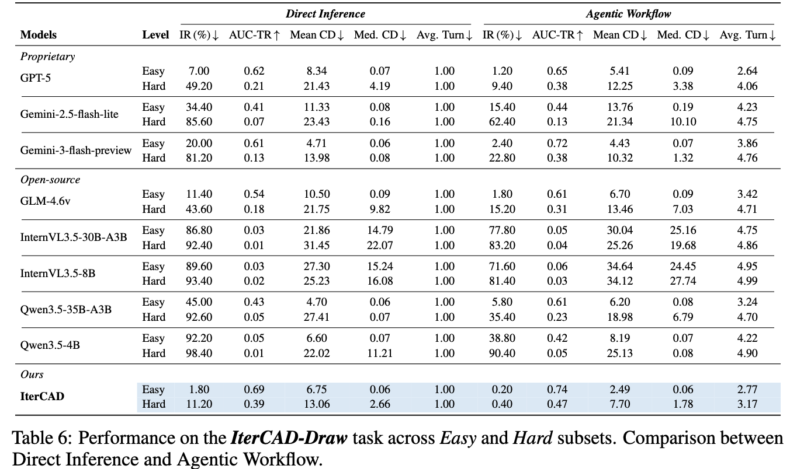

- Agentic 기준 IterCAD: Easy IR **0.20%** / AUC-TR **0.74** / Mean CD 2.49, Hard IR **0.40%** / AUC-TR **0.47** / Mean CD 7.70
  - 모든 baseline이 Easy $\to$ Hard에서 IR 상승·AUC-TR 하락 (난이도 층화가 유효함)
  - GPT-5는 Hard에서 IR 9.40 / AUC-TR 0.38, Gemini-3-flash는 22.80 / 0.38로 꺾이지만 IterCAD는 유지

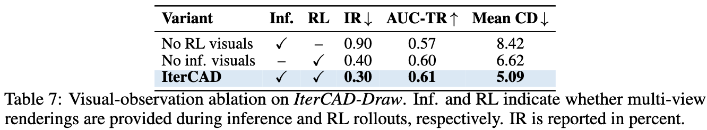

- 어느 쪽을 빼도 기하 정확도가 떨어지며, **RL rollout에서 visual을 빼는 쪽 손해가 더 큼**(Mean CD 8.42)

### Hard subset 실패 분석 (저자 자체 감사)

- $CD > 0.01$ 기준 Hard 실패율 **17.2% (86/500)**
- **finishing 연산은 범인이 아님**: chamfer 포함 파트 실패율 **0%**, shell 4.2%, fillet 5.3% (전부 Hard 평균 이하)
- 실패는 두 모드에 집중
  1. **복잡한 sketch geometry (~30%)**: 조밀한 `lineTo` 윤곽이나 다중 `threePointArc`가 폴리라인으로 근사되거나 누락/위상 손상. `lineTo` ≤ 4일 때 11.7% $\to$ 복잡 윤곽에서 30% 이상
  2. **Boolean / multi-body collapse (~37%)**: `union` 포함 시 Hard 실패율 24.3% vs 미포함 14.1%. 실패한 cut 포함 케이스의 **약 2/3에서 최종 코드가 `cut`을 아예 생략**하고 다단계 subtraction을 단일 extrude로 붕괴시킴

## 8.6 Case Study

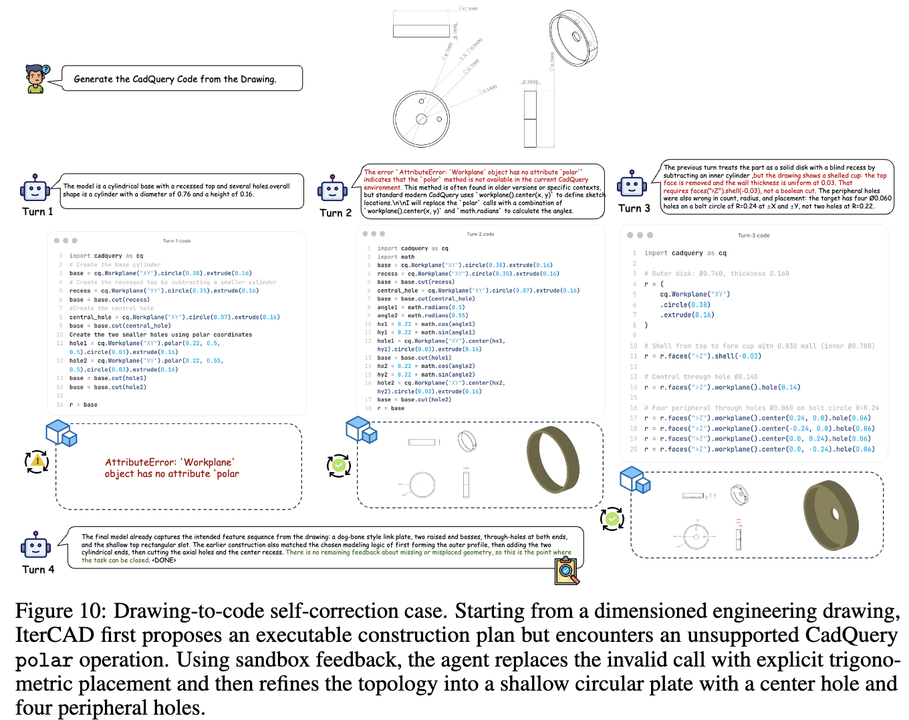

Drawing-to-code 자기수정: 미지원 `polar` API 호출 실패 → 삼각함수 배치로 교체 → shallow shell + 중앙/주변 홀 복원

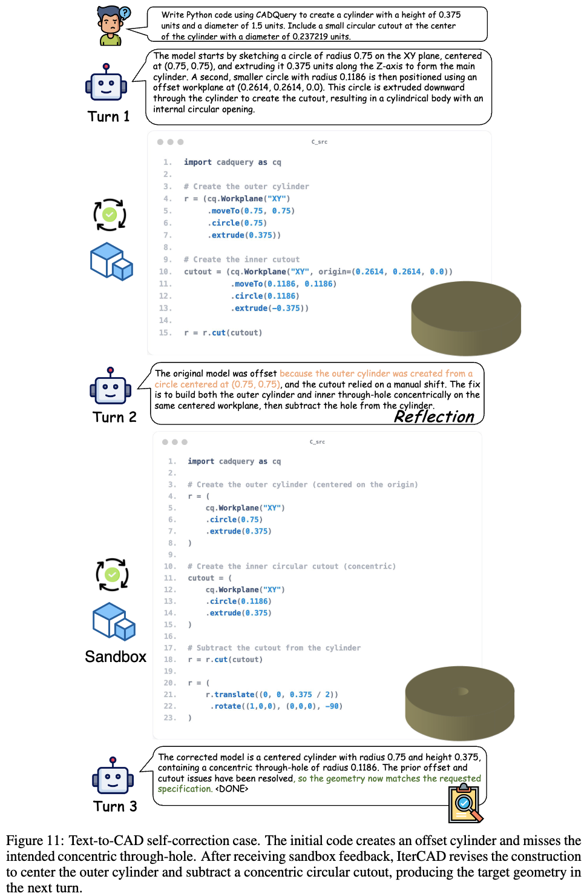

Text-to-CAD 자기수정: 오프셋된 실린더와 누락된 동심 관통홀을 centered workplane 기반으로 재작성

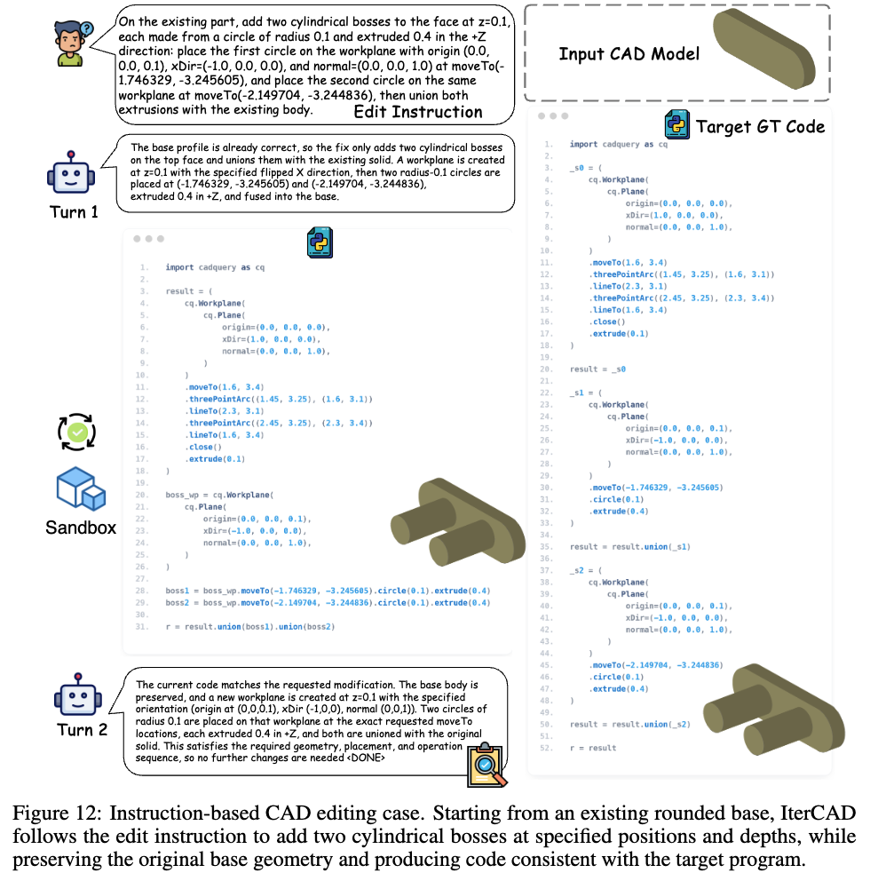

국소 편집: 원본 base geometry를 보존하며 실린더 boss 2개 추가

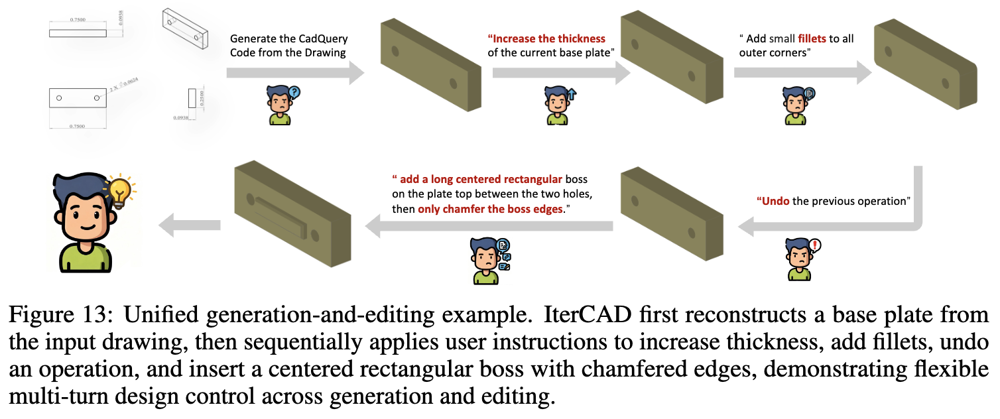

단일 세션 내 통합 생성+편집: 도면에서 base plate 복원 → 두께 수정 → fillet 추가 → "이전 연산 취소" → chamfer boss 추가

- Fig. 13이 가장 중요한 질적 결과임: **"undo the previous operation" 같은 과거 참조를 해소**하면서 영향 없는 geometry를 보존함 $\to$ 턴을 가로질러 design state를 유지하는 능력

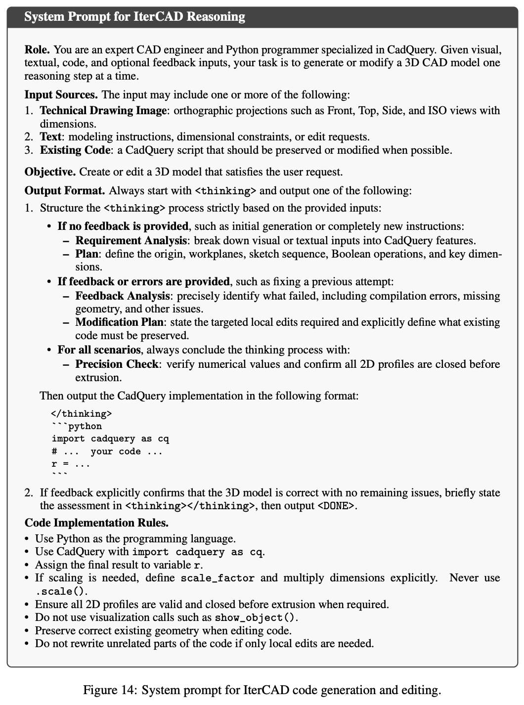

# 9. Conclusion & Limitations

## Conclusion

- 도면 기반 CAD 에이전트를 "from-scratch 합성 + instruction 기반 편집"을 아우르는 **execution sandbox와의 closed-loop 상호작용**으로 재정의
- 치수가 박힌 multi-view 도면이 syntax/point-cloud 피드백의 한계를 넘는 **정밀한 물리적 anchor** 역할을 함
- progressive SFT + geometry-aware RL + GVPM으로 4B 모델이 훨씬 큰 모델들을 joint robustness에서 상회
- CD-TR / AUC-TR이 survivor bias 없는 평가 표준을 제시

## Limitations (저자 명시)

1. **단일 파트 + 특정 도면 표준에 국한**. CadQuery 프로그램 안의 single-part parametric modeling만 다룸 — 다른 독점 도면 규격이나 **assembly-level 협업 설계**로의 확장은 미검증
2. **기하 지표의 의미론적 공백**. Chamfer Distance는 고수준 기계공학적 semantics와 제조 의도를 포착하지 못함 $\to$ 치수가 맞아도 **keyway, bearing fit, thread spec** 같은 피처의 공학적 용도를 모델이 인식하지 못함
3. **유지보수성 미고려**. 즉각적 기하 수렴을 우선하다 보니 hard-coded, 비구조적 구현을 내놓는 경우가 있음. 실무에 필요한 **계층적 parametric design tree**가 없음

## 개인적으로 짚고 싶은 부분

- **평가 지표 기여가 방법론 기여만큼 중요함**. Direct Inference에서 IterCAD의 Mean CD가 백본보다 나쁘게 나오는 현상이 survivor bias를 가장 선명하게 드러내는데, 저자들이 이걸 숨기지 않고 표에 그대로 둔 점이 좋음. 반대로 말하면 **기존 CAD 논문들의 Mean CD 비교는 상당수 신뢰하기 어렵다**는 함의가 있음
- **GVPM의 진짜 효과는 "턴 수를 늘리는 것"**. RL에서 reward hacking의 전형적 발현이 조기 종료인데, 이걸 reward 설계($R_{prog}$)와 gradient masking(GVPM) 양쪽에서 막은 구조가 깔끔함. 다만 $K=2$라는 trigger window가 꽤 공격적이고, 이 하이퍼파라미터에 대한 민감도 분석은 없음
- **IterCAD-Edit에서 GPT-5에 밀린다**는 사실이 본문에서 다소 완곡하게 서술됨. "nearly match GPT-5"는 IR과 턴 수 한정이고 AUC-TR은 0.54 vs 0.79로 격차가 큼
- Hard subset 실패 분석은 솔직한데, **`cut`을 통째로 생략하고 단일 extrude로 붕괴시키는 실패 모드**가 2/3라는 건 모델이 Boolean 연산의 필요성 자체를 인식 못 하는 수준이라는 뜻임. 피드백 루프가 "실행 성공"을 만들어주지만 "의도한 위상"까지 보장하지는 못한다는 한계

# Takeaways

- **closed-loop > one-shot**: 같은 4B 백본에서 IR 64.60% $\to$ 0.30%. 다만 이득의 대부분은 RL이 아니라 **cold-start SFT와 on-policy refinement 데이터**에서 나옴(64.60 $\to$ 0.80)
- **치수 주석이 붙은 표준 도면이 핵심 anchor**. 단순 렌더 이미지 대신 OCCT로 투영·치수 계산한 피드백을 쓴 게 "국소화 가능한 피드백"을 만든 요인
- **survivor-bias-free 지표(CD-TR/AUC-TR)가 없으면 비교 자체가 왜곡됨**. 실행 실패를 분모에 남기는 것만으로 모델 순위가 뒤집힘
- **GVPM은 multi-turn RL의 범용 패턴**으로 재사용 가능함 — "망가진 suffix를 마스킹하고 viable prefix에는 one-sided advantage clamp"는 CAD 밖의 agentic RL에도 그대로 적용 가능한 아이디어
- 남은 한계는 **semantics**: 치수는 맞추지만 기계적 의도(fit, thread, keyway)와 유지보수 가능한 parametric tree는 아직 범위 밖
