# [Agent] RAGEN: Understanding Self-Evolution in LLM Agents via Multi-Turn Reinforcement Learning

- paper: https://arxiv.org/pdf/2504.20073
- github: https://github.com/RAGEN-AI/RAGEN
- webpage: https://ragen-ai.github.io/
- arXiv preprint (인용수: 333회, '26-11-08 기준)
- 저자: Zihan Wang\*, Kangrui Wang\*, Qineng Wang\*, Pingyue Zhang\*, Linjie Li\* 외 (Northwestern / UW / Stanford / Microsoft / NYU / UBC / SMU), 교신 Manling Li
- downstream task: Multi-turn, stochastic 환경에서의 LLM agent RL
  - 여러 턴에 걸쳐 환경과 상호작용하며 순차 결정을 내리고, 확률적 피드백에 적응하는 agent 학습
- 주요 용어
  - **StarPO (State-Thinking-Actions-Reward Policy Optimization)**: 단일 action이 아니라 **trajectory 전체**를 하나의 최적화 단위로 보는 agent RL 프레임워크. $J_{\text{StarPO}}(\theta) = \mathbb{E}_{\mathcal{M}, \tau \sim \pi_\theta}[R(\tau)]$ 로, 기존 $J_{\text{step}}(\theta) = \mathbb{E}[R(x,y)]$ 과 대비됨
  - **Echo Trap**: multi-turn RL에서 반복되는 붕괴 패턴. 초기엔 다양하던 reasoning이 **국소적으로 보상받은 템플릿**으로 수렴하며 reward 분산 붕괴 $\to$ entropy 하락 $\to$ gradient spike 로 이어짐
  - **StarPO-S**: Echo Trap을 막는 안정화 변종. ① reward 분산 기반 **trajectory filtering** ② critic baselining ③ decoupled clipping (KL 제거 + clip-higher)
  - **Outcome uncertainty** $U(\pi_\theta, \mathcal{M}, s_0) = \text{Std}_{\tau \sim \pi_\theta(\cdot|s_0)}[R(\tau)]$: 같은 초기 상태에서 반복 롤아웃했을 때 보상의 표준편차. 이 값이 큰 prompt만 남겨 학습
  - **Online-$k$**: 한 번 수집한 롤아웃을 $k$ 번의 policy update에 재사용하는 전략. $k=1$ 이 완전 on-policy

# 1. Motivation

- 수학/코딩 같은 **static, single-turn** 태스크에서는 rule-based RL이 잘 먹힘 (DeepSeek-R1 등)
- 그러나 agent 세팅은 다름
  - 여러 턴에 걸친 **순차 결정**, 턴 간 메모리 유지, **확률적(stochastic) 환경 피드백**에 적응
  - 이 조건에서 LLM RL은 학습 불안정 / 복잡한 보상 신호 / 환경 변화에 대한 일반화 부족을 보임

기존 방법은 math·code 같은 non-interactive 태스크에 집중 vs RAGEN은 multi-turn stochastic 상호작용을 다룸

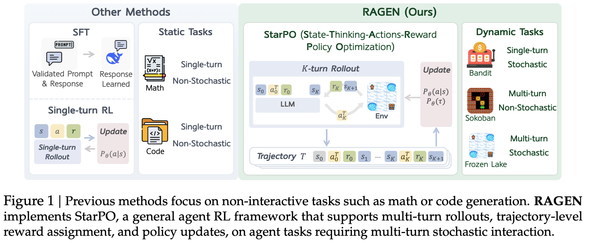

- 실제 웹브라우징 같은 태스크로 바로 가면 pretrained prior와 태스크별 엔지니어링에 결과가 가려짐
  - $\to$ **통제 가능한 최소 환경**에서 학습 동역학 자체를 뜯어보자

  $\to$ (Research Question) **self-evolving LLM agent가 효과적이고 안정적으로 학습하게 만드는 설계 요인은 무엇인가?**

# 2. Contribution

- **StarPO 제안**: reasoning trace, action, 환경 피드백을 포함한 **trajectory 전체**를 rollout·최적화 단위로 삼는 일반 agent RL 프레임워크. PPO / GRPO 둘 다 인스턴스화 가능
- **RAGEN 시스템 공개**: rollout 생성 $\to$ reward 할당 $\to$ trajectory 최적화의 전체 루프를 구현한 모듈형 연구 인프라
- **3가지 핵심 발견**
  1. multi-turn RL은 **Echo Trap**이라는 고유한 붕괴 모드를 가짐 $\to$ **StarPO-S**로 완화
  2. rollout 품질이 self-evolution을 좌우함: **다양한 초기 상태 + 중간 수준의 interaction granularity + 잦은 샘플링**
  3. **fine-grained, reasoning-aware reward** 없이는 agent reasoning이 거의 창발하지 않음. 생기더라도 shallow strategy이거나 **hallucinated thought**

# 3. Framework

## 3.1 MDP Formulation

- 기존 single-turn RL: $J_{\text{step}}(\theta) = \mathbb{E}_{s \sim \mathcal{D}, a \sim \pi_\theta(\cdot|s)}[R(s,a)]$
- agent는 MDP $\mathcal{M} = \{S, A, P\}$ 에서 동작. $a_t \sim \pi_\theta(\cdot|s_t, \tau_{<t})$, $(r_t, s_{t+1}) \sim P(\cdot|s_t, a_t)$
  - 상호작용 이력 $\tau_{<t} = \{s_0, a_0, r_0, \dots, s_{t-1}, a_{t-1}, r_{t-1}\}$
  - horizon $K$ 까지 진행해 전체 궤적 $\tau = \{s_0, a_0, r_0, \dots, s_K\}$ 를 얻음

## 3.2 StarPO

- 목적함수는 궤적 단위 누적 보상

$$J_{\text{StarPO}}(\theta) = \mathbb{E}_{\mathcal{M}, \tau \sim \pi_\theta}[R(\tau)]$$

- 각 스텝의 출력은 reasoning-guided structured output

$$a_t^T = \texttt{<think>}...\texttt{</think>}\texttt{<answer>}\ a_t\ \texttt{</answer>}$$

- $\pi_\theta(\tau)$ 를 token-level likelihood로 분해하므로 autoregressive LLM과 그대로 호환
- 학습 루프: $P$ 개 초기 상태 × $N$ 개 궤적, batch $E$, $L$ loop $\to$ 총 $S = \frac{L \cdot P \cdot N}{E}$ gradient step

StarPO 프레임워크 — K-turn rollout과 trajectory-level advantage estimation

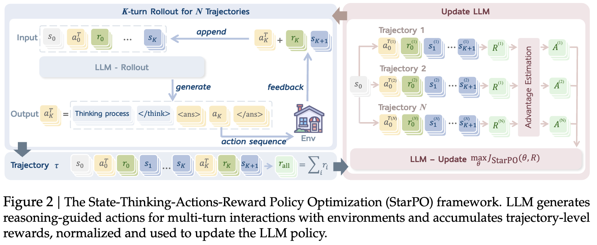

## 3.3 Modular Optimization

- **PPO**: critic이 token-level value/advantage $A_{i,t}$ 추정
- **GRPO**: critic 없이 궤적 보상 $R(\tau_i)$ 를 그룹 내 정규화해 모든 토큰에 동일 advantage 부여

$$\hat{A}_{i,t} = \frac{R(\tau_i) - \text{mean}(\{R(\tau_1), \dots, R(\tau_G)\})}{\text{std}(\{R(\tau_1), \dots, R(\tau_G)\})}$$

# 4. Experiment Setup

- **환경 4종** (복잡도 축을 분리하도록 설계)

| 환경 | 턴 | 특성 |
|---|---|---|
| **Bandit** | single-turn | stochastic. 노이즈 피드백 하의 risk-sensitive reasoning |
| **Sokoban** | multi-turn | deterministic. **되돌릴 수 없는** symbolic planning |
| **Frozen Lake** | multi-turn | stochastic. 확률적 전이 + planning |
| **WebShop** | multi-turn | open-domain. 자연어 grounding, 실제 웹 환경 |

  - 앞 3개는 의도적으로 최소화·완전 통제 가능하게 만들었고, WebShop만 현실적 태스크 구조를 더함
- **모델**: Qwen-2.5-Instruct **0.5B** (symbolic 3종), **3B** (WebShop). H100, 100~200 rollout-update iteration
- **하이퍼파라미터**: $P=8$ prompts, $N=16$ rollouts/prompt, 최대 5턴 · 10 action. GAE ($\gamma=1.0$, $\lambda=1.0$), entropy bonus $\beta=0.001$, response-format penalty $-0.1$
- **평가**: 환경당 고정 prompt 256개, $T=0.5$, 5턴 후 truncate
  - 지표: success rate / rollout entropy / **in-group reward variability** / response length / gradient norm

# 5. Experimental Results

## 5.1 Multi-turn RL의 새로운 불안정성

4개 환경에서의 baseline StarPO 성능 — PPO vs GRPO

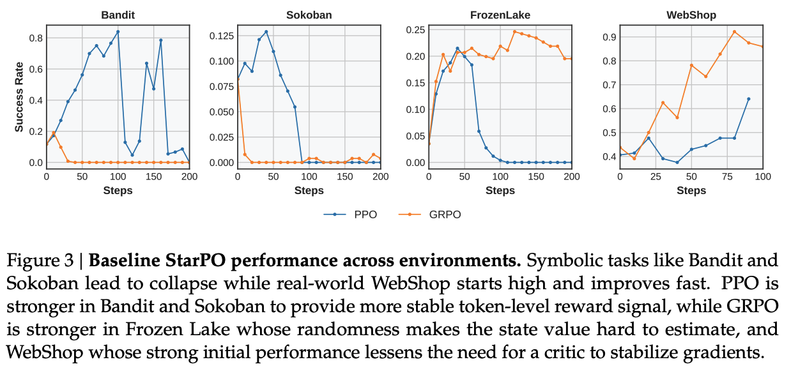

- Bandit, Sokoban 같은 symbolic 환경은 초반에 오르다가 **결국 붕괴**. WebShop은 높게 시작해 빠르게 개선
- **PPO vs GRPO의 비대칭**
  - PPO가 Bandit·Sokoban에서 더 안정적 (critic이 부드러운 보상 추정 제공)
  - GRPO가 Frozen Lake에서 더 안정적 (무작위성 때문에 state value 추정이 어려워 PPO critic이 불안정해짐)
  - WebShop은 둘 다 성공 (강한 language prior + 높은 초기 보상으로 critic 필요성이 낮음)

> **Finding 1**: single-turn RL을 multi-turn agent RL에 그대로 가져오면 초기 이득 후 붕괴한다. PPO의 critic은 불안정성을 **지연**시킬 뿐 reasoning degradation을 막지 못한다.

**Echo Trap.** 초기·후기 궤적을 비교하면

- Bandit 초기: symbolic 의미와 기대 보상에 대한 **다양한 reasoning**
- Bandit 후기: 반복적·결정론적 문구로 고정
- $\to$ RL이 **내재된 reasoning shortcut을 과증폭**하고 탐색을 억제함

> **Finding 2**: agent RL의 model collapse는 학습 과정에서 "Echo Trap"으로 나타난다. 고정된 문구로 수렴한다는 것은 RL이 일반적 reasoning 대신 표면 패턴을 강화했다는 신호다.

## 5.2 붕괴의 조기 경보 신호

붕괴 지표와 조기 경보 신호 — average reward, gradient norm, reward std, entropy

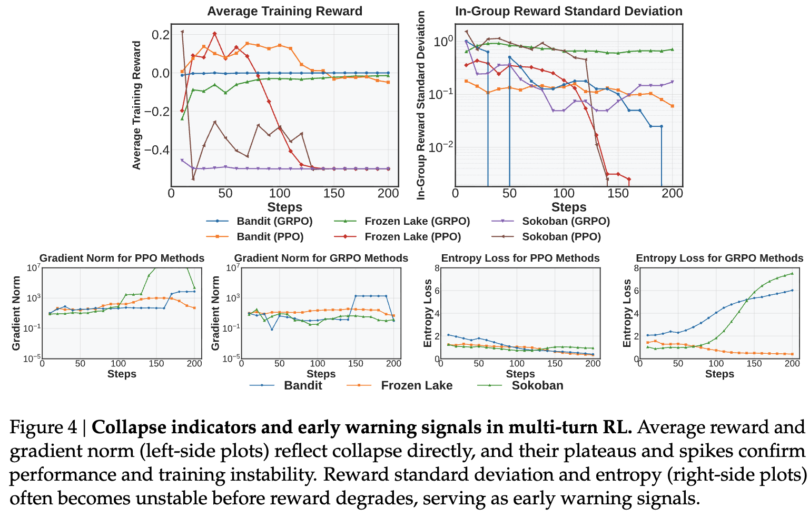

- **Reward standard deviation은 수렴의 선행 지표**
  - FrozenLake-PPO: std가 **step 40**에 급락, reward mean 붕괴는 **step 90** (이때 성능은 거의 최적)
  - Bandit-PPO: std가 step 70 즈음 바닥, reward peak는 step 120
  - Sokoban-PPO: step 10 부근에서 std와 mean이 동시 붕괴 (조기 포화)
- **Gradient norm spike는 돌이킬 수 없는 붕괴 지점**
  - Bandit step 170, Sokoban step 110, FrozenLake step 90에서 spike 발생 $\to$ 이후 회복 불가
- **Entropy는 안정적으로 감쇠해야 정상**. 급증하거나 요동치면 reasoning 붕괴와 상관

> **Finding 3**: reward std와 entropy가 성능 저하보다 **먼저** 요동치고, gradient norm spike가 비가역적 붕괴 지점을 표시한다.

## 5.3 StarPO-S

- 핵심 가설: **outcome uncertainty가 큰 instance**가 가장 유익한 학습 샘플 (Active Learning의 직관)
  - 너무 쉬운 것도, 너무 어려운 것도 피함
- 매 스텝 reward std 기준 정렬 후 **상위 $p$% 만 유지**

uncertainty-based filtering 효과 — keep 25/50/75% vs all rollouts, 그리고 학습 시간

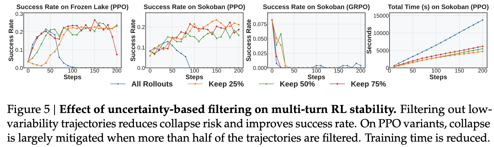

- PPO에서 효과 확연
  - **75% 유지**: FrozenLake 안정 구간 100 $\to$ **140 step**
  - **50% 유지**: 붕괴 **완전 회피**
  - GRPO는 critic-free라 여전히 덜 안정적이지만 개선은 있음
- 기본값은 **25% 유지**. 학습 시간도 함께 줄어듦 (저자들도 "이 공격적 값이 모든 상황에 최적은 아닐 수 있다"고 단서)
- 추가 gradient shaping (DAPO에서 차용)
  - **KL Term Removal**: PPO 목적함수에서 KL penalty 제거 $\to$ 초기 분포 제약 없이 탐색
  - **Clip-Higher**: $\varepsilon_{\text{high}} = 0.28 > \varepsilon_{\text{low}} = 0.2$ 로 비대칭 clipping $\to$ 고보상 롤아웃에서 더 공격적으로 학습

StarPO vs StarPO-S — 4개 환경 전부에서 붕괴 완화 및 success rate 향상

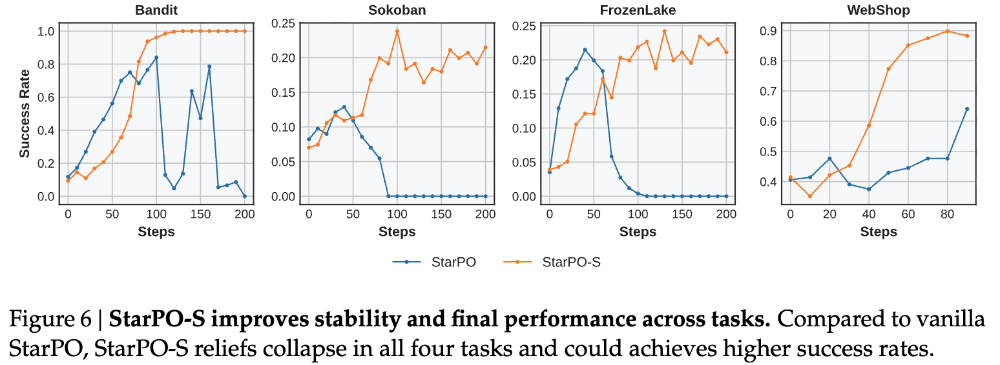

> **Finding 4**: 저분산 trajectory를 걸러내면 multi-turn RL의 붕괴가 지연되거나 사라진다. 정보량 없는 롤아웃을 버려 업데이트 스텝까지 줄인다.

## 5.4 어떤 Trajectory가 좋은가

**① Task diversity** — 고정 batch에서 prompt 수 ↔ prompt당 응답 수의 trade-off

task diversity가 일반화에 미치는 영향

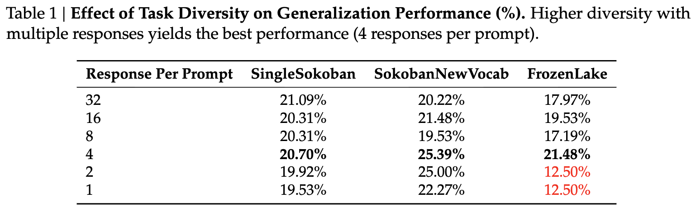

- prompt당 **4개 응답**이 sweet spot. 단, prompt당 복수 롤아웃이 있어야(=1개면 안 됨) 같은 조건에서 결과를 **대조**할 수 있어 성립

**② Interaction granularity** — 턴당 허용 action 수

턴당 max action 수에 따른 환경별 성능

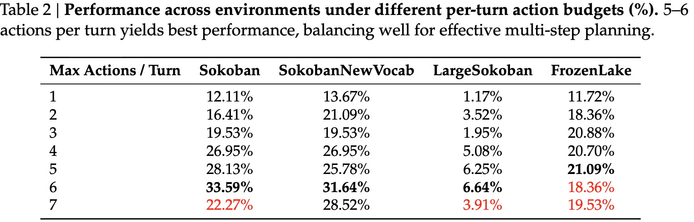

- **5~6개**가 최적. planning 공간은 충분히 주되 지나치게 긴 롤아웃의 노이즈는 피함
- 7개로 늘리면 **급락** (노이즈 전이 + 보상 피드백 희석)

**③ Rollout frequency** — Online-$k$

rollout 재사용 횟수 $k$ 에 따른 성능 — Online-1이 가장 빠른 수렴

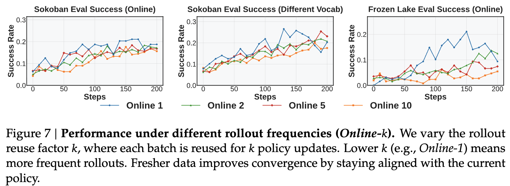

- **Online-1 (완전 on-policy)** 이 가장 빠르게 수렴하고 일반화도 좋음. $k$ 가 커질수록 policy-data mismatch 누적

> **Finding 5**: task diversity, action budget, rollout frequency가 rollout 품질을 결정한다. 다양한 instance / 적당한 action budget / 최신 rollout.

## 5.5 Reasoning은 왜 사라지는가

**Single-turn (Bandit)에서는 reasoning이 일반화를 돕는다.**

- `[Teacher, Engineer]` arm pair로 학습 $\to$ `[Librarian, Trader]` 로 평가 (직관적 risk-reward 정렬 유지)
- `BanditRev`: 보상 프로파일을 **반대로** 뒤집어 직관과 어긋나게 만든 버전

StarPO-S 하에서 reasoning 유무에 따른 일반화 성능

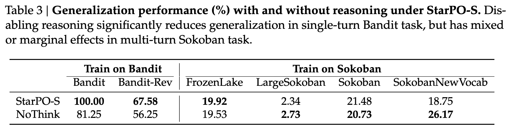

- Bandit: 100.00 vs 81.25 (**+18.75pp**), 반직관적인 Bandit-Rev에서도 67.58 vs 56.25 (**+11.33pp**)
- 그러나 **Sokoban으로 학습한 multi-turn 쪽은 혼재**. SokobanNewVocab에서는 NoThink가 26.17로 오히려 7.42pp 앞섬

**Multi-turn에서는 reasoning이 학습 중에 말라붙는다.**

학습 스텝별 `<think>` 블록 길이 변화

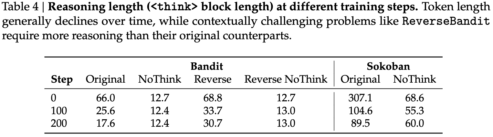

- Sokoban은 307.1 $\to$ **89.5** 토큰으로 쪼그라듦. 모델이 **스스로 사고 과정을 억제**함
- 반면 reasoning이 반드시 필요한 `BanditRev`는 68.8 $\to$ 30.7 로 상대적으로 길게 유지 $\to$ 맥락이 어려우면 reasoning이 버틴다
- 저자 해석: multi-turn의 **sparse·delayed reward**가 "일관된 reasoning"과 "운 좋은 trial-and-error"를 구분하지 못함
  - 실제로 **incoherent/hallucinated reasoning을 내놓고도 높은 보상**을 받는 사례가 appendix에 있음
  - 현재는 `<think>`–`<answer>` 구조가 없으면 소폭 페널티를 주는 정도로 대응. partial correctness 보상 같은 finer-grained 설계를 future work로 남김

> **Finding 6**: 중간 reasoning 단계를 명시적으로 장려하는 reward 설계가 없으면 multi-turn에서 reasoning은 지속되지 않는다. 구조화된 prompt를 줘도, 보상이 최종 결과만 보면 reasoning은 점진적으로 사라진다.

## 5.6 Scale & Frontier Model 비교

0.5B / 3B / 7B 스케일 효과 — 환경별

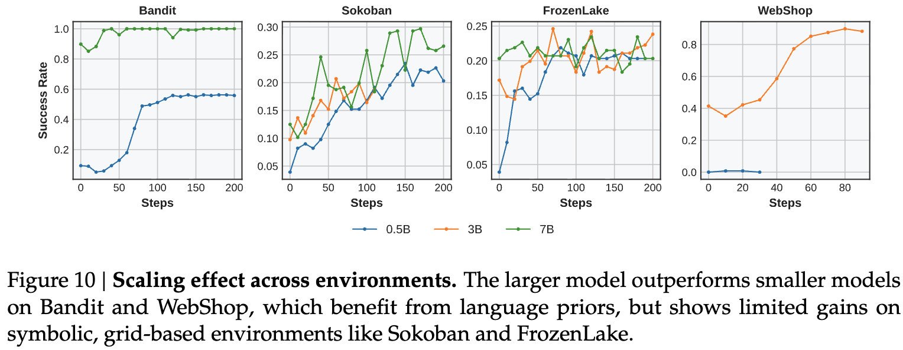

- **Bandit, WebShop**은 큰 모델이 유리 (language prior를 활용 가능)
- **Sokoban, FrozenLake** 같은 symbolic grid 태스크는 **스케일 이득이 제한적** — pretraining 분포와 겹치지 않기 때문

zero-shot frontier model vs 학습된 0.5B 비교

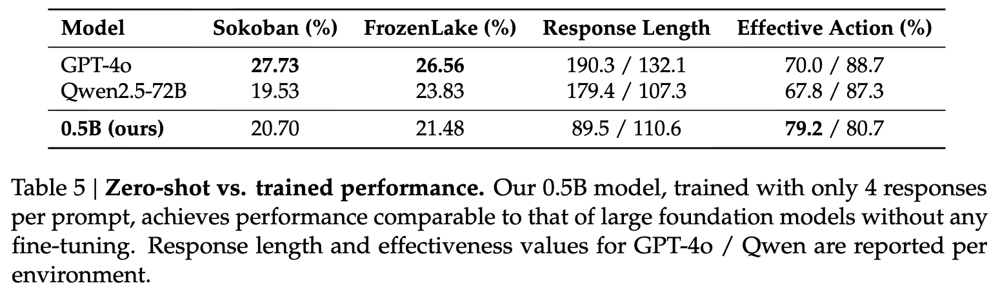

- 파라미터가 **100배 이상 적은 0.5B**가 zero-shot GPT-4o·Qwen2.5-72B와 비슷한 범위에 도달
- Effective Action 비율은 Sokoban에서 오히려 더 높음 (79.2% vs 70.0%)

# 6. Conclusion & Limitations

- **결론**: StarPO 기반 RAGEN으로 multi-turn agent RL 고유의 문제(gradient collapse, rollout drift, reasoning degradation)를 드러내고, rollout filtering / gradient shaping / reward-aware reasoning supervision이라는 설계 원칙을 도출
- **저자가 명시한 한계**
  - 비교적 **작은 스케일의 태스크**에 집중
  - replay buffer 같은 **확립된 RL 관행을 생략**
  - **multimodal 태스크 부재**
- **리뷰어 관점에서 추가로 걸리는 점**
  - "StarPO-S가 모든 태스크에서 붕괴를 완화한다"지만 symbolic 환경의 절대 성능은 여전히 낮음 (Sokoban ~0.2, LargeSokoban 6.64%)
  - filtering 기본값 25%의 근거가 약함. 저자들도 "Sokoban·FrozenLake는 반복적 reasoning 패턴 때문에 공격적 filtering이 잘 먹힌 것일 수 있다"고 인정
  - Finding 6은 **문제 제기에서 끝남** — fine-grained reward를 실제로 설계해 검증하지는 않음
  - table3의 reasoning 효과가 multi-turn에서 혼재(일부는 NoThink 우세)인데, 이를 "mixed or marginal"이라 표현만 하고 깊게 파고들지 않음

# Takeaways

- multi-turn agent RL의 실패는 성능 그래프가 아니라 **reward std와 entropy에서 먼저 보인다.** FrozenLake는 std 붕괴(step 40)가 reward 붕괴(step 90)를 50 step 앞섬 — 모니터링 지표를 성능에서 분산으로 옮겨야 함
- **gradient norm spike는 사망 선고.** 그 이후로는 작은 업데이트도 회복 불가능한 loss shift를 유발
- rollout 설계가 알고리즘만큼 중요함: prompt당 4 response / 턴당 5~6 action / Online-1. 특히 **턴당 7 action으로 늘리면 급락**하는 비단조성에 주의
- **reasoning은 보상이 떠받쳐주지 않으면 스스로 소멸한다.** Sokoban `<think>` 길이가 307 $\to$ 89 토큰. "`<think>` 태그를 쓰게 하면 생각할 것"이라는 가정은 multi-turn에서 깨짐
- 반대로 **의미적으로 어려운 태스크(BanditRev)에서는 reasoning이 버틴다** — reasoning 유지 여부가 태스크 난이도의 대리 지표가 될 수 있음
- 0.5B가 학습만 잘하면 zero-shot GPT-4o 근처까지 간다는 점은, symbolic agent 태스크에서 **스케일보다 rollout 구성이 지배적**임을 시사
