# [Agent] SynPlanResearch-R1: Encouraging Tool Exploration for Deep Research with Synthetic Plans

- paper: https://arxiv.org/pdf/2603.07853
- github: https://github.com/HansiZeng/syn-plan-research
- arXiv preprint (2603.07853) '26-03-09 submit (인용수 4회, '26-11-09 기준)
- 저자: Hansi Zeng, Zoey Li, Yifan Gao, Chenwei Zhang, Xiaoman Pan, Tao Yang, Fengran Mo, Jiacheng Lin, Xian Li, Jingbo Shang (UMass Amherst / Amazon / Univ. of Montreal / UIUC / UC San Diego)
- downstream task: Deep Research Agent (text-only multi-turn tool calling)
  - `web_search` + `crawl_webpage` 두 툴만으로 multi-hop QA / open-web 질의에 답하는 ReAct agent
- 주요 용어
  - **tool plan**: 생성 전에 미리 뽑아둔 액션 시퀀스 $P = (a_1, \dots, a_L)$. $a_1$은 항상 `web_search`로 고정, $t \ge 2$는 $\{$`web_search`, `crawl_webpage`$\}$에서 확률 0.5로 독립 샘플링. 길이 $L \sim \mathrm{Uniform}\{3,\dots,8\}$
  - **cue-injected thought**: ReAct `<think>` 블록 **맨 앞에 미리 박아 넣는 한두 문장** $c_t = \mathrm{Cue}(a_t)$. Large Reasoning Model(LRM)은 이 prefix에서 이어서 생각을 완성하고 액션을 내놓음 $\to$ $\tau_t = c_t \| \Delta\tau_t$
  - **void trajectory**: 정답이 틀린 게 아니라 **토큰/턴 한도 초과로 끊겨서** valid final answer를 못 낸 rollout. 전체의 10~15%
  - **hard failure**: tool call이 JSON 스키마를 위반한 경우. reflection으로 이어가지 않고 **즉시 생성 종료 + $-\alpha$ 페널티**
  - **exploration depth**: trajectory당 평균 tool call 수. 이 논문의 핵심 proxy 지표로, 성능과 거의 선형 관계를 보임

# 1. Motivation

- Research Agent(deep research)는 web search / browsing 툴을 수십 턴 돌리며 증거를 모아야 함. 학습은 보통 **cold-start SFT $\to$ RLVR(GRPO)** 2단계로 함
- 그런데 저자들의 관찰: **RLVR만으로는 탐색 행동이 안 생김**. 두 가지 실패 패턴이 반복됨
  1. **premature termination**: 검색 몇 번 하고 증거가 충분치 않은데 바로 `<answer>`를 뱉음
  2. **biased tool usage**: `web_search`만 반복 호출하고 `crawl_webpage`는 거의 안 씀 $\to$ snippet 수준의 얕고 파편화된 증거만 모임
- 원인 진단은 **RLVR의 on-policy 성질**임. 학습이 자기 rollout에서 bootstrap되므로, **초기화가 약하면 탐색 분포 자체가 좁고 거기에 갇힘**(local optimum)
  - 즉 RL은 이미 있는 탐색 정책을 다듬을 뿐, 초기화가 심어놓은 shallow tool-use prior를 **뒤집지는 못함**

  $\to$ (Research Question) RL 이전 단계인 cold-start SFT에서 **"더 깊이 탐색하는 습관"을 명시적으로 주입**해서 이후 RL의 성능 천장을 올릴 수 있는가?

# 2. Contribution

- **plan-guided data synthesis** 제안: 랜덤 tool plan을 먼저 뽑고, 그 plan을 따르도록 LRM(Qwen3-32B)을 유도해 trajectory를 합성. 정답 + 포맷을 모두 통과한 것만 남겨 cold-start SFT에 사용
  - plan을 액션 레벨에서 강제하는 게 아니라 **cue-injected thought라는 soft constraint**로 유도함 $\to$ ReAct의 자연스러운 reasoning flow를 깨지 않음
  - plan만 넣으면 준수율 **28.32%**인데, cue까지 넣으면 **76.96%**로 뜀 (table3)
- **multi-turn RL 안정화 트릭 2종**: void trajectory는 advantage 계산에는 쓰되 **policy loss에서 전체 마스킹**, JSON 스키마 위반은 **즉시 종료 + 포맷 페널티**
- 7개 벤치마크에서 SOTA 대비 일관된 향상: **Qwen3-8B +6.0%, Qwen3-4B +5.8%** (SimpleDeepSearcher 대비 상대값)
- 분석으로 메커니즘을 뒷받침: SynPlanResearch-R1이 **RL 내내 더 높은 policy entropy를 유지**하고 **tool call 수가 더 많으며**, tool call 수와 성능이 거의 선형 관계임을 보임

# 3. Related Works

## 3.1 RLVR

- DeepSeek-R1, Kimi K1.5, QwQ 계열이 보여준 outcome reward 기반 최적화. value-free(GRPO, RLOO)가 PPO 대비 단순/효율적이라 주류가 됨
- 안정성 개선(DAPO, GSPO, IS correction) 연구와 별개로, **"RLVR이 새 능력을 가르치는가 아니면 기존 능력을 sharpen할 뿐인가"** 논쟁이 있음
  - 이 논문의 관찰(RL만으로는 편향된 tool prior를 못 벗어남)은 후자 쪽 주장과 맞닿음

## 3.2 Research Agents

- RAG $\to$ Self-RAG $\to$ Search-R1 / WebThinker / SimpleDeepSearcher 계보
- 현재 연구 축은 (1) web research에 맞는 RL 알고리즘, (2) cold-start/RL용 고품질 데이터 구축, (3) long-horizon RL 인프라 세 갈래. 이 논문은 **(2)에 속하되 목적이 "정답률"이 아니라 "탐색 깊이"**라는 게 차별점

# 4. Problem Setting

- ReAct 포맷을 multi-turn으로 형식화: 매 스텝 Thought $\to$ Action $\to$ Observation
  $$y^T = (\tau_1, a_1, o_1, \dots, \tau_T, a_T)$$
- 액션 공간은 2개 툴 + 최종 답변: `web_search`(top-$k$ 후보 snippet + URL), `crawl_webpage`(지정 URL 본문 추출)
- 태그로 구조를 명시: `<think>`, `<tool_call>`, `<tool_response>`, `<answer>`
  - 프롬프트는 (1) tool description, (2) ReAct 프로토콜 instruction, (3) user question 3부 구성 (Appendix A.1)

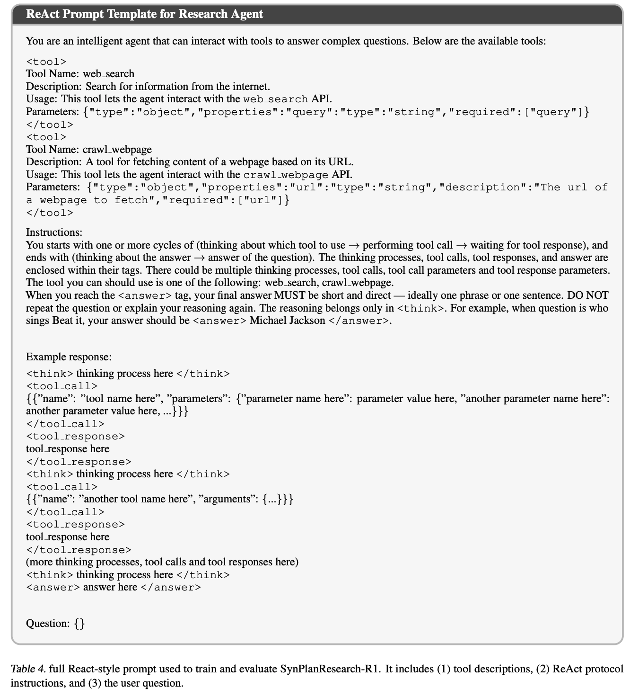

# 5. SynPlanResearch-R1 Framework

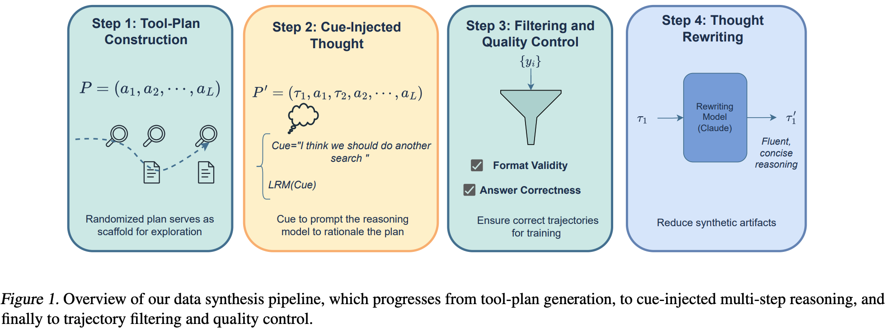

## 5.1 Step 1 — Tool-Plan Construction

- `tool_plan_generator`가 합성 plan을 생성. 제약은 아주 단순함
  - $L \sim \mathrm{Uniform}\{L_{min}{=}3, \dots, L_{max}{=}8\}$
  - $a_1 = $ `web_search` 고정 (후보 증거 bootstrap용)
  - $t \ge 2$: `web_search` / `crawl_webpage`를 **각 0.5 확률로 독립 샘플링**
- 이 plan은 정답을 위한 최적 경로가 아니라 **"더 길고 다양한 tool 조합을 밟게 만드는 scaffold"**임. 랜덤이라는 게 포인트

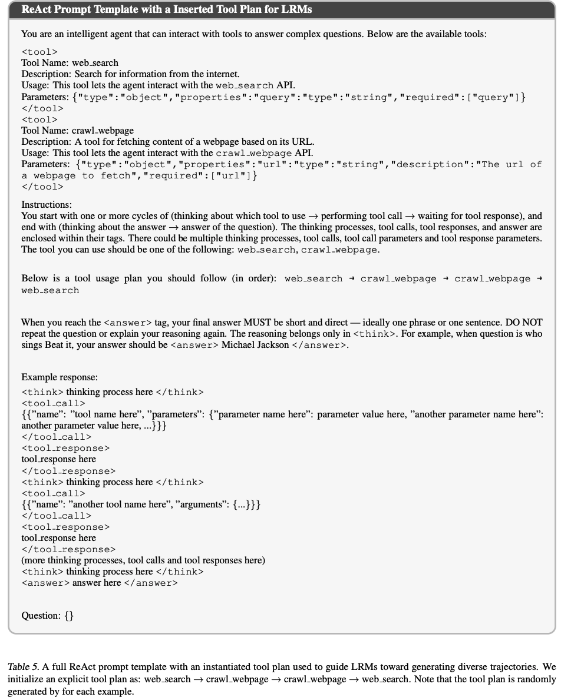

tool plan이 삽입된 ReAct 프롬프트 — "websearch $\to$ crawl $\to$ crawl $\to$ websearch" 예시

## 5.2 Step 2 — Cue-Injected Thoughts

- plan을 프롬프트에 넣기만 하면 두 문제가 생김
  1. LRM이 plan을 **충실히 따르지 않음** (특히 연속 tool call이 지정된 경우)
  2. ReAct는 매 tool call마다 자연어 thought를 요구하므로 **액션 레벨에서 plan을 직접 강제하기 어려움**
- 해법: thought 맨 앞에 액션별 cue 문장을 prefix로 박고, LRM이 **그 뒤를 이어 쓰게** 함
  $$(\Delta\tau_t, a_t) \sim \mathrm{LRM}(\cdot \mid H_{t-1}, \texttt{<think>}\, c_t), \quad \tau_t = c_t \| \Delta\tau_t$$
- 실제 cue 템플릿 (Appendix A.3)
  - `web_search`: "To answer this, I probably need to gather external information first. Let me think about the best way to phrase the query for web search."
  - `crawl_webpage`: "There are several promising links from the search results. Perhaps I should inspect one of them to obtain more specific information."

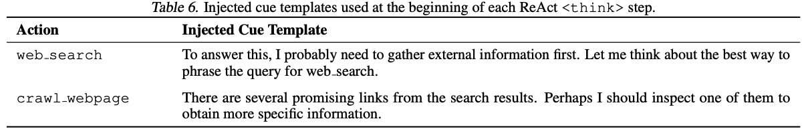

## 5.3 Step 3 — Filtering & Quality Control

- 질문당 $N{=}16$개 랜덤 plan으로 trajectory를 뽑고, 두 체크를 통과한 것만 보존
  - **Format validity**: ReAct 스키마(`<think>`/`<tool_call>`/`<tool_response>`/`<answer>`) 준수
  - **Answer correctness**: task별 checker로 최종 답 검증
- plan이 랜덤 샘플링이므로, 살아남은 집합이 자연스럽게 **다양한 reasoning/exploration 패턴을 커버**하게 됨

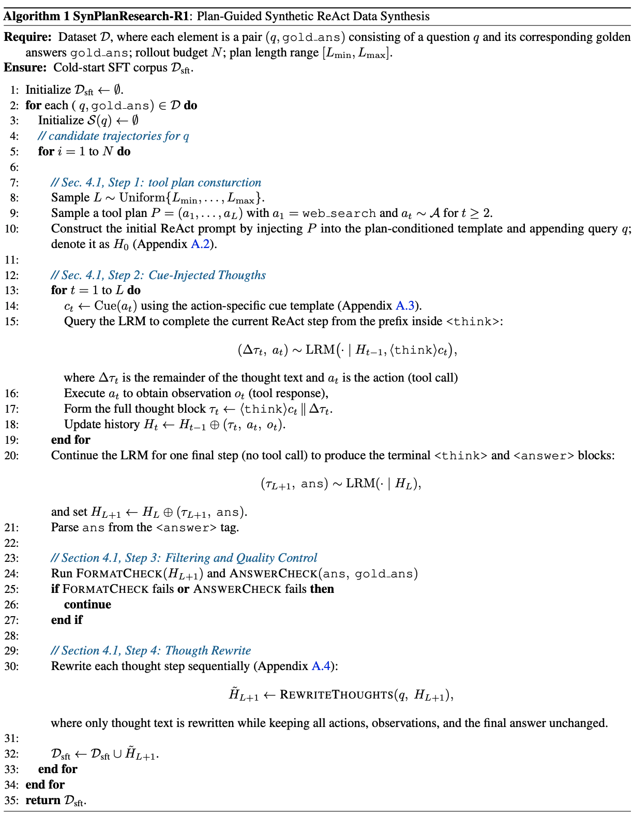

## 5.4 Step 4 — Thought Rewriting

- cue가 수작업으로 쓰인 문장이라 **부자연스러운 말투/스타일 편향**이 남음
- Claude-3.7-Sonnet으로 각 thought를 **지시 의도는 유지한 채** 간결/자연스럽게 paraphrase
  - 스텝별 순차 처리: 질문 $q$ + 이미 rewrite된 history + 현재 액션 $a_t$를 주고 $\tilde\tau_t$만 출력시킴
  $$\tilde\tau_t = \mathrm{LRM}_{rewrite}\big(q, \{(\tilde\tau_i, a_i, o_i)\}_{i<t}, a_t\big)$$

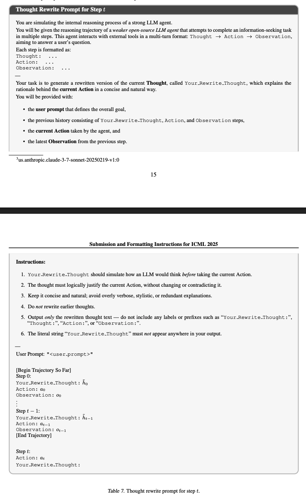

## 5.5 Cold-start SFT $\to$ RL

**Cold-start SFT**: 합성 corpus $\mathcal{D}_{sft} = \{(q,y)\}$ 위에서 표준 cross-entropy. 16개 rollout이 모두 실패한 질문은 아예 제거. 질문당 복수 정답 trajectory가 남을 수 있음

**RL (GRPO)**: $\pi_{sft}$에서 시작, group size $G{=}16$

$$\hat{\mathcal{L}}_{GRPO}(\theta) = \frac{1}{G}\sum_{i=1}^{G} \frac{1}{\sum_t m_{i,t}} \sum_{t=1}^{|y_i|} m_{i,t} \cdot \min\big(\rho_{i,t}A_{i,t}, \mathrm{clip}(\rho_{i,t}, 1-\epsilon, 1+\epsilon)A_{i,t}\big)$$

- **tool response에서 온 토큰은 $m_{i,t}=0$** (Search-R1과 동일한 처리)
- reward는 F1 기반 정확도 $s_{ans}$와 포맷 준수 $f \in \{0,1\}$의 조합

$$r(q, y_i) = \begin{cases} s_{ans} + \alpha, & f=1,\ s_{ans}>0 \\ 0, & f=1,\ s_{ans}=0 \\ 0, & f=0,\ s_{ans}\ge\tau \\ -\alpha, & f=0,\ s_{ans}<\tau \end{cases}$$

($\alpha = 0.2$, $\tau = 0.8$)

**안정화 트릭 2종** (Appendix C.3)

- **void turn masking**: 토큰/턴 한도 초과로 끊긴 rollout(10~15%)은 reward $-\alpha$를 주되 **모든 토큰의 loss mask를 0**으로 둠 $\to$ group advantage 통계에는 기여하지만 **gradient는 0**. 잘린 rollout이 policy를 직접 흔드는 걸 막음
- **JSON 스키마 위반 = hard failure**: 파싱 에러를 tool response로 돌려주며 reflection을 유도하지 않고 **즉시 생성 중단 + 포맷 페널티**

# 6. Experiments

## 6.1 Setup

- **평가**: multi-hop QA 4종(HotpotQA, 2WikiMultihopQA, MuSiQue, Bamboogle) + advanced QA 3종(GPQA, WebWalkerQA, GAIA). HotpotQA/2Wiki는 5K로 downsample, 나머지는 full split. 지표는 **F1** (GAIA는 Pass@4)
- **학습 데이터**: SFT 8k (multi-hop QA 소스 70% / SuperGPQA 15% / WebWalker-Silver 15%), RL은 같은 비율 8k + ARPO 1.6k $\to$ 약 9.6k. 평가셋과 중복 없음
- **합성 LRM**: Qwen3-32B, 질문당 $N{=}16$ rollout
- **하이퍼파라미터**: SFT 2.5 epoch / LR $5e^{-6}$ / max seq 32,768 (8×A100 80GB, FSDP + Ulysses SP=2), RL 80 step / LR $1e^{-6}$ / batch 256 / max input 16K·response 4K / **최대 8턴** / rollout temperature 1.0, top-$p$ 1.0, top-$k$ $-1$ / KL 계수 0
- **baseline 6종**: Direct Inference, RAG, Search-o1, Rejection Sampling(RFT, 동일 합성 데이터로 RL 대신 multi-iteration SFT), Search-R1, SimpleDeepSearcher

## 6.2 Main Results

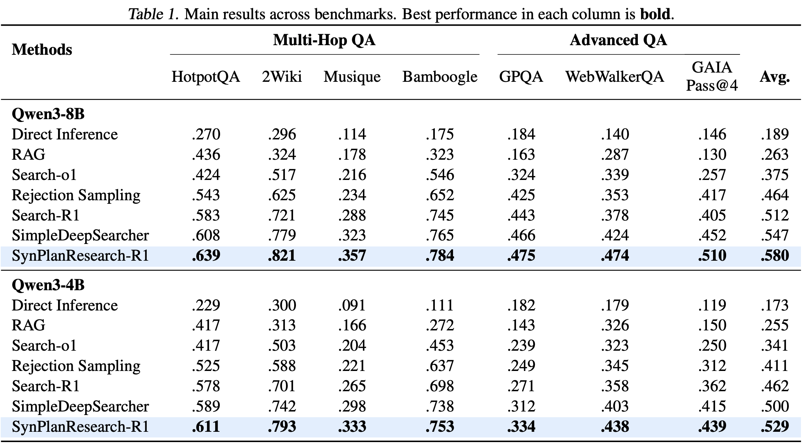

- 8B 평균 **0.580**으로 전 컬럼 best. 상대 향상: RFT 대비 **+25.0%**, Search-R1 대비 **+13.2%**, SimpleDeepSearcher 대비 **+6.0%**
- 4B도 동일 경향 — 평균 **0.529** vs SimpleDeepSearcher 0.500 (**+5.8%**), Search-R1 0.462 (+14.5%), RFT 0.411 (+28.7%)
- 해석 포인트 두 개
  - **vs RFT(+25.0%)**: 같은 합성 데이터를 쓰는데 RL이 iterative SFT보다 훨씬 효율적. 양성/음성 trajectory 양쪽에서 학습하기 때문
  - **vs SimpleDeepSearcher(+6.0%)**: SimpleDeepSearcher는 "좋은 질문 고르기"에 집중하는데, 이 논문은 "**다양한 trajectory 합성**"에 집중. 같은 cold-start 계열에서 후자가 더 먹힘

## 6.3 Tool Usage & Exploration

7개 벤치마크 각각에서 평균 tool call 수(x축) vs EM 성능(y축), RL 20/40/60/80 step 체크포인트 4개씩

- 비교 대상 3종: SynPlanResearch-R1 / naive cold-start SFT 후 RL / RL from scratch
- **tool call 수와 성능이 거의 선형**. 세 방법 모두 학습이 진행되면 tool 사용이 늘지만, RL-from-scratch와 naive SFT+RL은 **초기값과 최종값 모두 낮은 구간에 갇힘**
  - $\to$ RL은 기존 exploration policy를 refine할 뿐, 초기화가 준 shallow prior를 못 벗어난다는 주장의 직접 증거
- **탐색 예산이 난이도에 적응**함: GAIA 같은 open-web 태스크는 반복 증거 수집이 많고, 정제된 multi-hop QA는 적은 tool call에서 포화

## 6.4 Training Dynamics

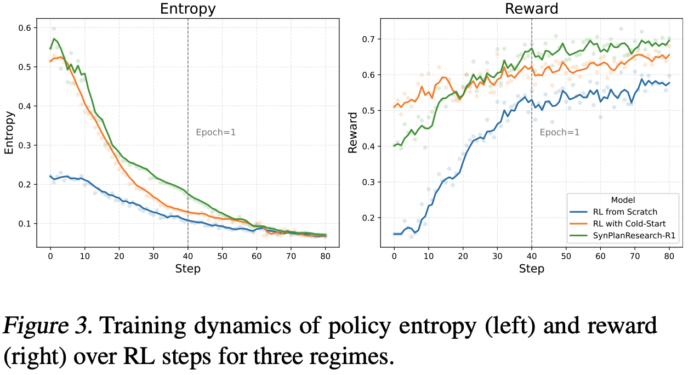

- **entropy**: SynPlanResearch-R1이 학습 내내 **일관되게 높은 entropy 유지** $\to$ 액션 분포가 넓게 유지되며 tool-use 패턴으로 조기 수렴하지 않음
- **reward**: 초반에는 naive SFT+RL보다 **오히려 뒤처짐**. 탐색이 많으니 초기 보상 축적이 느림. 하지만 장기적으로 역전해 최종적으로 전 방법 상회
  - naive SFT+RL은 일찍 plateau $\to$ 탐색 다양성 부족으로 local optimum 탈출 실패

## 6.5 Ablation

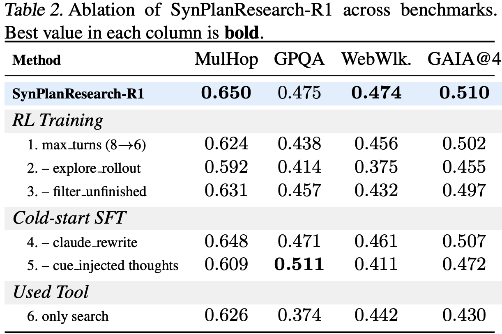

- **Row 2 (rollout temperature 1.0 $\to$ 0.6)가 가장 치명적**: WebWalkerQA $-9.9$pp, MulHop $-5.8$pp. RL 중 **탐색 다양성 유지가 전부**라는 결론
- **Row 5 (cue 제거)**: MulHop $-4.1$pp / WebWalkerQA $-6.3$pp / GAIA $-3.8$pp. cue 없으면 모델이 지정된 plan에서 이탈해 **얕은 탐색 패턴이 그대로 RL까지 전이**됨
  - 다만 **GPQA만은 0.511로 오히려 best**(+3.6pp). GPQA는 web 탐색보다 내부 지식 의존도가 높은 태스크라 깊은 탐색이 오히려 손해일 수 있다는 해석이 가능함 (논문에 명시적 설명은 없음)
- **Row 4 (Claude rewrite 제거)의 영향은 미미**($-0.2 \sim -1.3$pp) $\to$ 성능을 만드는 건 **문장 다듬기가 아니라 올바른 tool usage 유도**임
- **Row 6 (search 전용)**: GAIA $-8.0$pp, GPQA $-10.1$pp. webpage crawl이 복잡한 web reasoning에 필수
- Row 3은 void rollout을 negative example로 그냥 쓰는 경우 — 전반 하락, 학습 안정성 저하

## 6.6 Pre-training Statistics (합성 데이터 통계)

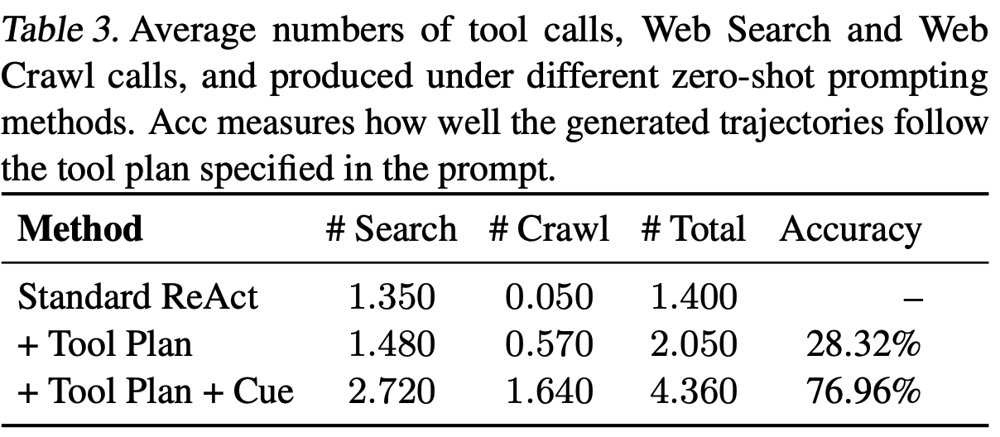

- **vanilla ReAct는 crawl을 사실상 안 씀**(질의당 0.05회). 저자들이 지적한 biased tool usage가 합성 단계에서부터 보임
- plan만 주면 총 tool call 1.40 $\to$ 2.05로 늘지만 **준수율은 28.32%**에 그침
- **cue를 추가하면 4.36회 / 76.96%**. 이게 이 논문의 핵심 숫자 — "plan은 필요조건이고, cue가 실행을 담보한다"

## 6.7 Case Study

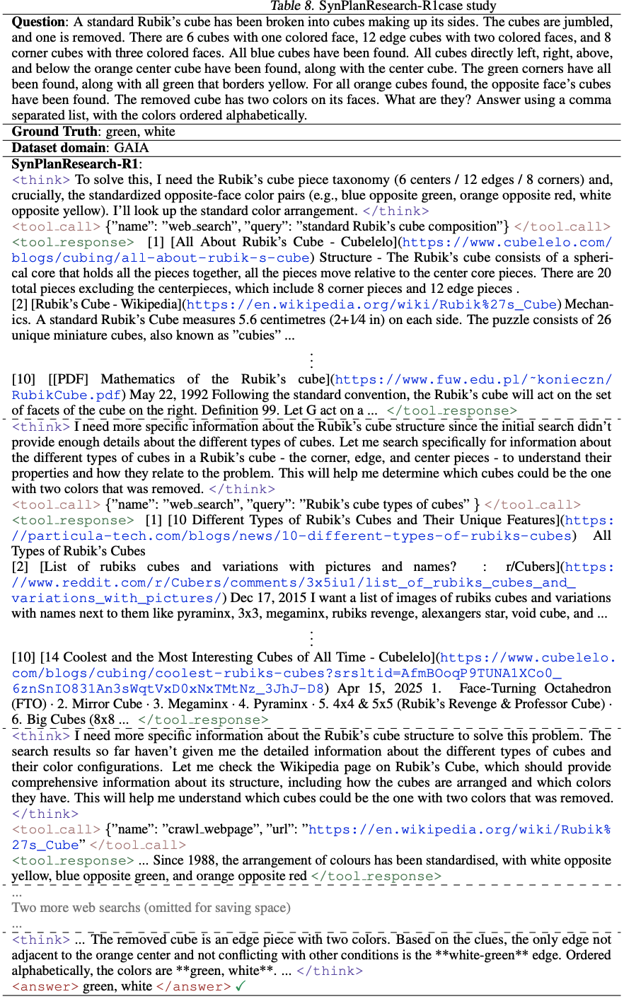

# 7. Conclusion & Limitations

- **결론**: RL 이전 단계인 cold-start SFT를 "**탐색 행동을 심는 자리**"로 재정의. 랜덤 tool plan + cue-injected thought로 합성한 데이터가 premature termination과 tool bias를 줄이고, 이후 RL의 성능 천장을 올림

**한계 / 비판적으로 볼 지점**

- **툴이 2개뿐**(`web_search`, `crawl_webpage`). plan 샘플링이 "0.5 확률 이항 선택"이라 **툴이 많아지면 랜덤 plan의 유효성이 급격히 떨어질** 가능성이 큼. 코드 실행/파일/멀티모달 툴이 섞인 실제 deep research 환경으로의 확장성은 미검증
- **cue가 수작업 템플릿 2개**. 액션 종류가 늘면 cue 설계가 그대로 수작업 부담이 됨. Claude rewrite ablation이 보여주듯 cue의 *언어적* 품질은 중요치 않으니, cue 자동 생성 여지는 있어 보임
- **"더 많은 tool call = 더 좋음"이 전제**. figure2의 선형 관계는 7개 벤치 범위 안의 관찰이고, Row 5에서 GPQA가 cue 제거 시 오히려 좋아진 건 이 전제가 **모든 태스크에 성립하진 않음**을 보여줌. 비용(latency·API) 대비 이득 분석은 없음
- **RL 80 step**으로 비교적 짧음. 세 regime의 reward 곡선이 아직 수렴 중으로 보여, 더 긴 학습에서 naive SFT+RL과의 격차가 유지되는지는 미확인
- 본문 ablation 서술의 델타 값(ex. "$-0.65$ on Multi-Hop QA")과 table2 수치가 스케일/자릿수에서 일치하지 않음 $\to$ 위 표는 **table2 원 수치에서 직접 계산한 pp**로 적었음
- 저자들이 밝힌 공개 범위는 코드뿐이며, 합성 데이터셋 자체의 공개 여부는 본문에 명시 없음

# Takeaways

- **cold-start SFT는 "정답 맞추는 법"이 아니라 "탐색하는 습관"을 가르치는 단계로 쓰는 게 이득이 크다.** RLVR은 on-policy라 초기화가 준 탐색 분포를 벗어나지 못한다
- plan을 **액션 레벨로 강제하지 말고 thought prefix(cue)로 soft하게 유도**하라 — plan만 주면 준수율 28%, cue 추가 시 77%
- RL 중 **rollout temperature를 낮추는 건 최악의 선택**(ablation 최대 하락폭). 탐색 다양성 유지가 성능의 실질 driver
- 합성 데이터 품질에서 중요한 건 **문장 자연스러움이 아니라 tool usage 패턴의 다양성**. Claude rewrite 제거는 거의 영향 없음
- multi-turn RL 실무 팁: 잘린 rollout(void turn)은 **advantage 통계에는 남기고 gradient는 죽이기**, JSON 스키마 위반은 reflection 없이 즉시 종료
