# [Agent] ToolRL: Reward is All Tool Learning Needs

- paper: https://arxiv.org/pdf/2504.13958
- github: https://github.com/qiancheng0/ToolRL
- NeurIPS 2025 accepted(인용수: 460회, 26-11-10 기준)
- 저자: Cheng Qian, Emre Can Acikgoz, Qi He, Hongru Wang, Xiusi Chen, Dilek Hakkani-Tür, Gokhan Tur, Heng Ji
  - University of Illinois Urbana-Champaign

- downstream task: Tool-Integrated Reasoning (TIR) — tool selection + application
  - 주어진 tool set에서 적절한 tool을 고르고, 파라미터까지 채워 multi-step으로 호출하며 답을 만드는 테스크
- 주요 용어
  - **TIR (Tool-Integrated Reasoning)**: reasoning 궤적 안에 외부 tool 호출을 끼워넣는 과정. 궤적은 $s_k = (r_1, \mathcal{T}_1, o_1), \dots, (r_k, \mathcal{T}_k, o_k)$ 로 정의되고, 각 스텝에서 reasoning $r_{k+1}$ + tool subset $\mathcal{T}_{k+1} \subseteq \mathcal{T}$ 를 생성
  - **Format reward** $\mathcal{R}_{\text{format}} \in \{0,1\}$: `<think>` / `<tool_call>` / `<response>` 특수 토큰이 요구된 순서로 모두 등장하는지만 보는 이진 보상
  - **Correctness reward** $\mathcal{R}_{\text{correct}} \in [-3,3]$: 예측 tool call 집합 $P$ 와 ground-truth $G$ 를 tool name / parameter name / parameter content 세 층위로 쪼개 매칭한 점수
  - **Reward granularity**: correctness를 몇 개 성분으로 분해하는지. 가장 잘게 쪼갠 것(원본)부터 전부 묶어 exact match 하나로 본 Coarse까지
  - **Dynamic reward scaling**: 학습 진행도 $p \in [0,1]$ 에 따라 format과 correctness의 보상 스케일을 연속적으로 옮기는 스케줄

# 1. Motivation

- tool use 능력은 대부분 **SFT**로 학습됨. 오프라인으로 만든 tool-integrated 궤적을 모방하는 방식

  - 문제: 특정 패턴에 overfit 되고, 처음 보는 tool / 복잡한 조합에 일반화가 안 됨
  - figure1의 예시가 직설적임. "SFO ~ LAX 거리"를 물었는데 tool list에는 `get_date` 밖에 없는 상황
    - SFT 모델(R1 long thought distill): "But wait, maybe there's a misunderstanding... maybe the tool can still be used" 라며 **over-interpret** 하고 결국 `get_date`를 억지로 호출
    - GRPO 모델: "`get_date` is not suitable for calculating the distance" 라며 깔끔하게 거절
  - 즉 SFT는 "but wait" 같은 deep-thinking의 **표면 신호만 흉내**낼 뿐, 실제로 깊게 생각하지 않음

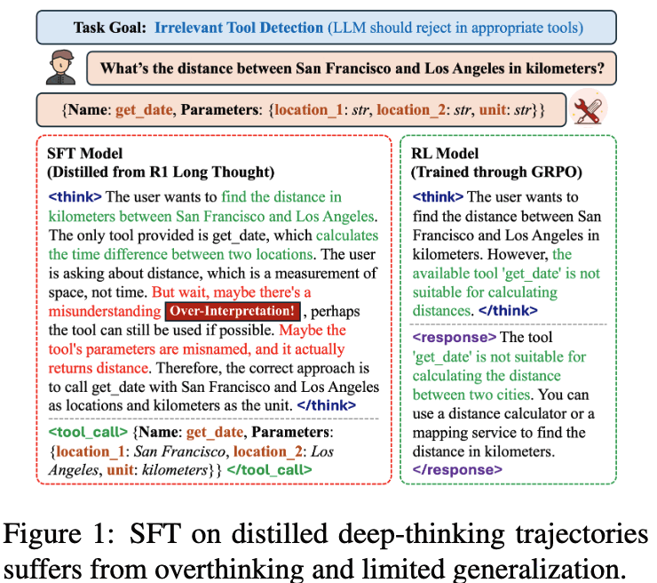

SFT가 distilled deep-thinking 궤적을 따라하다 overthinking + 부적절한 tool 수용으로 빠지는 예시

- 그렇다고 RL을 붙이자니, TIR는 math처럼 정답 하나로 환원되지 않음

  - 한 턴에 여러 tool이 동시에 호출될 수 있고, 각 tool마다 파라미터 스키마가 다름
  - 기존 연구의 보상은 **answer matching 수준의 coarse signal** 이라 "tool 이름은 맞췄는데 파라미터 하나가 틀림" 같은 부분 정답을 구분하지 못함
  - Search-R1, TORL 등 선행 RL 연구는 search / code 같은 **단일 tool 도메인에 한정**됨

  $\to$ (Research Question) general-purpose tool use에 맞는 reward는 어떻게 설계해야 하는가? type / scale / granularity / dynamics 네 축을 전부 뜯어보자

# 2. Contribution

- **TIR를 위한 principled reward 설계 제안**: $\mathcal{R}_{\text{final}} = \mathcal{R}_{\text{format}} + \mathcal{R}_{\text{correct}} \in [-3, 4]$
  - correctness를 tool name / parameter name / parameter content 3단으로 분해해 **부분 정답을 점수화**
  - algorithm-agnostic. GRPO와 PPO 양쪽에 붙여 검증
- **4개 축의 체계적 ablation**: reward type(length 추가 여부), scale(format vs correctness 비중), granularity(분해 정도), dynamics(시간에 따른 스케일 변화)
- **성능**: base 모델 대비 **+17%**, SFT 모델 대비 **+15%** (BFCL / API-Bank / Bamboogle 평균)
  - Qwen2.5-7B BFCL Overall 41.97% $\to$ **55.38%**
  - SFT를 거치지 않은 **cold start GRPO**가 SFT 초기화 RL보다 일관되게 좋음
- **세 가지 Takeaway**
  1. reasoning trace가 길다고 좋은 게 아님. length reward는 오히려 해가 될 수 있음
  2. reward scale은 급격히 바꾸는 것보다 **점진적으로** 옮기는 게 좋음
  3. fine-grained reward decomposition이 coarse보다 확실히 낫다

# 3. Related Works

## 3.1 Tool-Integrated Reasoning

- Toolformer, ToolLLM, Gorilla 등이 LLM에 외부 tool을 붙이는 흐름을 열었고, BFCL / API-Bank / ToolLLM이 평가 축을 만듦
- 데이터 측면에서는 ToolACE, Hammer, xLAM 등이 고품질 tool use 데이터셋을 구축
- RL 측면에서는 Search-R1(정보검색), TORL(math tool)이 있으나 **단일 도메인**에 묶여 있음

## 3.2 RL for LLMs

- RLHF $\to$ PPO $\to$ DPO / SimPO / GRPO 로 이어지는 흐름
- GRPO는 critic을 group-based 평가로 대체해 math, search, code generation에서 강세
- 본 논문은 GRPO를 **general tool use**로 확장. 단, KL penalty 항을 **제거**해 커스텀 포맷/보상에 더 자유롭게 적응하도록 함 ($\to$ 수렴이 빨라지고 파이프라인이 단순해짐)

# 4. Method

## 4.1 Task Definition

- tool set $\mathcal{T} = \{t_1, \dots, t_n\}$ 와 질의 $Q$ 가 주어짐
- policy $\pi: s_k \to (r_{k+1}, \mathcal{T}_{k+1})$, 각 스텝의 목표는 immediate reward 최대화

$$\mathcal{T}^*_{k+1} = \arg\max_{\mathcal{T}_{k+1} \subseteq \mathcal{T}} R(s_k, \mathcal{T}_{k+1}, o_{k+1})$$

- 정책은 암묵적으로 궤적 전체의 누적 보상을 최대화함: $\max_\pi \mathbb{E}_\pi [\sum_{k=1}^K R(s_k, \mathcal{T}_{k+1}, o_{k+1})]$
- QA와 달리 **step-wise ground truth tool call**이 있으므로 dense intermediate feedback이 가능하다는 점이 핵심 전제

## 4.2 TIR Rollout

- system prompt가 `<think>` / `<tool_call>` / `<response>` 세 특수 토큰 사용을 강제
  - `<tool_call>` 안에는 `{"name": ..., "parameters": {...}}` JSON 객체를 (여러 개 가능) 넣음
  - `<tool_call>` 과 `<response>` 는 **배타적이지 않음**. 한 출력에 둘 다 나올 수 있음
- `<tool_call>` 이 감지되면 파싱 $\to$ 실행 $\to$ 결과를 `<obs>` 필드로 dialogue history에 append
- multi-step 궤적은 학습 시 **single-step 인스턴스로 분해**하고, 이전 대화 이력을 user prompt에 주입하는 방식으로 다룸

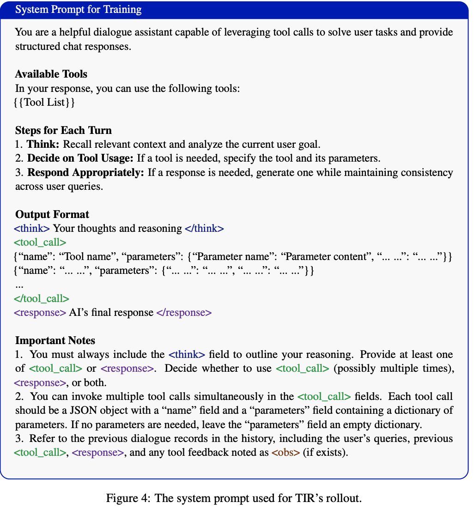

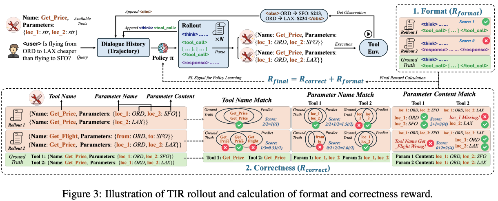

## 4.3 Reward Design

**Format Reward.** 필요한 필드가 모두, 올바른 순서로 등장하면 1, 아니면 0.

$$\mathcal{R}_{\text{format}} = \begin{cases} 1, & \text{필수 필드가 전부 올바른 순서로 등장} \\ 0, & \text{otherwise} \end{cases}$$

**Correctness Reward.** 예측 $P = \{P_1, ..., P_m\}$ 과 정답 $G = \{G_1, ..., G_n\}$ 을 3층으로 매칭.

- **Tool Name Matching** — 이름 집합의 Jaccard 유사도

$$r_{\text{name}} = \frac{|N_G \cap N_P|}{|N_G \cup N_P|} \in [0,1]$$

- **Parameter Name Matching** — 매칭된 tool별 파라미터 키 집합의 Jaccard 합

$$r_{\text{param}} = \sum_{G_j \in G} \frac{|\text{keys}(P_G) \cap \text{keys}(P_P)|}{|\text{keys}(P_G) \cup \text{keys}(P_P)|} \in [0, |G|]$$

- **Parameter Content Matching** — 값까지 일치하는 키 개수

$$r_{\text{value}} = \sum_{G_j \in G} \sum_{k \in \text{keys}(G_j)} \mathbb{1}[P_G[k] = P_P[k]]$$

- 세 성분의 합 $r_{\text{match}} = r_{\text{name}} + r_{\text{param}} + r_{\text{value}} \in [0, S_{\max}]$, 여기서 $S_{\max} = 1 + |G| + \sum_{G_j \in G}|\text{keys}(G_j)|$
- $P$ 와 $G$ 사이 **optimal matching**으로 총점 $R_{\max}$ 를 구한 뒤 $[-3,3]$ 으로 정규화

$$\mathcal{R}_{\text{correct}} = 6 \cdot \frac{R_{\max}}{S_{\max}} - 3 \in [-3, 3]$$

- 최종 $\mathcal{R}_{\text{final}} = \mathcal{R}_{\text{format}} + \mathcal{R}_{\text{correct}} \in [-3, 4]$
  - 설계 의도: **structural compliance와 semantic correctness를 분리**하고, correctness에 더 큰 스케일을 줘서 format hacking을 막음

## 4.4 GRPO

- 질의 $Q$ 의 롤아웃 그룹 $G_Q = \{A, (s_1, r_1), \dots, (s_n, r_n)\}$ 에서 group-wise normalized advantage 계산

$$A_i(s_i|Q) = \frac{r_i - \mu_Q}{\sigma_Q + \eta}$$

- 목적함수는 표준 clipped PPO objective에 위 advantage를 꽂은 형태
- **KL penalty 항은 제거** — 커스텀 포맷/보상에 자유롭게 적응하게 하기 위함. 실제로 수렴이 빨라지고 성능은 동등

# 5. Experiments

## 5.1 Setup

- **학습 데이터**: ToolACE 2K + Hammer(Masked) 1K + xLAM 1K = **4K**
  - Hammer(Masked)는 tool/parameter 이름을 랜덤화해 **설명문에 의존하도록** 강제하는 서브셋
  - appendix에서 "4K를 넘겨도 수렴/최종 성능이 눈에 띄게 좋아지지 않았다"고 밝힘 (동일 분포 샘플이라 diversity가 늘지 않음)
- **모델**: Qwen2.5-Instruct 1.5B / 3B / 7B, Llama-3.2-3B-Instruct
- **학습**: veRL, A100 80G ×2, batch 512, query당 4 rollout, 15 epoch, lr 1e-6, KL loss 미사용, temperature 1.0
- **평가**: BFCL V3 / API-Bank(73 tools, 3 레벨) / Bamboogle(multi-hop QA, web search tool)
- **베이스라인**: Raw Instruct, SFT on RL Data (400 또는 4K), GRPO on SFT Model, PPO (cold start + SFT init)
  - SFT용 thought 내용은 **DeepSeek-R1 궤적에서 distill**. GRPO는 tool call만 보상에 쓰므로 ground-truth thought가 불필요

## 5.2 Main Results

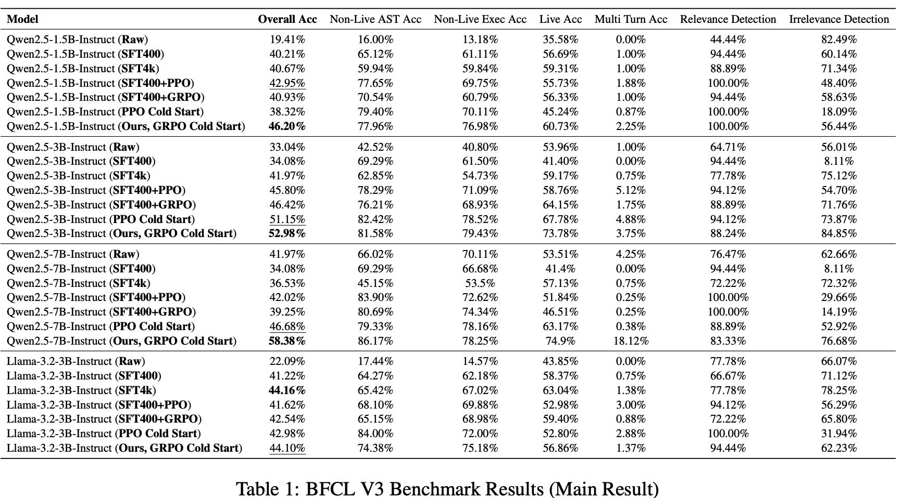

BFCL V3 메인 결과 — Overall / Non-Live AST / Non-Live Exec / Live / Multi Turn / Relevance / Irrelevance Detection

- 7B가 가장 극적임. Raw 41.97 $\to$ 55.38 (**+13.41pp**), 특히 **Multi Turn Acc 4.25 $\to$ 18.12%**
- Llama-3.2-3B만 SFT4k(44.16)에 아주 근소하게 뒤짐(44.10). 저자들은 "GRPO식 일반화에 대한 적응력이 낮은 듯"이라 설명하고, API-Bank에서는 여전히 최고라고 덧붙임
- SFT4k가 Raw보다 나쁜 경우(7B: 41.97 $\to$ 36.53)가 있다는 점이 SFT overfitting 주장을 뒷받침

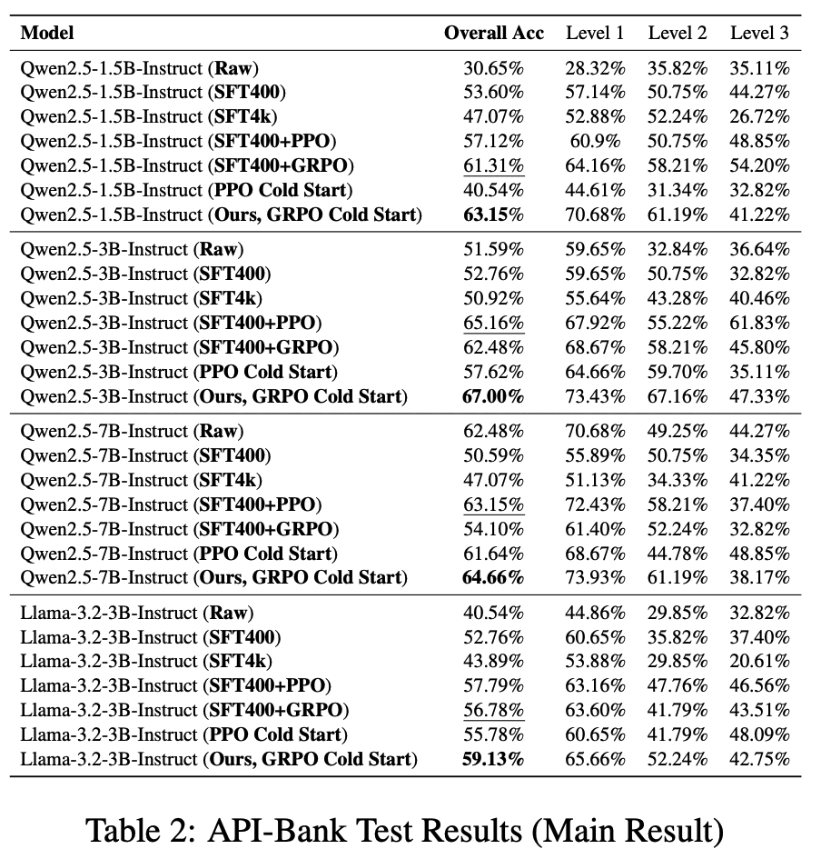

- API-Bank Overall: 1.5B 30.65 $\to$ **63.15**, 3B 51.59 $\to$ **67.00**, 7B 62.48 $\to$ **64.66**, Llama-3B 40.54 $\to$ **59.13**
  - 다만 Level 3(가장 어려움)에서는 Ours가 최고가 아닌 경우가 많음 (7B: PPO Cold 48.85 > Ours 38.17)

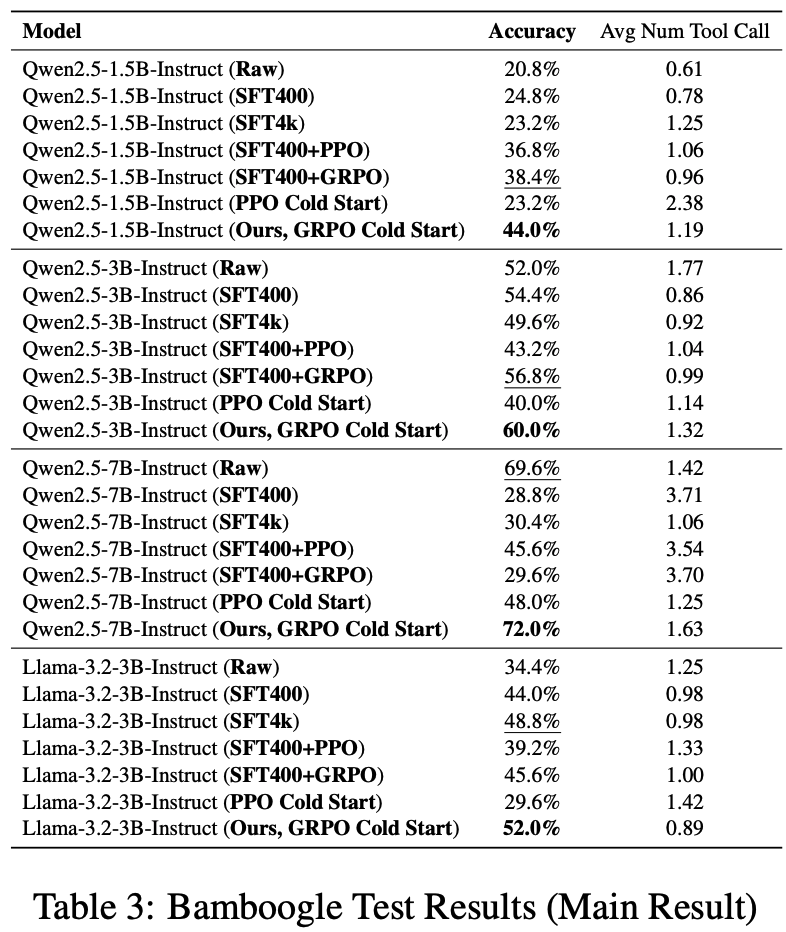

- **Free-form inference**: Bamboogle은 tool call 파라미터에 제약이 없고 **최종 답만** 채점하는 goal-oriented 세팅. 즉 학습 분포 밖
  - 1.5B 20.8 $\to$ **44.0%**, 3B 52.0 $\to$ **60.0%**, 7B 69.6 $\to$ **72.0%**, Llama-3B 34.4 $\to$ **52.0%**
  - 주목할 점은 **tool call 수가 늘지 않았다는 것**. 7B Raw는 SFT 계열에서 3.5~3.7회씩 호출하는데 Ours는 1.63회로 더 높은 정확도 달성 $\to$ 남발이 아니라 필요할 때만 쓴다

## 5.3 SFT Initialization Impacts

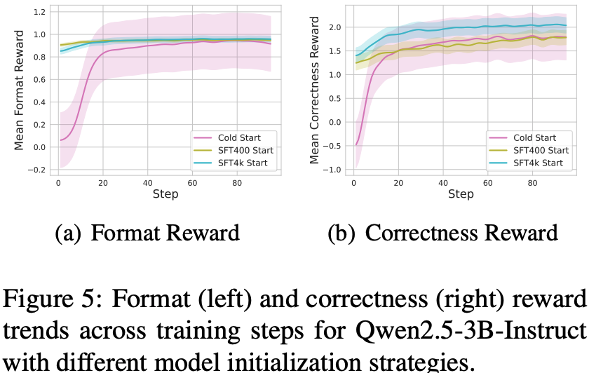

초기화 전략별 format/correctness reward 추이 — Cold Start vs SFT400 Start vs SFT4k Start

- SFT 초기화 모델은 **학습 중 reward는 더 높게** 나옴 (SFT와 RL 데이터 분포가 정렬되어 있으므로)
- 그런데 **벤치마크 일반화는 더 나쁨**. cold start GRPO가 일관되게 이김
- 저자 해석: SFT 초기화가 memorization/overfitting을 유발해 GRPO의 일반화 효과를 깎음
  - $\to$ **학습 reward가 높다고 일반화가 좋은 게 아니다**

## 5.4 Reward Design on PPO

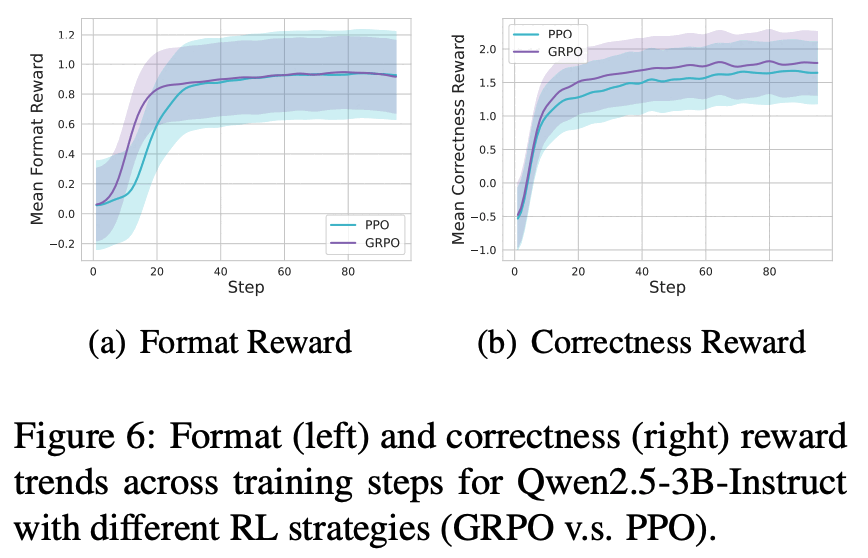

- 같은 reward 설계를 PPO에 붙이면 cold start PPO도 SFT를 이기는 경우가 있으나 **모델별 편차가 큼**
- GRPO는 cold start에서도 더 높은 reward에 더 빨리 도달
- 흥미로운 비대칭: **PPO는 SFT 초기화가 유리**, **GRPO는 cold start가 유리**

## 5.5 Generalization Studies

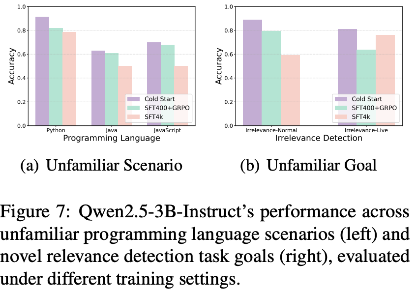

unseen programming language / novel irrelevance detection goal에서의 Qwen2.5-3B 성능

- 학습에 없던 **프로그래밍 언어**(Java, JavaScript)와 **irrelevant tool detection** 과제 둘 다에서 cold start GRPO가 최고
- table4에 정성 예시 2개 — 둘 다 "tool을 안 쓰는" 선택을 한 사례
  1. 영화 티켓 예매에서 영화명/상영일이 없자 **호출 대신 되물음** (proactiveness)
  2. 수학 문제에서 `find_critical_points`가 무관함을 인지하고 **직접 답변** (metacognition)

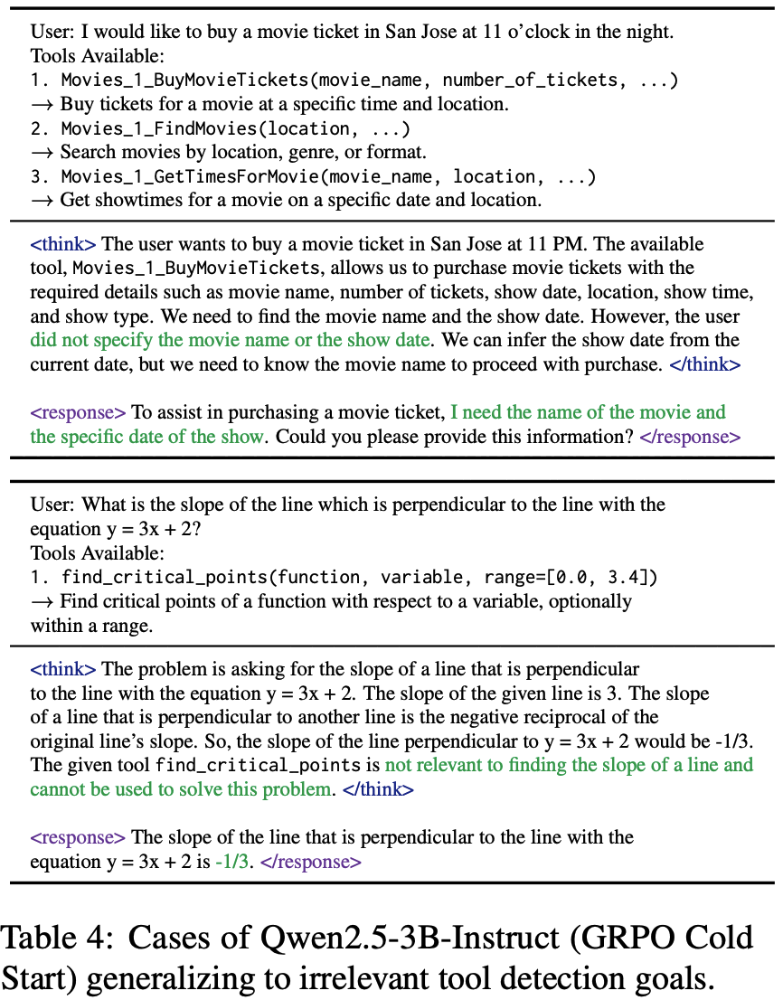

irrelevant tool detection으로 일반화된 정성 사례 2건

# 6. Analysis — 네 축의 Ablation

## 6.1 Reward Type: Length Reward

- $\mathcal{R}_{\text{length}} = \min(L_{\text{think}} / L_{\text{target}}, 1)$, $L_{\text{target}} = 512$ 로 설정해 긴 사고를 유도

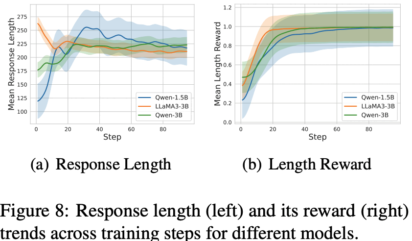

length reward 적용 시 response length와 length reward 추이

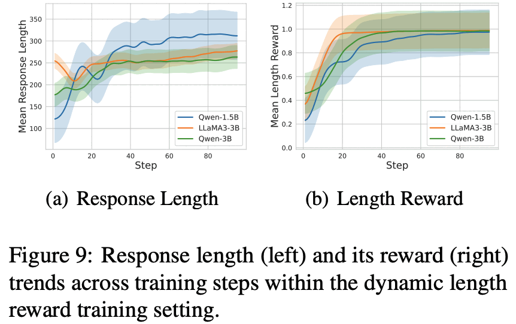

dynamic length reward 세팅에서의 length 추이

- **dynamic 버전**도 실험: $\mathcal{R}_{\text{dynamic}} = \min\left(\frac{L_{\text{think}}}{L_{\text{target}} \cdot (1+p)}, 1\right)$, $p$ 는 학습 진행도

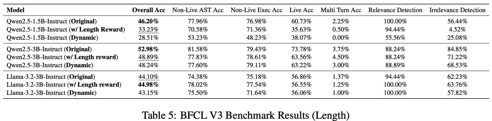

length reward 유무/방식에 따른 BFCL V3 결과

- 길이는 확실히 늘어나는데 **성능은 떨어짐**. 특히 작은 모델에서 치명적 (1.5B: 46.20 $\to$ 33.23, **-12.97pp**)
- Irrelevance Detection이 1.5B에서 56.44 $\to$ 4.52%로 붕괴 — 길게 생각하다 결국 쓸데없는 tool을 받아들임

> **Takeaway 1**: length reward는 더 긴 reasoning을 유도하지만 성능을 일관되게 올리지 못하고, 작은 모델에서는 오히려 해친다. tool use에서 긴 reasoning은 본질적으로 좋은 게 아니다.

## 6.2 Reward Scale

- **Equal Max**: correctness를 format과 같은 $[-1,1]$ 로 맞춤 $\to$ $\mathcal{R}_{\text{correct}} = 2 \cdot \frac{R_{\max}}{S_{\max}} - 1$
- **Two stage (Coarse)**: $s=30$ 스텝까지는 correctness를 1/3로 줄이고 format을 $[0,1]$ 유지. 이후 correctness를 $[-3,3]$ 복원하고 format을 $[0,0.5]$ 로 축소
- **Dynamic (Finegrained)**: 연속 보간. $\text{Scale}_{\text{format}} = [-2+p, 2-p]$, $\text{Scale}_{\text{correct}} = [-2-p, 2+p]$

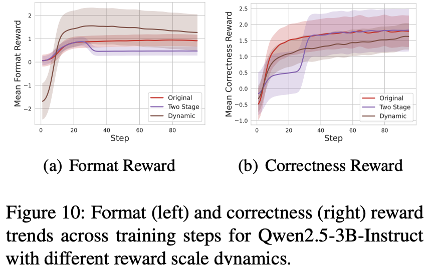

reward scale dynamics별 format/correctness reward 추이

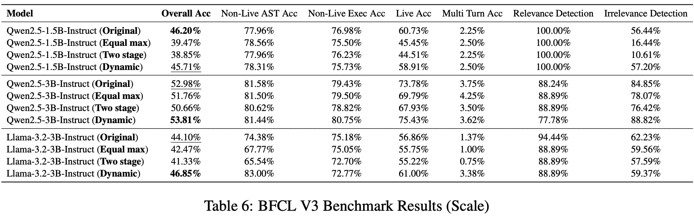

reward scale 변형별 BFCL V3 결과

- correctness를 format과 동급으로 맞추면(Equal max) 대체로 하락 $\to$ **correctness에 더 큰 가중치를 주는 게 맞다**
- **Two stage는 오히려 떨어지고 Dynamic은 개선** — 급격한 스케일 전환이 training dynamics를 망침

> **Takeaway 2**: reward scale은 급변보다 **점진적 전환**이 학습과 일반화를 더 잘 뒷받침한다. 쉬운 목표(format)에서 어려운 목표(correctness)로 부드럽게 옮겨가야 한다.

## 6.3 Reward Granularity

- correctness를 점점 뭉쳐가며 3가지 변형 비교
  - **Finegrained**: tool name과 parameter name에 **exact match** 강제 ($r_{\text{name}} = \mathbb{1}[N_G = N_P]$)
  - **Intermediate**: parameter name과 value를 하나로 합쳐 파라미터 dict 전체 exact match
  - **Coarse**: 이름·키·값 전부 엮어 tool set 전체가 정확히 일치할 때만 보상 ($\mathbb{1}[G = P]$)

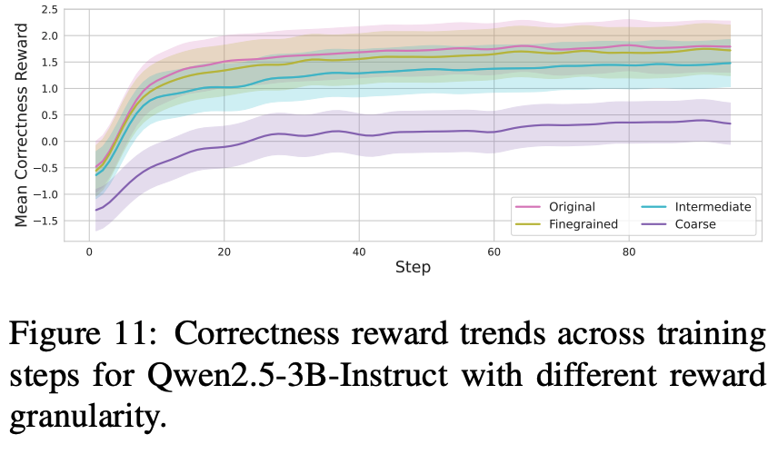

granularity별 correctness reward 추이 — 거칠수록 reward 상승이 느림

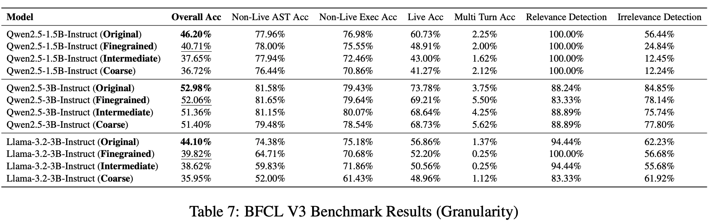

granularity별 BFCL V3 결과

- **모든 모델에서 원본(가장 잘게 쪼갠 설계)이 최고**, 거칠어질수록 단조 하락
- 용어 주의: 여기서 "Finegrained"는 exact-match를 끼운 변형이라 **원본보다 더 거친** 쪽에 가까움. 원본이 partial credit을 가장 많이 주는 설계
- Coarse일수록 학습 중 reward 자체가 잘 안 오름 $\to$ sparse credit assignment 문제

> **Takeaway 3**: fine-grained reward decomposition이 더 풍부한 학습 신호를 주며, coarse 보상은 학습 진전을 막고 최종 성능을 떨어뜨린다.

# 7. Conclusion & Limitations

- **결론**: TIR에 맞춘 reward 설계 하나로 cold start GRPO가 SFT, SFT+RL, PPO를 전반적으로 이김. QA 세팅으로도 일반화되며 proactiveness / metacognition 같은 창발적 행동이 관찰됨
- **저자가 명시한 한계**는 별도 Limitations 섹션 없이 본문에 흩어져 있음
  - Llama-3.2-3B는 BFCL에서 SFT4k(44.16)를 넘지 못함 — "GRPO식 일반화에 대한 적응력이 낮다"는 가설만 제시
  - length reward 실험에서 Llama만 반대 경향(44.98로 개선) — 모델 계열별 일관성이 없음
  - 학습 데이터 4K가 전부 동일 분포(ToolACE/Hammer/xLAM) 샘플이라 **더 키워도 이득이 없었다**고 인정 — 데이터 다양성 축은 미탐색
  - API-Bank Level 3처럼 가장 어려운 난이도에서는 PPO cold start에 뒤지는 경우 존재
- **리뷰어 관점에서 추가로 걸리는 점**
  - "+17% / +15%"는 여러 벤치마크를 섞은 상대 수치. 테이블별로 보면 7B BFCL(+13.41pp)처럼 큰 곳과 7B API-Bank(+2.18pp)처럼 작은 곳의 편차가 큼
  - correctness reward가 **ground-truth tool call을 요구**하므로, 정답 궤적이 없는 실제 환경으로 바로 옮기기 어려움 (Bamboogle 결과가 이 간극을 메우려는 시도)
  - 7B가 최대 규모. "reward is all you need"라는 주장을 더 큰 모델에서 검증하지 않음

# Takeaways

- tool use RL의 병목은 알고리즘이 아니라 **reward granularity**다. name / param key / param value 3단 분해만으로 coarse exact-match 대비 BFCL에서 최대 10pp 가까이 벌어짐
- **SFT 초기화는 RL의 일반화를 깎는다.** 학습 reward는 SFT-init이 더 높지만 벤치마크는 cold start가 이김 — reward curve를 성능 지표로 읽으면 안 됨
- **길게 생각하게 만드는 보상은 tool use에서 역효과**. math/reasoning의 직관을 그대로 가져오면 안 되고, 작은 모델일수록 피해가 큼
- reward scale은 **스케줄링하되 부드럽게**. 30스텝에서 뚝 바꾸는 two-stage는 오히려 손해
- PPO는 SFT init, GRPO는 cold start가 유리하다는 비대칭이 있음 — 알고리즘 바꿀 때 초기화 전략도 같이 재검토해야 함
