# [Agent] RAGEN-2: Reasoning Collapse in Agentic RL

- paper: https://arxiv.org/pdf/2604.06268
- webpage: https://ragen-ai.github.io/v2/
- ICLR 2026 accepted (oral, 인용수: 3회, '26-11-10 기준)
- 저자: Zihan Wang†\*, Chi Gui†, Xing Jin†, Qineng Wang†, Licheng Liu† 외 (Northwestern / UIUC / Imperial / Oxford / UW / Microsoft / Stanford), 교신 Manling Li
  - † core contributor, \* project lead. [RAGEN](https://arxiv.org/abs/2504.20073) 후속 논문
- downstream task: Multi-turn LLM agent RL의 **학습 진단(diagnosis) 및 안정화**
  - closed-loop 환경에서 rollout $\to$ update를 반복하는 agent RL에서, reasoning이 조용히 망가지는 현상을 측정하고 고침
- 주요 용어
  - **Template Collapse**: reasoning이 **입력별로는 다양해 보이지만 입력이 바뀌어도 거의 동일한** 보일러플레이트로 수렴하는 실패 모드. $H(Z|X)$는 높은데 $I(X;Z)$만 무너지므로 entropy 모니터링에 **잡히지 않음**
  - **Reasoning 분해**: $H(Z) = I(X;Z) + H(Z|X)$. $H(Z|X)$ = within-input diversity(기존 entropy 지표가 보는 것), $I(X;Z)$ = cross-input distinguishability(입력 의존성)
  - **MI proxy (In-Batch Cross-Scoring)**: 배치 안의 모든 $(Z_{i,k}, X_j)$ 쌍에 teacher-forced log-likelihood $\mathcal{L}_{i,k,j} = \log p_\theta(Z_{i,k} \mid X_j)$를 매겨 만든 행렬로 $I(X;Z)$를 추정. **추가 모델·추가 inference 불필요**
  - **SNR (Signal-to-Noise Ratio) 관점**: $g_{\text{total}} = g_{\text{signal}} + g_{\text{task-noise}} + g_{\text{reg}}$. reward variance가 낮으면 $g_{\text{task}}\to 0$인데 $g_{\text{reg}}$(KL/entropy)는 그대로 $\to$ 입력 무관한 방향이 업데이트를 지배
  - **SNR-Aware Filtering**: 매 iteration마다 prompt별 within-input reward variance $\widehat{\mathrm{Var}}(R\mid X)$를 계산해 **variance mass 기준 top-$p$** prompt만 남겨 업데이트

# 1. Motivation

- multi-turn agent RL은 본질적으로 불안정함. 그래서 두 지표를 본다
  - **reward** $\to$ outcome stability
  - **entropy** $\to$ reasoning process stability
- 그런데 entropy는 reasoning 품질의 지표로서 **모호함**
  - entropy가 **내려가면**: 태스크에 특화되어 확신이 생긴 정상적 수렴일 수 있음
  - entropy가 **높게 유지되면**: 안전한 게 아님. 같은 입력 안에서는 다양해 보이지만 **입력이 바뀌어도 사실상 동일한** 템플릿으로 흐를 수 있음

좌: input-driven reasoning vs templated reasoning 예시 / 우: $H(Z|X)$–$I(X;Z)$ 두 축으로 나눈 네 가지 reasoning regime

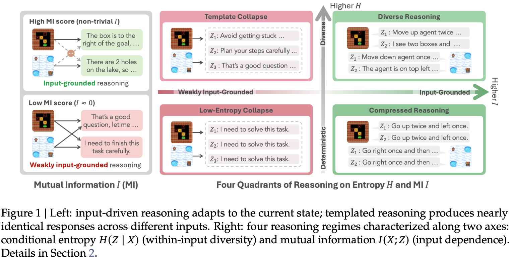

- 정보이론적으로 보면 당연한 이야기임

  $$H(Z) = I(X;Z) + H(Z|X)$$

  - 기존 entropy 지표는 **$H(Z|X)$만** 대리함
  - 따라서 $H(Z|X)$가 높게 유지된 채 $I(X;Z)$가 0으로 떨어지는 경로가 **완전한 사각지대**
  - 저자들은 이걸 **template collapse**라 명명

- 네 가지 regime
  1. **Diverse Reasoning** (high $H(Z|X)$, high $I(X;Z)$): 원하는 상태
  2. **Template Collapse** (high $H(Z|X)$, **low $I(X;Z)$**): 겉보기 다양하지만 입력 무관 $\to$ 기존 지표의 사각지대
  3. **Compressed Reasoning** (low $H(Z|X)$, high $I(X;Z)$): 입력엔 충실하지만 지나치게 결정적
  4. **Low-Entropy Collapse** (low, low): 완전 degenerate

- multi-turn에서 특히 위험함
  - sparse reward는 "입력에 반응한 reasoning"과 "우연히 성공한 템플릿"을 **구분하지 못함**
  - reasoning chain 자체는 직접 supervise하기 어려움
  - $\to$ 학습 내내 **들키지 않고** 지속됨

  $\to$ (Research Question) **(Q1) 어떻게 진단할 것인가? (Q2) 왜 일어나는가?**

# 2. Contribution

- **Template collapse 식별 + MI proxy 제안**
  - reasoning이 입력에 무관해지는 실패 모드를 정의하고, **외부 모델 없이** 학습 rollout만으로 탐지하는 mutual information proxy family를 제안
  - MI는 최종 성능과 Spearman **+0.39**(Trajectory MI-ZScore)로 상관하는 반면, entropy 계열은 **−0.11 ~ −0.14**로 오히려 **방향이 반대**
- **SNR 메커니즘으로 설명**
  - 낮은 reward variance $\to$ task gradient 약화 / input-agnostic regularization(KL·entropy)은 **그대로** $\to$ 입력 의존성 소거
  - reward-variance 버킷별 gradient 분해 증거 + 이론 bound $\lVert g_{\text{task}}\rVert \le \sqrt{\widehat{\mathrm{Var}}(R\mid X)}\cdot C$ 제시
- **SNR-Aware Filtering 제안**
  - 업데이트 전에 reward variance 기준 top-$p$ prompt만 남김. 추가 rollout·모델 **불필요**
  - 4개 태스크 × 4개 RL 알고리즘 × 0.5B~7B 스케일 × 텍스트/이미지 modality 전부에서 평균 성능 향상
  - 게다가 업데이트에 들어가는 group이 줄어 **step time 26~41% 감소**

# 3. Related Works

## 3.1 Reasoning collapse / policy degeneracy

- LLM agent RL에서 보고된 collapse들: rationale이 템플릿화되며 입력 대응이 약해지는 **reasoning collapse**, 재현하기 쉬운 패턴으로 행동이 몰리는 **policy-level degeneracy**
- self-training의 model collapse와 궤를 같이함 — 평균 지표는 멀쩡해 보여도 내부가 무너짐

## 3.2 Reasoning diversity / input dependence 평가

- 기존 diversity 지표: lexical overlap, embedding dispersion, uncertainty 분석
  - 공통 한계: **within-input variability만** 포착하고 cross-input shift를 놓침
- input dependence probing: behavioral test, contrast set, retrieval-style matching, prompt reconstruction
- reasoning faithfulness: 설명이 실제 결정 근거를 반영하는가
  - RAGEN-2의 질문은 다름 $\to$ **RL 이후 reasoning이 점점 입력에 둔감해지는가**

## 3.3 Multi-turn Agent RL 안정화

- KL control, entropy regularization, clipping, reward shaping, curriculum, replay mixture, stepwise reward, self-correction 등
- 한계: 이들은 **optimization collapse 방지 / 총 reward 개선**에 맞춰져 있어, 같은 prompt의 rollout이 전부 비슷한 reward를 받는 상황에서 **prompt-agnostic 템플릿으로의 drift를 막지 못함**

# 4. 진단: Mutual Information Proxy (Q1)

## 4.1 In-Batch Cross-Scoring

- 직관: $I(X;Z)$는 **reasoning $Z$를 보고 어떤 입력 $X$에서 나왔는지 얼마나 알 수 있는가**
  - collapse했다면 $Z_i$는 다른 입력 $X_j$ 아래에서도 똑같이 그럴듯함 $\to$ 식별 불가
- $P$개 prompt × $G$개 샘플에 대해 scoring matrix $\mathcal{L}_{i,k,j} = \log p_\theta(Z_{i,k}\mid X_j)$ 계산 후 두 값을 뽑음

  $$\text{matched}_{i,k} = \frac{\mathcal{L}_{i,k,i}}{|Z_{i,k}|}, \quad \text{marginal}_{i,k} = \frac{1}{|Z_{i,k}|}\log\frac{1}{P}\sum_j \exp(\mathcal{L}_{i,k,j})$$

- **두 대표 proxy**
  1. **Retrieval-Acc** (discrete, 해석 쉬움): $\text{Acc} = \frac{1}{PG}\sum_{i,k}\mathbb{I}[i = \arg\max_j \mathcal{L}_{i,k,j}]$
     - collapse 시 chance level $1/P$로 수렴 ($P{=}64$일 때 **1.56%**) $\to$ **절대 기준점**이 생김
     - **reasoning**이 **원래 입력에서 가장 높은 점수를 받는 비율**입니다. 최대는 \(1\)(\(100\%\))이고, 입력과 reasoning의 관계가 사라지면 우연히 맞히는 수준인 \(1/P\)에 가까워집니다.
  2. **MI-ZScore-EMA** (continuous, robust): $\hat I(X;Z) = \frac{1}{PG}\sum_{i,k}(\text{matched}_{i,k} - \text{marginal}_{i,k})$ 에 z-score + EMA ($\epsilon = 10^{-3}$, $\alpha = 0.9$)
     - collapse 시 matched $\approx$ marginal $\to$ 0으로 수렴
     - **reasoning**이 **자기 입력에 다른 입력보다 얼마나 더 잘 맞는지 측정**하고, **점수를 정규화·평활화한 지표**입니다. 입력 의존성이 사라지면 \(0\)에 가까워집니다.
  
- proxy variant는 ① turn scope(first-turn only vs trajectory-uniform) ② aggregation(discrete retrieval vs continuous MI) ③ length normalization(per-token vs per-sequence) 세 축으로 구성됨
- 동시에 $H(Z|X) = -\frac{1}{PG}\sum \text{matched}$, $H(Z) = -\frac{1}{PG}\sum \text{marginal}$ 도 같이 로깅되어 항등식 $H(Z) = \hat I(X;Z) + H(Z|X)$가 유지됨

MI proxy family — Retrieval-Acc / Recall@k / MI-Est / MI-Seq-Est / MI-ZScore / MI-ZScore-EMA 의 수식과 특성

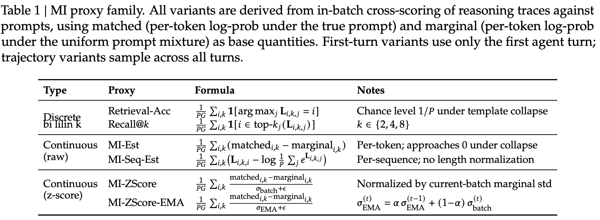

- 핵심 장점: 모든 proxy가 **학습 rollout의 $(X_i, Z_{i,k})$ 쌍을 재사용**하므로 추가 모델이나 inference pass가 필요 없음

# 5. 원인: Signal-to-Noise Ratio 메커니즘 (Q2)

## 5.1 Gradient 관찰

- prompt를 within-input reward variance(RV) 기준으로 정렬해 6개 동일 크기 버킷(Q1~Q6)으로 나눠 gradient norm을 측정

RV 분위 버킷별 (a) reward variance (b) task grad norm (c) regularizer grad norm — PPO/GRPO 모두

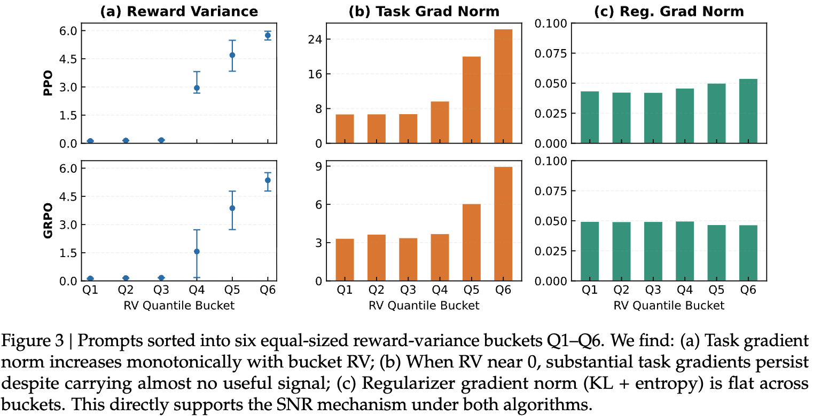

- 세 가지 패턴이 **알고리즘 무관하게** 반복됨
  1. **task gradient는 RV에 비례**: $\lVert g_{\text{task}}\rVert$가 버킷 RV에 따라 단조 증가
  2. **regularization gradient는 평평**: KL+entropy에서 오는 $\lVert g_{\text{reg}}\rVert$는 모든 버킷에서 일정 $\to$ prompt와 무관하게 **균일한 수축**을 가함
  3. **low-RV 버킷에선 업데이트가 regularization에 지배됨**: task gradient는 거의 사라졌는데 reg gradient는 그대로 $\to$ 업데이트가 거의 전부 input-agnostic 방향

## 5.2 형식화

SNR 관점 도식 — 좌: gradient 분해, 우: high RV = 강하고 뚜렷한 방향 vs low RV = regularizer 지배로 erratic update

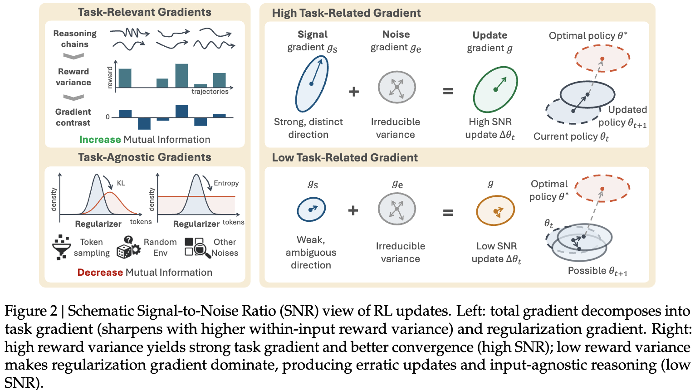

- advantage $A_g = R_g - \bar R(x)$, task gradient $g_{\text{task}}(x) = \frac{1}{G}\sum_g A_g \nabla_\theta \log \pi_\theta(\tau_g \mid x)$
- Cauchy-Schwarz로 다음이 성립 (Appendix H)

  $$|g_{\text{task}}(x)| \le \sqrt{\widehat{\mathrm{Var}}(R \mid X = x)} \cdot C$$

  $\to$ RV가 낮으면 $g_{\text{task}}$만 약해지고 $g_{\text{reg}}$는 그대로 $\to$ $I(X;Z)\to 0$
  - **중요**: 이때 $H(Z|X)$는 **떨어질 필요가 없음**. entropy regularization이 within-input 다양성을 유지시켜 주기 때문 $\to$ 바로 template collapse의 정의
- 더 나아가 $G$-sample Monte Carlo estimator의 SNR도 상한이 걸림 (Theorem H.3)

  $$\mathrm{SNR}(x) \le \sqrt{G}\cdot \frac{\sqrt{\mathrm{RV}(x)}}{\sigma(x)}$$

three-noise decomposition — $g_{\text{signal}}$ / $g_{\text{task-noise}}$ / $g_{\text{reg}}$ 각각의 출처·레벨·제어가능성·완화책

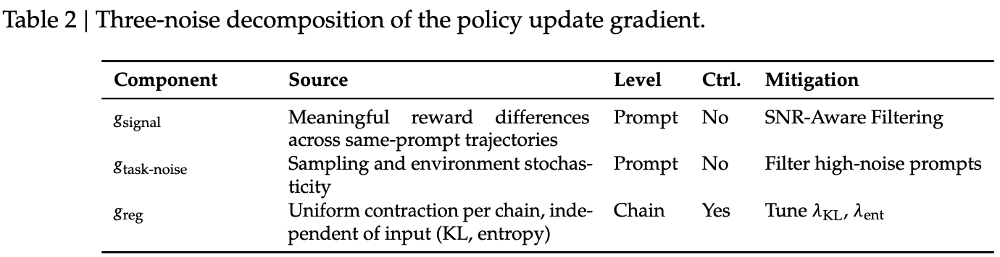

- 핵심 구분: signal과 task-noise는 **prompt 레벨**에서 변하지만, $g_{\text{reg}}$는 **chain 레벨에서 균일**하게 작용함 $\to$ cross-input 차이를 직접 누르는 힘은 regularization

  $$\mathrm{SNR}(x) = \frac{\lVert g_{\text{signal}}(x)\rVert}{\lVert g_{\text{task-noise}}(x)\rVert + \lVert g_{\text{reg}}\rVert}$$

## 5.3 SNR-Aware Filtering

SNR-Aware Filtering workflow — rollout 수집 $\to$ prompt별 RV 계산 $\to$ RV 랭킹 후 top-$p$만 남겨 policy update

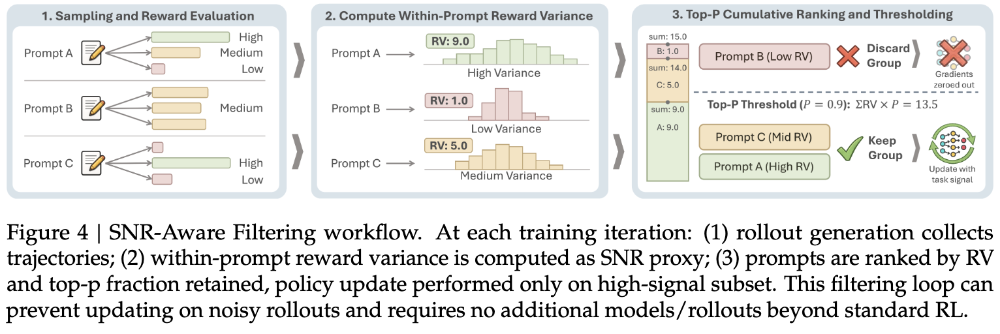

- 매 iteration마다 prompt별로 $G$개 trajectory를 뽑아 episode return의 표본분산을 계산

  $$\widehat{\mathrm{Var}}(R\mid X) = \frac{1}{G-1}\sum_{g=1}^{G}\left(R_g(X) - \bar R(X)\right)^2$$

- **top-$p$ filtering** (nucleus sampling의 variance 버전)
  - token 확률이 아니라 **per-prompt reward variance**로 랭킹
  - 임계값 $\tau = \rho \sum_i \widehat{\mathrm{Var}}(R\mid X = x_i)$ 를 잡고, 상위부터 variance mass를 누적해 $\tau$에 도달하는 최소 개수 $k^*$만 유지
  - 즉 **variance 분포 모양에 따라 남기는 개수가 자동 조정**됨. 대부분이 약한 신호면 배치 전체를 버릴 수도 있음
  - 필터된 objective: $\mathcal{L}_\rho(\theta) = \frac{1}{k^*}\sum_{i\in S}\sum_{j\in B_i} L_\theta(\xi_j)$

# 6. Experiments

## 6.1 Setup

- testbed: RAGEN 기반 **7개 환경**

환경별 stochastic / multi-turn / state / reward 특성 요약

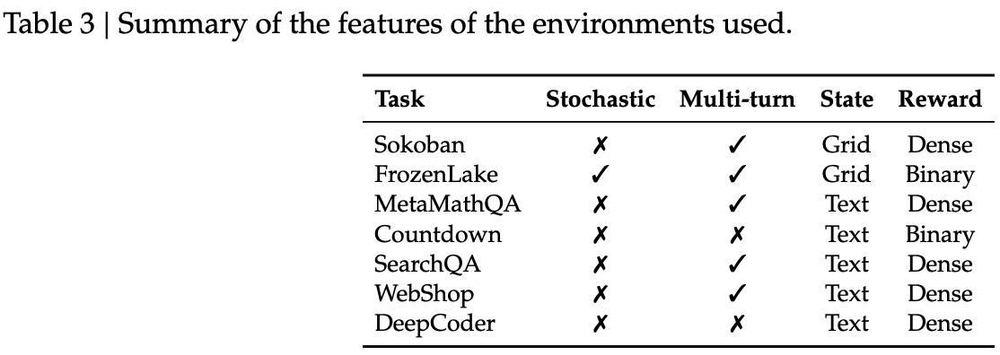

  - **Sokoban**: 박스를 당길 수 없어 행동이 사실상 **비가역**인 grid puzzle
  - **FrozenLake**: sparse reward + **stochastic transition**(미끄러짐)의 long-horizon navigation
  - **MetaMathQA**: 여러 번 답을 고칠 수 있고 재시도마다 reward를 **절반씩 감가**
  - **Countdown**: 단일 턴 산술 조합 게임
  - **SearchQA / WebShop / DeepCoder**: multi-turn 검색 QA / 웹 내비게이션 / 코드 합성
- 모델: Qwen2.5-3B 기본, veRL/HybridFlow 스택, RAGEN 기본 설정
- 알고리즘: PPO / DAPO / GRPO / Dr. GRPO, 최대 400 rollout–update iteration
- 배치: iteration당 $K = P \times G = 128$ trajectory ($P{=}8$, $G{=}16$)
  - filtering 시 effective minibatch를 줄이고 per-step loss를 $\rho$로 스케일해 **step size를 맞춤**
- 평가: 환경별 고정 512 validation prompt, temperature $T = 0.5$, success rate

## 6.2 Template collapse는 일관되게 발생한다

개입 전략별 학습 dynamics — (a) success rate (b) retrieval accuracy (c) reasoning entropy

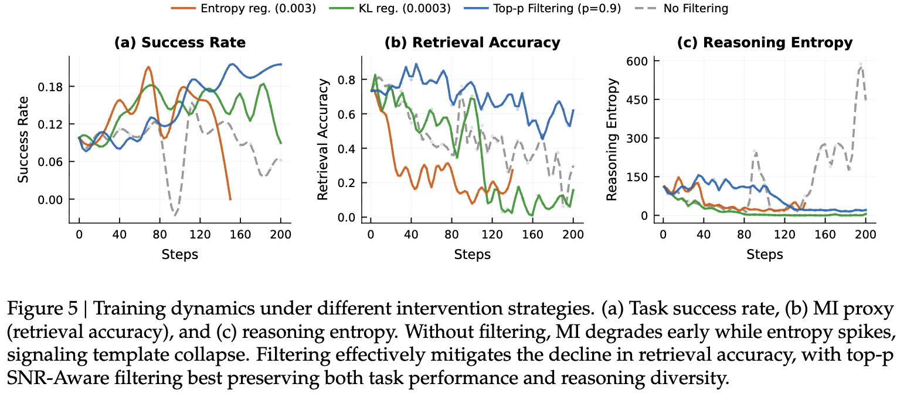

- **MI가 task 성능보다 먼저 떨어진다**
  - no filtering: MI가 초기에 급락하는 동안 entropy는 오히려 **spike**하며 높게 유지됨 $\to$ 정확히 template collapse의 지문
  - 즉 MI proxy는 **early warning signal**로 작동하고, entropy는 이를 전혀 못 잡음
- 행동 수준에서도 드러남

8개 환경에서의 reasoning length 단조 감소 — template collapse의 행동적 지문

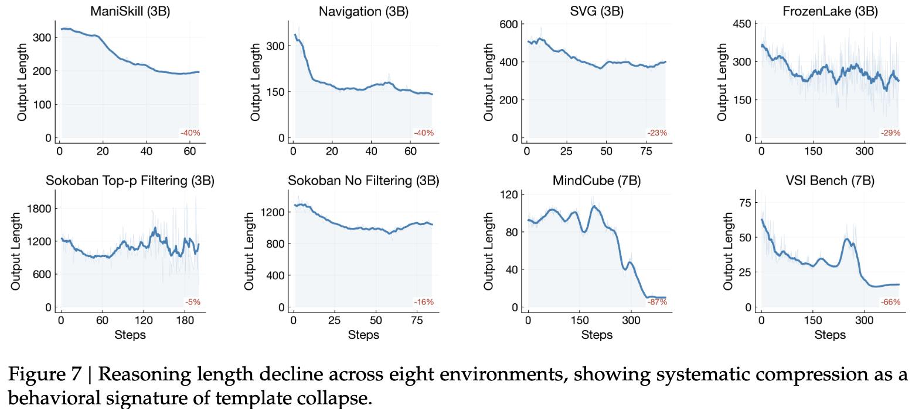

  - spatial agent / logic puzzle agent / visual agent / math agent 관련 기존 실험들을 재현했을 때 **8개 환경 전부에서 reasoning length가 단조 감소**
  - 재사용 가능한 템플릿으로 수렴하면서 출력이 짧고 정형화됨

## 6.3 SNR-Aware Filtering 결과

Top-$p$ vs Top-$k$ vs no-filter — 4개 환경 success rate 비교

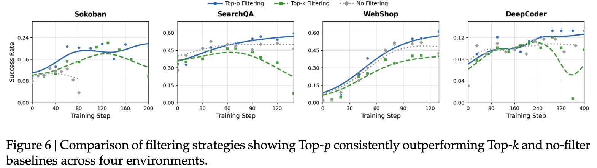

- **Top-$p$ > Top-$k$ > no filter**
  - Top-$k$는 신호 품질과 무관하게 고정 비율을 남겨 저품질 업데이트가 섞임
  - Top-$p$는 variance 분포에 적응해 **신호가 약한 배치는 통째로 거부**할 수 있음

알고리즘/스케일/모델타입/modality 별 SNR-Aware Filtering 결과 — baseline peak와 (+Δ)

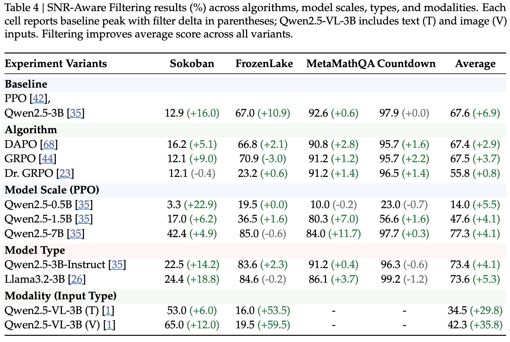

- **모든 variant에서 average가 향상**됨. 개별 셀에는 음수도 있지만(특히 이미 포화된 Countdown, GRPO의 FrozenLake) 평균은 전부 +
- DAPO와의 관계: DAPO 자체도 filtering/acceptance 단계를 가짐 $\to$ **선택 기준이 고정된 특수 케이스**로 해석 가능. SNR-Aware Filtering은 keep rate $\rho$라는 **명시적이고 튜닝 가능한 SNR 노브**를 제공

### 연산 오버헤드

- RV 추정에는 prompt당 $G \ge 2$가 필요함. 단, 총 rollout 예산 $K{=}128$은 고정이므로 $P \times G$ 재분할일 뿐 **rollout 비용은 동일**

$P \times G$ sweep — Sokoban, Qwen2.5-3B, NF vs F($\rho$=0.9)의 성능/step time/VRAM

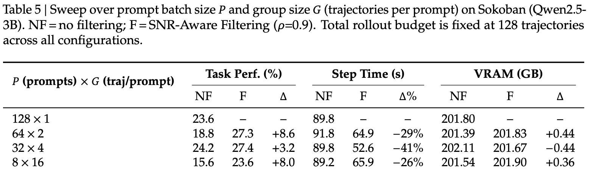

- RV 계산 자체는 iteration 시간의 **<0.1%**
- filtering으로 gradient 연산에 들어가는 group이 줄어 **step time 26~41% 감소**, VRAM은 사실상 동일
- $G \ge 4$ + filtering 조합이 $128\times 1$ baseline을 따라잡거나 상회 $\to$ **추가 연산 없이 얻는 이득**

# 7. Analysis

## 7.1 MI는 entropy보다 collapse를 잘 진단한다

entropy sweep / KL sweep / RV-filter sweep 세 개입의 MI–성능, entropy–성능 궤적

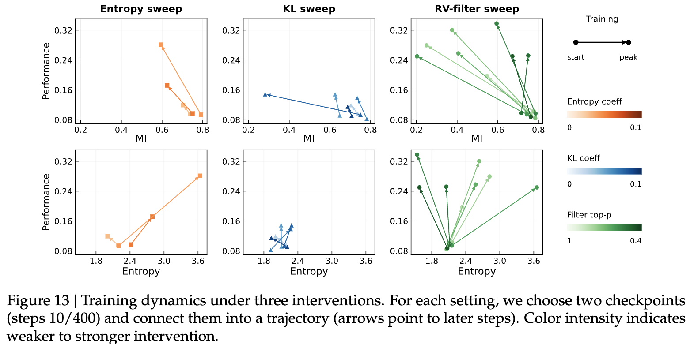

- entropy·KL 기반 stabilizer는 $H(Z|X)$만 크게 움직이고 $\hat I(X;Z)$는 거의 못 움직임
  - entropy를 너무 올리면 불안정해지며 성능 붕괴, KL은 reference 근처에 묶어둘 뿐 입력 의존성을 **올리지는 못함**
  - 이론적으로도 KL이 작으면 $|I_\theta(X;Z) - I_0(X;Z)| \le f(\varepsilon)$ $\to$ KL은 입력 의존성을 **보존할 뿐 증가시키지 않음** (Theorem L.1)
- SNR-Aware Filtering만 $\hat I(X;Z)$와 성능을 **동시에 단조 개선**

진단 지표별 task 성능과의 Spearman 상관

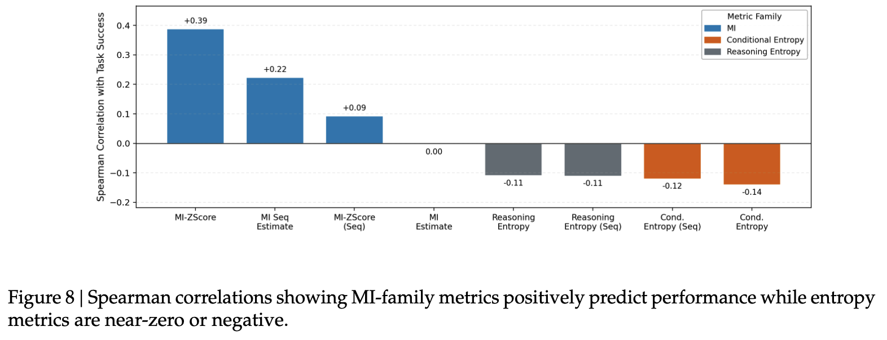

$\to$ entropy는 상관이 0에 가깝거나 **방향이 반대**. MI가 2배 이상 신뢰할 만한 모니터

## 7.2 SNR 메커니즘은 실제로 성립하는가

저자들은 네 가지 질문으로 stress test함

**(1) RV를 직접 통제하면 성능·MI가 따라오는가 — quartile ablation**

RV 분위별 단독 학습 결과 — Sokoban, Qwen2.5-3B, $P$=8, $G$=16, 매 step 25%만 유지

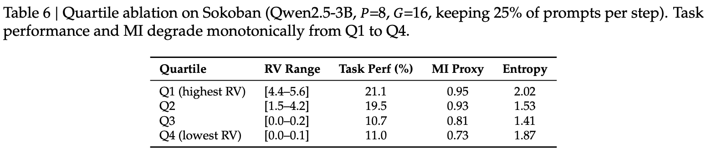

- task 성능과 MI가 Q1 $\to$ Q4로 **단조 감소**. 반면 entropy는 Q4에서 오히려 1.87로 **반등**함 (entropy로는 구분 불가라는 또 다른 증거)
- 이론 bound와 합쳐 **reward variance $\to$ gradient 품질 $\to$ input-dependent reasoning** 인과 사슬 성립

**(2) 환경 노이즈를 주입하면 MI가 예측대로 떨어지는가**

FrozenLake stochasticity 0%→100%에 따른 top-$p$ filtering vs no filtering 성능

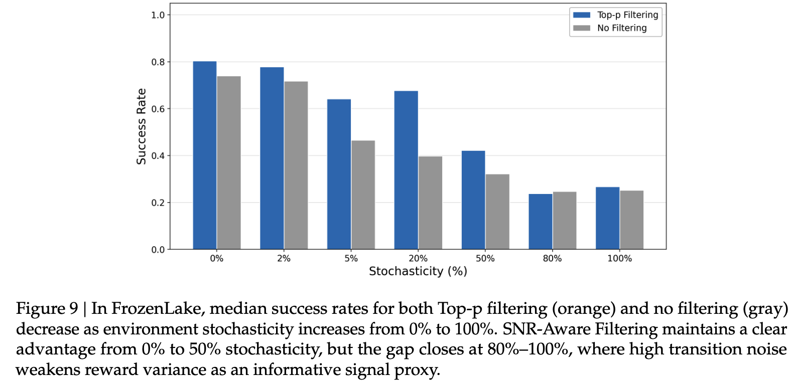

- stochasticity가 올라갈수록 return 하락 / conditional entropy 상승 / $\hat I(X;Z)$ **단조 하락**
- 흥미로운 점: filtering의 이점이 **0~50%에선 뚜렷하나 80~100%에선 사라짐**
  - 환경이 너무 확률적이면 RV가 signal-free하게 부풀려져 **RV의 변별력 자체가 소멸**
  - 메커니즘이 **자기 자신의 경계 조건을 정확히 예측**한다는 점이 오히려 설득력

**(3) 이득이 prompt 분포 편향 때문은 아닌가 — trajectory-level filtering과 비교**

trajectory-level vs prompt-level filtering — Sokoban, Qwen2.5-3B

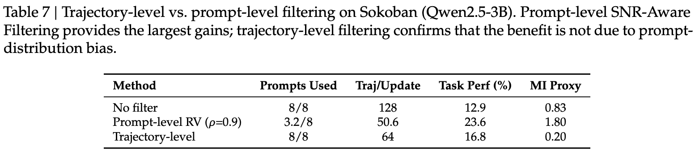

- trajectory-level(prompt 분포 보존 + per-prompt SNR만 개선)도 no filter보단 낫지만 **prompt-level이 훨씬 큼**
- 특히 trajectory-level은 MI proxy가 **0.20으로 오히려 붕괴** $\to$ 본질적으로 RV가 낮은 prompt 안에서 억지로 분산을 만들면 **노이즈만 증폭**됨

**(4) 언제 효과가 있는가 — 사전 진단 지표**

설정별 RV 통계와 filtering 효과 — Std/Mean 비율이 예측 지표

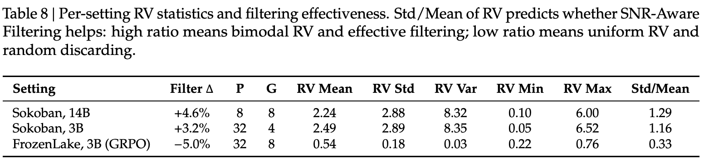

- **Std(RV)/Mean(RV)** 가 높으면 RV 분포가 bimodal $\to$ 신호/노이즈가 깨끗이 분리되어 filtering이 먹힘
- 0에 가까우면 모든 prompt의 RV가 비슷해 **무작위로 데이터를 버리는 것과 동일** $\to$ 성능 하락
- **rollout 배치 한 번이면 계산 가능**하므로 학습 전에 미리 판단할 수 있는 싼 진단

## 7.3 추가 관찰

effective kept ratio $\rho_{\text{eff}}$와 zero-variance prompt 개수의 학습 중 변화

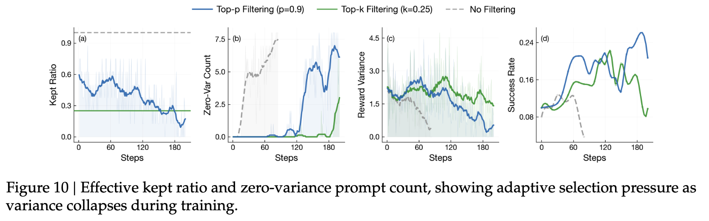

- 학습이 진행되어 policy가 수렴할수록 rollout reward가 비슷해지는 prompt가 늘어남(zero-variance 개수 증가) $\to$ 필터는 자동으로 **더 엄격해짐**(kept ratio 하락)
- 고정 $k$의 Top-$k$는 이런 **자동 조임**을 흉내낼 수 없음

학습 초/중/후반의 prompt-level reward 분포 변화

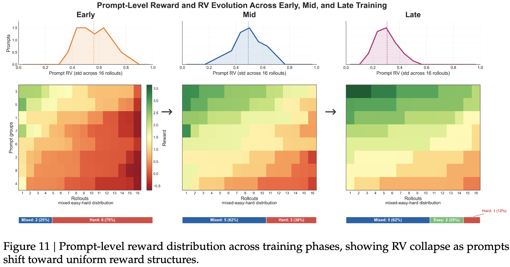

- hard 구간이 줄고 mixed 구간이 늘다가 **후반엔 prompt-level variance 자체가 붕괴**
- 후반부는 단순히 "쉬워진" 게 아니라 **gradient가 task 변별 정보를 점점 덜 싣는 regime**

format validity vs MI/entropy — 형식 유효성은 collapse 지표가 될 수 없음

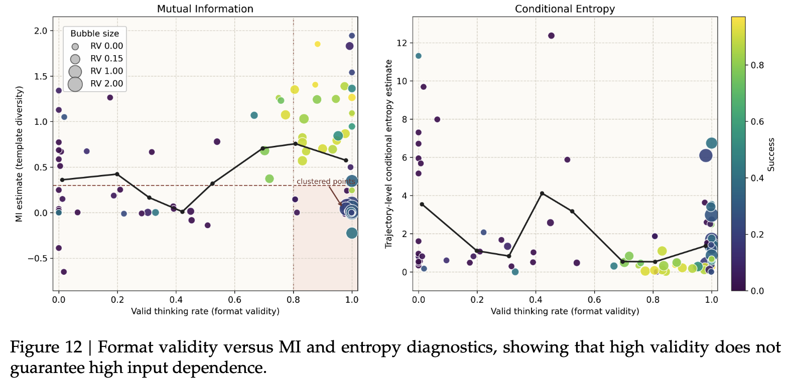

- format validity는 거의 완벽하게 유지되면서 MI는 낮은 run들이 존재 $\to$ **구조적 정확성과 의미적 입력 의존성은 별개 축**
- RV의 상관: conditional entropy −0.14, response length 0.12, **task reward 0.63**
  - $\to$ RV는 surface 통계와 거의 직교하는 **독립적인 품질 축**이며, KL·entropy regularization과 **상호보완적**

## 7.4 Filtering 설계 ablation

sampling strategy / filtering metric / keep strategy ablation — Sokoban, Qwen2.5-3B

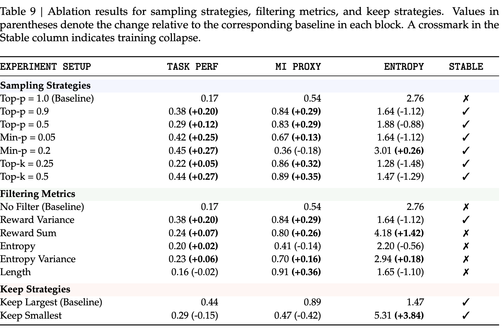

**Filtering metric 비교** (baseline: No Filter, Task Perf 0.17 / MI 0.54 / Entropy 2.76, 학습 붕괴)

- reward variance만이 **성능 향상 + MI 보존 + 학습 안정성**을 동시에 달성
- entropy/length 기반 필터는 MI를 억누르거나 collapse를 못 막음 (length 필터는 MI는 0.91로 제일 높은데 성능은 오히려 하락 $\to$ MI 단독 최적화도 답이 아님)

**Keep strategy**: keep-largest(0.44 / 0.89 / 1.47) vs keep-smallest(0.29 / 0.47 / 5.31)

- 낮은 variance group을 남기면 성능·MI 모두 떨어지고 entropy만 **5.31로 폭증** $\to$ low-RV rollout은 대체로 무정보 또는 노이즈라는 가설을 뒷받침

**Sampling strategy**: 필터를 고정해도 sampling 설정에 따라 결과가 크게 바뀜 (Top-p 0.9에서 0.38, Min-p 0.2에서 0.45지만 MI는 0.36으로 하락 등) $\to$ **"더 공격적인 filtering이 항상 좋은 건 아님"**

# 8. Conclusion & Limitations

- closed-loop multi-turn agent RL은 **조용히 실패**할 수 있음. conditional entropy는 안정적인데 reasoning은 유창하지만 입력 무관한 보일러플레이트로 흘러감 $\to$ **template collapse**
- 세 가지 기여: ① 입력–reasoning 간 **MI proxy**로 진단 ② **SNR 메커니즘**으로 원인 설명 ③ **SNR-Aware Filtering**으로 완화
- **Limitations** (저자 명시)
  - SNR 분해는 task signal과 regularization noise가 **깨끗이 분리된다고 가정**하지만, 실제로는 gradient accumulation을 통해 커플링될 수 있음
  - 모든 실험이 **single-agent**. multi-agent RL에서 template collapse가 어떻게 전파되는지는 미해결
  - 충분히 유능한 모델은 **reward variance를 인위적으로 부풀려 필터링 기준을 game**할 수 있음 (장기 학습에서 모니터링 필요)
  - reward variance가 신뢰할 만한 신호 대리여야 하는데, **sparse / noisy reward 환경에서 열화**됨 (FrozenLake 80~100% stochasticity 사례)
  - 공격적인 filtering은 **exploration coverage를 좁힐** 수 있고, keep mass는 태스크별 튜닝이 필요함

# Takeaways

- **entropy는 reasoning 품질의 대리 지표로 불충분하다.** $H(Z) = I(X;Z) + H(Z|X)$ 중 entropy는 둘째 항만 본다. 입력 의존성 $I(X;Z)$가 무너지는 경로는 완전히 사각지대고, 실제로 성능과의 Spearman 상관은 **음수(−0.11 ~ −0.14)** 다.
- **MI proxy는 공짜다.** 배치 안에서 reasoning을 다른 prompt에 cross-scoring 하는 것만으로 $I(X;Z)$를 추정하므로 추가 모델·추가 inference가 필요 없고, Retrieval-Acc는 chance level $1/P$라는 **해석 가능한 절대 기준**을 준다. agent RL 돌릴 때 로깅 항목에 넣을 가치가 충분.
- **"왜 collapse하는가"에 대한 깔끔한 gradient 수준 답.** $\lVert g_{\text{task}}\rVert \le \sqrt{\mathrm{RV}}\cdot C$ 인데 $g_{\text{reg}}$는 RV와 무관하게 일정 $\to$ low-RV prompt의 업데이트는 **전부 input-agnostic 방향**. RAGEN의 Echo Trap을 더 정밀한 메커니즘으로 설명한 셈.
- **대응책이 단순하고 싸다.** reward variance top-$p$ 필터링은 구현 몇 줄, RV 계산 비용 <0.1%, 오히려 step time을 26~41% 줄인다. PPO/DAPO/GRPO/Dr.GRPO, 0.5B~7B, 텍스트/비전 전부에서 평균 향상.
- **다만 만능은 아니다.** Std(RV)/Mean(RV)가 낮으면(≈0.33) 효과가 **음수**로 뒤집힌다. 환경 stochasticity가 아주 높으면 RV가 신호가 아니게 된다. 적용 전에 이 비율을 한 배치로 먼저 재보는 게 맞다.
- **trajectory-level이 아니라 prompt-level이어야 한다.** 같은 prompt 안에서 trajectory를 골라 억지로 분산을 만들면 MI가 0.83 $\to$ 0.20으로 오히려 붕괴한다. "자연적으로 변별력 있는 prompt를 고르는 것"이 핵심.
