# [Agent] BAGEN: Are LLM Agents Budget-Aware?

- paper: https://arxiv.org/pdf/2606.00198
- webpage: https://ragen-ai.github.io/bagen
- ICML 2026 AIWILD workshop accepted (인용수: 18회, 26-11-13 기준)
- 저자: Yuxiang Lin\*, Zihan Wang\*†, Mengyang Liu\*, Yuxuan Shan\*, Longju Bai\*, Junyao Zhang, Xing Jin, Boshan Chen, Jinyan Su, Xingyao Wang, Jiaxin Pei, Manling Li (Northwestern / O2 Lab / UMich / Cornell / All Hands AI / Stanford / UT Austin)
  - \* core contributors, † project lead. [RAGEN](https://arxiv.org/abs/2504.20073)·[VAGEN](https://arxiv.org/pdf/2510.16907) 계열의 세 번째 "-GEN"
- downstream task: **LLM agent의 budget 자기추정(self-estimation) 능력 벤치마크 + 학습**
  - 실행 도중 "남은 예산이 얼마나 필요한가 / 이 태스크가 아직 가능한가"를 agent가 스스로 답할 수 있는지
- 주요 용어
  - **Internal budget**: agent **자신의 reasoning이 생성하는** 비용. turn $t$의 신규 토큰 $c^{\text{in}}_t$, 누적 $C^{\text{in}}_k = \sum_{t\le k} c^{\text{in}}_t$, 남은 비용 $R^{\text{in}}_k = C^{\text{in}}_T - C^{\text{in}}_k$. 전체 cap $B^{\text{in}}$ 초과 시 truncate + 실패 처리
  - **External budget**: agent의 **action이 환경에 commit하는** 비용. $D$차원 벡터 $\mathbf{c}^{\text{ex}}_t \in \mathbb{R}^D$ (돈·시간·재고 등), 차원별 제약 $C^{\text{ex},(d)}_T \le B^{(d)}$. 차원 간 **결합(coupled)**됨 — 재고를 늘리면 매출은 오르지만 창고 용량을 먹음
  - **Progressive interval estimation**: 매 turn $k$마다 남은 예산의 **구간** $[\hat{R}^{\text{lo}}_k, \hat{R}^{\text{hi}}_k]$을 내거나, 완료가 불가능하면 `impossible`을 선언하는 능력. uncertainty(구간 폭) + progressiveness(매 턴 갱신) + infeasibility awareness(명시적 포기)를 동시에 포착
  - **Rollout-replay protocol**: 먼저 **예산 제약 없이** 전체 rollout을 수행해 로깅한 뒤, 각 prefix $\tau_{\le k}$를 history로 다시 넣어 **같은 agent에게 따로** 추정을 질의. 추정 자체의 토큰 비용이 태스크 수행 비용과 섞이지 않도록 분리
  - **세 가지 sub-capability**: (1) feasibility prediction — macro-$F_1$, (2) early failure detection — Fail-$F_1$, (3) remaining budget estimation — coverage × tightness 점수 $S_k$

# 1. Motivation

- agent는 점점 더 긴 horizon, 더 높은 stakes에서 돌아감
  - coding agent는 reasoning step당 토큰, web agent는 query당 API call, supply-chain agent는 **실제 돈과 창고 용량**을 commit
- 그런데 현재 agent cost는 거의 전부 **사후(post-hoc) 측정**됨
  - "실행이 끝나고 보니 얼마 썼다"는 알지만, **실행 도중 agent 자신이 알고 있었는가**는 거의 묻지 않음
- $\to$ (RQ) **does the agent know how much budget it needs?**
  - 자기 자원 요구량을 모르면 hopeless task를 언제 중단할지, 언제 추가 자원을 요청할지, sub-goal에 예산을 어떻게 배분할지 **아무것도 결정할 수 없음**
- 기존 연구의 두 gap
  1. cost를 **post-hoc metric**으로만 계산하고 self-estimate 여부를 묻지 않음
  2. 평가가 **task 시작 시점의 single-point 예측**에 머묾 — feasibility가 턴마다 바뀌는 long-horizon agentic task와 안 맞음
  - 비유: 프로젝트 매니저는 매 마일스톤마다 남은 일정을 **재추정**하고, 점이 아니라 **범위**를 주고, 완료 불가해지면 **flag를 올림**

single-point estimation(기존) vs progressive interval estimation(제안) — rollout 후 prefix별 replay로 구간/impossible을 질의하는 구조

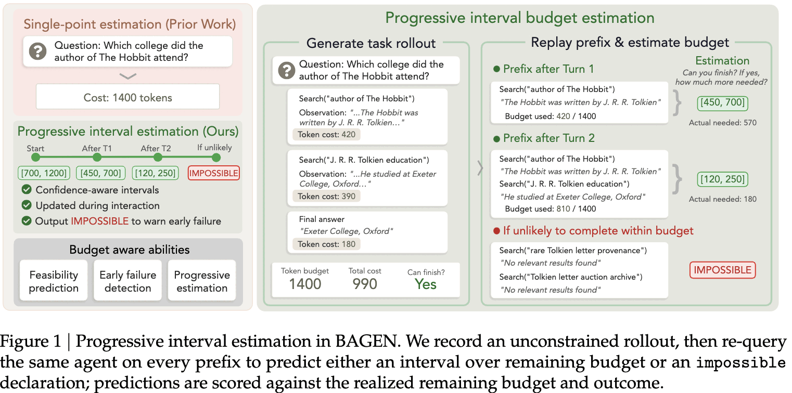

# 2. Contribution

- **Budget-Aware Agent (BAGEN)** 정의: 예산을 passive cost metric이 아니라 **active control signal**로 취급
- budget을 **internal(computation) / external(action)** 두 modality로 체계적으로 정의
- budget-awareness를 **progressive interval estimation**으로 형식화하고, **rollout-replay protocol**로 "추정 능력"과 "수행 능력"을 분리해 채점
- 4개 환경 × 5개 frontier model에서 일관된 failure pattern 4가지 발견
  1. **강한 agent가 budget-aware한 건 아님** — task success와 interval hit rate 상관 $r \approx 0.35$
  2. **모든 frontier model이 일관되게 over-optimistic** — 성공 가능성이 낮은 태스크에서 사용자에게 경고하는 대신 **계속 씀**
  3. **신호는 actionable하고 trainable함** — early stop으로 실패 trajectory 토큰 **28~64%** 절감, SFT+RL로 early stop/alert 행동 강화
  4. **정밀한 interval calibration은 여전히 어려움** — SFT+RL 이후에도 interval coverage가 **47%**에서 막힘

# 3. 두 가지 Single-Point Estimation 실패

Sokoban·Search-R1 두 internal-budget 환경에서 5개 frontier model에 **task 시작 시점 단일 토큰 추정치**를 받아본 pilot probe:

- **실패 1: 체계적 낙관(systematic optimism)**
  - 5개 모델 × 2개 태스크 **전부**에서, first-turn 예측이 실제 rollout 비용을 **과대추정보다 과소추정하는 경우가 더 많음**
  - 편향이 **task difficulty가 아니라 model confidence를 따라감** — 같은 태스크에서 **약한 모델일수록 더 낙관적**

rollout 진행 구간별 hit / overly optimistic / overly conservative 비율 — 5개 모델 전부 optimism이 지배

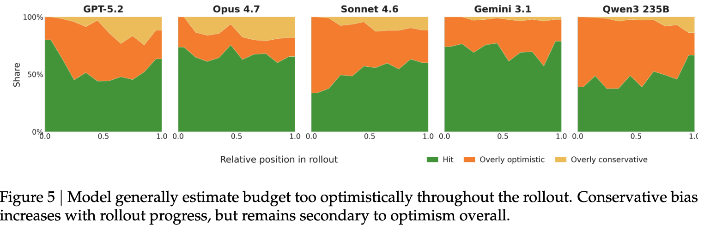

- **실패 2: first-turn과 later-turn 추정이 서로 다름**
  - Sokoban에서 Gemini의 feasibility $F_1$은 first-turn $\to$ all-turn으로 **+21.9pp** 개선
  - Search-R1에서 Qwen3-235B는 반대로 **−9.3pp**
  - $\to$ first-turn 판단은 all-turn 판단의 일관된 과대/과소추정이 **아니라 그냥 다른 판단**. 어느 쪽인지는 모델·태스크마다 다름

first-turn vs all-turn feasibility macro-$F_1$ — equality line 양쪽으로 흩어짐

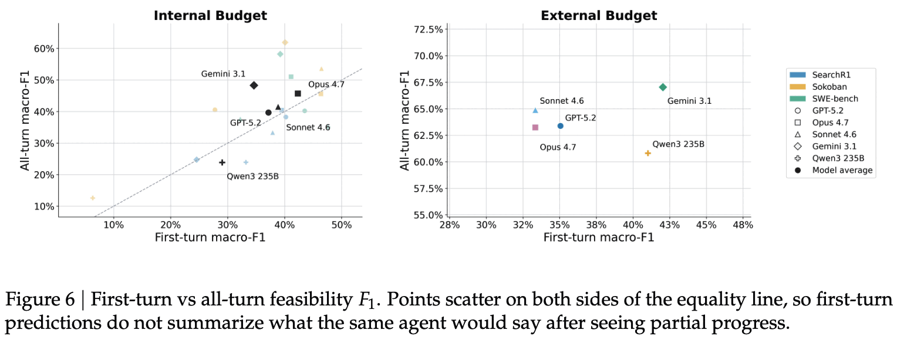

$\to$ 점 추정은 모델이 드러내는 낙관을 표현할 수 없음. **구간**은 표현할 수 있고, 명시적 `impossible` 옵션은 "조용히 과소추정"하는 대신 **선언**하게 만듦

# 4. Progressive Interval Estimation

## 4.1 추정 형식

$$\hat{y}_k = \begin{cases} [\hat{R}^{\text{lo}}_k, \hat{R}^{\text{hi}}_k] & \text{task가 아직 feasible하다고 예측} \\ \texttt{impossible} & \text{완료가 더 이상 불가능하다고 예측} \end{cases}$$

## 4.2 Rollout-replay protocol

1. **Rollout generation**: agent가 **예산 제약 없이** 태스크 수행. 전체 $\tau$ + turn별 비용 $c_t$ + 최종 outcome을 로깅
2. **Prefix replay & estimation**: 각 non-terminal turn $k \in \{1,\ldots,T-1\}$에 대해 prefix $\tau_{\le k}$를 history로 재생하고 누적 사용량 요약을 붙여 $\hat{y}_k$를 질의. 실제 $R_k = C_T - C_k$와 실제 outcome으로 채점

- rollout 도중에 바로 추정하게 하지 않은 이유: **추정 자체가 토큰을 소모**해서 task-completion cost와 self-assessment cost가 섞임. online estimation은 future work로 남김

## 4.3 세 가지 sub-capability metric

- **(1) Feasibility prediction** — 구간을 내면 "feasible"로 간주:

  $$\text{Macro-}F_1 = \tfrac{1}{2}(F_1^{\text{feasible}} + F_1^{\texttt{impossible}})$$

  전체 trajectory(all-turn) 또는 first-turn only로 각각 계산

- **(2) Early failure detection** — 결국 실패하는 태스크에서 `impossible`을 positive class로 두고:

  $$\text{Fail-}F_1 = \frac{2 \cdot \text{Prec}_{\text{imp}} \cdot \text{Rec}_{\text{imp}}}{\text{Prec}_{\text{imp}} + \text{Rec}_{\text{imp}}}$$

- **(3) Remaining budget estimation** — 성공한 trajectory에 한정, feasibility를 맞춘 경우만 채점:

  $$S_k = \underbrace{\mathbb{1}[R_k \in [\hat{R}^{\text{lo}}_k, \hat{R}^{\text{hi}}_k]]}_{\text{coverage}} \cdot \underbrace{\max\left(0, 1 - \frac{\hat{R}^{\text{hi}}_k - \hat{R}^{\text{lo}}_k}{R_k}\right)}_{\text{tightness}}$$

  - 완벽한 예측 $[R_k, R_k]$는 1점, 폭이 $R_k$만큼 넓으면 0점. 성공 trajectory에 `impossible`을 내면 **0점**
  - 진단용으로 interval hit rate와 midpoint relative error $|\frac{\hat{R}^{\text{lo}}_k + \hat{R}^{\text{hi}}_k}{2} - R_k| / R_k$ (P50, P90)도 보고

## 4.4 실험 셋업

**Internal-budget 환경**

- **Sokoban**: $8\times 8$ grid 박스 밀기 planning, 2,500 토큰 cap
- **Search-R1**: multi-hop 정보 검색, 3,500 토큰 cap
- **SWE-bench**: GitHub issue 해결, 160 turn cap

**External-budget 환경**

- **Warehouse**: 실제 enterprise data로 만든 supply-chain 환경. **세 개의 결합된 예산 차원** — 누적 비용(USD), 시간(weeks), 창고 점유(item-weeks). 24주 horizon(12 turn) 동안 조달·배분 결정
  - task가 "cash maximization"이라 자연스러운 binary success가 없음 $\to$ **challenge-conditioned feasibility probe**로 reachable/unreachable을 50/50으로 맞춰 $F_1$·calibration이 양쪽에서 식별되게 설계

**모델**: GPT-5.2 Instant, Claude Opus 4.7, Claude Sonnet 4.6, Gemini 3.1 Pro Preview, Qwen3-235B. SFT/RL 학습은 Qwen2.5-7B-Instruct

**스케일**: 모델당 Sokoban/Search-R1/Warehouse 128 rollout, SWE-bench 64 rollout $\to$ model-task pair당 **2,000~3,000 추정 샘플**

# 5. Budget Awareness는 Task Performance와 분리된다

4개 환경 × 5개 모델의 rollout 성능 + feasibility prediction + interval quality 전체 결과

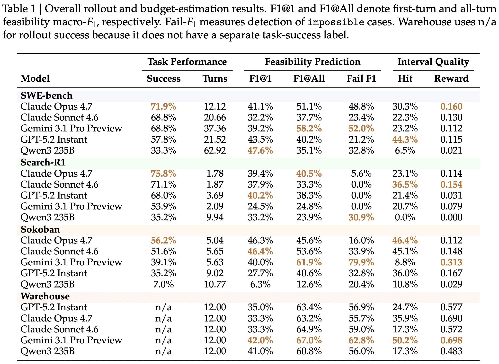

- **최고의 수행자가 최고의 추정자가 아님**
  
  - Search-R1: Opus가 성공률 1위(75.8%)인데 interval hit은 Sonnet(36.5%)이 Opus(23.1%)보다 좋음
  - SWE-bench는 **3등분**됨 — task success는 Opus, feasibility는 Gemini, interval은 GPT-5.2
  - Warehouse: Gemini가 hit 50.2%로 1위, Sonnet·Qwen이 17.3%로 최하
- **상관은 약함**: 20개 model-environment pair에서 task success rate와 feasibility prediction의 상관 $r \approx 0.35$
  - # $\to$ budget awareness는 problem-solving이 아니라 **metacognitive monitoring**에 가까운 별도 능력

좌·중: internal/external budget 모두에서 추정 품질과 task 성능의 약한 관계 / 우: 실패한 Sokoban trajectory에서 진행률이 올라야 예측 정확도가 오름

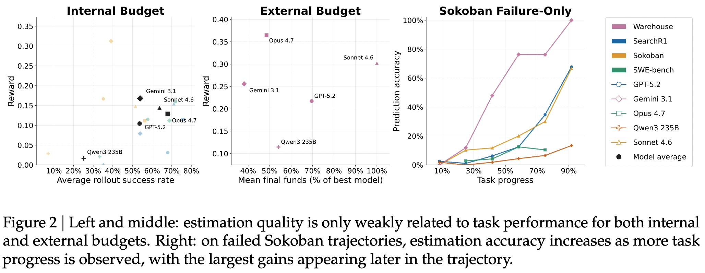

## 5.1 Agent 추정은 선형 외삽 이상인가

Warehouse에서 agent midpoint 추정 vs 선형 외삽 baseline의 paired error reduction heatmap

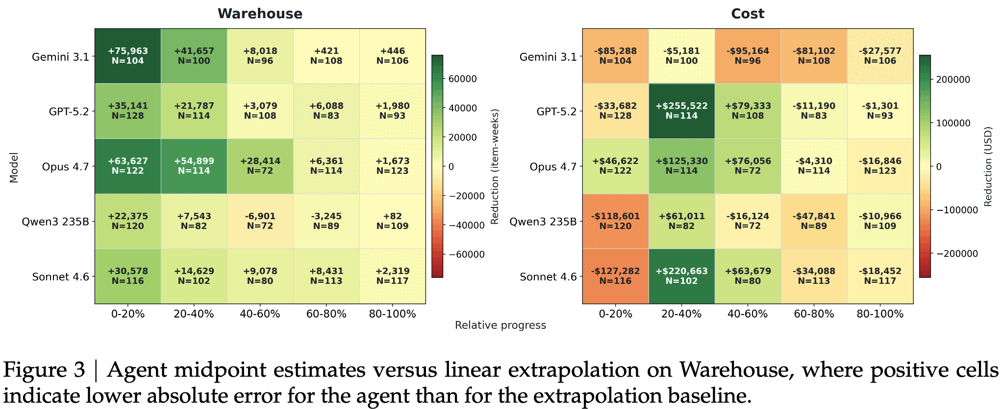

- baseline: $\hat{R}_{\text{lin}} = (C_k / k) T - C_k$ (단순 선형 외삽)
- **창고 점유(warehouse occupancy)** 차원에서는 대부분의 model-progress bin에서 agent가 오차를 줄임. **특히 rollout 초반**에 효과적
- **누적 비용(cost)** 차원은 혼재 — 외삽이 여전히 경쟁력 있음
- $\to$ budget awareness의 이점은 **실재하지만 예산 차원에 따라 다름**

## 5.2 모든 sub-capability를 지배하는 모델은 없다

- Gemini는 Sokoban binary $F_1$ 1위(61.9%)인데 **interval hit은 꼴찌(8.8%)**
- Warehouse에서 Gemini가 Fail-$F_1$ 1위(62.8%)인데 Qwen은 hit 17.3%로 낮음
- **좋은 추정자를 가르는 건 calibration이지 feasibility prediction이 아님**
  - interval hit rate는 midpoint bias와 $r \approx -0.67$, width adequacy와 $r \approx 0.62$로 **강하게** 상관
  - feasibility $F_1$과는 $r \approx 0.35$로 **약하게만** 상관
  - $\to$ feasibility 예측은 **필요조건이지 충분조건이 아님**

# 6. 왜 Budget Estimation이 실패하는가 — 4가지 가설

| 가설 | 내용 | 결과 |
|---|---|---|
| **H1 capability gap** | 예산 예측에 필요한 reasoning 자체가 부족 | **interval은 지지 / binary feasibility는 기각** |
| **H2 optimistic prior** | 남은 예산을 과소추정하는 일반적 편향 | **지지** (전 모델) |
| **H3 static estimation** | 실행 결과를 추정 갱신에 못 쓴다 | **완전 기각** |
| **H4 late recognition** | 예산을 거의 다 쓴 뒤에야 가망 없음을 인식 | **지지** (전 모델) |

## 6.1 H1 — binary feasibility는 calibration, interval은 reasoning

Qwen-7B를 Sokoban budget estimation으로 SFT $\to$ RL:

- **binary feasibility는 쉽게 학습됨**: base 25.5% $\to$ **SFT만으로 약 90%** (RL 불필요)
  - $\to$ 능력은 **이미 있었고 포맷이 문제**였음. feasibility에 대해서는 H1 **기각**
- **interval은 훨씬 느리게 개선**: base coverage 10.5% $\to$ SFT 26~53%(target 폭에 따라) $\to$ **SFT+RL 47%**, median midpoint relative error 28%
  - 학습 후에도 **거의 절반의 구간이 여전히 정답을 놓침**. interval에 대해서는 H1 **지지** — 병목은 포맷이 아니라 reasoning

좌: SFT checkpoint들의 coverage vs midpoint error 트레이드오프 / 우: 같은 SFT에서 출발한 RL 전후 reward

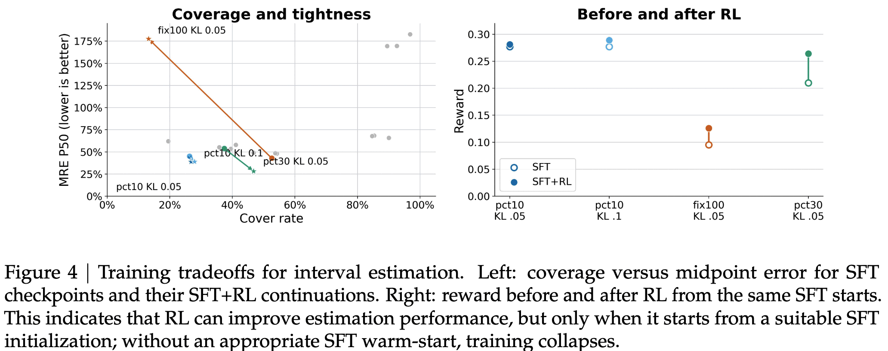

- **SFT warm-start 없는 RL은 붕괴함**: 모든 입력에 `impossible`을 내뱉거나, 유효하지 않은 포맷으로 reward를 해킹
  - SFT가 주는 **format prior 없이는 sparse reward로 복구 불가**. 기저 능력이 얇을수록 supervision이 reward보다 중요하다는 H1과 정합

SFT+GRPO budget-estimator의 in-task / cross-task transfer 결과

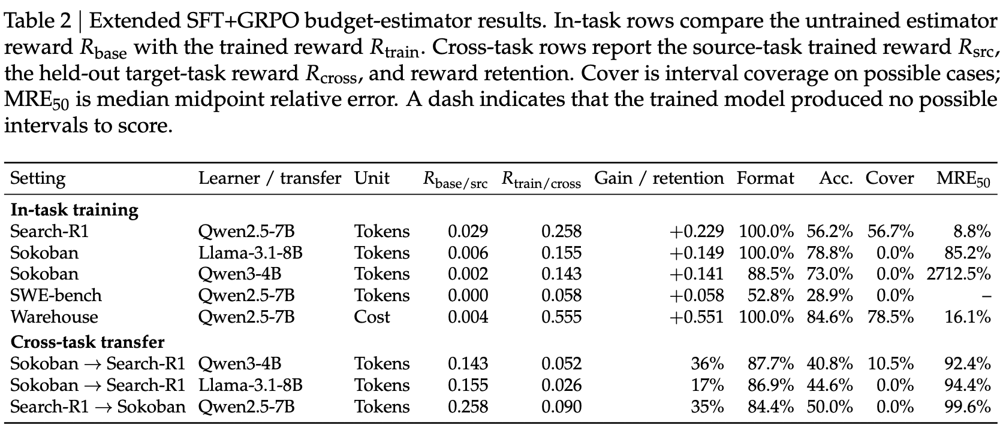

- **in-task는 전부 개선**. Warehouse에서 gain이 가장 크고, token-budget interval 품질은 Search-R1이 가장 좋음
- **cross-task는 17~36%만 유지** $\to$ **출력 포맷은 전이되지만 budget estimation 자체는 대체로 task-specific**

## 6.2 H2 — 낙관 편향은 모델·태스크 불문 보편적

- 20개 model-environment pair **전부**에서, 모든 rollout-progress bin에서 optimistic miss가 conservative miss보다 많음
- Gemini·Qwen이 가장 낙관적, Sonnet·Opus가 가장 calibrated하지만 **여전히 낮게 치우침**
- 턴을 평균 내도 편향이 사라지지 않음
- **편향은 task difficulty가 아니라 model confidence를 따라감** — 환경 내에서 **약한 모델이 더 낙관적**
  - 어려운 태스크에 대한 reasoning 부족이 원인이라면 **반대가 나왔어야** 함
  - $\to$ 제한된 self-awareness 하의 overconfidence. **모델은 자기가 모른다는 걸 모름**

## 6.3 H3 — 추정은 갱신되지만 항상 진실 쪽은 아님

- Sokoban에서 Gemini macro-$F_1$ first-turn $\to$ all-turn **+21.9pp**
- SWE-bench에서 Qwen은 **−12.5pp**
- equality line 양쪽으로 흩어짐 $\to$ H3 **기각**: 추정은 분명 갱신됨
- 다만 갱신이 **진실 쪽으로의 refinement인지는 model-environment 조합마다 다름**. "나중 턴이 더 낫다"를 전제로 프로토콜을 짤 수 없음

## 6.4 H4 — 실패 인식이 행동으로 옮기기엔 너무 늦다

환경별 early-stop share 박스플롯 — 예산의 상당 부분을 쓴 뒤에야 `impossible` 라벨이 붙음

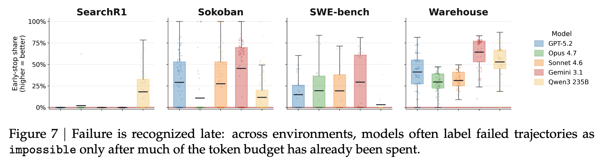

- 결국 실패하는 trajectory에서, **예산의 60%를 쓴 뒤에도 feasibility를 70% 이상으로 예측**
- 예측이 급락하는 건 **마지막 20% 구간** — 의미 있는 개입을 하기에 너무 늦음
- $\to$ **이 늦은 인식이 상당한 compute를 낭비함**

# 7. 신호는 Actionable하고 Trainable하다

## 7.1 Early Stopping은 낮은 위험으로 토큰을 아낀다

정책: 매 턴 모델 추정이 `impossible`이면 **즉시 종료**. 두 종류의 오류 — *false abort*(성공했을 trajectory를 중단) / *false continue*(실패할 걸 못 멈춤)

모델별 early-stopping 트레이드오프

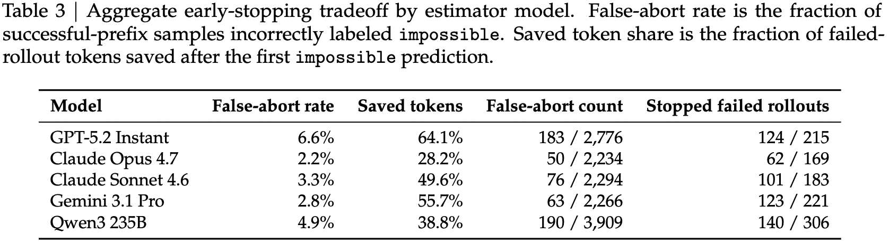

- 실패 trajectory에서 **28~64% 토큰 절감**, 전체 success rate 손실은 **1.6~4.2pp**에 불과
- 추정 신호는 **이미 모델 예측 안에 있고**, 정책은 그걸 행동으로 옮기기만 함
- GPT-5.2가 절감 1위(64%)지만 false-abort도 1위(6.6%). Opus는 보수적 — 28% 절감에 false-abort 2.2%
- 환경별로는 **Warehouse·SWE-bench에서 절감 최대**, Sokoban은 작고, **Search-R1은 거의 0** (rollout이 짧아 infeasibility 감지 전에 끝남)

## 7.2 학습 동역학: 폭, epoch, 초기화

SFT 설정이 Sokoban budget estimator 행동을 제어하는 방식 — percent-width / fixed-width / feasible-rate shift / recall shift

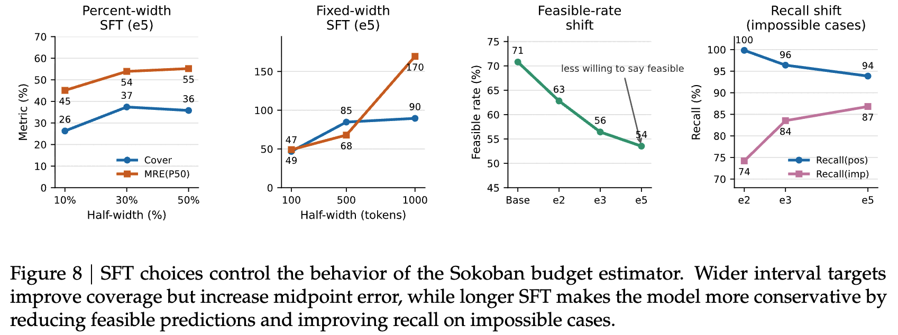

- **SFT target interval 폭이 coverage–tightness 트레이드오프를 결정**
  - 좁은 target(남은 예산의 10%): coverage **26%**, midpoint relative error 45% — tight하지만 거의 못 맞춤
  - 넓은 target(1,000 토큰 고정): coverage **90%+**지만 precision 최악 (MRE **170%**)
  - **sweet spot은 중간** — 100-token fixed interval이 coverage **47%**, MRE **49%**
- **SFT를 길게 할수록 모델이 보수적으로 변함**: feasible 예측 비율이 base 71% $\to$ e5 54%로 하락하고, `impossible` case의 recall은 상승

# 8. Conclusion & Limitations

- **결론**: budget은 사후 회계용 metric이 아니라 **control signal**이고, 현재 resource-limited agent는 이 신호를 갖고 있지 않음. BAGEN은 이를 progressive interval estimation으로 형식화하고, 능력이 task performance와 분리되며, 구조적으로(낙관 편향 / 늦은 실패 인식 / calibration-bound feasibility vs reasoning-bound interval) 실패하고, 단순 early-stop 정책으로 **이미 활용 가능**하며 SFT-then-RL로 **학습 가능**함을 보임
- **저자가 명시한 한계 / open direction**
  - 학습 분석이 **model scale·환경 측면에서 제한적** (Sokoban 중심, Qwen2.5-7B급)
  - estimator 예측을 **actor에 되먹이는 loop가 닫혀 있지 않음** — early stopping 외에는 활용 안 함
  - 예산 차원 간 **fungible(대체 가능) budget**을 지원하지 않고 독립적 hard constraint로만 다룸
  - **interval estimation gap이 중심 난제**로 남음 (SFT+RL 후에도 coverage 47%)
- **리뷰어 관점에서 추가로 걸리는 점**
  - rollout-replay는 추정 비용과 수행 비용을 분리해주지만, 실제 배포에서는 **추정도 토큰을 쓴다**. online estimation의 순이득은 미검증 (저자도 future work로 인정)
  - "예산 제약 없이 rollout" $\to$ "prefix replay"는 **off-policy 성격** — 실제로 예산 압박을 받는 agent의 행동 분포와 다를 수 있음
  - Warehouse는 자연스러운 binary success가 없어 **50/50으로 인위 조정한 feasibility probe**로 평가함. 다른 세 환경과 동일선상에서 읽기 어려움
  - Search-R1 Sonnet의 Fail-$F_1$ 0.0%, Qwen3-235B의 interval hit 0.0% 같은 **완전 0 셀**이 여러 개 — 지표가 특정 모델에서 아예 degenerate한 구간이 있음
  - frontier 모델은 **프롬프트만으로** 평가했고 학습 실험은 7B급 open model에서만 함 $\to$ "학습으로 고칠 수 있다"는 결론이 frontier 스케일에서 성립하는지는 미지

# Takeaways

- **agent cost는 지표가 아니라 제어 신호다.** 사후에 "얼마 썼다"를 세는 것과, 실행 중에 "얼마 더 필요한가"를 아는 것은 전혀 다른 문제이고, 후자가 abort/재할당/에스컬레이션 결정을 전부 좌우한다
- **잘 푸는 모델이 잘 추정하지 않는다.** 20쌍에서 $r \approx 0.35$. Search-R1에서 Opus는 성공률 1위지만 interval은 Sonnet에 밀림 $\to$ budget awareness는 metacognition 축의 별도 능력
- **낙관 편향은 보편적이고, 약한 모델일수록 심하다.** 어려운 문제라서 못 맞추는 게 아니라 **자기 한계를 모르는 것**. 20개 pair 전부에서 optimistic miss가 우세
- **feasibility는 calibration 문제, interval은 reasoning 문제.** 전자는 SFT만으로 25.5% $\to$ 90%, 후자는 SFT+RL 후에도 coverage 47%에서 멈춤. 두 sub-capability를 같은 처방으로 다루면 안 됨
- **실패 인식이 너무 늦다.** 예산 60%를 쓴 뒤에도 feasibility를 70%+로 예측하고, 경고는 마지막 20%에서야 나옴. 지금의 `impossible` 신호는 있으나 **타이밍이 쓸모없는 쪽에 치우쳐** 있음
- **그래도 지금 당장 쓸 수 있다.** `impossible`에 early-stop만 걸어도 실패 trajectory 토큰 28~64% 절감, success rate 손실 1.6~4.2pp. 공짜에 가까운 운영 최적화
- **RL은 SFT warm-start 없이는 붕괴한다.** 능력이 얇은 영역에서는 reward보다 supervision이 먼저다 — [RAGEN-2](https://arxiv.org/pdf/2604.06268)의 SFT-init 논의와는 **반대 방향**의 교훈이라 흥미로움
