# [VLM] VAGEN: Reinforcing World Model Reasoning for Multi-Turn VLM Agents

- paper: https://arxiv.org/pdf/2510.16907
- webpage: http://mll-lab.northwestern.edu/VAGEN
- NeurIPS 2025 accepted (인용수: 74회, 26-11-12 기준)
- 저자: Kangrui Wang\*, Pingyue Zhang\*, Zihan Wang\*, Yaning Gao\*, Linjie Li\*, Qineng Wang, Hanyang Chen, Chi Wan, Yiping Lu, Zhengyuan Yang, Lijuan Wang, Ranjay Krishna, Jiajun Wu, Li Fei-Fei, Yejin Choi, Manling Li† (Northwestern / UW / Stanford / Microsoft / UW-Madison / UIUC)
  - \* equal contribution, † corresponding. [RAGEN](https://arxiv.org/abs/2504.20073) 저자진의 VLM 버전
- downstream task: **Multi-turn VLM agent RL**
  - 시각 관측만 주어지는 POMDP에서 agent가 내부 world model을 유지하도록 reasoning을 구조화하고 RL로 보상
- 주요 용어
  - **Internal Belief $\hat{s}_t$**: 실제 환경 상태 $s_t$를 직접 볼 수 없는 VLM agent가 관측 $o_t$로부터 추정해 **텍스트로 명시적으로 쓰는** 상태. $\hat{a}_t$(행동 belief), $a^e_t$(파싱된 실행 가능 action)와 구분
  - **StateEstimation**: $P(\hat{s}_t \mid o_t)$ — "지금 상태가 뭐지?". `<observation>` 토큰으로 현재 시각 상태를 언어화. grounding 역할
  - **TransitionModeling**: $P(\hat{s}_{t+1} \mid o_t, \hat{s}_t, \hat{a}_t)$ — "다음엔 뭐가 될까?". `<prediction>` 토큰으로 다음 상태를 예측. prediction 역할
  - **WorldModeling**: 위 둘을 모두 요구하는 full reasoning 전략. $z_t = \langle \hat{s}_t, \hat{a}_t, \hat{s}_{t+1} \rangle$
  - **WorldModeling Reward**: LLM-as-a-Judge가 `<observation>`/`<prediction>` 내용을 ground-truth state와 대조해 매기는 **turn 단위 dense reward**. $r^{\text{reason}}_t = \beta_s \cdot \mathbb{I}_{\texttt{SE}}(\hat{s}_t, s_t) + \beta_w \cdot \mathbb{I}_{\texttt{TM}}(\hat{s}_{t+1}, s_{t+1})$
  - **Bi-Level GAE**: advantage를 **turn-level로 먼저** 계산($\gamma_{\text{turn}}$)하고, 그 값을 해당 turn의 **마지막 action token의 advantage로 주입**해 token-level($\gamma_{\text{token}}$)로 역전파하는 2단 credit assignment

# 1. Motivation

- LLM agent와 달리 **VLM agent는 상태가 텍스트가 아니라 이미지**로 들어옴
  - 관측 $o_t$는 부분적·노이즈 있음 $\to$ 문제가 MDP가 아니라 **POMDP**가 됨
  - agent는 "행동하기 전에 먼저 **상태를 추정**"해야 함. 이 다리 역할을 하는 것이 **internal world model**
- 그런데 기존 multi-turn VLM agent 접근은 명시적 world modeling이 없음
  - $\to$ (RQ) **명시적 visual state reasoning으로 VLM에게 internal world model을 가르칠 수 있는가?**
- 세 개의 하위 질문으로 쪼갬
  1. **무엇을** reasoning 해야 하나 $\to$ 5가지 reasoning 전략 비교 (§2)
  2. **어떤 표현으로** 쓸 것인가 $\to$ NL / Symbolic / Structured 비교 (§3)
  3. **어떻게 최적화**할 것인가 $\to$ reward shaping + credit assignment (§4)

VAGEN 개요: POMDP 안에서 StateEstimation/TransitionModeling으로 internal belief를 구성하는 구조, PrimitiveSkill·Navigation 예시

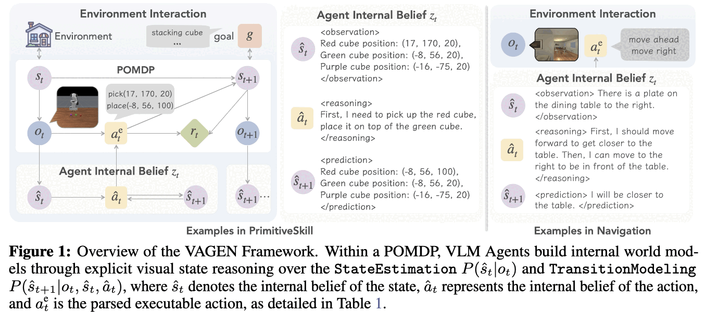

# 2. Contribution

- **reasoning을 world model 구조로 강제**하는 것이 multi-turn VLM agent RL에서 결정적임을 5-way 비교로 입증
  - `WorldModeling` 0.76 vs `FreeThink` 0.67 vs `NoThink` 0.28 (Qwen2.5-VL-3B, 5태스크 평균)
- **visual state 표현은 태스크 의존적**임을 보임 — 보편 최적 표현은 없음
  - 일반 태스크는 Natural Language, 고정밀 manipulation은 Structured. Symbolic은 **가장 나쁨**(grounding 실패)
- **WorldModeling Reward** (LLM-as-a-Judge 기반 turn-level dense reward) + **Bi-Level GAE** (turn $\to$ token 2단 credit assignment) 제안
- **3B 모델로 overall 0.82** 달성 — untrained 0.21 대비 약 4배, GPT-5(0.75)·Gemini 2.5 Pro(0.67)·Claude 4.5 Sonnet(0.62) 상회
- **VAGEN framework** 공개: 환경 셋업과 모델 학습을 분리한 확장 가능한 multi-turn VLM agent RL 시스템

# 3. 문제 정의와 5가지 Reasoning 전략

## 3.1 POMDP formulation

- $(\mathcal{S}, \mathcal{O}, \mathcal{A}, P, R, \Omega, \gamma)$로 multi-turn VLM agentic task를 정의
- 매 turn $t$에서 agent는 $a_t = \langle z_t, a^e_t \rangle$를 생성. $z_t$는 reasoning 토큰, $a^e_t$는 파싱되어 실제 실행되는 action
- trajectory $\tau = (s_0, o_0, a_0, r_0, \ldots, s_T, o_T)$ 전체를 최적화 대상으로 둠 (single-turn 최적화 기반인 기존 VLM RL과의 차이)

VAGEN notation 정리: $o_t, s_t, \hat{s}_t, a_t, \hat{a}_t, a^e_t$ 등

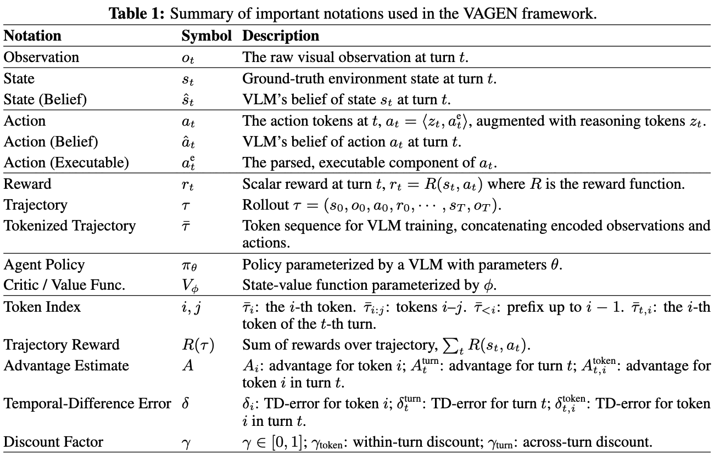

## 3.2 5가지 reasoning 전략

$z_t$를 어떻게 구조화하느냐로 5단계를 설계:

| 전략 | $z_t$ 구성 | 학습 대상 |
|---|---|---|
| `NoThink` | $z_t = \emptyset$ | 없음 (action만) |
| `FreeThink` | 자유 자연어 | 암묵적 |
| `StateEstimation` | $\langle \hat{s}_t, \hat{a}_t \rangle$ | $\hat{s}_t \to s_t$ |
| `TransitionModeling` | $\langle \hat{a}_t, \hat{s}_{t+1} \rangle$ | $\hat{s}_{t+1} \to s_{t+1}$ |
| `WorldModeling` | $\langle \hat{s}_t, \hat{a}_t, \hat{s}_{t+1} \rangle$ | 둘 다 |

- 출력 포맷은 `<think><observation>…</observation><reasoning>…</reasoning><prediction>…</prediction></think><answer>…</answer>`
- 포맷 준수를 위해 DeepSeek-R1식 **format reward** $r^{\text{format}}_t$ 병행
- 주의: $t+1$ turn에서는 예측한 $\hat{s}_{t+1}$을 쓰지 않고 **실제 관측 $o_{t+1}$로 belief를 재생성**함 (오차 누적 차단)

## 3.3 VAGEN-Base 최적화

- actor-critic + PPO. observation token은 **mask**해서 loss에서 제외
  - $M^{\text{loss}}_i$ = action token이면 1, observation token이면 0
  - 이유: image token은 policy가 생성한 게 아니므로 여기서 학습하면 근본적으로 틀림
- VAGEN-Base는 표준 **Token-Level GAE** 사용. 중간 토큰 reward는 KL penalty, 마지막 action token에 trajectory 총 return $R(\tau) = \sum_t R(s_t, a_t)$를 몰아줌

# 4. 실험 환경과 Off-the-Shelf VLM의 한계

## 4.1 5개 환경

- **Sokoban**: 2D grid 박스 밀기, discrete action (up/down/left/right)
- **FrozenLake**: 2D grid 목표 도달, slippery 비활성화로 결정론화
- **Navigation**: AI2-THOR 기반 3D embodied, 1인칭 뷰 + `moveahead` 등 discrete action
- **PrimitiveSkill**: ManiSkill3 Panda Arm 조작, hybrid action space (`pick(x,y,z)`). 3인칭 3D 장면에서 좌표로 grounding 필요
- **SVG Reconstruction**: 타겟 이미지를 재현하는 SVG 코드 생성, open-ended text action. DreamSim/DINO similarity를 dense reward로

5개 환경의 visual state 예시

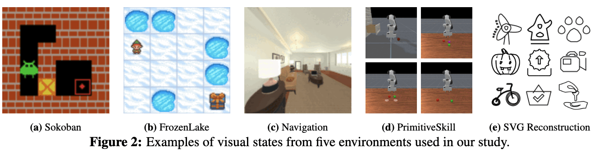

## 4.2 기존 VLM은 multi-turn agentic task를 못 푼다

7개 proprietary/open-source 모델 + 5가지 reasoning 전략 + RL baseline 전체 비교

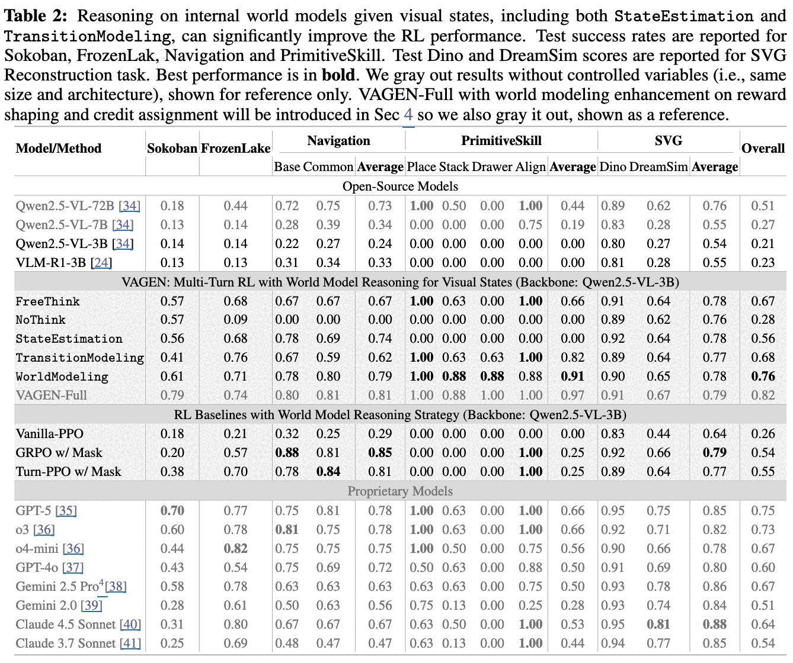

- 최고 성능 proprietary 모델인 GPT-5도 **0.75/1.0**에 그침
- 특히 **PrimitiveSkill Drawer는 어떤 모델도 성공하지 못함**(전부 0.00) — 현 VLM의 조작 reasoning 한계를 보여주는 구간
- VLM-R1처럼 **비(非)agentic 태스크로 학습된 reasoning VLM은 multi-turn에서 이득이 없음**(overall 0.23)

## 4.3 reasoning 전략 비교 (Qwen2.5-VL-3B, VAGEN-Base)

| 전략 | Sokoban | FrozenLake | Nav avg | PrimitiveSkill avg | SVG avg | **Overall** |
|---|---|---|---|---|---|---|
| `NoThink` | 0.57 | 0.09 | 0.00 | 0.00 | 0.76 | **0.28** |
| `FreeThink` | 0.57 | 0.68 | 0.67 | 0.66 | 0.64 | **0.67** |
| `StateEstimation` | 0.56 | 0.68 | 0.74 | 0.00 | 0.62 | **0.56** |
| `TransitionModeling` | 0.41 | 0.76 | 0.62 | 0.82 | 0.77 | **0.68** |
| `WorldModeling` | 0.61 | 0.71 | 0.79 | 0.91 | 0.78 | **0.76** |

- `FreeThink` $\to$ `NoThink` 격차(0.67 vs 0.28)가 **명시적 reasoning 자체의 가치**를 보여줌. Navigation/PrimitiveSkill에서 `NoThink`는 아예 0
- **역할 분담이 선명함**
  - `StateEstimation`은 Navigation에서 강함(0.74) — 현재 관측 이해가 핵심인 태스크
  - `TransitionModeling`은 PrimitiveSkill에서 강함(0.82) — 다음 상태 예측이 핵심인 조작 태스크
  - 한쪽만 쓰면 **태스크 구조가 안 맞을 때 오히려 손해** (`StateEstimation`의 PrimitiveSkill 0.00)
- $\to$ 둘을 합친 `WorldModeling`만이 **모든 태스크에서 안정적**. untrained 대비 **+0.55** 개선으로 모든 proprietary 모델을 앞섬

## 4.4 기존 RL baseline은 왜 안 되는가

| RL baseline | Overall |
|---|---|
| Vanilla-PPO | 0.26 |
| GRPO w/ Mask | 0.54 |
| Turn-PPO w/ Mask | 0.55 |
| **VAGEN-Base (WorldModeling)** | **0.76** |

- **Vanilla-PPO**: observation token masking 부재 $\to$ image token으로부터 학습하는 게 구조적으로 틀림. 게다가 긴 observation sequence가 learning weight를 지배
- **GRPO w/ Mask**: scene change로 trajectory diversity가 너무 커서 masking을 해도 샘플 수가 감당 안 됨
- **Turn-PPO w/ Mask**: turn 내 action token에 **균일 advantage**를 주므로 토큰별 기여도를 못 잡음 $\to$ Bi-Level GAE의 동기

# 5. Internal Belief를 어떤 표현으로 쓸 것인가

같은 visual state를 Natural Language / Symbolic / Structured로 변환한 예시

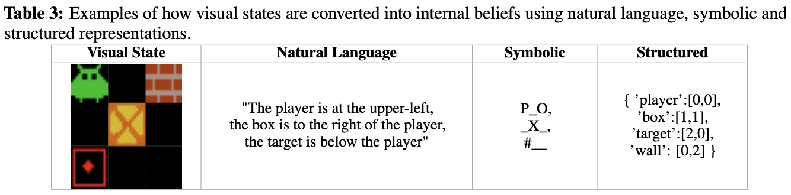

- **Natural Language**: "player is at the upper-left, the box is to the right of the player" 같은 자유 서술
- **Symbolic**: 환경 고유 grid 심볼 (`P_O_`, `_X_`, `#__`)
- **Structured**: 태스크별 dict (`{'player':[0,0], 'box':[1,1], 'target':[2,0], 'wall':[0,2]}`)

표현별 성능 비교

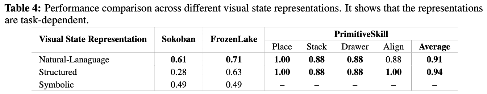

- **grid 태스크(Sokoban/FrozenLake)는 Natural Language 압승**
  - 모델에 symbolic layout을 해석할 prior가 없고, image-only 입력에서 뽑은 structured 출력은 노이즈가 큼
  - Sokoban에서 NL 0.61 vs Structured 0.28 — **33pp 격차**
- **PrimitiveSkill은 Structured가 근소 우위**(0.94 vs 0.91)
  - 프롬프트로 structured object position list를 제공하므로 grounding이 정밀해지고 next-state 예측이 쉬워짐
- **Symbolic은 가장 나쁨** — 추상 심볼과 raw visual input을 연결하는 grounding 문제. "추상화가 일반화를 주지 않는다"는 다소 반직관적 결과
- $\to$ 이후 실험 기본값은 **NL**, PrimitiveSkill만 **Structured**

# 6. Reward Shaping과 Credit Assignment

## 6.1 WorldModeling Reward

- 첫 시도는 **CLIP 기반 image-text similarity**였으나 **실패**
  - fine-grained spatial/geometric detail에 충분히 민감하지 않아 reward signal이 신뢰 불가
- 대안: **LLM-as-a-Judge**
  - 환경에서 text 기반 ground-truth state를 추출 (Sokoban: player/box/target 2D 좌표, FrozenLake: player/target/hole, PrimitiveSkill: object 이름+좌표, Navigation: object로부터의 상대 거리·방향)
  - judge가 **직접 판정**하거나, agent 텍스트에서 구조화 정보를 먼저 뽑아 **rule-based F1**으로 비교하는 hybrid protocol

  $$r^{\text{reason}}_t = \beta_s \cdot \mathbb{I}_{\texttt{StateEstimation}}(\hat{s}_t, s_t) + \beta_w \cdot \mathbb{I}_{\texttt{TransitionModeling}}(\hat{s}_{t+1}, s_{t+1})$$

  - $\mathbb{I}$는 binary(직접 판정) 또는 연속 정규화 점수(rule-based). 실험에서 $\beta_s = \beta_w = 0.5$

## 6.2 Bi-Level GAE

- VAGEN-Base의 한계: 모든 task reward를 **trajectory 마지막 토큰에 몰아줌** $\to$ turn 단위 성공/실패에 credit을 못 줌
- **turn-level advantage** 먼저 계산:

  $$\delta^{\text{turn}}_t = r_t + \gamma_{\text{turn}} V_\phi(\bar\tau_{\le a_{t+1}}) - V_\phi(\bar\tau_{\le a_t})$$
  $$A^{\text{turn}}_t = \delta^{\text{turn}}_t + \gamma_{\text{turn}} \lambda^{\text{turn}} A^{\text{turn}}_{t+1}$$

- **token-level advantage**는 turn 내부에서 별도 GAE. 토큰 reward는 KL penalty뿐:

  $$\delta^{\text{token}}_{t,i} = r^{\text{KL}}_{t,i} + \gamma_{\text{token}} V_\phi(\bar\tau_{t,<i+1}) - V_\phi(\bar\tau_{t,<i})$$
  $$A^{\text{token}}_{t,i} = \delta^{\text{token}}_{t,i} + \gamma_{\text{token}} \lambda^{\text{token}} A^{\text{token}}_{t,i+1}$$

- **두 레벨을 잇는 핵심**: token backward pass를 **action $a_t$의 마지막 토큰 advantage = $A^{\text{turn}}_t$** 로 초기화
  - turn별 피드백이 그 turn을 생성한 모든 토큰으로 역전파됨

Token-Level GAE vs Bi-Level GAE 비교 — sparse 최종 reward 역전파 vs turn별 reward 주입 후 2단 전파

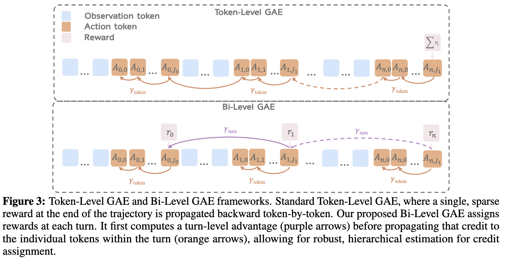

Bi-Level GAE 절차, Appendix

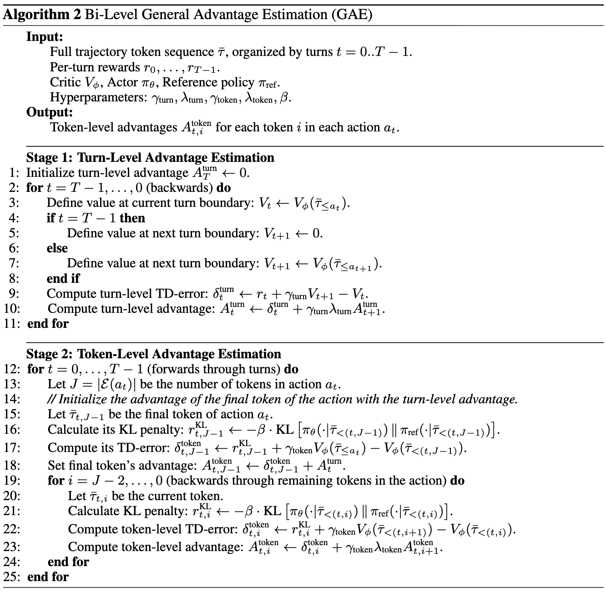

## 6.3 VAGEN-Full

$$r_t = r^{\text{reason}}_t + r^{\text{format}}_t + R(s_t, a_t)$$

- $r^{\text{reason}}_t$: `WorldModeling` 전략 + WorldModeling Reward + Bi-Level GAE
- $r^{\text{format}}_t$: output structure를 얼마따 준수했는지
- $R(s_t, a_t)$: 환경이 주는 sparse reward
- SVG Reconstruction은 world dynamics가 없는 multi-turn reasoning 태스크라 **Bi-Level GAE만** 적용

# 7. Experiments

## 7.1 VAGEN-Base vs VAGEN-Full

VAGEN-Base / VAGEN-Full test success rate

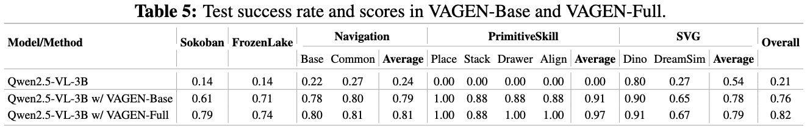

- Full이 전 태스크에서 Base 상회. 특히 **Sokoban +18pp**, **PrimitiveSkill +6pp**
- 중요한 관찰: PrimitiveSkill에서 **training accuracy는 Base/Full이 비슷한데 test는 Full이 크게 앞섬**
  - $\to$ StateEstimation·TransitionModeling supervision이 **새 장면에 대한 일반화(robustness)**를 올린다는 해석

## 7.2 Ablation

VAGEN-Base / +Bi-Level GAE / +WorldModeling Reward / VAGEN-Full의 학습 곡선, 5개 환경

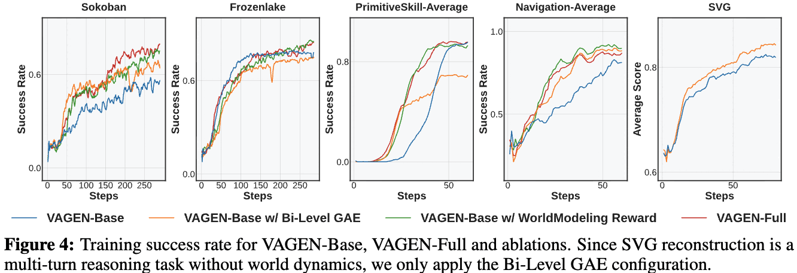

- **Bi-Level GAE 단독**: 이득은 크지만 **일관성이 없음**
  - reward sparsity/accuracy에 매우 민감 $\to$ dense·정확한 중간 보상이 없는 환경에서는 **학습 불안정**
- **WorldModeling Reward 단독**: baseline 대비 **일관되게** 개선하지만, 표준 RL의 거친 trajectory-level credit assignment에 발목 잡힘
- **VAGEN-Full**: 가장 안정적이고 전 태스크에서 고르게 좋음
- $\to$ **fine-grained credit assignment와 고품질 reasoning supervision은 둘 다 있어야** 함 (상보적)

## 7.3 Case Study

Navigation / Sokoban / PrimitiveSkill에서 VAGEN-Base(좌) vs VAGEN-Full(우) rollout 비교

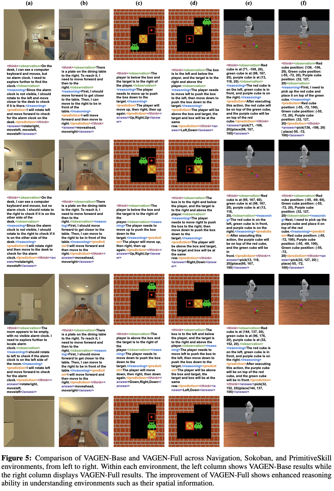

- **공간 이해·계획 향상**: VAGEN-Full은 공간 관계를 식별하고 blocking constraint를 인식 $\to$ 더 효과적인 navigation
- **response convergence와 exploration 감소**: 학습이 진행되며 entropy가 꾸준히 하락. 초기에는 다양하고 서술적이던 응답이 후기에는 **간결·템플릿화**됨
  - WorldModeling Reward 유무와 **무관하게** 발생 $\to$ RL training의 일반적 패턴
- **Reward Hacking / over-optimization**: LLM-as-a-Judge 기준만 만족시키는 **범용적이고 두루뭉술한 응답**을 학습하는 경우 존재
  - **Bi-Level GAE를 쓴 agent에서 특히 두드러짐** (reward maximization에 그만큼 효과적이라는 반증)
  - 완화 방법은 Appendix D.2

# 8. Conclusion & Limitations

- **결론**: reasoning 과정을 StateEstimation(grounding)과 TransitionModeling(prediction)으로 **구조화해서 보상**하면, VLM agent가 multi-turn 상호작용 중 internal world model을 유지·갱신하게 됨. turn-level WorldModeling Reward가 dense signal을, Bi-Level GAE가 long-horizon credit assignment를 담당
- **저자가 명시한 한계**
  - **제한된 model architecture** — Qwen2.5-VL-3B 중심, 다른 VLM family 미검증
  - **제한된 evaluation environment** — 5개 환경이 전부
  - future work로 추가 VLM family 탐색과 multi-turn visual understanding용 SFT를 언급
- **리뷰어 관점에서 추가로 걸리는 점**
  - **WorldModeling Reward가 환경의 text ground-truth state에 의존**함. Sokoban의 좌표, PrimitiveSkill의 object 좌표처럼 시뮬레이터가 내주는 정보가 필요 $\to$ 실제 환경 이전이 간단하지 않음
  - **LLM-as-a-Judge가 reward hacking 경로**임을 저자 스스로 case study에서 인정. 완화책은 Appendix로 미룸
  - Table 2에서 proprietary 모델은 **크기/아키텍처가 통제되지 않은 reference**이고 VAGEN-Full도 grey-out 처리됨 — "3B가 GPT-5를 이겼다"는 **5개 태스크 특화 학습 후의 in-domain 비교**임에 유의
  - Gemini 2.5 Pro는 safety policy로 PrimitiveSkill·Navigation 응답 일부가 차단되어 **unblocked case만으로 산출**된 수치
  - FrozenLake는 VAGEN-Full(0.74)이 `TransitionModeling`(0.76)·Claude 4.5(0.80)보다 낮음 — 모든 구간에서 이기는 건 아님
  - entropy 하락·템플릿화를 "RL의 일반적 패턴"으로 넘겼는데, 같은 저자진의 [RAGEN-2](https://arxiv.org/pdf/2604.06268)가 지적한 **template collapse**와 정확히 겹치는 현상

# Takeaways

- multi-turn **VLM** agent의 병목은 action 선택이 아니라 **상태 추정**이다. POMDP로 보면 reasoning은 world model을 세우는 과정이어야 하고, 그걸 포맷으로 강제하는 것만으로 0.28 $\to$ 0.76이 나온다
- **StateEstimation과 TransitionModeling은 태스크마다 역할이 다르다.** navigation은 "지금 뭐가 보이나", manipulation은 "다음에 뭐가 되나". 한쪽만 쓰면 안 맞는 태스크에서 0점이 나오므로 **둘 다 요구하는 게 안전**
- **internal belief 표현에 보편 최적은 없다.** grid 태스크는 자연어, 고정밀 조작은 structured. symbolic 추상화는 grounding이 안 돼서 가장 나쁨 — "더 추상적 = 더 일반적"이 아님
- **dense reward와 fine-grained credit assignment는 세트로 가야 한다.** Bi-Level GAE 단독은 reward sparsity에 민감해 불안정하고, dense reward 단독은 trajectory-level credit에 묻힌다
- **observation token masking은 VLM agent RL의 전제조건**이다. 빼먹으면(Vanilla-PPO) 0.26으로 주저앉음
- LLM-as-a-Judge reward는 **강력한 만큼 해킹된다**. advantage estimation이 정교해질수록 hacking도 잘하게 된다는 점이 역설적
