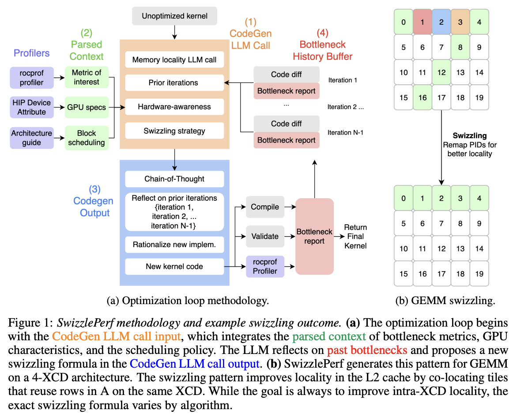

# [Agent] SwizzlePerf: Hardware-Aware LLM으로 GPU Kernel의 Cache Locality를 최적화하기

- paper: https://arxiv.org/pdf/2508.20258
- github (base framework, IntelliPerf): https://github.com/AMDResearch/intelliperf
- NeurIPS 2026 accepted (인용수: 21회, 26-11-19 기준)
- 저자: Harvard University (Arya Tschand, Jeffrey Ma, Vijay Janapa Reddi), AMD (Muhammad Awad, Ryan Swann, Keith Lowery, Ganesh Dasika), Stanford University (Kesavan Ramakrishnan)
- downstream task: LLM-based GPU kernel performance optimization
  - AMD Instinct MI300X의 disaggregated XCD 구조에서 Triton kernel의 program ID를 재배치하여 per-XCD L2 locality를 높이는 **swizzling pattern 생성**
- 주요 용어
  - **hardware-awareness**: GPU/XCD/cache 사양, block scheduling policy, profiler metric을 LLM context에 명시적으로 제공하는 것
  - **XCD (Accelerator Complex Die)**: MI300X를 구성하는 chiplet 단위. 각 XCD가 전용 L2 cache를 가지므로 어느 XCD에 workgroup이 배치되는지가 locality를 좌우함
  - **swizzling**: 계산 결과는 유지하면서 program ID가 처리할 tile을 재매핑하여, 재사용 관계가 있는 tile을 같은 XCD에 모으는 변환
  - **bottleneck metric**: 광범위한 runtime 대신 최적화 대상과 직접 연결된 저잡음 지표. 본 논문에서는 spatial locality의 proxy로 **L2 hit rate**를 사용
  - **bottleneck history buffer**: 이전 iteration의 code diff와 profiling 결과를 누적하여, LLM이 실패한 mapping을 반복하지 않고 다음 후보를 제안하게 하는 기록

# 1. Motivation

- 기존 LLM 기반 GPU kernel 최적화는 대체로 **runtime을 reward로 둔 search**임
  - runtime은 kernel launch overhead, compute saturation, 여러 병목의 중첩 때문에 noisy함
  - cache topology, chiplet boundary, block placement policy가 prompt에 없으면 하드웨어에 맞는 변환을 추론하기 어려움

- 인간 performance engineer는 다음과 같이 작업함

  1. profiler로 병목을 격리
  2. architecture와 scheduling policy를 함께 해석
  3. 병목에 직접 대응하는 변환을 적용
  4. 관련 metric으로 개선 여부를 확인

- MI300X와 같은 disaggregated GPU에서는 각 XCD가 별도 L2 cache를 가짐
  - 기본 workgroup scheduling은 XCD 사이의 round-robin
  - 인접 tile이 서로 다른 XCD에 흩어지면 동일 데이터를 재사용해도 local L2에서 찾지 못함
  - program ID를 바꿔 관련 tile을 같은 XCD에 모으면, 계산 자체를 바꾸지 않고 cache locality를 높일 수 있음

$\to$ LLM에 **필터링된 hardware context + bottleneck-specific feedback**를 주면, 인간이 수작업으로 찾던 swizzling pattern을 자동으로 만들 수 있는가?

# 2. Contribution

- **SwizzlePerf** 제안: IntelliPerf의 compile/validate/profile loop에 hardware-awareness를 추가한 GPU kernel optimization agent
  - `rocprofv3`의 병목 metric, HIP device attribute, architecture guide의 scheduling policy를 구조화하여 prompt에 제공
  - L2 hit rate를 primary objective로 고정하고, correctness를 통과한 후보 중 최고 hit rate kernel을 유지
- GEMM에서 전문가가 2주 동안 설계·검증한 swizzle과 기능적으로 같은 mapping을 **5분 미만**에 생성
  - 전문가 코드에는 없던 ceiling-division edge case까지 처리
- 10개 ML/Science kernel에서
  - 9/10개 kernel speedup
  - 평균 **1.29×**, 최대 **2.06×** speedup
  - L2 hit rate 평균 **+23.9pp**, 최대 **+70pp**
- 문제 크기와 LLM을 바꾸는 ablation으로 generalization과 model dependency를 분석

SwizzlePerf optimization loop와 GEMM의 XCD-aware swizzling 개념

# 3. Related Works

## 3.1 GPU Kernel Optimization

- **heuristic autotuner / analytic cost model**: tiling, unrolling, coalescing 등의 rule-based schedule 탐색
- **learned cost model**: code·schedule feature에서 runtime을 예측하고 combinatorial search를 유도
- **LLM/RL-driven search**: test-time exploration 또는 multi-turn refinement로 빠른 kernel을 생성
  - KernelBench, CUDA-L1, GPU Kernel Scientist, Kevin 등이 이 계열

- 논문의 문제 제기
  - 기존 방법은 구체적인 cache topology, chiplet boundary, block scheduling을 추상화함
  - machine feedback도 대체로 최종 runtime에 치우침
  - 따라서 hardware-specific transformation을 찾기에는 search space가 넓고 feedback이 불안정함

## 3.2 Swizzling on Disaggregated GPUs

- swizzling은 data/work와 execution/storage location의 mapping을 재정렬하는 일반적 기법
- 본 논문의 case study에서는 Triton program ID를 다시 계산하여 tile과 XCD의 대응 관계를 바꿈

$$
\text{related tiles} \to \text{same XCD} \to \text{per-XCD L2 reuse 증가}
$$

- 핵심은 단순히 연속 block을 묶는 것이 아니라, **kernel의 memory access pattern에 따라 어떤 tile이 데이터를 공유하는지**를 찾아 mapping 식으로 바꾸는 것

# 4. SwizzlePerf

## 4.1 Hardware-Aware Optimization Loop

SwizzlePerf는 매 iteration마다 다음 네 요소를 연결함.

### (1) CodeGen LLM Call

- 입력
  - original kernel과 bottleneck report
  - kernel의 memory-locality 요약
  - 이전 optimization attempt의 compact history
  - XCD 수, cache 크기, block scheduling policy
  - 목표 transformation과 output code 형식
- 일반적인 "kernel을 빠르게 만들어라"가 아니라 **L2 locality를 높이는 swizzling formula를 작성하라**고 목표를 제한함

### (2) Parsed Context

- `rocprofv3` $\to$ L2 hit rate 등 bottleneck metric
- HIP device attributes $\to$ GPU/XCD/cache parameter
- architecture guide $\to$ default block scheduling policy
- 비교 대상
  - **Hardware-unaware**: 위 hardware/scheduling context가 없는 기본 IntelliPerf
  - **Hardware-overload**: 필터링하지 않은 10k+ token GPU architecture 문서를 통째로 제공

### (3) CodeGen Output

- DSPy output signature로 다음 출력을 요구
  - 이전 mapping이 suboptimal했던 이유
  - 새 mapping이 나을 것으로 예상하는 이유
  - swizzling formula가 포함된 kernel code
- 생성한 kernel은 즉시 compile하고 reference implementation과 correctness를 비교한 뒤 profiling함

### (4) Bottleneck History Buffer

- 각 iteration의 code diff와 bottleneck report를 누적
- 다음 호출은 broken mapping, L2 변화가 없던 mapping을 보고 다른 remapping을 제안
- correctness를 통과한 후보를 L2 hit rate로 rank하고 best-so-far kernel을 반환

figure3 첨부 (hardware-aware LLM input prompt 구조)

figure4 첨부 (DSPy output signature와 이전 시도 reflection 구조)

# 5. Hardware-Aware Swizzling Patterns

## 5.1 GEMM Swizzling Example

- tiled GEMM에서 output $C(M\times N)$의 같은 행 tile은 $A$의 행을, 같은 열 tile은 $B$의 열을 공유함
- round-robin scheduling에서는 인접 tile이 다른 XCD에 배치되어 per-XCD L2 reuse가 깨짐
- SwizzlePerf가 생성한 핵심 mapping

$$
\texttt{b\_per\_xcd}=\left\lceil\frac{\texttt{num\_blocks}}{\texttt{num\_xcds}}\right\rceil
$$

$$
\texttt{new\_pid}=(\texttt{pid}\bmod \texttt{num\_xcds})\cdot\texttt{b\_per\_xcd}
+\left\lfloor\frac{\texttt{pid}}{\texttt{num\_xcds}}\right\rfloor
$$

- contiguous tile group을 같은 XCD가 담당하도록 PID를 바꾸되, ceiling division으로 block 수가 XCD 수의 배수가 아닌 경우도 처리
- GEMM은 L2 hit rate가 **+14.1pp** 증가하지만 compute-bound여서 speedup은 **1.03×**에 그침

figure5 첨부 (GEMM tile-to-XCD mapping과 생성된 Triton swizzling code)

## 5.2 Kernel-Specific Mapping

- **LayerNorm**: 같은 row의 column chunk를 한 XCD에 모아 mean/variance partial sum과 weight/bias를 재사용 $\to$ **+33.7pp**
- **Softmax**: 같은 row의 chunk를 한 XCD에 묶어 max와 exp-sum의 two-phase reduction 사이에 row value 유지 $\to$ **+66.5pp**, **1.54×**
- **FDTD 2D**: 같은 vertical stride의 neighbor-dependent block을 묶고 XCD 사이에는 균등 분산 $\to$ **+19.7pp**, **1.73×**
- **Stencil 2D**: M/N 방향의 neighbor tile을 같은 L2에 배치 $\to$ **+69.9pp**, **1.29×**
- **Transpose**: input row와 대응 output column band를 같은 XCD가 담당 $\to$ **+40.9pp**, **2.06×**

figure6 첨부 (LayerNorm swizzling pattern)

figure7 첨부 (Softmax swizzling pattern)

figure8 첨부 (FDTD 2D swizzling pattern)

figure9 첨부 (Stencil 2D swizzling pattern)

figure10 첨부 (Transpose swizzling pattern)

# 6. Experiments

## 6.1 Setup

- hardware: AMD Instinct MI300X, 8 XCD configuration
- kernel: 총 10개, medium problem size에서 원본 runtime이 약 5ms인 설정
  - ML 6개: Fused Elementwise, naive SpMV, GEMM, LayerNorm, Softmax, Transpose
  - Science 4개: Black-Scholes, Smith-Waterman, Stencil 2D, FDTD 2D
- correctness
  - ML kernel: PyTorch reference
  - Science kernel: CPU reference
- metric
  - primary optimization signal: L2 hit rate
  - final utility: end-to-end kernel speedup
- baseline
  - Hardware-unaware
  - Hardware-overload

## 6.2 Main Results

figure2 첨부 (10개 kernel의 L2 hit rate 개선과 end-to-end speedup)

| Kernel | L2 hit rate 개선 | Speedup |
|---|---:|---:|
| Fused Elementwise | 0pp | 1.00× |
| naive SpMV | +8.3pp | 1.00× |
| GEMM | +14.1pp | 1.03× |
| LayerNorm | +33.7pp | 1.09× |
| Softmax | +66.5pp | 1.54× |
| Transpose | +40.9pp | **2.06×** |
| Black-Scholes | +1.8pp | 1.00× |
| Smith-Waterman | +3.8pp | 1.17× |
| Stencil 2D | **+69.9pp** | 1.29× |
| FDTD 2D | +19.7pp | 1.73× |

- 평균 speedup **1.29×**, L2 hit rate 평균 개선 **+23.9pp**
- 4개 kernel의 swizzled implementation은 L2 hit rate가 거의 100%에 도달
- memory-sensitive kernel에서는 L2 개선이 큰 speedup으로 이어짐
  - Transpose: +40.9pp $\to$ 2.06×
  - FDTD 2D: +19.7pp $\to$ 1.73×
- 반대로 cache hit rate가 좋아져도 compute-bound이거나 다른 병목이 지배하면 runtime은 거의 그대로임
  - GEMM: +14.1pp $\to$ 1.03×
  - naive SpMV: +8.3pp $\to$ 1.00×

$\to$ L2 hit rate는 **swizzling이 의도대로 locality를 바꿨는지** 보여주는 좋은 optimization signal이지만, 최종 speedup의 충분조건은 아님

## 6.3 Filtered Context vs Hardware Overload

- Hardware-unaware는 kernel size에 기반한 단순 mapping을 생성하여 유의미한 개선을 거의 만들지 못함
- Hardware-overload는 bitwise SHIFT/ADD swizzle을 생성
  - 특정 Transpose size에서는 SwizzlePerf보다 L2 hit rate가 최대 70% 높을 수 있음
  - 그러나 tile count, block size, XCD 수가 바뀌면 reuse가 깨지고, bijectivity를 위반하여 non-existent block을 가리키는 correctness failure가 발생
- 필터링된 context의 장점은 정보량 자체보다 **현재 병목과 mapping constraint에 필요한 정보만 남기는 것**

figure11 첨부 (hardware-aware Transpose swizzling code)

figure12 첨부 (hardware-unaware Transpose mapping)

figure13 첨부 (hardware-overload가 만든 bitwise swizzling code)

## 6.4 Optimization Progression

- 5 iteration 동안 best-so-far L2 hit rate와 현재 후보의 hit rate를 비교
- GEMM은 1 iteration 안에 정답 mapping을 찾지만 두 baseline은 5회 모두 실패
- Stencil 2D는 여러 mapping을 탐색하며 거의 100%까지 상승
- Softmax와 LayerNorm은 여러 iteration 뒤에야 성공 pattern에 수렴
- history buffer가 단순 best-of-$N$ search를 넘어 실패 원인을 다음 proposal에 전달한다는 정성적 증거

figure14 첨부 (GEMM·Stencil 2D·SpMV·Softmax·LayerNorm의 iteration별 L2 hit rate)

## 6.5 Generalization Across Problem Sizes

- **LayerNorm**: $64\times1024\times1024$부터 $512\times8192\times1024$까지 L2 hit rate가 대체로 46% $\to$ 60%로 일정하게 상승
- **Smith-Waterman**: sequence length $512^2$부터 $8192^2$ DP cell까지, 작은 입력 약 +3pp에서 큰 입력 약 +10pp로 gap 증가
- **Stencil 2D**: $512^2$부터 $10{,}240^2$ cell까지
  - unswizzled: 65% $\to$ 53%로 감소
  - swizzled: 74–82% 유지

figure15 첨부 (LayerNorm·Smith-Waterman·Stencil 2D의 problem size별 L2 hit rate)

## 6.6 Different LLMs

- OpenAI 4o, 4.1-mini, o3-mini를 GEMM, LayerNorm, FDTD, Smith-Waterman에 비교
- GEMM: 세 모델 모두 expert-equivalent pattern 발견
- LayerNorm, FDTD: 4o만 효과적인 pattern 발견
- Smith-Waterman: o3-mini가 4o와 4.1-mini보다 높은 L2 hit rate
- reasoning model이 항상 우수하지 않으며, 적합한 모델은 kernel·architecture·problem size에 따라 달라짐

figure16 첨부 (4o·4.1-mini·o3-mini별 생성 pattern의 L2 hit rate와 4o speedup)

# 7. Conclusion & Limitations

## 7.1 Strengths

- **optimization objective를 잘 분해함**
  - noisy한 runtime만 직접 최적화하지 않고, 변환과 인과적으로 가까운 L2 hit rate를 search signal로 사용
  - runtime은 최종 utility로 별도 측정하여 proxy와 실제 성능을 구분함
- **hardware context가 구체적임**
  - 막연한 architecture 설명이 아니라 XCD 수, cache, scheduling policy, profiler 결과를 mapping constraint로 연결
- **correctness를 optimization loop 안에 포함함**
  - compile 성공만 보지 않고 reference implementation과 비교
  - hardware-overload의 높은 hit rate가 잘못된 mapping에서 나올 수 있음을 직접 보여줌
- **kernel마다 다른 locality structure를 코드로 구현함**
  - GEMM 한 사례에 그치지 않고 reduction, stencil, transpose 등 서로 다른 access pattern을 다룸

## 7.2 Limitations

- **단일 hardware / 단일 transformation**
  - MI300X의 XCD-aware swizzling만 평가함
  - NVIDIA GPU, 다른 AMD 세대, multi-GPU, tiling·fusion·vectorization 같은 다른 최적화로 일반화되는지는 미검증
- **작은 benchmark와 제한된 workload**
  - 10개 kernel, 약 5ms medium-size 설정이며 production model의 end-to-end workload는 아님
  - problem-size ablation도 3개 kernel에만 수행
- **baseline이 충분히 강하지 않음**
  - hardware-unaware와 unfiltered-document overload만 비교함
  - expert-written swizzle, compiler/autotuner, random/evolutionary search, 동일 budget의 program search와 성능·탐색 비용을 비교하지 않음
- **component ablation 부족**
  - profiler metric, architecture spec, scheduling policy, memory analysis, history buffer를 하나씩 제거한 실험이 없음
  - 따라서 어느 context가 성능을 만드는지 분리하기 어려움
- **통계와 측정 protocol 부족**
  - runtime 반복 횟수, 분산, confidence interval, warm-up 조건이 보고되지 않음
  - 1.03×, 1.09× 같은 작은 차이가 안정적인지 판단하기 어려움
- **본문과 부록의 수치가 완전히 일치하지 않음**
  - Figure 2는 Transpose의 L2 hit rate 개선을 +40.9pp로 표시하지만 Appendix A.3 설명은 +34%라고 서술함
  - 서로 다른 설정의 결과인지 단순 표기 오류인지 설명되지 않음
- **재현성 정보가 불완전함**
  - prompt의 골격은 공개하지만 main experiment의 정확한 model/configuration, sampling parameter, iteration budget, kernel별 전체 input과 생성 code가 충분히 명시되지 않음
  - 논문이 링크한 repository는 기반인 IntelliPerf이며, SwizzlePerf artifact가 별도로 제시되지는 않음
- **"hardware-awareness is necessary"는 다소 강한 주장**
  - 실험은 선택한 두 baseline보다 filtered context가 낫다는 것을 보이지만, hardware-aware cost model이나 다른 search가 불가능함을 보이지는 않음
- **L2 hit rate와 runtime의 불일치**
  - GEMM·SpMV처럼 hit rate는 올라도 speedup이 거의 없는 사례가 존재
  - 향후에는 L2 locality를 만족한 후보 안에서 runtime·power·occupancy까지 다목적으로 최적화할 필요
- **power efficiency는 가설 단계**
  - off-chip traffic 감소가 energy에 유리하다는 논리는 타당하지만, 본 논문에서는 전력이나 energy-to-solution을 측정하지 않음

## 7.3 Conclusion

- SwizzlePerf의 핵심 메시지는 LLM의 크기보다 **관측과 feedback의 설계**임
  - `hardware context + bottleneck metric + validated history`로 search space를 구조화하면, LLM이 architecture-specific code transformation을 빠르게 찾을 수 있음
- 10개 kernel에서 평균 1.29×, 최대 2.06×는 유의미하지만, 결과는 MI300X swizzling이라는 좁은 범위의 proof-of-concept로 읽는 것이 적절함
- 후속 연구에서 필요한 것
  - 여러 GPU architecture와 transformation으로 확장
  - 강한 autotuning/search baseline 및 expert code와 동일 budget 비교
  - context component별 ablation
  - runtime·power의 반복 측정과 통계 보고
  - 전체 artifact 공개를 통한 재현성 확보

## Takeaways

- GPU optimization agent에는 긴 hardware 문서보다 **병목과 직접 관련된 구조화 context**가 중요함
- transformation-specific proxy metric은 search를 안정화하지만, 최종 runtime과 함께 봐야 함
- LLM은 2주짜리 expert 작업을 5분 미만으로 줄일 가능성을 보였지만, 현재 증거는 단일 architecture의 swizzling에 한정됨
- 이 논문의 가장 일반화 가능한 아이디어는 **LLM code generation을 profiler–validator–history feedback loop 안에 넣는 것**임
