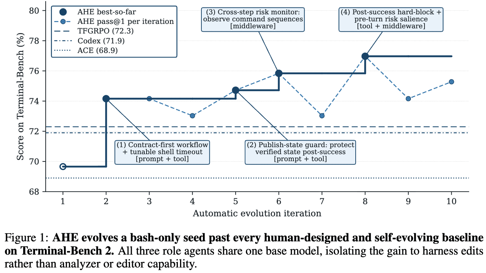
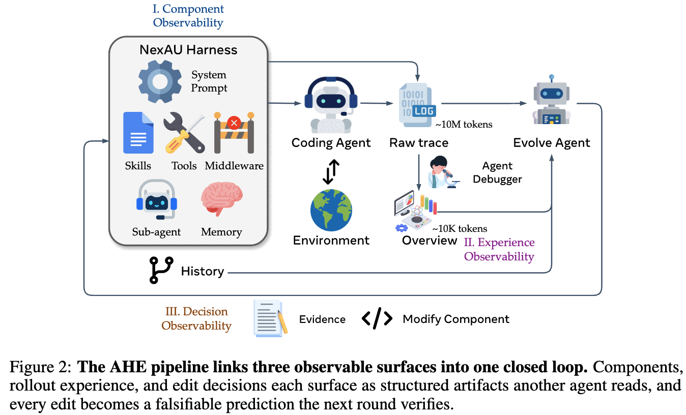
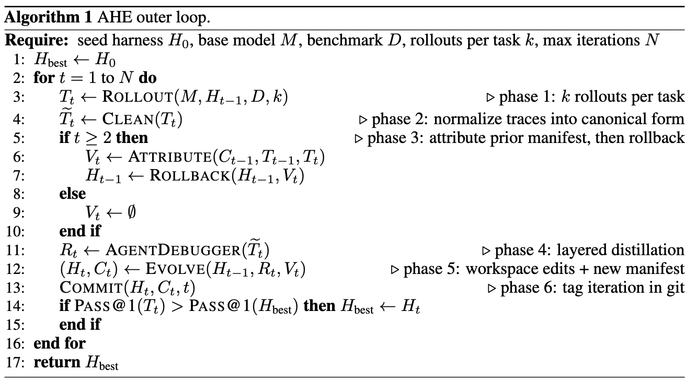
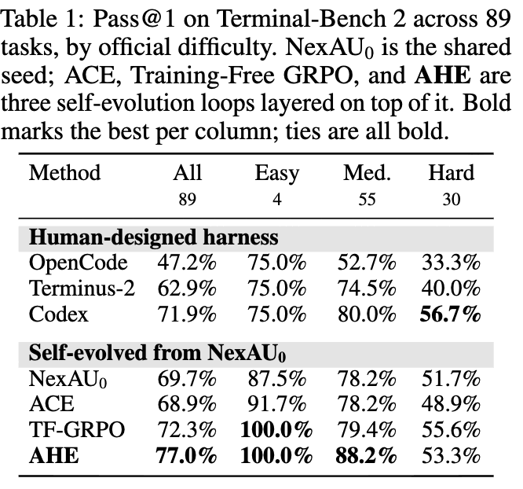
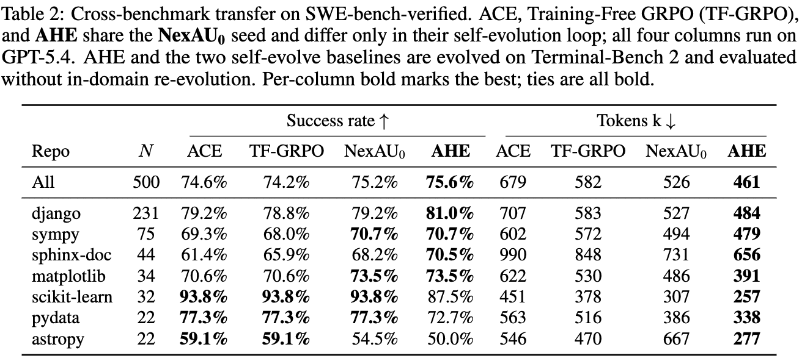
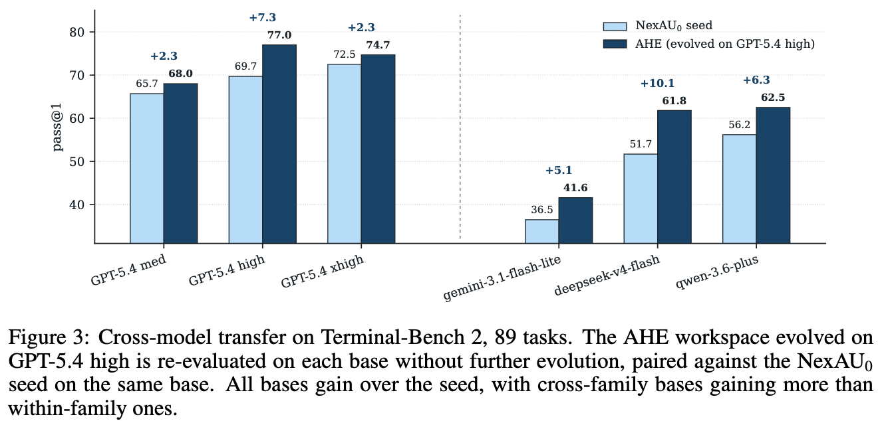
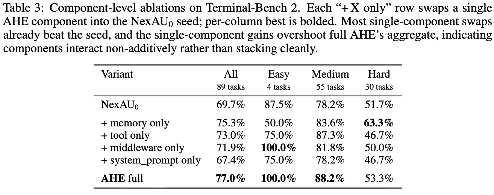
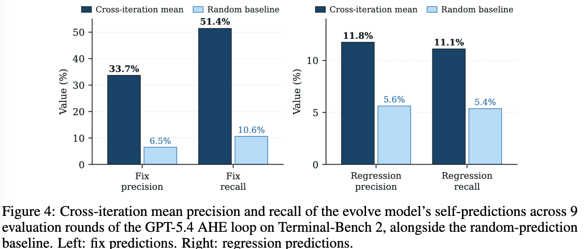

# [Agent] Agentic Harness Engineering: Observability로 Coding-Agent Harness를 자동 진화시키기

- paper: https://arxiv.org/pdf/2604.25850
- github: https://github.com/china-qijizhifeng/agentic-harness-engineering
- arXiv preprint (인용수: 71회, 26-11-20 기준)
- 저자: Fudan University (Jiahang Lin, Shichun Liu, Lizhi Lin, Shihan Dou, Zhiheng Xi, Xuanjing Huang, Tao Gui, Yu-Gang Jiang), Peking University (Chengjun Pan), Shanghai Qiji Zhifeng (Hang Yan, Zhenhua Han)
- downstream task: coding-agent harness의 자동 진화 (base model은 고정, model-external 컴포넌트만 편집)
  - Terminal-Bench 2 / SWE-bench-verified에서 pass@1과 token 효율을 동시에 개선하는 **harness 구성 탐색**
- 주요 용어
  - **harness**: model 바깥에 있는 편집 가능한 전부 — system prompt, tool description/implementation, middleware, skill, sub-agent config, long-term memory. 즉 모델이 환경을 어떻게 보고 어떻게 행동하는지를 매개하는 층
  - **component observability**: 7종 컴포넌트를 고정 mount point의 **파일**로 분리해, 각 failure pattern이 단일 컴포넌트 클래스에 매핑되고 edit이 file-level diff/rollback으로 환원되게 하는 것
  - **experience observability**: 수백만 token의 raw trajectory($\sim$10M)를 per-task analysis $\to$ benchmark-level overview($\sim$10K)로 계층 압축하고, 원본 trace는 drill-down 가능한 파일로 남겨 **progressive disclosure**를 제공하는 것
  - **decision observability**: 모든 edit에 "다음 라운드에 어떤 task가 고쳐지고(predicted fix) 어떤 task가 깨질지(predicted regression)"를 선언한 **change manifest**를 붙여, 다음 라운드 실측 delta와 교차해 검증·rollback하는 것
  - **falsifiable contract**: 위 manifest 때문에 모든 edit이 "그럴듯한 rationale"이 아니라 **반증 가능한 계약**이 되는 구조. 반증되면 파일 단위로 revert

# 1. Motivation

- coding agent의 성능은 base model만큼이나 **harness**에 좌우됨
  - base model을 고정해도 harness 설계만으로 long-horizon task 성공률이 크게 변함
  - 그런데 optimal harness는 model-specific $\to$ base model이 바뀔 때마다 사람이 trajectory를 뒤져 prompt/tool/middleware/skill을 손으로 고쳐야 함
  - 모델 발전 속도를 수작업 loop가 못 따라가면서 **model capability와 harness 사이의 gap**이 벌어짐

- 이 loop를 evolution agent로 자동화하려는 시도는 있었으나, 대부분 **단일 컴포넌트**만 건드림
  - prompt만 진화 (GEPA, ACE류 playbook), skill library만, in-context playbook만
  - 전체 harness를 end-to-end로 공동 진화시키려면 세 가지 구조적 장애가 있음
    1. **heterogeneous action space**: 편집 대상이 prompt/tool/middleware/memory로 이질적이라 "무엇을 고칠 수 있는가"가 명시적이지 않음
    2. **voluminous trajectory**: 라운드당 수백만~천만 token의 raw log에 실제 신호가 묻힘
    3. **attribution**: 어떤 edit이 어떤 성능 변화를 만들었는지 귀속이 어려움

$\to$ 저자들의 핵심 주장: 이 문제의 병목은 **agent capability가 아니라 observability**다. evolution agent에게 clear action space + 구조화된 evidence를 주면 더 나은 harness로 안정적으로 수렴한다.

10번의 자동 진화 iteration 동안 Terminal-Bench 2 점수가 69.7 $\to$ 77.0으로 오르며 Codex 71.9, TF-GRPO 72.3, ACE 68.9를 모두 넘어서는 곡선. 네 번의 주요 edit 지점에 어떤 컴포넌트가 바뀌었는지 주석

# 2. Contribution

- **AHE (Agentic Harness Engineering)** 제안: 세 개의 observability pillar로 구동되는 closed loop
  - 세 role agent(Code Agent / Agent Debugger / Evolve Agent)가 **같은 base model**을 공유 $\to$ gain이 analyzer·editor의 능력이 아니라 harness edit에서 온다는 것을 격리
- 실증: Terminal-Bench 2 pass@1을 10 iteration(약 32시간)만에 **69.7% $\to$ 77.0%**
  - human-designed harness인 Codex(71.9%), OpenCode(47.2%), Terminus-2(62.9%) 모두 상회
  - self-evolving baseline인 ACE(68.9%), Training-Free GRPO(72.3%)도 상회
- 진화를 멈춘 **frozen harness가 그대로 전이**됨 (재진화 없음)
  - SWE-bench-verified: aggregate success 최고 + seed 대비 token **12% 절감**
  - 3개 타 model family에서 Terminal-Bench 2 pass@1 **+5.1 ~ +10.1pp**
- 한계도 명시적으로 분석
  - 컴포넌트는 **non-additive**하게 상호작용해 단일 컴포넌트 gain의 합(+11.1pp)이 full AHE(+7.3pp)보다 큼
  - loop의 self-attribution은 **fix 예측은 신뢰할 만하지만 regression 예측은 사실상 blind**

# 3. Related Works

## 3.1 Harness engineering / evaluation

- harness = model을 둘러싼 tool, interface, memory, execution constraint, feedback loop 전체
- 평가 축은 task horizon과 environmental realism 두 방향으로 성숙
  - short-horizon function benchmark $\to$ repository-scale patch resolution(SWE-bench) $\to$ multi-hour terminal workflow(Terminal-Bench)
- AHE는 이 중 reproducible·traceable·verifiable execution 인프라 흐름 위에 observation system을 올림

## 3.2 Automated optimization of LLM agents

- optimizer가 **무엇을 관찰하고 무엇을 편집하는가**로 갈림
  - 출력 자체를 reflection으로 수정 / system prompt·instruction만 편집(playbook, semantic-advantage prior) / skill library / program·agent archive / graph-structured workflow
- AHE의 차별점
  - 단일 편집면이 아니라 **harness 전체를 combinatorial whole**로 튜닝 $\to$ cross-component trade-off가 optimizer에게 보임
  - human prior를 최소화 — methodology를 손으로 박지 않고 rollout에서 발견하게 함

# 4. Method: 세 개의 Observability Pillar

AHE pipeline: NexAU Harness의 7 컴포넌트 $\to$ Coding Agent $\to$ raw trace $\sim$10M token $\to$ Agent Debugger $\to$ overview $\sim$10K token $\to$ Evolve Agent $\to$ modify component, git history로 순환

설계 원칙: loop의 **모든 phase가 observable해야 한다**. 각 phase가 만드는 artifact(컴포넌트, rollout trajectory, edit decision)를 다른 agent가 읽고 행동할 수 있는 구조적·계층적 형태로 기록함.

## 4.1 Component observability — NexAU substrate

- harness $H$를 **NexAU** framework 위에 instantiate
  - 7종 orthogonal component를 고정 mount point의 **명시적 파일**로 노출: system prompt, tool description, tool implementation, middleware, skill, sub-agent config, long-term memory
  - 컴포넌트가 loosely coupled $\to$ middleware 추가에 system prompt를 안 건드려도 되고, skill 추가에 tool을 안 건드려도 됨
- 이 decoupling이 주는 것
  - 각 failure pattern이 **단일 컴포넌트 클래스**로 매핑 $\to$ evolve agent의 action space가 깨끗해짐
  - pass-rate 변화가 수백 줄 prompt prose에 흩어지지 않고 **한 파일**에 국소화
  - 각 logical edit = workspace git history의 한 commit $\to$ file-level diff와 rollback이 공짜

- seed harness $H_0$는 **의도적으로 최소**: shell-execution tool 하나, middleware 없음, skill 없음, sub-agent 없음
  - 이미 target benchmark에 맞춰진 seed를 쓰면 이후 모든 edit의 attribution이 오염됨 (gain이 loop에서 왔는지 seed에서 왔는지 구분 불가)
  - minimal seed는 AHE가 추가하는 **모든 컴포넌트가 measured rollout으로 제 값을 증명**하도록 강제

## 4.2 Experience observability — Agent Debugger

- benchmark의 각 task에 대해 harness $H$로 $k$개 trace 생성 ($k \geq 2$)
- raw message는 수백만 token $\to$ 그대로는 evolve agent가 소비 불가
- **Agent Debugger**: trajectory를 *navigable, file-based environment*로 변환
  - 각 trajectory message가 **자기 파일**에 들어가고, 일반 shell/scripting tool로 탐색됨
  - 같은 환경에 동일 task의 trace들을 모아 놓고, debugger가 failure의 root cause 또는 success pattern을 분석 $\to$ **per-task analysis** report
  - report에는 pass/fail status도 포함되어 Evolve Agent를 grounding
  - 모든 report를 **benchmark-level overview** 한 문서로 집계 $\to$ 매 iteration의 entry point
- 원본 trace도 raw / 경량 정제 두 형태로 함께 제공 $\to$ report의 주장을 검증 가능
  - 전부 파일로 제공되어 **progressive disclosure**: token을 아끼면서도 더 나은 agent decision 가능

## 4.3 Decision observability — Evolve Agent

Evolve Agent가 loop를 닫음. 매 라운드 계층 evidence corpus를 읽고 어떤 컴포넌트를 add/modify/remove할지 결정, workspace에 적용, 그리고 **모든 edit의 근거를 기록**. 두 제약이 decision observability를 실현함.

**제약 1 — controllability**
- Evolve Agent는 **harness workspace 안에만** 쓸 수 있음
- runs 디렉토리, tracer, verifier, LLM configuration은 **read-only**, seed system prompt는 non-deletable
- 이는 unconstrained self-modifier가 택할 지름길(verifier 비활성화, model 교체, reasoning budget 증액)을 차단 $\to$ 기록된 gain이 전부 harness edit에 귀속됨

**제약 2 — evidence-driven**
- 모든 change에 manifest entry를 첨부: ① failure evidence ② inferred root cause ③ targeted fix ④ **predicted impact (expected fix + at-risk regression)**
- 다음 라운드에 predicted-fix / predicted-regression 집합을 **실측 task-level delta와 교차** $\to$ per-edit verdict
- 즉 각 edit이 다음 평가로 **반증 가능**해지며, rationale 기반 self-justification이 라운드 간 measurable contract로 대체됨

## 4.4 Outer loop

AHE outer loop: rollout $\to$ clean $\to$ attribute+rollback $\to$ AgentDebugger $\to$ evolve $\to$ commit, $N$ iteration 반복 후 best harness 반환

- 한 iteration의 6 phase
  1. $T_t \leftarrow \text{Rollout}(M, H_{t-1}, D, k)$ — task당 $k$ rollout
  2. $\widetilde{T}_t \leftarrow \text{Clean}(T_t)$ — canonical form으로 정규화
  3. $t \geq 2$이면 $V_t \leftarrow \text{Attribute}(C_{t-1}, T_{t-1}, T_t)$, $H_{t-1} \leftarrow \text{Rollback}(H_{t-1}, V_t)$
  4. $R_t \leftarrow \text{AgentDebugger}(\widetilde{T}_t)$ — 계층 distillation
  5. $(H_t, C_t) \leftarrow \text{Evolve}(H_{t-1}, R_t, V_t)$ — workspace edit + 새 manifest
  6. $\text{Commit}(H_t, C_t, t)$ — git tag
  - pass@1이 best를 넘으면 $H_{\text{best}}$ 갱신
- 설계 포인트
  - $k \geq 2$가 task별 pass-rate 신호를 줌 $\to$ pass@1 안정화 + partial-pass task가 comparative diagnosis의 anchor가 됨
  - **Attribution이 distillation보다 먼저** 실행됨 $\to$ verdict가 evidence corpus 안에 들어가, 직전 manifest가 rationale이 아닌 **contract**로 다음 라운드에 묶임
    - Attribution(귀속·원인 판정): 이번 결과가 지난번의 어떤 수정과 관련 있는지 살펴보는 단계
      - 예를 들어 “이 수정이 예상한 실패를 고쳤나?”를 확인합니다. 
    - Distillation(정제·요약): 긴 실행 기록을 분석하기 쉬운 보고서로 추려내는 과정. 
    - Evidence(증거): 판정이나 보고서의 근거가 되는 작업별 성공·실패 결과와 실행 기록. 
    - Corpus(자료 모음): 그런 보고서와 실행 기록을 모아 둔 자료 모음이에요. 필요할 때 자세한 기록까지 찾아볼 수 있도록 파일 형태로 
    - Rationale(설명·이유): 수정할 당시 “이런 이유로 도움이 될 것”이라고 적은 설명. 아직 검증 전의 예상일 수 있음.
    - Contract(검증 약속): 그 예상이 실제로 맞았는지 다음 평가에서 확인하겠다는 약속. 이 논문에서는 매 수정에 예측을 붙이고, 다음 라운드 결과로 판정.
    - Verdict: 판정 또는 결과
  - iteration 1과 병렬로 one-shot explore agent가 NexAU source와 공개 coding-agent reference에서 소수의 재사용 가능한 skill을 seeding. 단 **특별 보호는 없음** — iteration 2부터 Evolve Agent가 rollout 근거로 유지/수정/삭제 가능

# 5. Experiments

## 5.1 Setup

- **Evaluation**
  - 진화 구동: Terminal-Bench 2 전체 89 task (easy 4 / medium 55 / hard 30), per-task timeout 1시간
  - cross-benchmark transfer: SWE-bench-verified 500 task, 7 repository
  - metric 2종: **pass@1** (task당 $k$ rollout의 평균 binary success), **tokens/trial** (모든 LLM call의 prompt+completion 평균, 단위 K)
  - infra-abort / timeout trial은 pass@1에서 **failure로 계산** (official leaderboard와 동일), token 평균에서는 제외
- **Models**
  - 진화 loop와 main experiment: 세 role agent 모두 **GPT-5.4 (high reasoning)** 공유
  - cross-model transfer: GPT-5.4 medium/xhigh, qwen-3.6-plus, gemini-3.1-flash-lite-preview, deepseek-v4-flash 총 5개 base로 Code Agent만 교체 재평가

## 5.2 RQ1: 왜 agentic harness engineering인가

Terminal-Bench 2 89 task, difficulty별 pass@1 비교

- AHE가 human-designed 3종, self-evolve 2종을 **전부** 상회 (aggregate 기준)
  - 10 iteration, 약 32시간, bash-only NexAU$_0$ seed에서 출발
- 예외는 **Hard tier** — Codex(56.7%)에 소폭 뒤짐(53.3%)
  - 저자 해석: capability 부재가 아니라 long-horizon task에서 **AHE 컴포넌트 간 간섭** 때문. long-term memory만 seed에 꽂으면 Hard에서 63.3%로 Codex를 이미 넘김 ($\to$ 5.4절)
- **prompt-only self-evolution은 gain이 있는 층을 놓침**
  - ACE는 agent가 in-context로 읽는 natural-language playbook을 distill
  - TF-GRPO는 성공한 tool sequence를 강화하는 trajectory-feedback GRPO 변형
  - 둘 다 **주변 scaffolding 자체는 건드리지 않음** $\to$ AHE의 gain이 집중된 tool/middleware/memory가 손대지지 않은 층

## 5.3 RQ2: optimization target에 overfit되는가

**Cross-benchmark transfer (SWE-bench-verified, 재진화 없음)**

SWE-bench-verified 500 task, repo별 success rate와 tokens

- ACE와 TF-GRPO는 seed보다 **aggregate에서 퇴행**하면서 token은 11~29% 더 씀
  - playbook과 trajectory 분포가 Terminal-Bench 2 trace에서 distill된 것이라, task surface가 달라지면 **매 model call마다 prompt에 실려 비용만 추가**
- AHE는 aggregate 최고 + token을 ACE 대비 **32%**, TF-GRPO 대비 **21%**, seed 대비 **12%** 절감
  - seed 대비 gain이 django와 sphinx-doc(가장 크고 token-expensive한 두 repo)에 집중 — multi-step edit-and-verify loop가 AHE의 tool/middleware/memory 구조와 맞음
  - 퇴행은 가장 작은 3개 repo에만 나타남(pass@1 variance 범위)
  - 핵심: **behavior를 tool/middleware/memory에 encoding**하면 prompt-only baseline이 매 call마다 치르는 re-derivation cost를 피함

**Cross-model transfer*

Terminal-Bench 2에서 NexAU$_0$ seed vs AHE harness를 5개 base model로 재평가한 막대그래프

- 5개 base 전부 **양의 gain** $\to$ 한 provider의 idiom이나 특정 reasoning depth에 특화된 workspace가 아님
- **cross-family gain이 within-family보다 큼** (deepseek +10.1, qwen +6.3, gemini +5.1 vs GPT-5.4 med/xhigh +2.3)
  - 해석: saturation에서 먼 base일수록 AHE가 tool/middleware/memory에 고정해 둔 coordination pattern에 더 의존. 강한 base는 같은 행동을 자기 prompt에서 저비용으로 재유도함
- 단, family 내부 profile은 **non-monotone** (med +2.3, high +7.3, xhigh +2.3)
  - AHE의 step budget과 per-task timeout이 GPT-5.4 high에 맞춰 fitting됨
  - medium은 step당 여유는 많지만 raw capability의 reasoning tier를 잃음
  - xhigh는 per-task timeout을 넘기는 trial이 많아지고, 본 논문 convention상 timeout = failure
  - $\to$ 양방향 모두 gain을 깎음 (limitation으로 명시)

## 5.4 RQ3a: 어느 컴포넌트에 value가 쌓이는가

Terminal-Bench 2 component-level ablation: 단일 컴포넌트만 seed에 swap

- 4개 중 **3개가 단독으로 seed를 상회**, 유일한 퇴행은 **system prompt swap(-2.3pp)**
  - $\to$ "factual harness structure는 전이되지만 prose-level strategy는 전이되지 않는다"
- 컴포넌트별로 담당하는 failure surface가 다름
  - **memory**: 12개 boundary-case lesson(performance margin, queued-over-limit cancellation, evaluator-style closure, source-packaging layout). Hard에서 full AHE를 **넘김**, 반대로 Easy에서는 불필요한 re-verification으로 축소
  - **tool**: 1364줄 shell로 성장. 각 command 근처 파일에서 contract hint를 auto-surface. Medium은 full AHE의 0.9pp 이내, Hard에서는 built-in publish guard가 loop를 너무 일찍 닫음
  - **middleware**: evaluator-isomorphic closure check를 강제하는 finish-hook. Easy는 전부 통과시키지만 Hard에서는 turn count를 부풀림
  - **system prompt**: 79줄의 universal discipline. executability가 나머지 셋에 의존 $\to$ 단독 삽입 시 -2.3pp
- **non-additivity**: 양의 단일 컴포넌트 gain 합 **+11.1pp** vs full AHE **+7.3pp**
  - memory/middleware/system prompt가 모두 closure-style verification을 밀어붙여, 쌓으면 long-horizon budget을 redundant re-check에 소모
  - evolve agent가 55개 Medium이 지배하는 aggregate를 최적화 $\to$ Hard memory 효과 일부를 반납하는 Medium-heavy trade-off로 수렴
  - interaction-aware evolution은 future work로 남김

## 5.5 RQ3b: loop의 self-attribution은 얼마나 믿을 만한가

GPT-5.4 AHE loop 9 라운드의 self-prediction precision/recall을 random baseline과 비교. 좌: fix 예측, 우: regression 예측

- **fix 예측은 evidence-driven** — random 대비 약 5배 $\to$ 각 harness edit이 임의의 subset이 아니라 agent가 실제로 예견한 target에 착지
- **regression은 사실상 blind** — random 대비 약 2배에 불과
  - agent는 어떤 edit이 **왜 도움이 될지는 정당화**할 수 있지만, 그 edit이 **무엇을 깨뜨릴지는 지목하지 못함**
  - 이것이 5.2절 진화 곡선의 **non-monotone step**을 만드는 원인
  - 저자들은 이 gap을 future self-evolution loop의 가장 명확한 개선 방향으로 지목

# 6. Conclusion & Limitations

- **결론**: AHE는 base model을 고정한 채 harness를 learnable adaptation surface로 바꾸는 observability-driven loop
  - 컴포넌트를 파일로 노출, rollout을 계층 evidence corpus로 distill, 각 edit을 반증 가능한 다음 라운드 예측에 바인딩
  - 10 iteration으로 Terminal-Bench 2 69.7% $\to$ 77.0%, frozen harness가 SWE-bench-verified와 3개 타 model family로 전이
  - harness-level evolution을 model-side training의 **보완 축**으로 위치시킴 — coding-agent experience가 축적되는 externalized, auditable surface

- **Limitations** (저자 명시)
  - 본 연구는 **promising but high-variance setting** — 주장 범위를 그에 맞게 해석해야 함
  - **benchmark scope**: Terminal-Bench 2에서 진화하고 SWE-bench-verified로 transfer를 probe. 더 넓은 프로그래밍 언어, repository-scale deployment, human-in-the-loop workflow는 **미검증**
  - **evolution operating point**: step budget과 per-task timeout이 GPT-5.4 high에 fitting $\to$ cross-model transfer 수치가 harness portability와 operating-point coupling을 혼재. family 내부에서도 reasoning tier에 따라 non-monotone. 분리하려면 여러 operating point에서 loop 재실행 필요
  - **self-modification governance**: workspace 경계 + versioned manifest + file-level rollback은 있으나 **완전한 guardrail stack은 아님**. long-horizon harness cleanup과 강한 misuse prevention은 미완 $\to$ AHE는 완성된 자율 self-improvement system이 아니라 **controlled research prototype**

# Takeaways

- **"agent가 약해서가 아니라 안 보여서 못 고친다"**는 프레이밍이 핵심. evolution agent의 능력을 올리는 대신, action space(파일 분해) · evidence(계층 distillation) · decision(반증 가능한 manifest)을 관측 가능하게 만들어 같은 base model로 성능을 끌어올림
- 세 role agent가 동일 base model을 공유하도록 설계한 것이 "gain = harness edit"이라는 주장을 지탱하는 실험 설계의 핵심. 마찬가지로 **의도적으로 빈약한 seed**($H_0$ = bash only)가 attribution 오염을 막음
- prompt-only self-evolution(ACE, TF-GRPO)의 실패 양상이 시사적 — 다른 task surface에서는 **성능은 퇴행하고 token만 늘어남**. 반대로 AHE는 behavior를 tool/middleware/memory에 encoding해 token을 12~32% 절감
- 가장 실용적인 ablation 결과: **system prompt에 적은 산문적 전략은 전이되지 않고(-2.3pp), tool/middleware/memory 같은 구조적 사실은 전이된다**. harness를 손으로 다듬는 입장에서도 바로 쓸 수 있는 교훈
- 자가 진화 loop의 미해결 지점이 **regression foresight**라는 진단이 명확함. fix 예측은 random의 5배지만 regression 예측은 2배 $\to$ "고칠 것"은 알아도 "깨뜨릴 것"은 모르는 상태가 non-monotone 진화 곡선의 원인
- 컴포넌트가 non-additive하게 상호작용(단일 gain 합 +11.1pp > full +7.3pp)한다는 점은, 향후 harness 자동 최적화가 greedy stacking이 아니라 **interaction-aware search**로 가야 함을 의미
