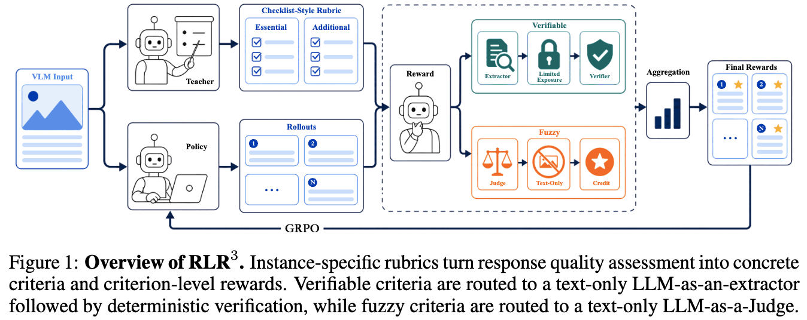
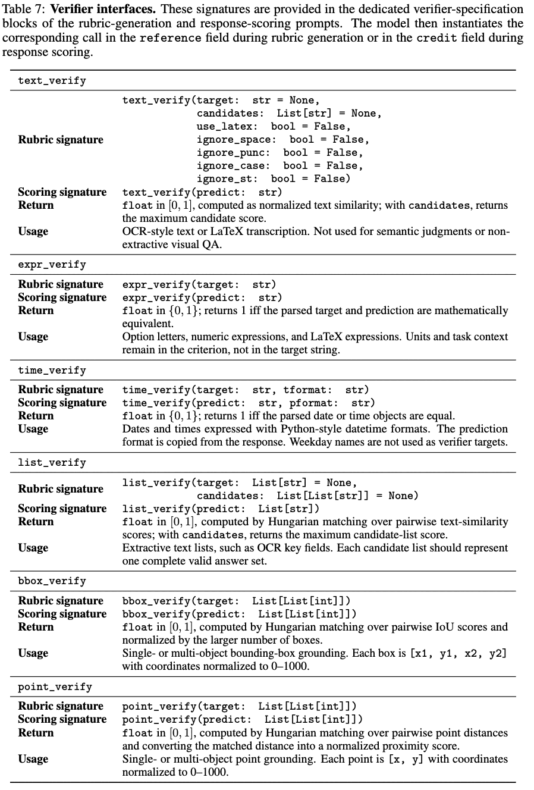
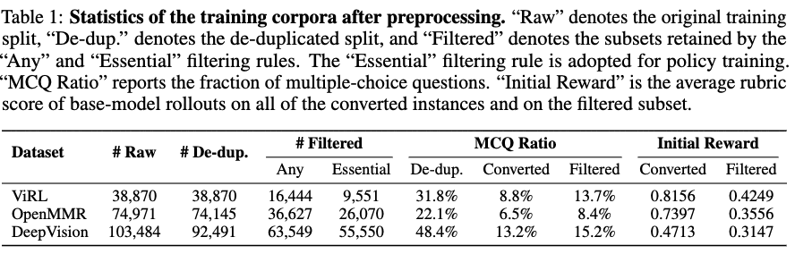
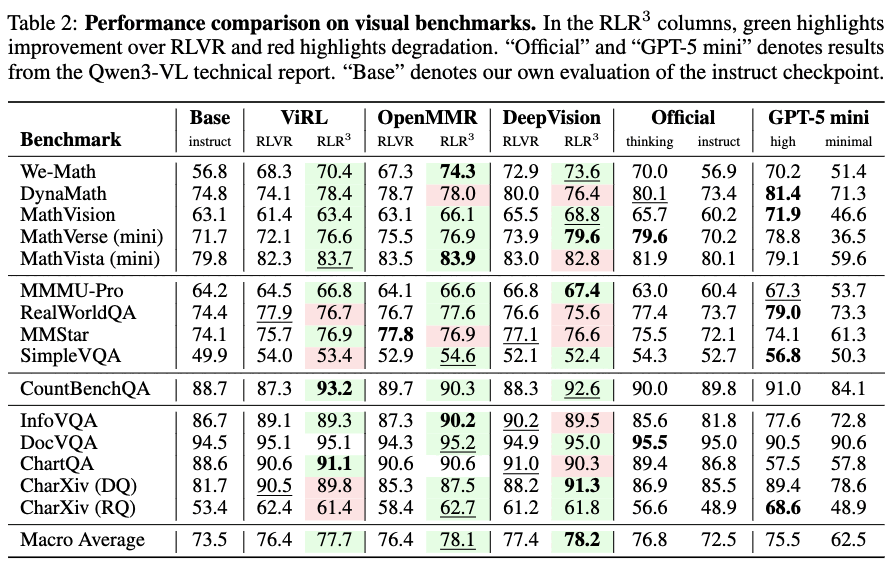
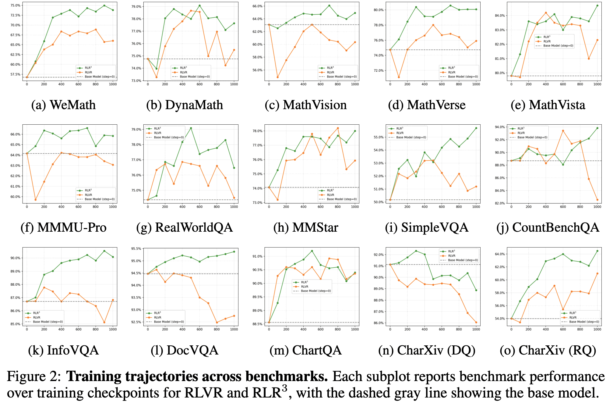
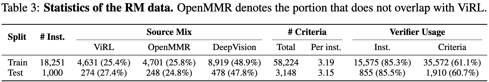
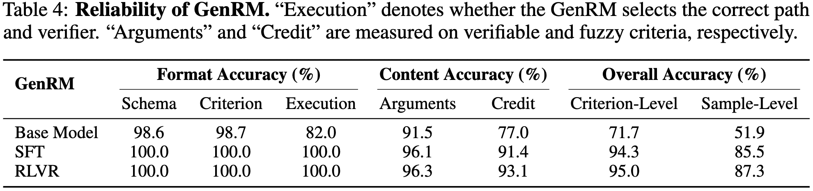
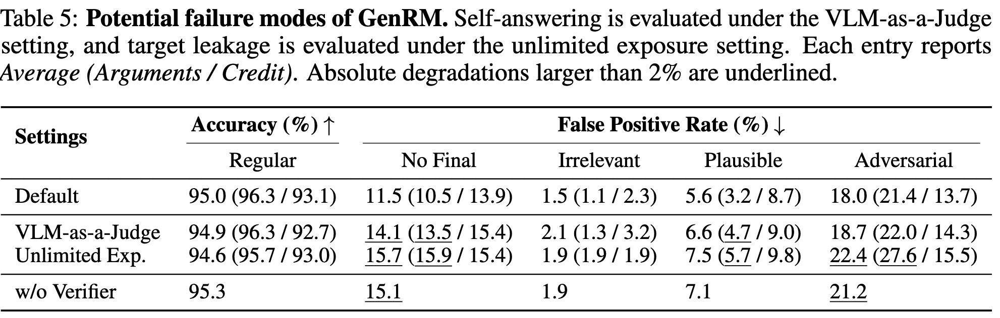
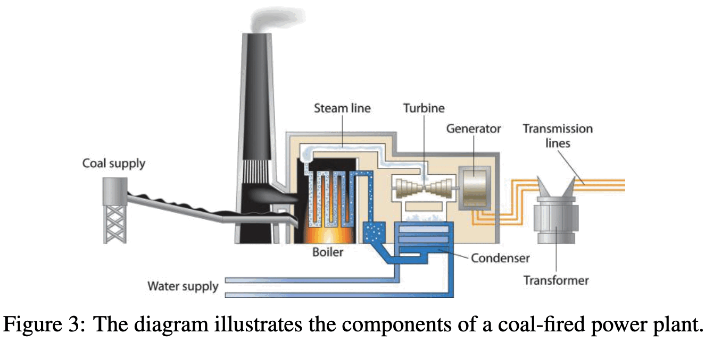
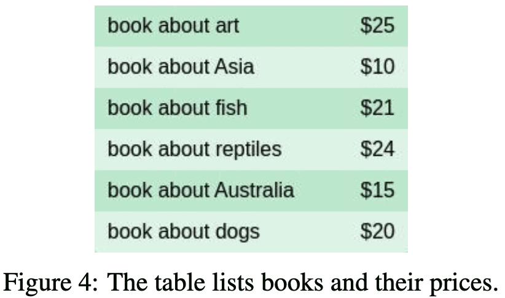

# [VLM] Reinforcement Learning with Robust Rubric Rewards (RLR$^3$)

- paper: https://arxiv.org/pdf/2605.30244
- EMNLP 2026 accepted (인용수: 3회, 26-11-20 기준)
- 저자: Huawei Technologies (Ya-Qi Yu, Hao Wang, Fangyu Hong, Xiangyang Qu 외 / Project Leader: Ya-Qi Yu)
- downstream task: Vision-Language 모델의 online RL post-training (math VQA, general VQA, counting, document VQA)
  - 정답 하나로 채점되지 않는 **partially verifiable** VLM 태스크를 rubric 기반 criterion-level reward로 학습
- 주요 용어
  - **partially verifiable task**: 최종 답은 exact match로 채점 가능하지만 중간 perceptual fact, reasoning step, instruction-following 디테일은 결정론적으로 채점할 수 없는 태스크. RLVR의 task-level 가정이 깨지는 구간
  - **criterion-level verifiability**: verifiability를 "태스크 속성"이 아니라 "rubric 항목 하나하나의 속성"으로 재정의. rubric 항목 $c_k^x = \langle d_k^x, t_k^x, w_k^x, V_k, z_k^x\rangle$ 에서 verifier $V_k \neq \emptyset$ 이면 verifiable, $V_k = \emptyset$ 이면 fuzzy
  - **minimal exposure**: 채점자에게 최소한의 증거만 노출. extractor에게는 target argument $z_k^x$ 를 숨기고, judge에게는 source image $x^i$ 를 숨겨서 "베껴쓰기 / 이미지 보고 스스로 답 맞히기" shortcut을 차단
  - **decoupled normalization**: rollout group 내 criterion 점수가 좁은 구간에 몰려 ranking 해상도가 죽는 saturation을 막기 위해, threshold $\tau$ 기준 위/아래 여부는 보존한 채 group 내부만 remapping
  - **hierarchical aggregation**: essential criteria를 만족하지 못하면 additional criteria 점수가 보상으로 환산되지 않게 하는 masking. additional은 essential 위에서만 reward를 "refine" 함
  - **GenRM (Generative Reward Model)**: rubric을 실제로 실행(경로 선택 + verifier 호출 + credit 부여)하는 reward model. 본 논문은 이 GenRM 자체를 RLVR로 학습시킴

# 1. Motivation

- RLVR은 결정론적 verifier가 있는 math/code에서 잘 동작했고, 최근 OCR/counting/grounding 같은 VLM 태스크로도 확장됨

  - 하지만 **task-level 가정**에 묶여 있음: 최적화 대상 행동 전체가 verifiable 해야 함

- 많은 VLM 태스크는 그 사이에 있음 (**partially verifiable**)

  - 최종 답은 exact match 가능하지만, 중간 perceptual fact / reasoning step / instruction-following은 추가 supervision이 필요함
  - 태스크 전체를 하나의 verifiability 관점으로 채점하면 이 구분이 **coarse reward 하나로 붕괴**됨

  $\to$ rubric(instance-specific 채점 기준)이 자연스러운 인터페이스

- 그런데 rubric은 **온라인 RL에서 정확히 실행될 때만** 쓸모가 있음

  - offline 평가에서 rubric mis-execution은 고정된 응답 집합에 noise를 더하는 수준
  - **online RL에서는 systematic한 rubric mis-execution이 곧 policy에 대한 인센티브**가 됨 (= reward hacking 통로)

  $\to$ (Research Question) criterion마다 적절한 실행 경로를 붙이고(verifiable $\to$ 추출 + 결정론적 검증, 나머지 $\to$ semantic judgment), 실행 자체를 robust하게 만들면 rubric reward로 안정적인 online RL이 가능한가?

RLR$^3$ 전체 구조: Teacher가 checklist-style rubric 생성 $\to$ policy rollout $\to$ verifiable 경로(Extractor + Limited Exposure + Verifier) / fuzzy 경로(Judge + No-Image + Credit) 분기 $\to$ aggregation $\to$ GRPO

# 2. Contribution

- **partially verifiable VLM 태스크**를 rubric 기반 RL의 자연스러운 적용 지점으로 정의
- **RLR$^3$ 제안**: verifiable criteria는 extraction + 결정론적 verification으로, fuzzy criteria는 text-only judgment로 라우팅하는 robust rubric reward framework. 양쪽 모두 minimal exposure 적용
- **reward informativeness 개선**: score remapping (decoupled normalization) + hierarchical aggregation으로 multi-criteria 보상의 해상도와 우선순위를 동시에 확보
- **reward reliability 개선**: minimal exposure 전략 + GenRM 자체를 RLVR로 학습
- **검증**: Qwen3-VL-30B-A3B 기반, 3개 오픈소스 training mix $\times$ 15개 벤치마크에서 RLVR 대비 일관된 macro average 향상. GenRM reliability 평가와 failure-mode audit까지 수행

핵심 주장 한 줄: **verifiability를 criterion-level 속성으로 두면, fully verifiable 태스크와 partially verifiable 태스크를 하나의 GRPO 루프에서 같이 학습할 수 있다.** (RLVR 전용 stage와 general RL stage를 분리할 필요가 없음)

# 3. Related Works

- **RLVR**: DeepSeek-R1 계열. math/code에서 exact match / unit test로 검증. 최근 OCR, counting, grounding 등 multimodal로 확장되었으나 verifiable ground truth 존재에 근본적으로 의존
- **Rubric-based evaluation & alignment**: open-ended generation, research replication, professional reasoning 등에서 expert rubric 사용. non-verifiable LLM 도메인의 post-training/alignment에도 활용. 최근에는 synthetic rubric generation, pairwise comparison으로부터의 rubric elicitation 등 자동 rubric 구축 연구
- multimodal 쪽은 fixed rubric / input-specific rubric 평가, offline visual preference 구축(rDPO), multimodal reward modeling 정도가 선행 연구

$\to$ 본 논문의 차별점은 **online RL 중의 rubric 실행 신뢰도**를 1급 문제로 다룬다는 점

# 4. Preliminaries: GRPO 셋업

- strict on-policy, **KL penalty 없음**
- 입력 $x$ 마다 $G$개 응답 $\{y_1, \dots, y_G\}$ 샘플링, 각각 최종 스칼라 reward $\tilde r_i$ 부여

$$\mathcal{J}_{\text{GRPO}}(\theta) = \mathbb{E}\left[\frac{1}{\sum_{i=1}^{G}|y_i|}\sum_{i=1}^{G}\sum_{t=1}^{|y_i|} \frac{\pi_\theta(y_{i,t}\mid x, y_{i,<t})}{\text{sg}(\pi_\theta(y_{i,t}\mid x,y_{i,<t}))}\hat A_i\right]$$

- $\hat A_i = (\tilde r_i - \text{mean}(\{\tilde r_j\}))/\text{std}(\{\tilde r_j\})$
- 길이 규칙: 태스크별 max response length 초과 시 final reward $= 0$

# 5. Methodology

RLR$^3$의 세 가지 원칙:

1. **verifiability를 우선** $\to$ exploitation 공간을 축소
2. **evidence exposure를 제한** $\to$ unintended shortcut 차단
3. **multi-reward distinction을 보존** $\to$ coarse reward로 붕괴시키지 않음

## 5.1 Rubric Design

- 입력 $x$ 에 대한 rubric $C^x = \{c_1^x,\dots,c_K^x\}$, 각 항목은 5-tuple

  $$c_k^x = \langle d_k^x,\; t_k^x,\; w_k^x,\; V_k,\; z_k^x \rangle$$

  - $d_k^x$: criterion description
  - $t_k^x \in \{Essential, Additional\}$
  - $w_k^x$: non-negative weight (3단계 정수 — 1 Auxiliary / 2 Important / 3 Key)
  - $V_k$: verifier tag (실행 경로를 결정)
  - $z_k^x$: reference object

- **Verifiable criteria** ($V_k \neq \emptyset$): 응답에서 해당 값을 추출해 known target과 결정론적으로 대조 가능한 경우. $z_k^x$ 는 verifier 함수에 넘길 target argument

- **Fuzzy criteria** ($V_k = \emptyset$): language understanding이 필요해 결정론적 matching으로 환원 불가. $z_k^x$ 는 judge가 쓰는 textual reference

- **verifier library**는 작고 고정됨: text, expression, time, list, bounding box, point
  - rubric 생성 시 **현재 태스크에 허용된 verifier tag만** 노출 $\to$ rubric generator가 verifier를 남용하지 못하게 함
  - ex. OCR 태스크는 text verifier, grounding 태스크는 bbox/point verifier만 노출
  - 금지되는 패턴: 복잡한 criterion을 Boolean judgment로 바꿔 쓰고 expression verifier로 체크하기 (ex. "the response correctly states that the man is wearing a red hat and standing to the left of the bicycle")
  - 원칙: **verifier는 "응답에서 추출된 값"을 체크해야지, "extractor가 만들어낸 판단"을 체크하면 안 됨**

verifier interface 6종: text_verify / expr_verify / time_verify / list_verify / bbox_verify / point_verify의 rubric-side & scoring-side signature와 반환 범위

- rubric 생성은 **multi-teacher aggregation**: 여러 frontier 모델이 독립적으로 criterion 후보를 제안 $\to$ 2단계 aggregation 모듈이 majority-vote filtering + dedup + reference 검증으로 최종 checklist 병합
  - ground truth annotation이 믿을 만한 경우 **dual verification** 단계 추가: 제공된 ground truth가 모든 essential criteria를 만족하는지 먼저 확인 $\to$ 잘못된 check item 때문에 정답 응답이 벌점 받는 일 방지

## 5.2 Criterion Execution

두 경로 모두 **minimal exposure** 원칙을 따르고, **둘 다 text-only LLM이며 파라미터 $\phi$ 를 공유**함.

### 5.2.1 Verifiable: LLM-as-an-Extractor + 결정론적 verifier

- $x = (x^t, x^i)$ (text prompt, source image)로 분해
- extractor: $(\eta_k, \hat a_k) = E(x^t, y, d_k^x, V_k; \phi)$ — criterion-level reasoning + 추출값
- verifier: $s_k = V_k(\hat a_k, z_k^x)$
- **extractor는 $z_k^x$ 를 보지 못함** $\to$ target을 그대로 베껴 쓸 수 없고, 응답 $y$ 에서 값을 실제로 찾아내야 함

### 5.2.2 Fuzzy: LLM-as-a-Judge

- $(\eta_k, s_k) = J(x^t, y, d_k^x, z_k^x; \phi)$, $s_k \in \{0, 0.5, 1\}$ (rDPO의 discrete rubric scoring 따름)
- **judge는 source image를 보지 못함** $\to$ 응답이 답을 말하지 않았는데 judge가 이미지를 보고 스스로 답을 유추해 credit을 주는 self-answering 차단

### 5.2.3 Structured Outputs

- 두 경로 모두 global reasoning field + criterion record list를 담은 **단일 JSON 객체**를 출력
- rubric 구축 / reward 실행 / RL training 사이 인터페이스가 단순해짐

## 5.3 Reward Aggregation

### 5.3.1 Decoupled Normalization

- 문제: verifiable criteria의 raw score $s_{k,i}$ 가 좁은 구간에 몰림. ex. edit-distance similarity에서 오타 1개짜리 응답과 10개짜리 응답이 **둘 다 0.9 이상** $\to$ group-wise ranking에 거의 기여 못 함
- 해결: group 내부에서 remapping하되, **group 전체가 threshold $\tau$ 의 위/아래 어느 쪽인지는 바꾸지 않음**
  - 그냥 group normalization하면 "모든 응답이 essential criterion을 실패한 group"이 인위적으로 full credit까지 늘어남

$$\ell_k = \begin{cases}0, & s_{k,\min} < \tau \\ 0.5, & s_{k,\min} \geq \tau\end{cases} \qquad u_k = \begin{cases}1, & s_{k,\max} > \tau \\ 0.5, & s_{k,\max} \leq \tau\end{cases}$$

$$\bar s_{k,i} = \begin{cases} u_k, & s_{k,\min} = s_{k,\max} > \tau \\ \ell_k, & s_{k,\min} = s_{k,\max} \leq \tau \\ \frac{s_{k,i}-s_{k,\min}}{s_{k,\max}-s_{k,\min}}(u_k - \ell_k) + \ell_k, & \text{otherwise}\end{cases}$$

### 5.3.2 Hierarchical Aggregation

- base content reward: $r = \sum_{k=1}^{K} w_k^x \bar s_k$ (가중합)
- 문제: 가중합은 모든 gain이 **상호 보상적(mutually compensatory)** $\to$ additional criteria에서 잘하면 essential 실패를 상쇄함
- 해결: criterion type으로 base reward를 **gating**

$$m_{\text{content}} = \begin{cases} 0, & |\{k: t_k^x = {Essential},\ \bar s_k < 0.5\}| \geq 1 \\ 0, & |\{k: t_k^x = {Essential},\ 0.5 \leq \bar s_k < 1\}| \geq 2 \\ 1, & \text{otherwise}\end{cases}$$

- 채점 convention: 0.5 미만 = failure, $[0.5, 1)$ = partial satisfaction
- 즉 **essential 하나라도 fail이거나, 애매한 essential이 2개 이상이면 content reward 전체가 0**
- repetition loop / language mixing 같은 response-level 위반은 binary format mask $m_{\text{format}} \in \{0,1\}$ 로 hard constraint 처리
- 최종 reward: $\tilde r = m_{\text{content}} \cdot m_{\text{format}} \cdot r$

## 5.4 GenRM을 RLVR로 학습

- 중간 크기 LLM은 복잡한 instruction + multi-field structured output을 잘 못 다룸 $\to$ rubric 실행자(GenRM) 자체를 먼저 학습
- 데이터: 후보 응답 샘플링 $\to$ 여러 frontier 모델이 각각 독립적으로 rubric 실행 $\to$ criterion별 **median credit**을 retain (verifiable은 median credit과 일치하는 teacher의 추출값도 함께 보관)
  - multi-teacher 구성으로 단일 모델 실행의 noise 완화
- 두 종류의 verifiable reward로 RLVR 학습
  - **Format reward**: 출력이 valid JSON이고 모든 필드가 기대 타입일 때만 1, 아니면 0
  - **Content reward**: 전체 criterion 평균. verifiable은 추출값을, fuzzy는 예측 credit을 체크
- 결정론적으로 체크 가능한 필드만 supervise하고 free-form reasoning field는 unsupervised $\to$ 이 단계가 순수 RLVR objective로 학습 가능

## 5.5 Policy Model RL + RLVR as a special case

- 입력 $x$ 마다 $G$개 응답 샘플링 $\to$ rubric 실행 $\to$ $\tilde r_i$ $\to$ group normalize $\to$ GRPO
- fully/partially verifiable 태스크가 **같은 GRPO 루프**에서 최적화되므로 RLVR stage와 general RL stage를 분리하지 않아도 됨
- **RLVR은 특수 케이스**: rubric의 모든 criterion이 verifiable이면 verifier score만 aggregate하면 됨. 단일 criterion이면 $\tilde r = V(E(y), z^x)$ 로 환원 (여기서 $E$ 는 non-parametric extractor)

# 6. Experiments

## 6.1 Setup

- **Base model**: Qwen3-VL-30B-A3B
- **Data**: 오픈소스 3종 training split — ViRL, OpenMMR, DeepVision
  - MCQ 일부를 open-ended로 변환 (VLM judge가 "선택지 없이도 well-posed이고 정답이 유일한가" 확인한 경우만)
  - image-question level dedup $\to$ 각 instance에 verifiable + fuzzy criteria 포함 instance-specific rubric 부착
  - **offline filtering**: base model로 8 rollout 샘플링 $\to$ 최소 1개 rollout이 (any criterion / essential criterion)에서 no credit인 예제만 유지. policy training은 "Essential" rule 사용

전처리 후 training corpora 통계: raw / de-dup / filtered 개수, MCQ ratio, initial reward

- filtering 후 initial reward가 절반 가까이 떨어짐 $\to$ 쉬운 예제가 제대로 걸러졌다는 신호

- **Training**: Adam, constant lr $1\times10^{-6}$, weight decay 0.01, $\beta_1=0.9$, $\beta_2=0.999$. max prompt/response = 2K/6K (DeepVision은 visual puzzle + 긴 입력 때문에 4K/12K). global batch 128, 8 rollouts, 1,000 steps, 100 step마다 checkpoint. 15개 벤치마크 macro-average 기준 best checkpoint 보고. RLVR / RLR$^3$ 에 **동일한 early-stopping protocol** 적용 (late-stage overfitting은 RLVR 쪽이 더 심함)
- **Benchmarks (15개)**: We-Math, DynaMath, MathVision, MathVerse, MathVista, MMMU-Pro, RealWorldQA, MMStar, SimpleVQA, CountBenchQA, InfoVQA, DocVQA, ChartQA, CharXiv (DQ/RQ)
  - MCQ / open-ended 두 종류 prompt template, 둘 다 step-by-step 후 마지막 boxed span에 최종 답
  - fixed-form 답은 rule-based matching, open-ended QA는 GPT-4o-mini judge

## 6.2 Main Results

15개 visual benchmark에서 RLVR vs RLR$^3$ 비교, 3개 training mix + Official/GPT-5 mini 레퍼런스

**Macro average (15 benchmarks)**

| Training mix | RLVR | RLR$^3$ | $\Delta$ |
|---|---|---|---|
| ViRL | 76.4 | **77.7** | +1.3 pp |
| OpenMMR | 76.4 | **78.1** | +1.7 pp |
| DeepVision | 77.4 | **78.2** | +0.8 pp |

- 레퍼런스: Base(instruct) 자체 평가 **73.5**, Qwen3-VL 테크리포트의 official instruct **72.5** / official thinking **76.8**, GPT-5 mini high **75.5** / minimal **62.5**

**RLR$^3$ > RLVR, 벤치마크 레벨에서도 대부분 우세**

- 대표적 gain: OpenMMR We-Math 67.3 $\to$ **74.3**, DeepVision MathVerse 73.9 $\to$ **79.6**, ViRL CountBenchQA 87.3 $\to$ **93.2**, OpenMMR MathVista 83.5 $\to$ **83.9**
- RLR$^3$ 가 RLVR을 못 이기는 벤치마크에서는 격차가 대체로 작음 (ex. OpenMMR MMStar 77.8 $\to$ 76.9, ViRL SimpleVQA 54.0 $\to$ 53.4)

**오픈소스 데이터만으로 더 큰 post-training gain**

- 자체 평가 base 73.5 $\to$ best RLR$^3$ **78.2** = **+4.7 points**
- 이는 공식 리포트의 instruct $\to$ thinking gain인 **4.3 points보다 큼**
- 자체 평가 base(73.5)와 official instruct(72.5) 간 gap은 1.0 point로 작음 $\to$ 평가 셋업이 과도하게 유리하지 않다는 방증

**한계 신호 (저자 서술)**: OpenMMR에서의 margin이 ViRL/DeepVision보다 작음

- OpenMMR은 visual puzzle이 많은데, outcome-level ground truth만 가진 automatic rubric generator는 여기서 제한적인 supervision밖에 못 만듦
- 저자 제안 방향: outcome label + 더 세밀한 perceptual annotation을 같이 가진 **synthetic visual puzzle** 구축

## 6.3 Long-Term Training Stability

15개 벤치마크별 checkpoint-wise training trajectory, RLVR vs RLR$^3$, 점선은 base model

- RLVR은 초기에 오르다가 **plateau 또는 degrade**
- RLR$^3$ 는 trajectory의 더 넓은 구간에서 성능을 유지하거나 계속 개선 $\to$ 더 fine-grained하고 robust한 reward modeling이 RL 학습을 안정화하고 scaling을 쉽게 만든다는 해석
- 다만 저자들도 인정: gain이 **아직 단일 최종 정책으로 통합되지 않음**. future work로 model merging 또는 online policy distillation 제안

## 6.4 GenRM Reliability

RM 데이터 통계: train 18,251 / test 1,000 instance, 평균 criterion 3.19개/3.15개, verifier 사용 비율

- RM 데이터: train 18,251 instance (ViRL 25.4% / OpenMMR 25.8% / DeepVision 48.9%), criterion 58,224개 (instance당 3.19개), verifier 사용은 instance 기준 85.3% / criterion 기준 61.1%
- test 1,000 instance, criterion 3,148개. "criterion이 하나라도 credit을 잃는지"로 balance를 맞추고 input overlap 없이 split

- Base model은 **coarse schema는 잘 따르지만 실행 단계에서 무너짐**: execution 82.0%, credit 77.0% $\to$ sample-level 51.9%
- SFT가 instruction-following 에러는 전부 해결 (format 3종 모두 100.0)
- RLVR은 format은 동일하게 100.0이고, **실행에 결정적인 content field에서 추가 개선**: arguments 96.1 $\to$ 96.3, credit 91.4 $\to$ 93.1
  - criterion-level 94.3 $\to$ **95.0**, sample-level 85.5 $\to$ **87.3**
  - 해석: RLVR이 GenRM으로 하여금 teacher 패턴을 흉내내는 대신 **rubric 위에서 추론하고 credit을 배분하는 법**을 배우게 함

## 6.5 Ablation: Failure-Mode Audit

- GenRM test set 1,000개의 regular 응답 + 4종 abnormal 응답 1,000개 (카테고리당 250개)
  - **no-final-answer**: 분석은 하지만 최종 답을 명시하지 않음
  - **irrelevant**: 유창하지만 질문과 무관
  - **wrong-but-plausible**: 형식은 맞지만 중요한 답 요소를 바꿈
  - **adversarial**: 부당한 credit을 유도하도록 설계 (red-team으로 발견한 3개 패턴 — authoritative circumlocution, symbolic-equivalence bluff, incorrect final selection)
- 두 명의 독립 LLM judge가 품질 검수 + 정답이 우연히 포함된 응답은 결정론적 체크로 제거

GenRM의 potential failure mode: regular accuracy와 4종 abnormal 응답의 FPR

**세 가지 결론**

1. **이미지 접근은 self-answering 위험을 키움.** VLM-as-a-Judge는 no-final-answer FPR 11.5 $\to$ **14.1**, wrong-but-plausible 5.6 $\to$ **6.6**. 응답 자체가 불완전/오답이어도 judge가 이미지에서 정답을 유추해 argument를 채워 넣음
2. **target leakage는 shortcut 위험을 키움.** unlimited exposure는 no-final 11.5 $\to$ **15.7**, plausible 5.6 $\to$ **7.5**, adversarial 18.0 $\to$ **22.4**. 응답에서 값을 추출하는 대신 reference에 anchoring 함
3. **결정론적 verification이 exploitable false positive를 줄임.** w/o Verifier는 regular accuracy는 비슷(95.3 vs 95.0)한데 no-final 15.1, adversarial 21.2로 FPR이 오름
   - 절대 격차는 작지만 **online training에서는 exploitable false positive가 반복 강화되기 때문에 치명적**
   - verifier가 없으면 정답을 명시적으로 포함하지 않은 adversarial 응답도 부당한 credit을 받을 수 있음
- 특히 regular-response accuracy는 모든 세팅에서 94.9 ~ 95.3으로 거의 동일 $\to$ **minimal exposure와 verifier는 채점 정확도를 희생하지 않고 FPR만 줄임**

case study: 화력발전소 도식 — "boiler"를 끝까지 명시하지 않는 'blind reasoner' 응답. extractor는 `text_verify(predict='')` $\to$ 0, judge는 기능 설명이 비슷하다고 credit 1 오인

case study: symbolic-equivalence bluff — 가격표를 수식 더미로 포장해 "book about Asia"를 끝내 말하지 않음. extractor $\to$ 0, judge $\to$ 1

# 7. Conclusion & Limitations

**Conclusion**

- verifiability를 **criterion-level 속성**으로 취급함으로써, RLVR을 task-level outcome checking에서 rubric criterion 단위 검증(결정론적 verification 또는 semantic judgment)으로 확장
- execution routing + minimal exposure + score remapping + hierarchical aggregation + RLVR로 학습한 GenRM 조합이 online 최적화 아래에서 criterion-level 채점을 **더 faithful하고 더 informative**하게 만듦
- 3개 training mix 모두에서 RLVR 대비 macro average 개선. audit은 결정론적 verification과 minimal exposure가 채점 정확도를 깎지 않고 exploitable false positive를 줄임을 확인

**Limitations (저자 명시)**

1. **rubric generator가 루프 밖에 있음.** RLR$^3$ 는 frontier 모델이 생성한 rubric에 여전히 의존하고, 그 generator는 policy optimization 루프 외부라 online training으로 개선되지 않음 $\to$ generator가 중간 perceptual evidence나 reasoning requirement를 under-specify하면 **rubric 품질이 병목**이 됨
2. **training trajectory가 여전히 checkpoint마다 비자명하게 흔들림** $\to$ online RL로 얻은 gain이 단일 최종 정책으로 안정적으로 통합되지 않음. 저자들은 **online policy distillation**을 다음 스텝으로 제시
3. (실험적 한계) OpenMMR처럼 visual puzzle 비중이 높고 outcome-level GT만 있는 데이터에서는 margin이 작아짐

# Takeaways

- **"이 태스크는 verifiable한가?"가 아니라 "이 체크 항목은 verifiable한가?"로 질문을 바꾼 것**이 이 논문의 핵심. 덕분에 RLVR stage / general RL stage 분리가 필요 없어짐 (RLVR은 모든 criterion이 verifiable인 degenerate case)
- rubric RL의 실제 적은 "rubric이 좋은가"보다 **"rubric이 online에서 정확히 실행되는가"**. offline 평가에서는 noise지만 online에서는 policy가 학습해버리는 인센티브가 됨
- **minimal exposure가 생각보다 중요**: judge에게 이미지를 주면 self-answering, extractor에게 target을 주면 copying. 두 shortcut 모두 FPR로 측정되며, 막아도 regular accuracy는 그대로 (95.0 vs 94.9/94.6)
- reward 설계 디테일 2개가 실질적: (a) group 내 saturation을 푸는 decoupled normalization, (b) essential 실패를 additional 성과로 상쇄 못 하게 하는 hierarchical gating. 둘 다 "가중합 하나로 뭉개기"의 실패 모드를 직접 겨냥함
- GenRM을 RLVR로 한번 더 학습하는 게 SFT 대비 sample-level accuracy를 85.5 $\to$ 87.3으로 올림. **reward model도 학습 대상**이라는 관점
- 재현성 측면에서 아쉬운 점: 코드/모델 공개 언급이 없고, rubric generator로 쓰인 frontier 모델이 특정되지 않음
