# [VLM] UI-UG 2: Advancing Mobile UI Understanding and Generation with Fine-Grained Supervision and Reinforcement Learning

- paper: https://arxiv.org/pdf/2611.00926
- arXiv preprint (인용수: 0회, '26-11-22 기준)
- 저자: Ant Group (Hao Yang, Shuoyang Liu, Xiaoyu Lin, Zhou Fang, Maji Huang, Zhaosong Huang, Ruichao Mao, Teng Guo, Hai Rao)
- downstream task: 모바일 UI Understanding(referring / dense grounding / GUI grounding) + 구조화된 UI Generation(요구사항 $\to$ renderable JSON DSL)
  - ex. 스크린샷 안의 `CloseButton` vs `ReturnButton`을 구분해 인식하고(understanding), 자연어 요구사항으로부터 렌더 가능한 JSON UI를 생성(generation)
- 주요 용어
  - **front-end-aligned taxonomy**: 프론트엔드 컴포넌트 시맨틱에 맞춘 2단계 UI 분류체계. 9개 parent class + 71개 child class로 총 **80 category**. 기능 역할(`ReturnButton` vs `CloseButton`), 컴포넌트 상태, 경계 잘림 등을 구분
  - **renderable JSON DSL**: raw HTML/CSS 대신 쓰는 compact JSON 표현. `type`(Component/Tag), `name`, `className`(Tailwind), `params`(bindType Static/Data), `children`로 구성. HTML 대비 토큰 **16.7%** 절감, progressive rendering 지원
  - **render-aware RL**: 샘플링된 DSL을 Playwright 서버 파이프라인으로 **실제 렌더링**한 뒤 보상을 계산하는 online GRPO. offline DPO의 preference-data mismatch를 줄임
  - **Contrastive Preference Ranking (CPR)**: 같은 GRPO rollout group 안에서 round-robin pairwise 비교로 상대 선호를 매기는 보상. LLM-as-a-Judge의 절대 점수 calibration drift를 보완
  - **understanding-to-generation transfer**: fine-grained UI 인지(perception) 지도를 늘리면 생성 품질도 좋아지는 비대칭 전이 현상. component-level 표현이 두 태스크의 공유 기반이라는 주장

# 1. Motivation

- 모바일 UI는 자연 이미지와 근본적으로 다름: 작고 의미가 밀집된 컴포넌트(버튼, 아이콘, 텍스트 필드, 내비게이션 바)로 이루어져 있고, 상호작용 시맨틱에 fine-grained 범주 추론이 필요함
  - `CloseButton`과 `ReturnButton`, 혹은 generic `TextInput`과 `SearchBar`를 구분하는 것은 신뢰할 만한 자동화·고품질 생성에 필수지만, 범용 모델이 안정적으로 도달하지 못하는 granularity임
- 기존 연구는 한쪽만 다룸
  - **Understanding**: Ferret-UI, Ferret-UI2 (grounding/referring)
  - **Generation**: DCGen, DeclarUI (structured generation)
  - 범용 MLLM(GPT, Claude, Gemini, Qwen-VL)은 둘 다 명목상 가능하지만 precision-critical 모바일 시나리오엔 정확도가 부족
- 선행 연구 UI-UG가 단일 MLLM으로 통합을 처음 시도했으나 한계가 남음
  1. label이 프론트엔드 컴포넌트 시맨틱 기준으로 조직되지 않음
  2. understanding coverage가 referring/dense grounding에 치우침
  3. generation 최적화가 고정된 preference dataset 위의 **offline DPO**에 의존
  4. understanding→generation transfer 근거가 예비적 수준

UI-UG 2 전체 개요: front-end-aligned taxonomy, joint training, task-specific reward, online render-aware RL

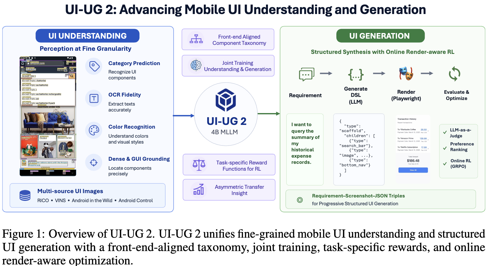

$\to$ (Research Question) 더 넓은 태스크 커버리지, 프론트엔드 정렬 taxonomy, online render-aware RL을 갖춘 compact(4B) 통합 MLLM을 만들고, fine-grained 인지가 생성에 전이되는지 체계적으로 검증하자

# 2. Contribution

- **UI-UG 2**: 모바일 UI 이해·생성을 함께 지원하는 compact 통합 MLLM. 4B backbone만으로 referring·dense grounding 벤치마크에서 최고, 비교 모델 중 최고 composite generation score 달성
- **Front-end-aligned 데이터·태스크**: 80-category 2단계 계층 understanding 데이터셋(referring/dense grounding/GUI grounding) + compact renderable JSON DSL 기반 생성 corpus
- **Task-specific online GRPO**: category / OCR / color / GUI grounding / format validity / renderability / LLM-judge / CPR에 대한 decomposed reward로 render-aware 생성 최적화
- **Understanding-to-generation synergy**: fine-grained UI 인지가 생성 품질에 일관되게 기여함을 data-mixing ablation, reward transfer 분석, attention probing으로 입증

# 3. Related Works

- **UI Understanding**: VINS/ERICA/WebSRC/RICO 등 데이터셋 → DOM/view hierarchy 기반 → pixel 기반 파싱. Ferret-UI/UI2, SeeClick/ShowUI/UI-TARS/GUI-Owl/UI-Venus가 ScreenSpot 계열에서 fine-grained localization 발전. 본 논문은 더 풍부한 front-end-aligned taxonomy와 포괄적 태스크 제공
- **UI Generation**: pix2code/Sketch2Code/REMAUI(초기 image-to-code) → DCGen/DeclarUI(구조적 생성). Web2Code/LiveCodeBench 벤치마크. 본 논문은 요구사항+참조 이미지 양쪽에서 생성 + interactive prototyping 지원
- **Unified Understanding & Generation**: UI-UG가 처음 통합. front-end-aligned supervision, rendered-feedback 최적화, transfer 분석이 열린 과제로 남아 있었음
- **RL & Multi-task MLLM**: RLHF → DPO → GRPO. Visual-RFT/R1-VL/VLM-R1 등 멀티모달 확장. 이질적 objective가 imbalance·asymmetric transfer를 유발 → 순차 최적화·전이 분석의 동기

# 4. Data and Structured Representation

## 4.1 Understanding Corpus

- RICO / VINS / Android in the Wild / Android Control에서 **30,000+** dedup 모바일 스크린샷 큐레이션
  - element-level(RICO/VINS) + action-level(AITW/AC) 상호작용 시맨틱 결합 → instruction-conditioned GUI grounding 샘플로 변환
- **80-category** 2단계 taxonomy (9 parent + 71 child), Ant Design/Material UI/Vant 네이밍·상호작용 패턴 참고
  - human-in-the-loop bootstrapping: post-trained detection 모델로 seed set 확장 → OCR·color label 자동화 후 human refinement
  - 500-image held-out에서 Cohen's $\kappa > 0.82$
  - 각 element에 category + bbox, 텍스트 element엔 OCR text·text-color 추가. 기능 역할·컴포넌트 상태·경계 잘림 구분
  - CLIP dedup corpus는 소스당 약 7.5K 스크린샷

## 4.2 Generation Corpus & Rendering Pipeline

- UI-UG의 renderable JSON DSL 유지(raw HTML/CSS 대신). cross-platform progressive rendering
- 더 강한 MLLM distillation·풍부한 요구사항·엄격한 rendering 필터링 → **5,000+** requirement–image–JSON triple
- DSL은 동등 HTML 대비 토큰 **16.7%** 절감. 공유 renderer가 생성 GRPO 중 샘플 DSL도 실행

UI generation 데이터셋 구축 파이프라인: cropping → captioning → requirement generation → rendering/schema check

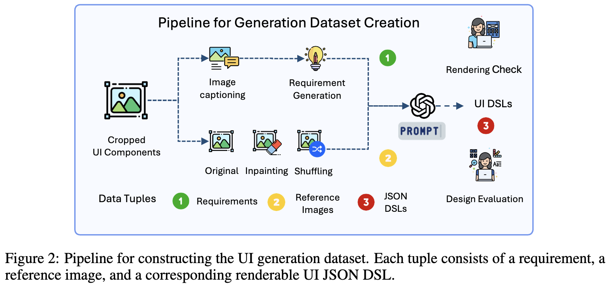

## 4.3 Renderable JSON Representation

- 노드 속성: `type`(Component/Tag), `name`, `className`(Tailwind, w-[100px]/w-full 등), `params`(bindType Static/Data), `children`
- 컴포넌트 identity / layout·styling / content binding / child 구조를 분리 → 모델이 명세를 생산하는 동안 progressive rendering 가능

# 5. Method

- Section 3 데이터·표현 위에서 **통합 SFT → task-specific GRPO** 2단계. UI-UG 대비 더 작은 4B backbone, offline generation preference 대신 **online render-aware GRPO**

## 5.1 Supervised Fine-tuning

- referring / grounding / generation 통합 SFT 데이터셋, 모든 target을 JSON으로 표현(파싱 신뢰성)
  - referring: 주어진 box로부터 category·OCR·color 예측
  - grounding: dense full-screen localization + instruction-conditioned captioned grounding
  - generation: 요구사항(+선택적 참조 스크린샷) → JSON DSL
  - dense-grounding box는 category 빈도·좌상단 좌표로 정렬 → 반복 레이아웃 규칙성 노출
- **UI-UG 2-4B-SFT**: Qwen3-VL-4B-Instruct 초기화, ViT encoder freeze, LLM + VL adapter만 학습

## 5.2 Reinforcement Learning via GRPO

**UI Understanding Rewards**

- **(1) Referring reward**: $R_{ref} = R_{fmt} + R_{cls} + \mathbf{1}[t^* \in \mathcal{T}_{txt}] \cdot (R_{ocr} + R_{col})$
  - $R_{fmt}, R_{cls} \in \{0,1\}$ (format validity, category correctness), 텍스트 element에만 OCR/color 활성화
  - OCR reward: normalized edit distance로 smooth partial credit, $R_{ocr} = 1 - \frac{\mathrm{ED}(\hat{s}, s^*)}{\max(|\hat{s}|, |s^*|)}$
  - Color reward: CIE L\*a\*b\* 공간, $R_{col} = \max\left(0, 1 - \frac{\Delta E_{ab}(\hat{\mathbf{c}}, \mathbf{c}^*)}{50}\right)$
- **(2) Grounding reward**: dense는 Dual-IoU로 recall($R_{rec}$)·precision($R_{pre}$) 모두 포착, $R_{dense} = R_{rec} + R_{pre} + R_{fmt}$. captioned는 $R_{cap} = \mathrm{IoU}(\hat{b}, b^*) + R_{fmt}$. 태스크 조건부로 $R_{ground} = \mathbf{1}[\text{dense}] \cdot R_{dense} + \mathbf{1}[\text{cap}] \cdot R_{cap}$
  - Dual 공식: recall만 최적화하면 over-detection, precision만 최적화하면 under-detection → 양쪽 균형

**UI Generation Reward** (format validity + renderability + perceptual quality 3-part)

- **(1) Format reward** $R_{fmt} \in \{0,1\}$: JSON 파싱 가능성·schema 준수
- **(2) Rendering reward** $R_{render}$: 서버측 Playwright로 online 렌더링, 실행/레이아웃 오류 없이 렌더되는지 확인
- **(3) Perceptual quality**: LLM-as-a-Judge + CPR
  - Judge: Qwen3-VL-235B-A22B가 4개 차원(Color&Aesthetic, Visual Structure&Alignment, Textual&Content Consistency, Interface Usability&Interactivity) 채점, $R_{judge} = \frac{1}{4}\sum_{k=1}^{4} \frac{s_k}{10}$
  - CPR: rollout group 내 round-robin pairwise, $R_{cpr}^{(i)} = \frac{1}{(G-1)K}\sum_{j \neq i}\sum_{k=1}^{K} w_k(y^{(i)}, y^{(j)})$
  - $R_{perc} = \alpha R_{judge} + (1-\alpha) R_{cpr}, \alpha = 0.5$
  - $R_{gen} = R_{fmt} + R_{render} + R_{perc}$ ($R_{fmt}=1, R_{render}=1$일 때만 $R_{perc}$ 계산)
- **Sequential GRPO**: joint가 아닌 순차 최적화(generation → referring → grounding), stage당 1 epoch

## 5.3 Training Configuration

- 4× A100 80GB. SFT 120K 샘플(~0.6B 토큰, Ref:Grd:Gen = 3:3:4), GRPO는 referring 6,000 / grounding 6,000 / generation 2,000 샘플, prompt당 8 rollout
- SFT ~2일 + GRPO ~2일 (judge-service compute 별도)

SFT / GRPO 하이퍼파라미터: LR 1e-5 vs 1e-6, batch 16 vs 64, KL penalty 0.01 등

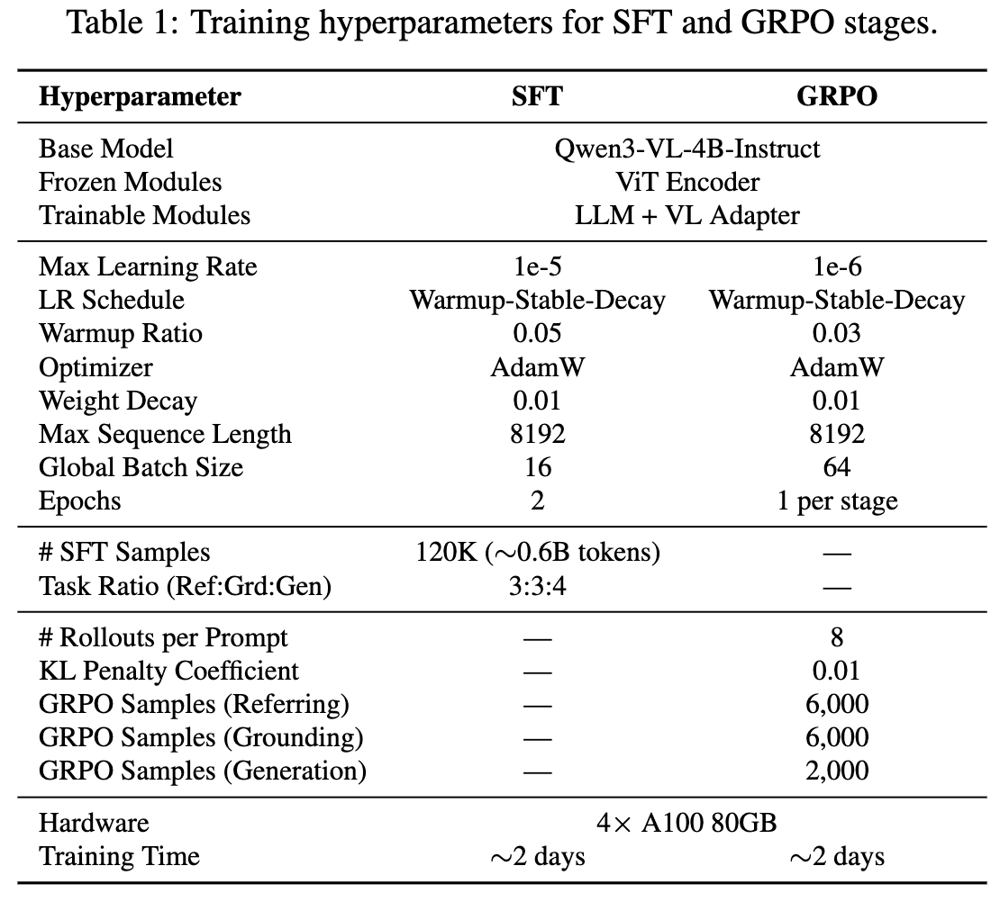

- Playwright (Environment), LLM Judge는 별도의 환경에서 띄웠음

# 6. Experiments

- 비교군: 범용 MLLM(GPT-5.2, Claude Sonnet 4.5, Gemini 3.1 Pro, Kimi K2.5, GLM-4.5V, Mistral Large 3, Qwen3-VL 계열) + UI-specific(Ferret-UI2, OmniParser V2, ShowUI, UI-TARS, GUI-Owl, UI-Venus, UI-UG-7B)

## 6.1 UI Understanding

- Referring/Dense Grounding은 in-house 데이터셋, GUI Grounding은 ScreenSpot V1/V2 mobile split(502/449 샘플)에서 평가
- MLLM은 confidence score를 안 주므로 Dense Grounding은 AP 대신 **set-matching F1**(Hungarian, IoU≥0.5)

UI understanding 결과: Referring Cat/OCR/Color, Dense Grounding F1/P/R/mIoU, GUI Grounding SS-V1/V2-Mobile

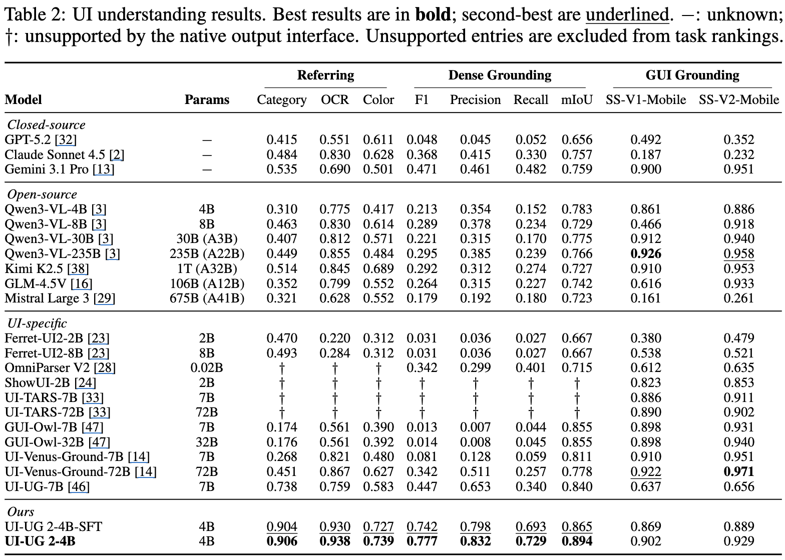

- **Referring** (Cat/OCR/Color)
  - 최강 closed-source Gemini 3.1 Pro: category 0.535, 최강 open general Kimi K2.5: 0.514에 그침
  - UI-UG 2-4B-SFT: 0.904/0.930/0.727 → GRPO로 **0.906/0.938/0.739**
- **Dense Grounding** (격차가 더 큼)
  - 최고 범용 Gemini 3.1 Pro: F1 0.471
  - UI-UG 2-4B-SFT: F1 0.742 / mIoU 0.865 → GRPO로 **0.777 F1 / 0.894 mIoU** (SFT 대비 +0.035 F1, +0.029 mIoU)
  - 기존 20-class label space는 80-category를 커버 못 해 recall에서 차이 큼
- **GUI Grounding**: ScreenSpot-V1/V2 mobile **0.902 / 0.929**. 대부분 open general MLLM·7B specialist(UI-TARS-7B 0.886/0.911) 상회. 단 single-target 특화된 UI-Venus-Ground-7B(0.910/0.951)·72B(0.922/0.971)는 여전히 더 높음. base Qwen3-VL-4B(0.861/0.886) 대비 명확히 향상

## 6.2 UI Generation

- JSON format 준수 + render 성공 + 4개 judge 차원([0,1] 정규화). composite $S_{gen} = p_{JSON} + p_{render} + \sum_{k=1}^{4}\bar{q}_k \in [0,6]$

UI generation 결과: JSON/Rend/Col/Str/Txt/Int/Sum, 최대 6점

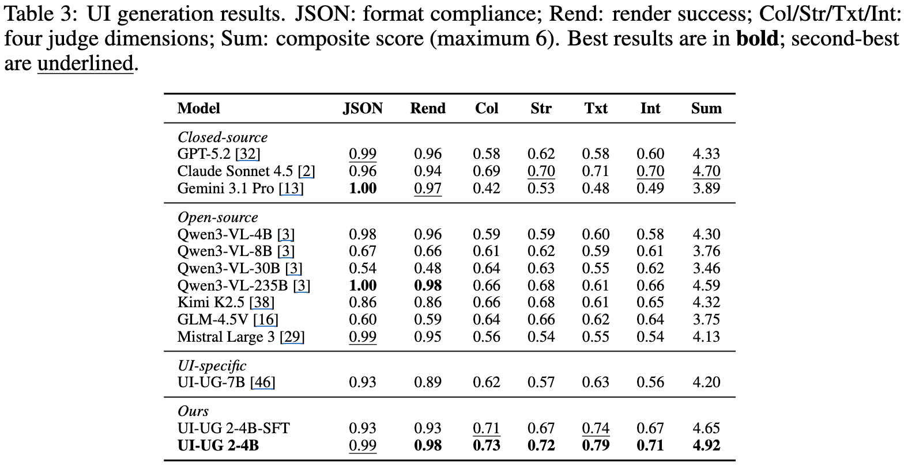

- UI-UG 2-4B: Sum **4.92**, SFT(4.65) 대비 **+5.8%**
  - Claude Sonnet 4.5(4.70), GPT-5.2(4.33), Gemini 3.1 Pro(3.89) 상회
  - Qwen3-VL-235B(4.59)도 상회 — 총 파라미터 약 **59×**, active 약 **5.5×** 더 큰 모델임
  - 범용 instruction tuning만으로는 structured UI 생성에 부족: GLM-4.5V(0.60)·Qwen3-VL-30B(0.54)는 format 준수율 낮음
- **Human-reference judge validation**: 전문 UI 디자이너 3인이 채점한 100 케이스에서 Qwen3-VL-235B judge의 mean absolute deviation 0.17(Gemini 3.1 Pro 0.08로 최저). Qwen은 배포·반복 평가 실용성 때문에 training reward로 사용. post-hoc 연구이며 매 RL update의 human alignment를 보장하진 않음

## 6.3 Ablation Study

- **RL Training Strategy** (SFT 대비 개선폭)
  - single-stage: GenerationRL **+4.43%**, GroundingRL F1 **+4.02%**, ReferringRL **+1.47%**
  - understanding-oriented RL도 generation에 도움 → UI 요소 이해가 생성에 전이
  - **Finding 2**: sequential > joint. Joint는 Gen +2.73%, Grd F1 +2.70%, Ref Acc +0.86%로 sequential보다 낮음(이질적 reward 결합의 불안정성)

RL strategy ablation heatmap: joint vs 1/2/3-stage sequential, ΔRef Acc/ΔGrd F1/ΔGen Score

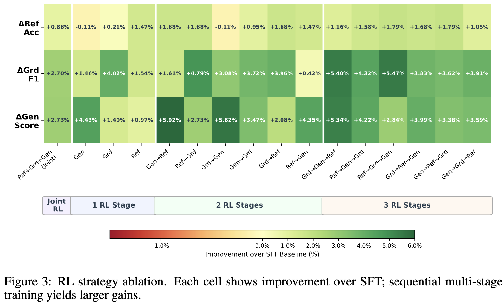

- **Dense Grounding reward components** (Table 4)

  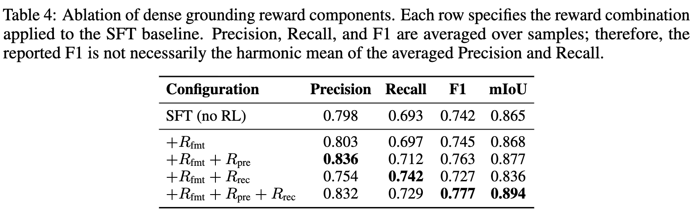

  - recall만 강조($+R_{rec}$)하면 Recall은 0.742로 오르지만 Precision 0.754로 하락, F1(0.727)·mIoU(0.836)가 SFT보다도 나빠짐 → **reward hacking**(box 남발). bidirectional IoU 지도 필수

## 6.4 Understanding–Generation Transfer 분석

- **Exp 1: SFT data-mixing ratio** (120K 고정 예산). U$xx$ = understanding 데이터 비율
  - generation은 **U20에서 peak(4.760)**, generation-only(U0, 4.668) 대비 상승 → 상호보완 지도 효과(규모가 아닌 fine-grained supervision). U20 넘으면 생성 전용 지도 감소로 점진 하락
  - understanding은 비율에 따라 **단조 증가**: referring 0.789(U10)→0.838(U100), grounding F1 0.475→0.690
  - 즉 비대칭 전이: 적당한 understanding 지도는 generation에 도움, understanding 지도를 generation으로 대체해도 understanding 지표는 개선 안 됨

understanding-data ratio가 referring/grounding/generation score에 미치는 영향

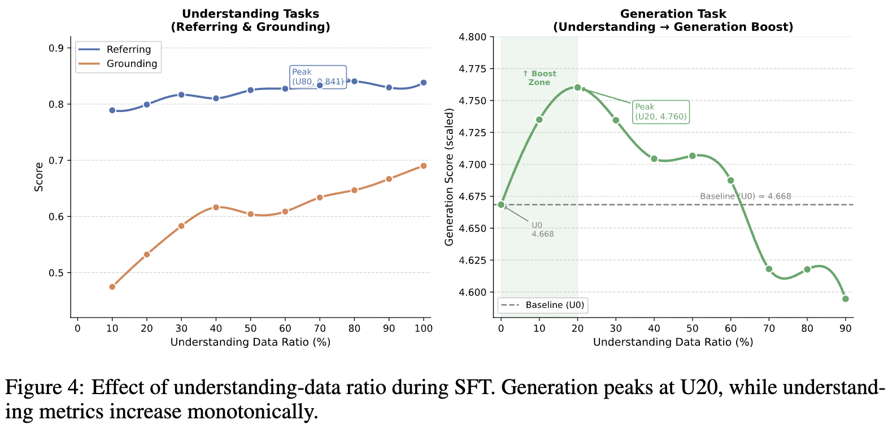

- **Exp 2: Dimension-specific reward** (Table 5): understanding reward가 의미적으로 정렬된 generation 차원을 개선
  - $+R_{col}$(Color)→Col +1.60%, $+R_{ocr}$(Text)→Txt +2.48%, $+R_{dense}$→Str(Visual Structure) +4.72%로 최대. $+R_{cap}$(GUI Gnd)은 거의 효과 없음 → 전이는 균일하지 않고 선택적

understanding reward별 generation score 상대 변화

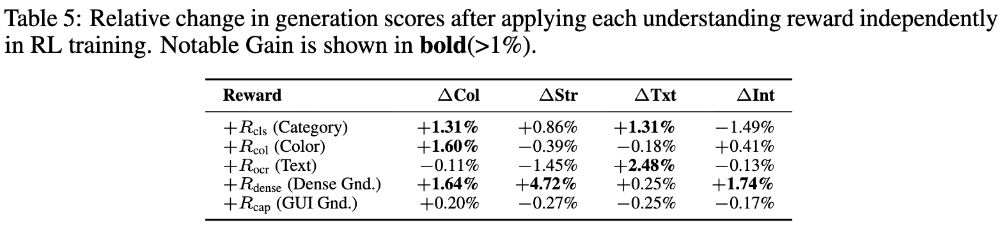

- **Exp 3: Cross-task attention similarity**: text-to-vision attention cosine similarity가 understanding–generation 쌍에서 높음, generation–dense grounding이 가장 강한 정렬. reward-transfer 결과와 일치하나 **상관 증거**일 뿐 인과는 아님

task별 text-to-vision attention cosine similarity matrix

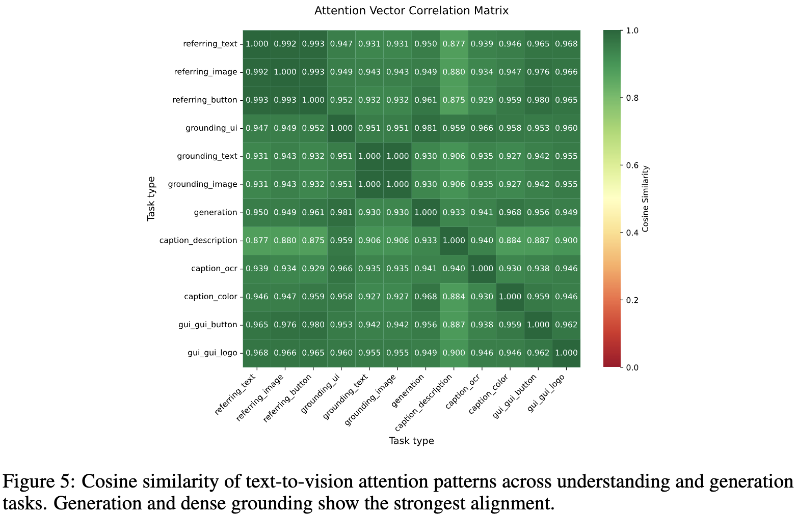

생성 UI 정성 비교: poster card·login interface, GPT-5.2/Claude/Gemini/Kimi/UI-UG-7B vs UI-UG 2-4B

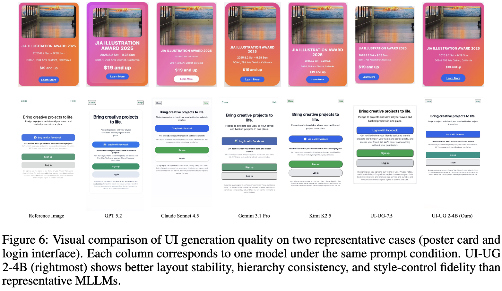

# 7. Conclusion & Limitations

- **결론**: front-end-aligned taxonomy + 넓은 grounding 지도 + compact renderable DSL + online render-aware GRPO로, 4B MLLM이 referring·dense grounding·GUI grounding·UI generation 전반에서 강한 성능. fine-grained understanding → generation의 비대칭 전이를 체계적으로 입증
- **Limitations** (저자 명시)
  - 최대 understanding gain은 자체 80-category corpus 기준 **in-domain** 결과. ScreenSpot mobile 외부 평가에선 더 크거나 특화된 모델이 여전히 우세
  - UI-UG-7B 비교는 backbone·data·taxonomy가 동시에 바뀌어 단일 설계 요인을 분리 못 함(Qwen3-VL-4B / UI-UG 2-4B-SFT 행이 same-backbone 대조)
  - generation reward와 평가 점수가 4개 시각 품질 차원을 공유 → rubric 밖 개선을 과대평가할 수 있음. human-reference 연구는 100 케이스·post-hoc
  - 스크린샷 기반 판정은 interactive functional test·accessibility·end-user 연구를 대체하지 못함
  - attention 정렬은 descriptive 증거(인과 아님), rare UI type·distribution shift·모바일 밖 환경은 open challenge
  - appendix latency 추정은 active parameter 기준의 rough scaling(직접 배포 벤치마크 아님)

# Takeaways

- **작은 모델 + 통합 설계가 거대 범용 모델을 이김**: 4B가 생성 품질에서 ~59× 큰 Qwen3-VL-235B, Claude Sonnet 4.5, GPT-5.2를 상회
- **render-aware online GRPO**가 offline DPO의 핵심 약점(preference-data vs inference-time mismatch)을 Playwright 실렌더링으로 메움
- **reward hacking 경고 사례**: dense grounding에서 recall-only reward는 지표를 오히려 악화 → Dual-IoU(precision+recall) 균형이 필수
- **understanding→generation 비대칭 전이**가 핵심 메시지: component-level 인지 표현이 생성의 공유 기반이며, 고정 예산에서 understanding 지도 ~20% 혼합이 생성 품질을 최대화
- 단, 가장 큰 이득은 in-domain(자체 80-category) 측정치이고 single-target localization 특화 모델엔 아직 못 미침 — 범용성보다 "모바일 UI 전용 통합 모델" 포지셔닝
