# [LLM] Rubrics as Rewards: Reinforcement Learning Beyond Verifiable Domains (RaR)

- paper: https://arxiv.org/pdf/2507.17746
- datasets: https://huggingface.co/datasets/anisha2102/RaR-Medicine , https://huggingface.co/datasets/anisha2102/RaR-Science
- ICLR 2026 accepted (인용수: 413회, '26-11-23 기준)
- 저자: Scale AI (Anisha Gunjal, Anthony Wang, Elaine Lau, Vaskar Nath, Yunzhong He, Bing Liu, Sean Hendryx)
- downstream task: 정답 검증이 어려운 expert reasoning 도메인(medicine, science)에서의 on-policy RL post-training
  - rubric-based 평가(HealthBench)와 multiple-choice 평가(GPQA-Diamond) 모두에서 검증
- 주요 용어
  - **Rubrics as Rewards (RaR)**: prompt마다 생성한 checklist형 rubric을 LLM judge에 넣어 reward를 계산하고, 이를 GRPO로 최적화하는 on-policy RL 프레임워크
  - **rubric item**: prompt $x$ 마다 $k$개의 $\{(w_j, c_j)\}_{j=1}^k$. $w_j \in \mathbb{R}$ 는 가중치, $c_j:(x,\hat{y}) \mapsto \{0,1\}$ 은 응답이 해당 기준을 만족하는지의 binary 판정
  - **Explicit Aggregation**: 기준마다 judge가 독립 판정 후 가중 평균
    $$r(x,\hat{y}) = \frac{\sum_{j=1}^k w_j \cdot c_j(x,\hat{y})}{\sum_{j=1}^k w_j}$$
  - **Implicit Aggregation**: rubric 전체(categorical label 포함)를 judge에게 한 번에 주고 1–10 Likert 점수 하나를 받음. $r_{\text{implicit}}(x,\hat{y}) = f_\phi(x,\hat{y},\{d_j\}_{j=1}^k)$ — 가중치 수동 튜닝 불필요
  - **Essential / Important / Optional / Pitfall**: rubric 항목의 categorical label. Pitfall은 흔한 오답·누락을 잡는 negative criterion

# 1. Motivation

- RLVR은 math/code처럼 **정답이 자동 검증되는** 태스크에서 강력함

  - 그러나 의료·과학 같은 real-world reasoning은 정답 하나가 아니라 **다기준(multi-criteria) 판단**이 필요 $\to$ RLVR을 그대로 쓸 수 없음

- 대안인 preference-based reward model의 한계

  - response length, formatting, annotator bias 같은 **표면적 artifact에 overfit**
  - 대량의 pairwise comparison 데이터 필요

- Instance-specific rubric은 이미 HealthBench 등 **평가**에는 쓰이고 있으나, **on-policy 학습의 reward**로 쓰는 연구는 거의 없음

  $\to$ (Research Question) rubric을 checklist형 supervision으로 바꿔 RLVR의 단순함과 preference ranking의 표현력 사이 middle ground를 만들 수 있는가?

# 2. Contribution

- **RaR 프레임워크**: checklist형 rubric을 multi-criteria reward로 사용하는 on-policy RL 방법 제안
- **데이터셋 공개**: instance-specific rubric이 포함된 **RaR-Medicine** (~20k), **RaR-Science** (~20k)
- **성능**: rubric-scored(HealthBench)와 verifiable MCQ(GPQA-Diamond) 모두에서 Likert 기반 baseline 대비 일관된 향상
- **Judge scale robustness**: rubric을 주면 작은 judge도 human preference에 잘 정렬되고, judge 크기에 따른 편차가 줄어듦

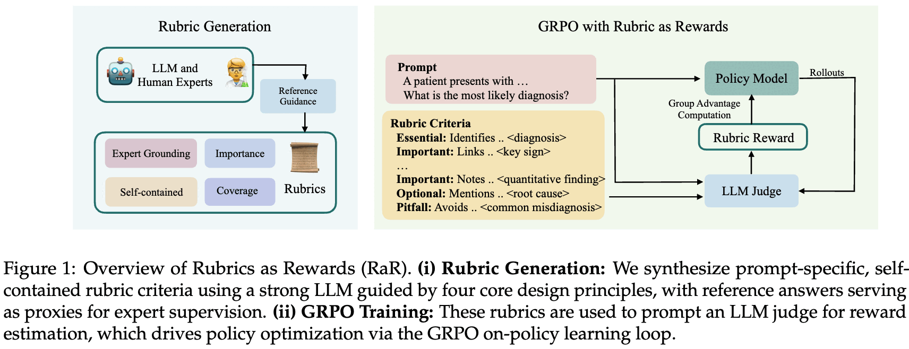

# 3. Rubrics as Rewards

## 3.1 Problem Formulation

- 입력 prompt $x$, 응답 $\hat{y} \sim \pi_\theta(\cdot \mid x)$
- 각 prompt에 $k$개의 rubric item $\{(w_j, c_j)\}_{j=1}^k$ 부여 — 가중치 + binary correctness 함수

## 3.2 Reward Aggregation

- **Explicit**: 기준별 판정 $\to$ Eq.(1) 가중 정규화 합
  - 정규화 덕분에 rubric 개수·가중치가 다른 prompt 간 reward 비교 가능
  - 실험은 binary $c_j$ 이지만 continuous score로 확장 가능
- **Implicit**: rubric 리스트를 통째로 judge에게 넘겨 holistic 1–10 점수 $\to$ $[0,1]$ 정규화
  - 가중치 설계를 judge에게 위임

## 3.3 RaR은 RLVR을 포함한다

- **Remark 1**: $k=1$, $w_1=1$, $c_1(x,\hat{y}) = \text{match}(y,\hat{y})$ 이면 RLVR과 동일
  $$r_{\text{RLVR}}(x,\hat{y}) = \text{match}(y,\hat{y})$$
- 즉 RLVR = "essential criterion 하나짜리 rubric RL"의 특수 경우
  - rubric은 여기에 다차원 supervision, 유연한 가중치, 주관/객관 기준의 결합을 추가

# 4. Rubric Generation

## 4.1 Desiderata (4가지 설계 원칙)

- **Grounded in Expert Guidance**: 정답에 필요한 핵심 사실·추론 단계·결론을 담을 것. 이상적으로는 human expert 또는 그 proxy(reference answer)에 근거
- **Comprehensive Coverage**: factual accuracy, logical coherence, completeness, style, safety 등 다차원 커버. 실수 잡는 **pitfall** 포함
- **Criterion Importance**: 기준 간 중요도 차이 반영 (e.g. factual correctness > stylistic clarity)
- **Self-Contained Evaluation**: 각 항목이 외부 맥락 없이 독립적으로 판정 가능해야 함

## 4.2 Rubrics Creation

- reference answer를 조건으로 LLM이 prompt당 **7–20개** self-contained rubric 생성
  - Medicine: `GPT-4o`, Science: `o3-mini`
- 각 항목은 numeric weight(1–5, pitfall은 −1/−2)와 categorical label을 모두 가지나, 실험에서는 categorical label(Essential/Important/Optional/Pitfall) 사용
- 데이터 통계 (Appendix)
  - RaR-Medicine: 20,166 examples, 평균 rubric 7.5개, 평균 질문 길이 45.0 words
    - label 분포: Important 34.1% / Essential 30.7% / Optional 22.1% / Pitfall 13.1%
    - 주제: Medical Diagnosis 50.3%, Treatment 16.0%, Knowledge 12.7% ...
  - RaR-Science: 20,625 examples, 평균 rubric 7.5개, 평균 질문 길이 52.6 words
    - label 분포: Important 34.8% / Essential 28.4% / Optional 22.3% / Pitfall 14.5%
    - GPQA-Diamond 카테고리에 맞춰 큐레이션 (General Chemistry 15.3%, Quantum Mechanics 15.3%, Physical Chemistry 13.4% ...)

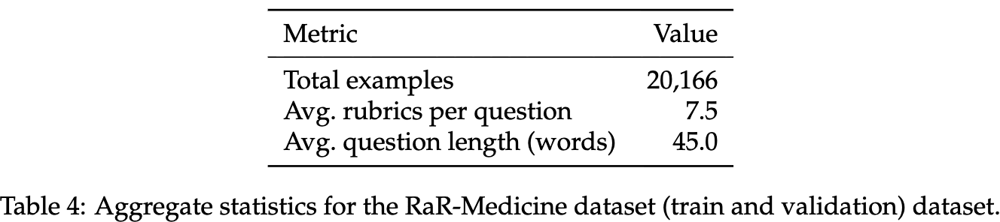

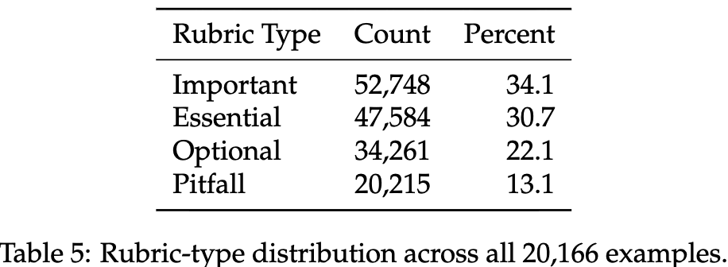

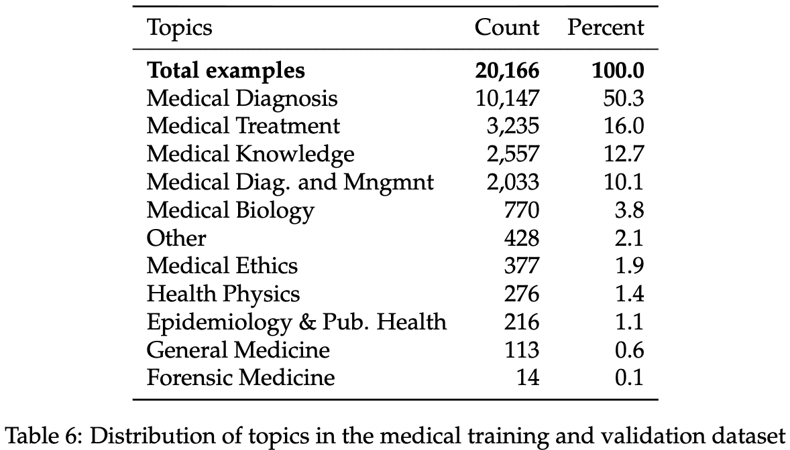

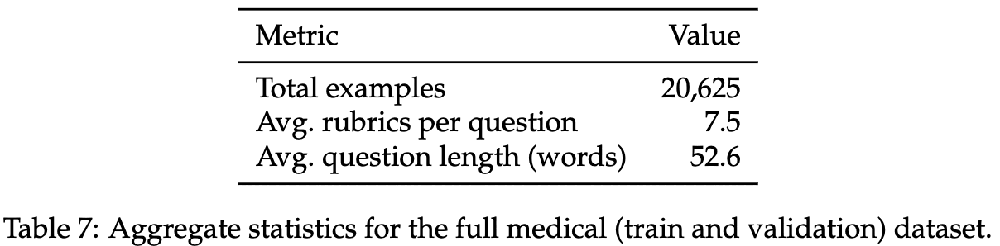

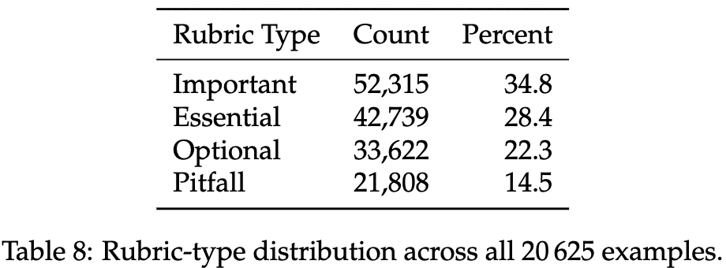

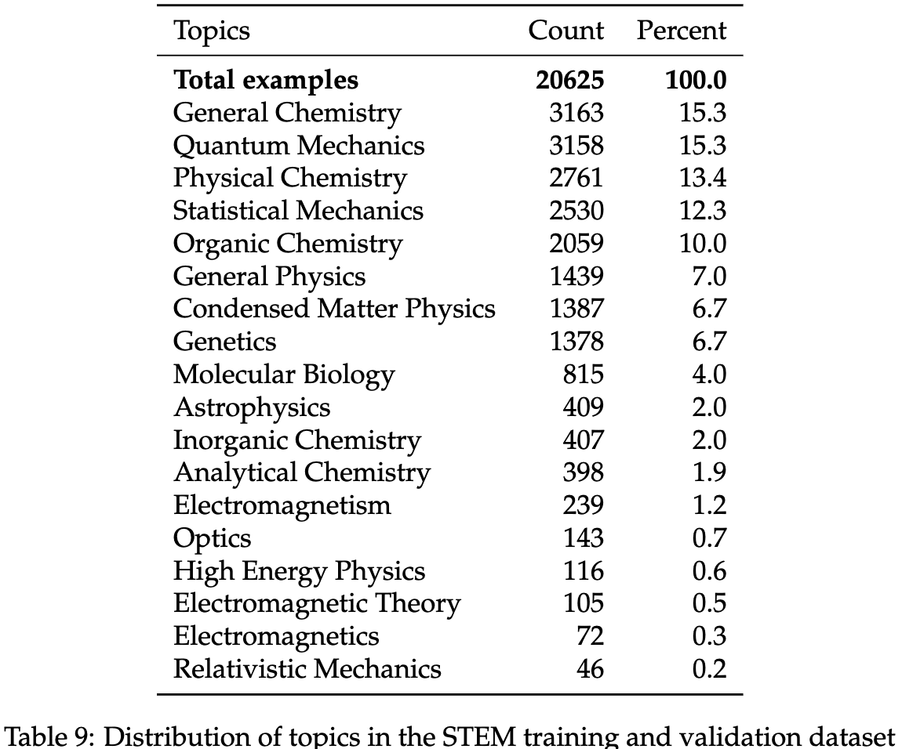

# 5. Experimental Setup

## 5.1 Datasets & Training

- **RaR-Medicine**: medical-o1-reasoning-SFT, natural_reasoning, SCP-116K, GeneralThought-430K 등에서 20k prompt
- **RaR-Science**: natural_reasoning, SCP-116K, GeneralThought-430K에서 ~20k prompt
- Policy: `Qwen2.5-7B` base, GRPO
  - rollouts/prompt 16, batch 96, lr $5\times10^{-6}$ (constant + 10% warmup), max length 3584, temperature 1.0, 300 steps
  - 8×H100 단일 노드
- Judge: `gpt-4o-mini`

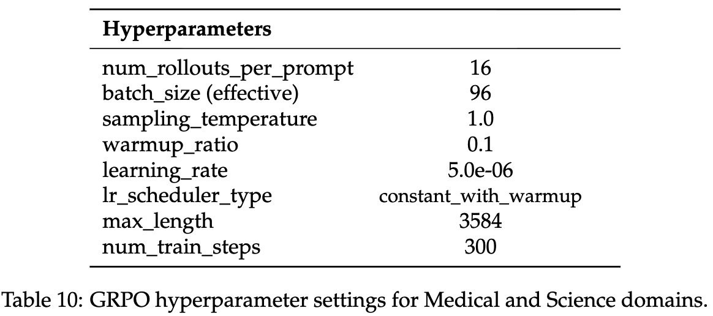

## 5.2 Baselines

- **Rubric-free**
  - `Off-the-shelf`: Qwen2.5-7B, Qwen2.5-7B-Instruct
  - `Direct-Likert`: judge가 prompt–response만 보고 1–10 점수
  - `Reference-Likert`: judge가 reference answer와 비교해 1–10 점수
- **Rubric-guided**
  - `RaR-Predefined`: 모든 prompt에 동일한 generic rubric 4개(정확성, 완결성, 간결성, 실용성), uniform weight + explicit aggregation
  - `RaR-Explicit`: instance-specific rubric + explicit aggregation. 가중치 {Essential: 1.0, Important: 0.7, Optional: 0.3, Pitfall: 0.9}
    - pitfall은 "The response avoids misinformation" 처럼 positive로 phrasing $\to$ 만족 시 가점, 불만족 시 감점
  - `RaR-Implicit`: instance-specific rubric + implicit aggregation (1–10 Likert)

## 5.3 Evaluation

- **Rubric-based**: HealthBench (5,000 clinical conversations, physician-authored rubric), greedy decoding. ablation용으로 1,000개(HealthBench-1k) 분리
- **Multiple-choice**: GPQA-Diamond, greedy로 10회 run, 보기 순서 permute, boxed answer 파싱(실패 시 GPT-4o verifier), 95% CI 보고
- **Judge alignment**: HealthBench ~3,000 prompt에서 practitioner-approved 답(preferred) vs o3로 만든 perturbed 답 쌍 $\to$ **pairwise preference accuracy**
  - 최종 3,027 preferred + 3,027 perturbed (총 6,054), perturbation은 manual screening으로 "객관적으로 더 나쁨" 확인

# 6. Experiments

## 6.1 Main Results

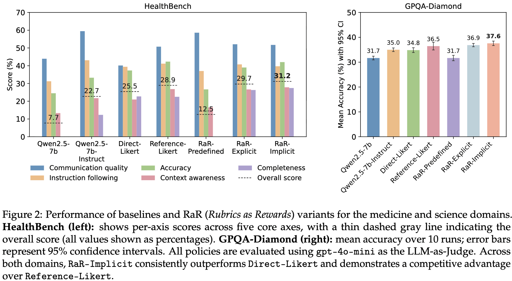

- **RaR-Implicit이 전 도메인 최고**
  - Direct-Likert 대비: HealthBench 25.5 $\to$ 31.2 (+5.7pp), GPQA 34.8 $\to$ 37.6 (+2.8pp)
  - 논문은 "relative gain up to 31% (HealthBench), 7% (GPQA)"라 서술하나, Figure 2 수치 기준 HealthBench 상대 향상은 약 22% — 수치/서술 간 불일치 있음
  - 본문은 "Table 2 reports results"라고 쓰지만 실제로는 Figure 2를 가리킴
- **rubric 학습 효과가 MCQ로도 일반화**: rubric으로만 학습했는데 verifiable한 GPQA에서도 향상
- **RaR-Predefined는 오히려 크게 하락** (HealthBench 12.5)
  - generic criteria는 prompt-specific 요구사항·failure mode를 못 잡아 reward가 misaligned $\to$ **instance-specific rubric 합성이 핵심**
- **Reference-Likert 대비도 소폭 우세** (28.9 $\to$ 31.2)
  - rubric 자체가 reference answer로 만들어지므로 rubric 품질은 reference 품질에 묶임. 그래도 open-ended 답을 explicit criteria로 쪼개는 것이 더 잘 정렬된 신호를 줌
- **Implicit vs Explicit**: Implicit이 최고 성능, Explicit은 해석성·통제력은 높지만 가중치 튜닝이 brittle $\to$ 저자들은 application-dependent로 판단

## 6.2 Judge Alignment across Model Scales

figure3 첨부 (judge 크기별 pairwise preference accuracy: Pure Likert vs Rubrics vs Rubrics w/o reference)

- 3B judge ~ gpt-4o까지 모든 judge 크기에서 **Rubrics > Rubrics w/o reference > Pure Likert**
- 작은 judge에서 이득이 가장 큼 $\to$ checklist형 기준이 small judge와 large judge의 격차를 좁힘
- reference answer 없이 만든 rubric(green)은 Likert보다는 낫지만 expert-grounded rubric에는 못 미침 $\to$ **expert guidance가 rubric 품질에 결정적**

- Judge 품질이 GRPO 학습에 미치는 영향 (Appendix A.8)
  - RaR-Implicit vs Direct-Likert: GPT-4o-mini 27.9 vs 25.3, Qwen-32B 26.2 vs 25.4, Qwen-14B 25.0 vs 24.9, Qwen-7B 26.7 vs 22.0
  - 가장 큰 이득은 Qwen-7B judge (+4.7pp) — 가장 약한 judge를 큰 judge 수준으로 끌어올림
  - rubric 기반 점수 분포가 더 좁음 (0.250–0.279 vs 0.220–0.254) $\to$ judge 간 일관성 향상
  - 참고: 본문 Appendix 텍스트에는 "+0.047"로 표기되어 Table 11 차이(+4.7pp)와 단위만 다름

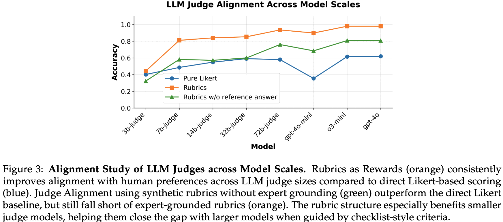

# 7. Ablations

## 7.1 Rubric 생성 전략 (Human vs Synthetic)

- HealthBench-1k를 hold-out, 나머지 3.5k prompt의 human-written rubric을 학습에 활용

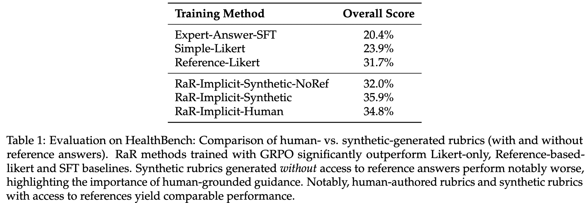

- 모든 instance-specific RaR 변형이 rubric-free baseline보다 우수 — 가장 약한 NoRef도 Reference-Likert 초과
- **reference 기반 synthetic rubric (35.9) ≈ human rubric (34.8)** $\to$ reference가 있으면 synthetic으로 충분
- reference 없는 synthetic rubric은 32.0으로 하락 $\to$ high-stakes 도메인에서 순수 synthetic rubric은 미묘한 기준을 놓침

## 7.2 Rubric 설계 요소

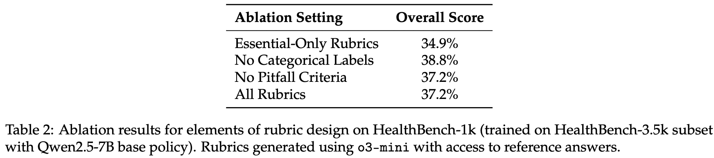

- 학습: HealthBench-3.5k, rubric은 o3-mini + reference
- **Essential만 쓰면 하락** (34.9) $\to$ 더 넓은 범위의 criteria가 풍부한 학습 신호
- **가중치(label)·pitfall 유무는 영향 미미**, 오히려 label 제거가 최고(38.8)
  - 저자 해석: 효과적인 pitfall을 합성하려면 모델의 흔한 failure mode를 예측해야 하는데, 이는 human intuition이 필요한 어려운 작업 $\to$ synthetic negative criteria의 specificity 부족

## 7.3 Rubric 생성 LLM의 역량

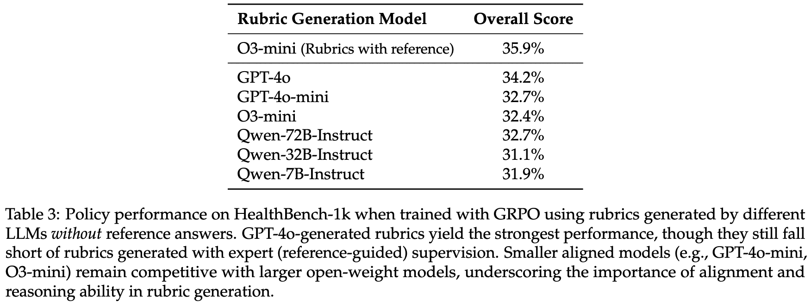

- reference 없이는 GPT-4o가 최고(34.2)지만 reference 있는 O3-mini(35.9)에 못 미침
- 작은 aligned 모델(GPT-4o-mini, O3-mini)이 큰 open-weight 모델과 비슷 $\to$ 크기보다 instruction tuning·reasoning 능력이 중요

# 8. Related Works

- **RLVR across domains**: General-Reasoner(200k mixed corpus, MMLU-Pro +10pt), Cross-Domain RLVR(single cross-domain RM), Med-RLVR(3B, MCQ clinical QA)
- **Rubrics for evaluation/training**: HealthBench(48k clinician criteria), rubric-prompted grader, CPT(rubric으로 DPO preference pair 생성), checklist 기반 preference tuning
  - 기존 연구는 rubric을 **채점 또는 preference data 생성**에 사용 $\to$ RaR은 **on-policy RL의 reward로 직접** 사용
- **Learning from feedback**: RLHF(reward hacking), RLVR(sparse), PRM/ThinkPRM(annotation cost) $\to$ rubric은 다수 criteria를 structured verifier로 바꾼 denser reward라는 middle ground

# 9. Conclusion & Limitations

- **Conclusion**
  - checklist형 rubric을 reward로 쓰는 RaR은 Likert 기반 baseline을 크게 넘고, reference-based reward와 동등 이상
  - human preference alignment 개선 + 큰 judge 의존도 감소
- **Limitations (저자 언급)**
  - 도메인이 medicine/science로 한정 — dialogue, tool use, agentic task 검증 필요
  - aggregation은 implicit/explicit 두 가지만 탐색 — learned continuous weight나 curriculum형 dynamic weighting(초반 essential correctness $\to$ 후반 style/safety)은 미탐색
  - judge는 off-the-shelf LLM만 사용 — 전용 evaluator / generative RM은 future work
- **추가로 보이는 한계**
  - policy가 Qwen2.5-7B 하나, judge도 메인 실험은 gpt-4o-mini 하나
  - 본문 서술(relative gain 31%, Table 2 참조)과 Figure 2 수치가 맞지 않는 등 v2에도 정리 안 된 부분이 있음
  - rubric 품질이 reference answer 품질에 종속 — reference 없는 도메인에서는 이득이 크게 줄어듦 (32.0 vs 35.9)

## Takeaways

- RLVR은 "essential criterion 1개짜리 rubric RL"이다 — rubric은 RLVR의 자연스러운 일반화
- **instance-specific**이 핵심: generic rubric(RaR-Predefined)은 base 근처까지 무너짐
- 가중치 hand-tuning(Explicit)보다 rubric을 통째로 judge에 넘기는 **Implicit**이 더 잘 됨
- rubric 생성 시 **reference answer 조건화**가 가장 큰 레버 — 있으면 synthetic ≈ human
- rubric은 small judge를 large judge 수준으로 끌어올려 reward 비용 절감에 유리
- pitfall/label 같은 세부 설계는 synthetic으로 만들면 효과가 거의 없음 — negative criteria는 사람이 더 잘 만든다
