# [LLM] Rubric Curriculum RL: Exploiting the Generation-Verification Gap in Non-Verifiable Domains

- paper: https://arxiv.org/pdf/2611.06244v1
- ICML 2026 accepted (인용수: 0회, '26-11-23 기준)
- 저자: Sumeet Ramesh Motwani\*, Tejas Krishnan\*, Alistair Letcher, Charles London, Suhaas Bhat, Huitian Jiao, Philip Torr, Riashat Islam, Christopher Summerfield, Jakob Foerster, Christian Schroeder de Witt, Qilong Gu, Shital Shah (University of Oxford, Microsoft Research)
- downstream task: Open-ended generation RL (creative short-fiction writing, HealthBench health QA)
- 주요 용어
  - **Generation-Verification (GV) gap**: 같은 모델이 직접 생성한 응답의 기대 품질보다, 자기가 $N$개 중 고른 응답의 기대 품질이 더 높은 현상. $\bar{V}^{(N)}_{\mathcal{M}} - \bar{G}_{\mathcal{M}} > 0$
  - **Rubric curriculum**: rubric 전체를 한번에 reward로 쓰지 않고, $n$ step마다 criterion을 하나씩 추가하는 non-stationary reward 스케줄
  - **Pairwise win-rate reward**: frozen self-judge $\pi_{\theta_0}$가 같은 group 안의 rollout들을 criterion 단위로 1:1 비교한 뒤 계산한 승률. $R^{(m)}_{\text{pair}}(\mathbf{q},\mathbf{o}_i) = \frac{1}{G-1}\sum_{j\neq i} y^{(m)}_{i\succ j}$
  - **$R_{\text{W-pair}}$**: 최신 criterion에 weight 1/2, 이전 criterion들에 나머지 1/2를 균등 분배해서 가중합한 pairwise reward
  - **$\mathcal{H}_{\text{ratio}}$**: 학습 종료 시 policy entropy / 초기 entropy. mode collapse 정도를 나타내는 지표

# 1. Motivation

- RLVR은 math/code에서 큰 성과를 냈지만, LLM 실사용의 상당 부분(ChatGPT 사용의 56.4%)은 creative writing, advice 같은 **open-ended generation**이고 이런 태스크에는 ground truth가 없음
  - 사람 annotation은 비싸고, offline dataset은 대규모가 필요하고, learned reward model은 reward hacking에 취약함
- **GV gap**: 좋은 이야기를 알아보는 것이 좋은 이야기를 쓰는 것보다 쉬움 (같은 모델이어도 마찬가지)
  
  - 검증은 고차원 output을 저차원 품질 판단으로 압축하는 일이고, 생성은 거대한 search space를 탐색하는 일이기 때문
  $\to$ 모델 자신의 검증 능력으로 생성을 학습시킬 수 있지 않을까?
- 하지만 기존의 rubric 기반 judge(RaR 등)는 두가지 문제가 있음
  1. **Low-precision signal**: 여러 criterion에 대한 판단이 숫자 하나로 합쳐지면서 credit assignment가 안 됨
  2. **Stationary target**: 고정된 rubric과 judge는 수백 step이면 reward hacking 당함
  - 실제로 self-improvement 방법들은 50~250 step 안에 plateau 또는 collapse함

static rubric RaR: train reward는 계속 오르지만 FictionBench eval win rate는 개선 없음

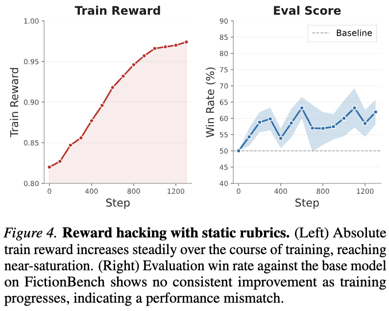

  $\to$ (Research Question) 추가 데이터, human annotation, 더 강한 teacher 없이 모델 스스로를 judge로 써서 open-ended 도메인에서 1000+ step 동안 계속 개선할 수 있을까?

# 2. Contribution

- open-ended 도메인에서 **GV gap**을 정의하고, 존재(Claim 1), 스케일링(Claim 2), 활용 가능성(Claim 3)을 실험으로 검증함
- **RcRL** 제안: pairwise reward + rubric criterion curriculum 조합
  - curriculum이 high-precision signal을 주고 reward hacking을 줄임
- 1000+ step 동안 계속 개선, entropy 유지 ($\mathcal{H}_{\text{ratio}}=0.93$), creative writing 벤치마크 3개 전부에서 self-improvement baseline보다 좋음
  - human eval 기준 base 대비 **70.5% win rate**. 새 데이터, human annotation, 더 강한 judge 모두 없이 달성
- HealthBench로 확장: base 대비 **+14.60%** (full), **+25.38%** (consensus subset)

FictionBench에서 RcRL vs RaR 학습 곡선: RcRL은 1300 step에서 ~75%, RaR은 55~65%에서 plateau

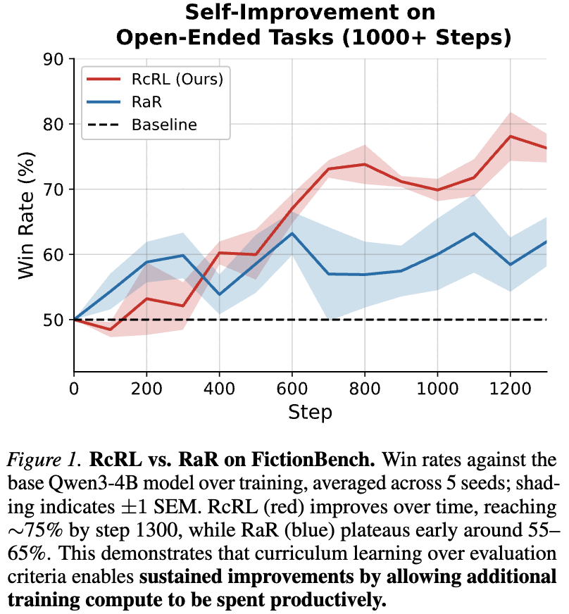

# 3. Related Works

- **RL on Open-Ended Domains**: RLHF, LLM-as-judge, 학습된 reward model (LitBench 등), self-rewarding, RaR(rubric judge)
  - 더 강한 모델이나 추가 데이터가 필요하거나 signal이 불안정함
- **GV Gap & Reward Hacking**: Gao et al. (2023)의 reward model overoptimization scaling law, Skalse et al.의 hackability 정의 등
  - RcRL은 non-stationary objective로 단일 고정 criterion에 대한 over-optimization을 막음
- **Curriculum & Exploration**: curriculum이 RLVR에서 reasoning과 sample efficiency를 개선하고, entropy 보존에도 도움이 된다는 선행연구
  - RcRL은 reward function 자체를 계속 이동시킴 (reward-switching과 유사함)

# 4. Generation-Verification Gap

## 4.1 정의

- $Q: \mathcal{X}\times\mathcal{Y}\to[0,1]$: 품질 함수 (실험에서는 GPT-5.2 judge의 정규화 rubric score)
- **Generative Ability**: $\bar{G}_{\mathcal{M}} = \mathbb{E}_{x}\mathbb{E}_{y\sim\pi_{\mathcal{M}}}[Q(x,y)]$
- **Self-Verification Ability**: $N$개를 뽑고 자기 ranking으로 고른 응답의 품질 $\bar{V}^{(N)}_{\mathcal{M}} = \mathbb{E}[Q(x, y_{i^*})]$, $i^* \in \arg\max_i \text{rank}_{\mathcal{M}}(x,y_i)$
- **GV Gap**: $\bar{V}^{(N)}_{\mathcal{M}} - \bar{G}_{\mathcal{M}} > 0$

## 4.2 세 가지 Claim

- **Claim 1 (Gap Exists)**: Best-of-$N$ self-selection(${N \choose 2}$ pairwise 비교로 최다 승리 rollout 선택)이 $N=1$보다 좋음
- **Claim 2 (Gap Scales)**: $N$과 모델 크기가 커질수록 gap이 커짐. Qwen3-8B의 gap이 모든 $N$에서 4B보다 큼
- **Claim 3 (Gap Is Exploitable)**: self-verification을 reward로 쓰면 RL 후 $\bar{G}_{\mathcal{M}'} > \bar{G}_{\mathcal{M}}$ $\to$ RcRL로 human eval 70.5%

FictionBench Best-of-N scaling: Qwen3-4B/8B self-verifier, N=1~32

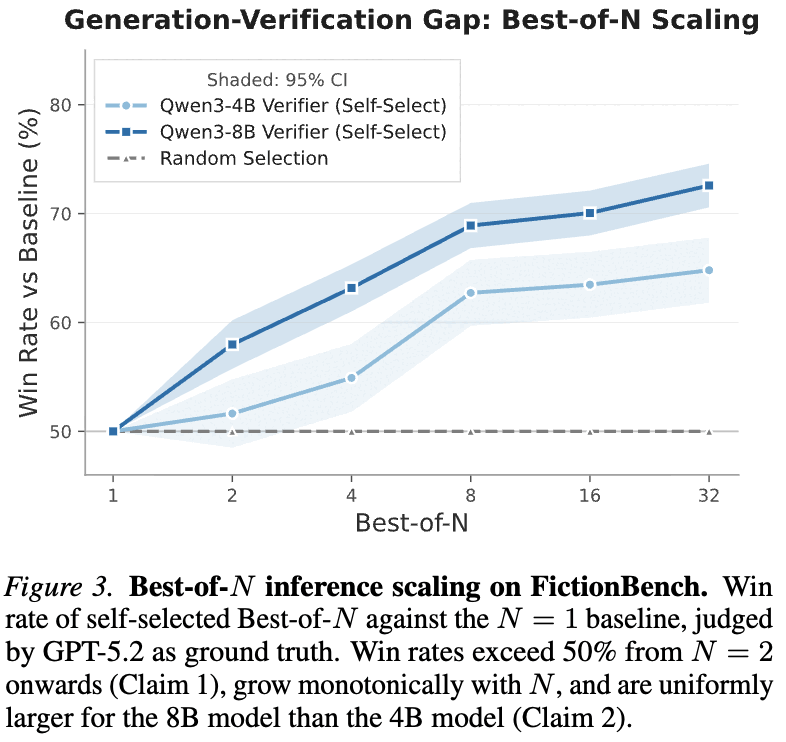

## 4.3 이론 (Appendix A.1, A.2)

- **GV gap 분해** (Prop. A.1): $\text{Gap}(\pi) = \mu(\pi)\,\nu(\pi)$
  - $\mu = \mathbb{E}[|\Delta|]$: policy의 **quality diversity**
  - $\nu$: judge의 $|\Delta|$-weighted ranking skill (chance 기준 centered)
  - gap이 사라지는 세 경로: (a) diversity collapse $\mu\to0$, (b) judge skill limit $\nu\to0$, (c) Goodharting $\nu<0$
  $\to$ 다양성 유지 + judge signal 강화 + 평가 기준 변경이 필요하다는 근거가 됨
- **Self-improvement** (Prop. A.2): KL-regularized update에서 pairwise win-rate reward를 쓰면
  $$\bar{G}(\pi_{t+1}) - \bar{G}(\pi_t) = \frac{\beta}{2}\text{Gap}(\pi_t) + O(\beta^2)$$
  - 즉, 현재 policy에서 gap이 양수이면 local 개선이 보장됨
- **Criterion dilution** (Thm. A.3): holistic judge가 $K$개 criterion을 하나의 verdict로 압축하면, target criterion에 대한 Fisher information이 criterion-wise 비교 대비 약 $\alpha_m^2$배로 줄어듦 (균등 가중이면 $O(1/K^2)$)
- **Relative vs absolute**: within-group win rate는 group 평균이 항상 1/2이라 위로 drift할 수 없음. absolute score는 고정 target이라 품질과 무관하게 올릴 수 있음

# 5. Method: Rubric Curriculum RL

Static rubric vs RcRL 개요: phase별 criterion 추가, pairwise 비교로 win-rate reward

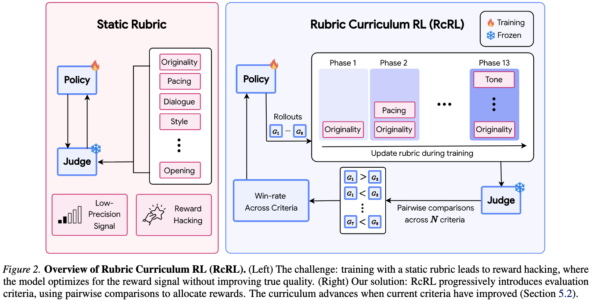

## 5.1 Base RL

- **Dr. GRPO** 사용. group 내 상대 advantage $\hat{A}_{i,t} = R(\mathbf{q},\mathbf{o}_i) - \text{mean}(\{R(\mathbf{q},\mathbf{o}_j)\})$
- RaR baseline: $R_{\text{RaR}} = \pi_{\text{judge}}(\mathbf{q},\mathbf{o}_i,\mathbf{r}) \in [0,1]$ (absolute rubric score)

## 5.2 RcRL Reward

- **Frozen self-judge**: $\pi_{\text{judge}} := \pi_{\theta_0}$ (base model snapshot이고 online update 안 함)
- **Pairwise reward**: criterion $r^{(m)}$에 대해 각 rollout의 group 내 승률 $R^{(m)}_{\text{pair}}$
- **Weighted curriculum**: 현재 active index $k(t)$
  $$w^{(m)}_t = \begin{cases}\frac{1}{2}, & m = k(t)\\ \frac{1}{2(k(t)-1)}, & 1\le m<k(t)\end{cases},\quad R_{\text{W-pair}} = \sum_{m=1}^{k(t)} w^{(m)}_t R^{(m)}_{\text{pair}} \in[0,1]$$
  - 새 criterion에 가중치를 몰아줘서 몇 step의 exploration만으로 signal을 잡게 하고, 이전 criterion이 퇴화하지 않도록 남겨둠
- $n=100$ step마다 curriculum 진행 (creative writing은 13 criteria, HealthBench는 $n=50$)

RcRL: 매 step W-pair reward로 GRPO update, t mod n = 0이면 k(t) 증가

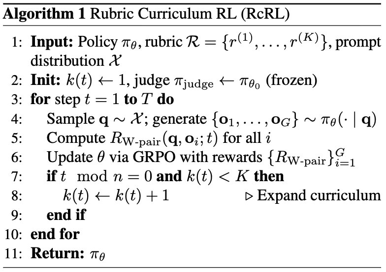

# 6. Experiments

## 6.1 Setup

- 주 모델: **Qwen3-4B** (instruct). scaling 실험은 Qwen3 0.6B~14B, cross-architecture는 Llama-3.2-3B
- 벤치마크
  - **Creative Writing V3 (CWv3)**: rubric score, win rate, ELO. judge 3종(GPT-5.2, Claude 4.5 Opus, Deepseek V3.2)
  - **FictionBench**: pairwise 비교 기반(GPT-5.2, 7× oversampling, 280 비교), win rate + Bradley-Terry ELO
  - **LechMazur (LM)**: GPT-5.2 judge, 18 criteria rubric score
- LR: RcRL 5e-6, RaR은 LR sweep 후 best

## 6.2 Main Results

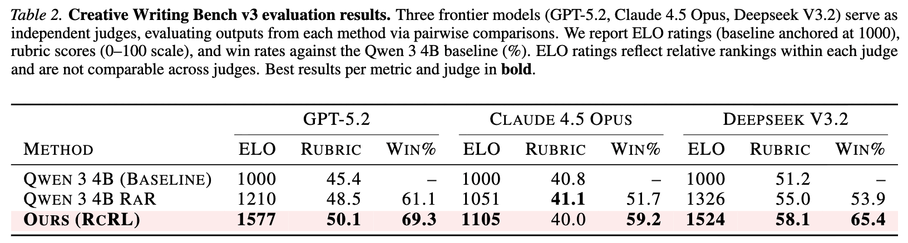

- base 대비 ELO: +577 (GPT-5.2), +105 (Claude), +524 (Deepseek). RaR 대비 ELO gain이 **1.6~2.7배**
- 단, Claude judge 기준 rubric score는 RaR 41.1 > RcRL 40.0 (base 40.8)

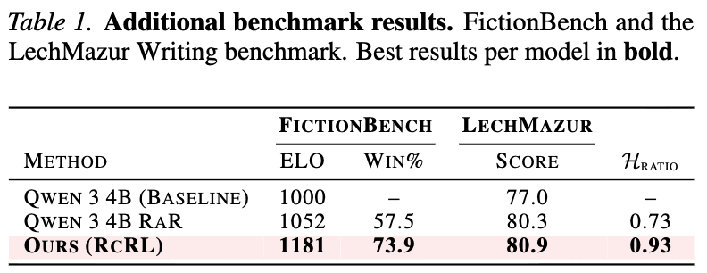

- FictionBench: win rate 73.9%, ELO gain은 RaR의 3.5배
- LechMazur: 77.0 $\to$ 80.9. prompt element integration(Q9A~Q9J)에서 특히 향상

## 6.3 Pairwise Model Comparisons & Human Eval

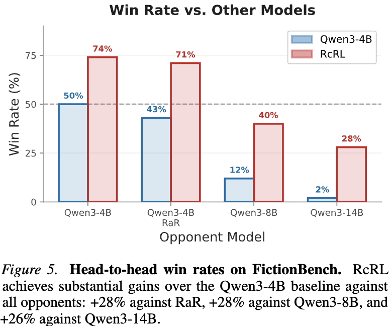

- RcRL은 RaR 상대로 **71.4%** win
- 더 큰 모델 상대: base 4B는 8B와 14B에게 12.1%, 1.8%만 이기는데 RcRL은 **40.0%**, **27.9%**까지 올라감 $\to$ capacity gap을 상당 부분 줄임

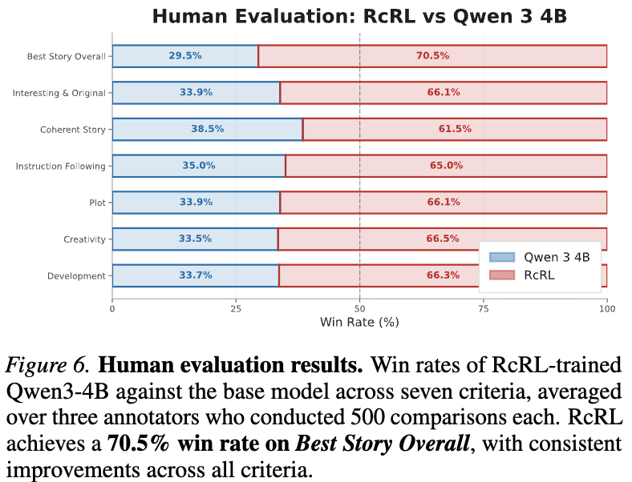

- 전문 annotator 3명이 각자 500쌍을 평가함. Best Story Overall에서 **70.5%**로 RcRL 선호
- 세 annotator가 만장일치한 비교는 70.8%이고, 7개 criterion 모두에서 개선됨

## 6.4 Scaling

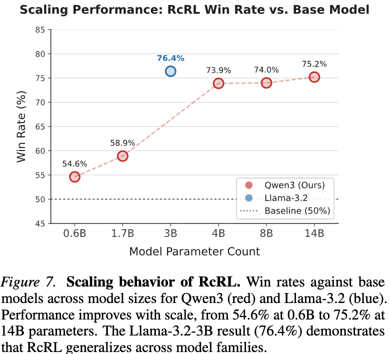

- Qwen3: 0.6B 54.6% $\to$ 1.7B 58.9% $\to$ 4B 73.9% $\to$ 8B 74.0% $\to$ 14B 75.2% (단조 증가)
- Llama-3.2-3B: 76.4% $\to$ 다른 모델 계열에서도 효과가 있음

## 6.5 Ablations

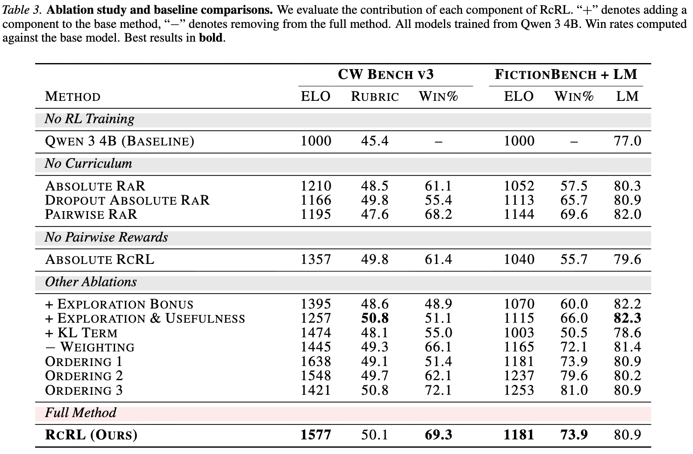

- **Pairwise 제거** (Absolute RcRL): FictionBench win rate가 18.2pp 떨어짐 (73.9 $\to$ 55.7)
- **Curriculum 제거**: ELO가 크게 떨어지고 entropy가 빠르게 collapse함 (300 step 안에 $\mathcal{H}_{\text{ratio}}=0.83$)
- **Criterion ordering**: 랜덤 순서 3개 모두 성능이 견고함. FictionBench에서는 오히려 79.6%, 81.0%로 더 높음
- Exploration bonus (RepExp), usefulness bonus는 add-on으로 일부 지표에서만 이득이 있음 (Appendix B)

## 6.6 Curriculum Pacing

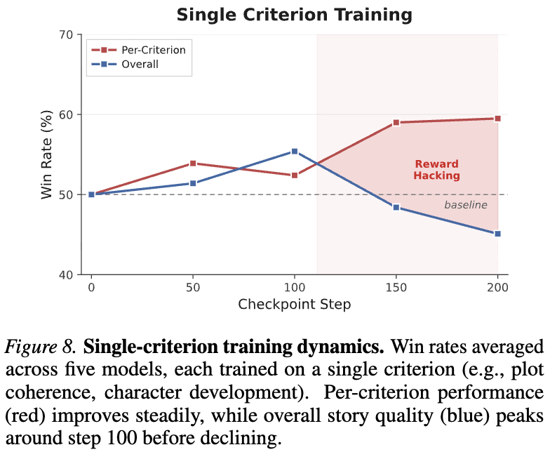

- criterion 하나로 200 step 학습하면, 해당 criterion 점수는 계속 오르지만 overall story quality는 **~100 step에서 정점** 이후 하락함 (reward hacking 구간)
- 이 inflection point에 맞춰 $n=100$으로 설정함

## 6.7 Entropy Preservation

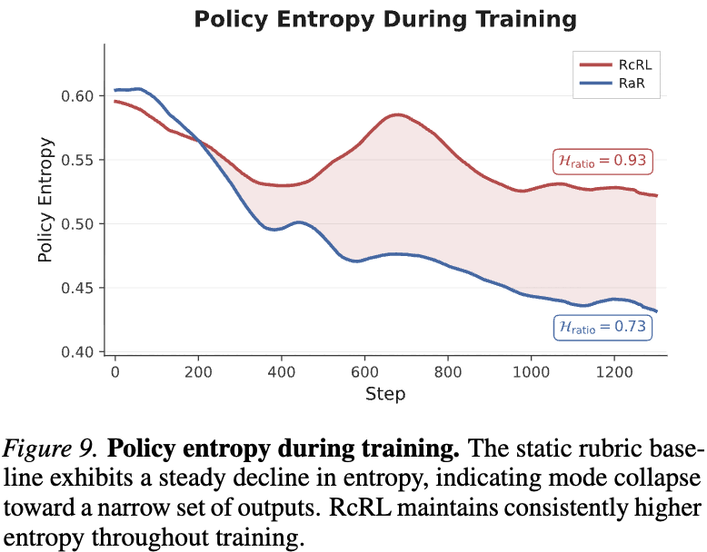

- RaR은 entropy가 계속 감소함 $\to$ n-gram 반복 증가, 이야기에 non-English token 삽입(ex. "二十年")
- RcRL은 entropy가 거의 일정함 ($\mathcal{H}_{\text{ratio}}=0.93$)
  - (i) curriculum이 reward landscape를 계속 바꾸고, (ii) pairwise reward는 절대 품질과 무관하게 judge가 변별하도록 강제해서 absolute reward 포화로 인한 vanishing gradient를 막음

n-gram repetition score: Qwen3-4B 11.51 / RaR 13.58 / RcRL 7.52

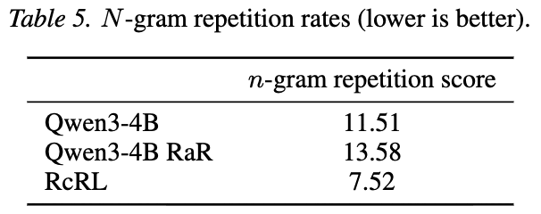

## 6.8 Cross-Domain: HealthBench

- Qwen3-4B, HealthBench 평가 rubric에서 만든 일반 criteria 13개를 사용함 (instance-specific rubric은 안 씀)

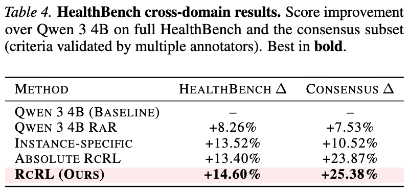

- 고정 rubric만으로 instance-specific rubric baseline도 이김
- 도메인별로 두 메커니즘의 기여도가 다름
  - creative writing: Pairwise RaR(no curriculum)이 이미 69.6% $\to$ **pairwise**가 핵심
  - HealthBench: Absolute RcRL이 full RcRL에 근접 $\to$ **curriculum**이 핵심. HealthBench criteria는 검증이 쉬워 absolute score도 calibration이 잘 되기 때문

# 7. Conclusion & Limitations

- **Conclusion**: pairwise reward와 rubric curriculum을 결합하면 non-verifiable 도메인에서도 GV gap을 학습 signal로 쓸 수 있고, 1000+ step의 scalable self-improvement가 가능함
- **Limitations (저자 언급)**
  - non-verifiable 도메인 평가는 본질적으로 noisy함. creative writing 전문가 간 inter-rater agreement도 $\kappa\approx0.6$ 수준
  - pairwise 비교 비용이 rollout group 크기 $G$에 대해 quadratic하고 training step에 linear함. $G=8$, 13 criteria에서는 감당할 만하지만 확장하려면 Swiss-system 같은 $O(G\log G)$ 근사가 필요함
  - rubric을 사람이 수작업으로 지정해야 함
  - curriculum을 100 step마다 균일하게 진행함 (criterion별 inflection을 자동으로 감지하지 않음)
  - criterion이 많아지면 고정 순서 제시의 정당성이 약해짐
- **Future work**: inflection 자동 감지, preference data에서 criterion 자동 발견, verification compute 스케일링, long-horizon task(deep research 등)로 확장
  - long-horizon 확장: stage별 rubric $\mathcal{R}_h$를 두고 task horizon과 rubric curriculum을 함께 늘리는 방식 제안

# Takeaways

- 외부 judge 없이 **frozen base model 자신**을 judge로 써도 open-ended 도메인에서 self-improvement가 가능함. 핵심은 judge의 품질보다 **reward 설계**
- **Absolute $\to$ pairwise**: group 평균이 1/2로 고정되어 reward가 drift하지 않음. GV gap을 직접 활용하는 형태
- **Static $\to$ curriculum**: 하나의 criterion이 hack되기 전(~100 step)에 target을 옮기는 것이 entropy 보존과 장기 학습의 열쇠
- Gap $=\mu\nu$ 분해는 실용적 진단 도구: diversity collapse, judge skill 한계, Goodharting 중 무엇이 문제인지 구분할 수 있음
- RaR (같은 날 리뷰)과 비교하면 rubric을 reward로 쓰는 아이디어는 같지만, "한번에 다 주지 말고 쪼개서 순차로 + 상대 비교로"라는 점이 차이
