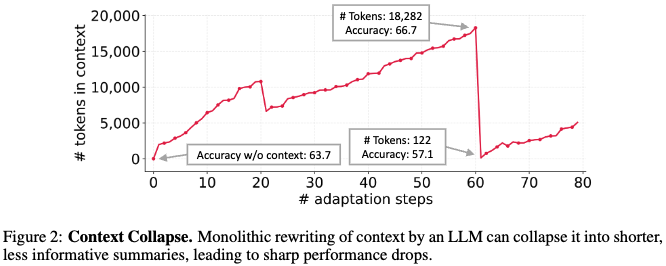
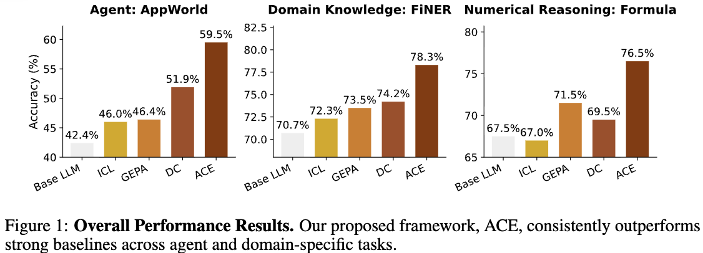
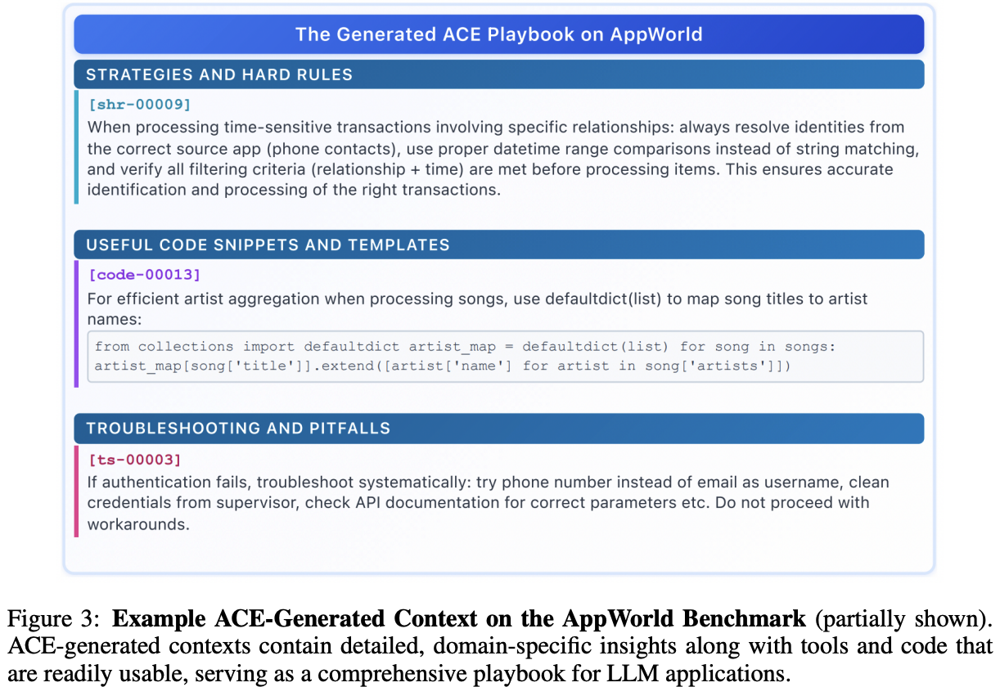
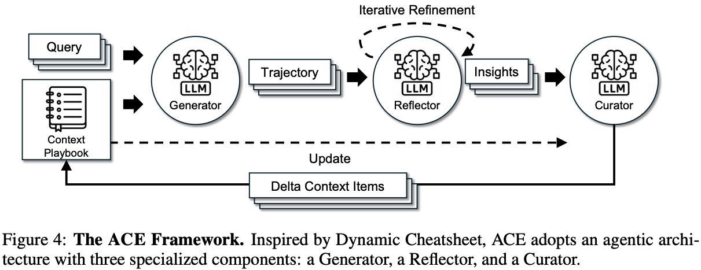
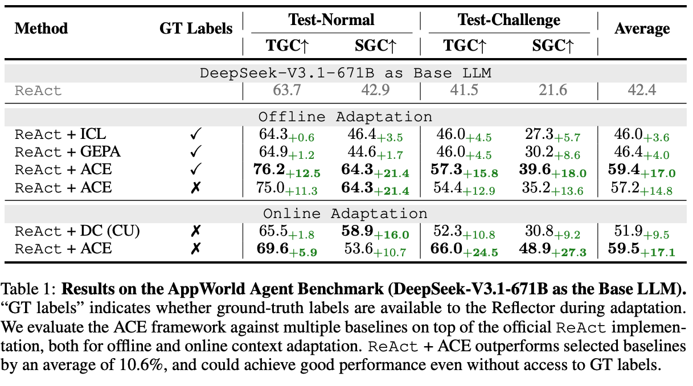
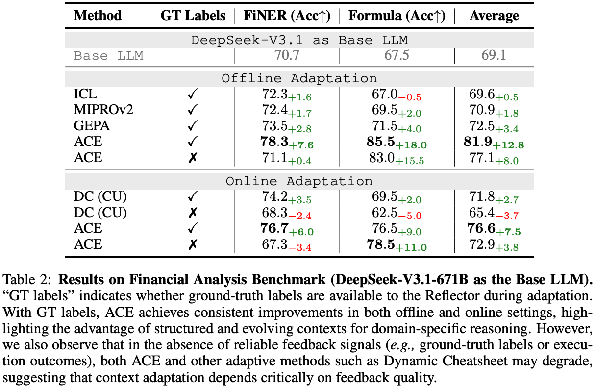
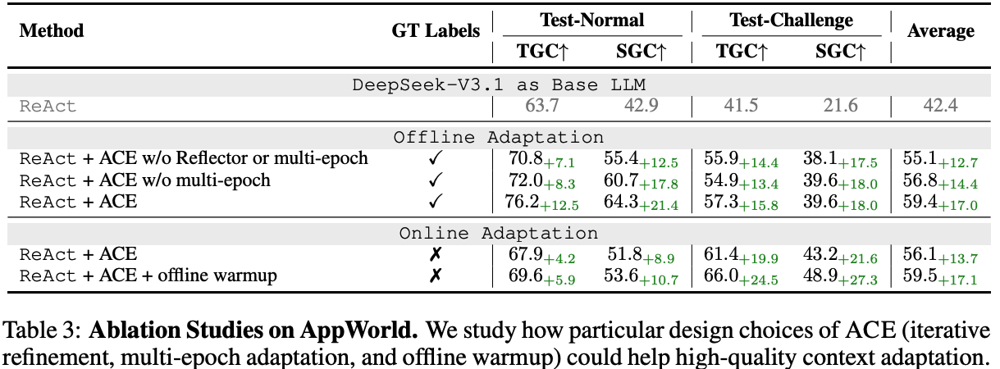
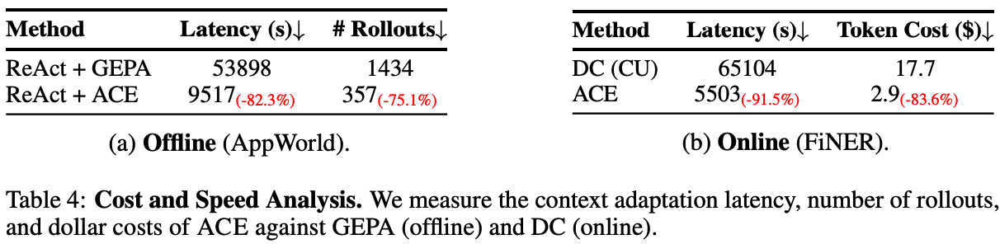

# [Agent] Agentic Context Engineering: Evolving Contexts for Self-Improving Language Models

- paper: https://arxiv.org/pdf/2510.04618
- github: https://github.com/ace-agent/ace
- webpage: https://ace-agent.github.io
- ICLR 2026 accepted (인용수: 624회, '26-11-25 기준)
- 저자: Qizheng Zhang\*, Changran Hu\*, Shubhangi Upasani, Boyuan Ma, Fenglu Hong, Vamsidhar Kamanuru, Jay Rainton, Chen Wu, Mengmeng Ji, Hanchen Li, Urmish Thakker, James Zou, Kunle Olukotun (Stanford University, SambaNova Systems, UC Berkeley)
- downstream task: LLM agent (AppWorld), domain-specific reasoning (FiNER, Formula 금융 분석 / DDXPlus 의료 / BIRD-SQL text-to-SQL)
- 주요 용어
  - **Context adaptation (context engineering)**: weight를 바꾸지 않고 system prompt, memory, evidence 등 LLM 입력을 수정해서 성능을 올리는 방식. offline(system prompt 최적화)과 online(test-time memory 적응) 두 설정이 있음
  - **Brevity bias**: prompt optimizer가 짧고 일반적인 instruction으로 수렴하면서 domain-specific heuristic, tool 사용 가이드, failure mode 같은 디테일을 잃어버리는 경향
  - **Context collapse**: LLM이 매 step마다 context 전체를 다시 쓰게 하면, context가 커졌을 때 짧은 요약으로 압축되면서 축적된 지식이 한번에 날아가는 현상
  - **Delta context / bullet**: context를 하나의 monolithic prompt가 아닌 itemized bullet 모음으로 표현. 각 bullet = (1) metadata(고유 ID, helpful/harmful counter) + (2) content(전략, 도메인 개념, failure mode 등). Reflector가 만든 소수의 후보 bullet 묶음이 delta context
  - **Grow-and-refine**: 새 bullet은 append하고 기존 bullet은 in-place로 업데이트(counter 증가 등)한 뒤, semantic embedding으로 중복을 제거하는 context 유지 메커니즘

# 1. Motivation

- agent, compound AI system은 weight 업데이트보다 **context adaptation**에 점점 더 의존함
  - context는 해석 가능하고, 런타임에 새 지식을 바로 반영할 수 있고, 여러 모델/모듈 간에 공유 가능
  - long-context LLM과 KV cache reuse 덕분에 배포 측면에서도 점점 실용적이 됨
- 하지만 기존 context adaptation 방법(Reflexion, TextGrad, GEPA, Dynamic Cheatsheet 등)에는 두가지 한계가 있음
  1. **Brevity bias**: GEPA처럼 간결함을 장점으로 내세우는 방법은 agent나 지식 집약적 태스크에 필요한 세부 전략을 버림
     - Gao et al.(2025): test generation prompt 최적화가 "Create unit tests to ensure methods behave as expected" 같은 거의 동일한 instruction으로 수렴함
  2. **Context collapse**: LLM에게 context 전체를 재작성시키면 어느 순간 급격히 압축됨
     - AppWorld case study (Dynamic Cheatsheet): step 60에서 **18,282 tokens / acc 66.7** $\to$ 바로 다음 step에서 **122 tokens / acc 57.1**로 붕괴. context 없는 baseline(63.7)보다도 낮음

Context Collapse: adaptation step에 따른 context token 수와 accuracy 급락

- 저자들의 주장: **context는 간결한 요약이 아니라 디테일하고 포괄적인 구조화된 playbook이어야 함**
  - 사람과 달리 LLM은 길고 자세한 context를 받았을 때 스스로 relevance를 골라내는 능력이 있음
  $\to$ domain heuristic을 압축하지 말고 보존하고, 무엇이 중요한지는 inference 시점에 모델이 판단하게 하자

AppWorld / FiNER / Formula에서 Base LLM, ICL, GEPA, DC, ACE 성능 비교

# 2. Contribution

- **ACE (Agentic Context Engineering)** 제안: Generator / Reflector / Curator의 3-role agentic 구조로 context를 진화하는 playbook으로 관리
  - offline(system prompt)과 online(agent memory) 모두 지원
- brevity bias와 context collapse를 해결하는 3가지 핵심 설계
  1. 평가/insight 추출을 curation과 분리하는 전용 **Reflector**
  2. monolithic rewrite를 대체하는 **incremental delta update**
  3. 중복을 제어하면서 context를 키우는 **grow-and-refine**
- 강한 baseline 대비 평균 **+10.6% (agent)**, **+8.6% (domain-specific)** 향상
- GT label 없이 execution feedback만으로도 효과적인 context 구성 가능 $\to$ self-improving agent의 핵심 요소
- AppWorld leaderboard에서 top-1 production agent IBM CUGA(GPT-4.1 기반)와 average 기준 동급, test-challenge에서는 능가 (open-source DeepSeek-V3.1 사용)
- adaptation latency 평균 **86.9% 감소**, rollout 수와 token 비용도 감소

# 3. Related Works

- **Natural language feedback 기반 context adaptation**: LLM이 execution trace, reasoning step, validation 결과를 보고 context 수정 방향을 자연어로 생성
  - **Reflexion**: 실패를 reflect해서 agent planning 개선
  - **TextGrad**: gradient 같은 textual feedback으로 prompt 최적화
  - **GEPA**: execution trace 기반 reflective prompt evolution + genetic Pareto search. 일부 설정에서 RL(GRPO)보다 우수
  - **Dynamic Cheatsheet (DC)**: 과거 성공/실패의 전략과 교훈을 축적하는 external memory. GT label 불필요
- ACE는 DC의 agentic 설계를 계승하되, Reflector 분리 + delta update + grow-and-refine으로 collapse를 막음
- bullet 개념은 DC, A-MEM 같은 LLM memory framework의 memory entry와 유사

# 4. Agentic Context Engineering (ACE)

AppWorld에서 ACE가 생성한 playbook 예시: strategies & hard rules / code snippets / troubleshooting

## 4.1 Framework

ACE 프레임워크: Generator → Reflector(iterative refinement) → Curator → delta context items로 playbook 업데이트

- **Generator**: 새 query에 대해 reasoning trajectory를 생성. 효과적인 전략과 반복되는 pitfall을 드러냄
  - 문제를 풀면서 어떤 bullet이 유용했는지/오도했는지 표시 $\to$ Reflector에게 feedback 제공
- **Reflector**: trajectory를 비평해서 구체적인 lesson을 추출. 여러 iteration에 걸쳐 refine 가능
- **Curator**: lesson을 compact한 **delta entry**로 합성하고, LLM이 아닌 deterministic logic으로 기존 context에 병합
- 사람이 배우는 방식(실험 $\to$ 반성 $\to$ 정리)을 모사하면서, 한 모델에 모든 역할을 몰아주는 병목을 피함
- 업데이트가 itemized/localized이므로 여러 delta를 **병렬 merge** 가능 $\to$ batched adaptation
- **multi-epoch adaptation**: 같은 query를 여러 번 재방문하며 context를 점진적으로 강화

## 4.2 Incremental Delta Updates

- context = **structured, itemized bullets**의 모음
- itemized 설계의 3가지 이점
  1. **localization**: 관련 bullet만 업데이트
  2. **fine-grained retrieval**: Generator가 가장 관련 있는 지식에 집중
  3. **incremental adaptation**: inference 중 효율적인 merge, pruning, de-duplication
- context 전체를 재생성하는 대신 **delta context**(소수의 후보 bullet)만 생성 $\to$ full rewrite의 비용/latency 회피, 과거 지식 보존

## 4.3 Grow-and-Refine

- 새 ID의 bullet은 append, 기존 bullet은 in-place 업데이트 (e.g., counter 증가)
- semantic embedding 비교로 중복 bullet pruning
- refine 시점은 선택 가능
  - **proactive**: 매 delta 이후
  - **lazy**: context window를 초과할 때만
- incremental update + grow-and-refine $\to$ context가 적응적으로 커지면서도 해석 가능하고, monolithic rewrite의 variance를 피함

# 5. Experimental Setup

## 5.1 Tasks & Datasets

- **LLM Agent: AppWorld**
  - API 이해, code generation, 환경 상호작용이 필요한 autonomous agent 태스크 (email, file system 등)
  - test-normal / test-challenge 두 난이도. 제출 시점 leaderboard 1위가 평균 60.3%에 불과
  - metric: **TGC** (Task Goal Completion), **SGC** (Scenario Goal Completion)
- **Domain-specific reasoning**
  - **FiNER**: XBRL 금융 문서의 token을 139개 fine-grained entity type 중 하나로 labeling
  - **Formula**: XBRL 기반 금융 개념 적용 + 수치 계산 (numerical reasoning)
  - 추가로 StreamBench의 **DDXPlus**(의료 추론), **BIRD-SQL**(text-to-SQL; GPT-4o-mini LLM-as-a-judge)
  - metric: exact-match accuracy
- **offline**: train split에서 최적화 $\to$ test split에서 pass@1
- **online**: test split을 순차적으로 처리. 각 sample마다 현재 context로 먼저 예측 $\to$ 그 sample로 context 업데이트

## 5.2 Baselines

- **Base LLM**: context engineering 없이 데이터셋 기본 prompt. AppWorld는 공식 **ReAct** 구현 위에 모든 방법을 얹음
- **ICL**: 가능한 만큼의 train sample을 demonstration으로 제공
- **MIPROv2**: instruction + demonstration을 bayesian optimization으로 joint 최적화 (DSPy, `auto="heavy"`)
- **GEPA**: reflective prompt evolution + genetic Pareto search (DSPy, `auto="heavy"`)
- **Dynamic Cheatsheet (DC)**: cumulative mode (DC-CU)
- **ACE**: Generator / Reflector / Curator 모두 같은 LLM 사용 (DeepSeek-V3.1 non-thinking)
  - 강한 Reflector/Curator에서 약한 Generator로의 knowledge transfer를 배제하여 context 구성 자체의 효과만 측정
  - batch size 1 (sample당 delta context 1개), Reflector refinement 최대 5 round, offline 최대 5 epoch

# 6. Experiments

## 6.1 Agent Benchmark (AppWorld)

AppWorld 결과, DeepSeek-V3.1-671B, offline/online adaptation

- offline: ACE가 ICL / GEPA 대비 각각 **+12.3%, +11.9%** (average 기준)
- online: DC 대비 평균 **+7.6%**
- **GT label 없이도** baseline 대비 평균 **+14.8%** $\to$ code execution 성공/실패 같은 자연스러운 실행 신호만으로 Reflector/Curator가 lesson 형성 가능
- AppWorld leaderboard (2025-09-20 기준)
  - ReAct + ACE (59.4%) ≈ top-1 IBM CUGA (60.3%, GPT-4.1 기반 production agent)
  - online adaptation 시 test-challenge에서 IBM CUGA를 TGC **+8.4%**, SGC **+0.7%** 상회
  - 단, 저자들은 CUGA를 직접 비교 대상이 아닌 참고용(rough contextual reference)으로만 언급

## 6.2 Domain-Specific Benchmark (Finance)

FiNER / Formula 금융 분석 결과, DeepSeek-V3.1-671B

- offline (GT 사용): ICL / MIPROv2 / GEPA 대비 평균 **+10.9%**
  - XBRL rule 같은 정밀한 domain 지식이 필요할 때 구조화된 진화형 context가 특히 효과적
- online: DC 대비 평균 **+6.2%**
- **주의**: GT나 신뢰할 수 있는 execution signal이 없으면 ACE와 DC 모두 성능이 떨어질 수 있음
  - online FiNER에서 GT 없는 ACE는 67.3으로 base(70.7)보다 **-3.4pp**
  - spurious/misleading signal로 context가 오염됨 $\to$ ACE의 효과는 feedback 품질에 크게 의존
- DDXPlus(의료), BIRD-SQL(text-to-SQL)에서도 일관된 향상 (Appendix A.2) $\to$ finance 전용이 아님

## 6.3 Generalization across LLMs

- backbone을 GPT-OSS-120B, GPT-5.1, Llama-3.3-70B-Instruct로 바꿔도 알고리즘/prompt 변경 없이 AppWorld와 Finance에서 일관된 향상 (Appendix A.1)

## 6.4 Ablation & Sensitivity

AppWorld ablation: Reflector / multi-epoch / offline warmup

- **Reflector with iterative refinement**: 제거 시 59.4 $\to$ 55.1 (multi-epoch도 함께 제거), multi-epoch만 제거 시 56.8
- **offline warmup**: online 시작 전 offline으로 context 초기화 $\to$ 56.1 $\to$ 59.5 (+3.4pp)
- **Incremental context update**의 효과는 Appendix A.5에서 분석
- **Reflection 품질에 대한 robustness**: 훨씬 약한 Reflector에서도 효과 유지, 강한 Reflector로 바꿔도 추가 이득은 소폭. noisy/harmful reflection에도 graceful하게 저하되어 base보다 위에 머묾 (매 iteration fully adversarial update인 경우 제외)
- **Hyperparameter sensitivity**: Reflector refinement round, epoch 수, grow-and-refine threshold를 바꿔도 변화가 작고 항상 baseline 이상

## 6.5 Cost & Speed

adaptation latency / rollout 수 / token 비용: offline AppWorld vs GEPA, online FiNER vs DC

- delta update + non-LLM merge/de-duplication 덕분에 비용과 latency가 크게 감소
- **Fine-grained cost**: AppWorld offline에서 GEPA 대비 input/output token **80.8% / 83.6%** 감소 (GEPA의 prompt-validation loop와 반복 full rewrite를 회피)
- **KV cache reuse: 긴 context ≠ 높은 serving 비용**
  - 평가 시 ACE는 raw input token이 더 많을 수 있지만, playbook 대부분이 재사용되어 cache됨
  - OpenAI API(GPT-5.1) prompt caching 실험: input token의 **91.8%가 cache hit** $\to$ raw token 기준 대비 billed input cost **82.6% 감소**

# 7. Conclusion & Limitations

- ACE는 context를 Generator / Reflector / Curator가 delta update로 키워가는 **evolving playbook**으로 다뤄서 brevity bias와 context collapse를 해결
- agent(AppWorld)와 domain-specific(금융, 의료, text-to-SQL) 벤치마크에서 offline/online 모두 강한 baseline을 능가하면서 latency/비용은 크게 감소
- **Implications**: weight fine-tuning보다 유연하고 저렴한 online/continual learning 대안. context가 사람이 읽을 수 있으므로 privacy/법적 사유나 잘못된 정보에 대한 **selective unlearning**도 가능
- **Limitations** (저자 언급)
  - **강한 Reflector에 의존**: Reflector가 의미 있는 insight를 못 뽑으면 context가 noisy하거나 해로워질 수 있음 (DC와 동일한 의존성)
  - **feedback 품질 의존**: GT/execution signal이 없으면 성능이 base 이하로 떨어질 수 있음 (online FiNER w/o GT)
  - **모든 태스크가 긴 context를 필요로 하지 않음**: HotPotQA처럼 간결한 high-level instruction이 더 나은 경우, Game of 24처럼 재사용 가능한 규칙 하나면 충분한 경우에는 이점이 적음
  - 상세한 도메인 지식, 복잡한 tool 사용, 환경 특화 전략이 필요한 설정에서 가장 효과적

## Takeaways

- context는 "짧을수록 좋다"가 아님: LLM은 긴 playbook에서 스스로 relevance를 골라낼 수 있으므로, 압축보다 **축적과 구조화**가 핵심
- context를 LLM이 통째로 다시 쓰게 하면 collapse 위험 $\to$ **bullet 단위 delta update + deterministic merge**가 안정성과 비용 모두에서 유리
- execution feedback만으로 self-improving agent가 가능하지만, feedback signal이 약한 도메인에서는 오히려 성능을 깎을 수 있음
- 긴 context의 serving 비용 우려는 KV cache reuse로 상당 부분 상쇄됨 (cache hit 91.8%)
