# [Agent] EvolveR: Self-Evolving LLM Agents through an Experience-Driven Lifecycle

- paper: https://arxiv.org/pdf/2510.16079
- github: https://github.com/Edaizi/EvolveR
- ICML 2026 accepted (인용수: 142회, '26-11-27 기준)
- 저자: Rong Wu\*, Xiaoman Wang\*, Jianbiao Mei, Pinlong Cai, Daocheng Fu, Cheng Yang, Licheng Wen, Xuemeng Yang, Yufan Shen, Yuxin Wang, Botian Shi† (Zhejiang University, Shanghai AI Laboratory, East China Normal University, Fudan University, Central South University, Shanghai Innovation Institute, Shanghai Jiao Tong University, USTC)
- downstream task: search-augmented multi-hop QA (NQ, HotpotQA / OOD: TriviaQA, PopQA, 2WikiMultiHopQA, Musique, Bamboogle)
- 주요 용어
  - **Experience lifecycle**: Online Interaction(trajectory 수집) $\to$ Offline Self-Distillation(principle 추출·정리) $\to$ Policy Evolution(RL로 weight 업데이트)을 반복하는 closed loop
  - **Principle**: trajectory에서 추출한 재사용 가능한 전략. 자연어 한 문장 description + 여러 개의 (subject, predicate, object) knowledge triple로 구성. 성공 trajectory $\to$ guiding principle, 실패 trajectory $\to$ cautionary principle
  - **Experience Base ($\mathcal{E}$)**: principle과 그 근거 trajectory들을 저장하는 vector DB. agent가 `<search experience>` action으로 조회
  - **Self-distillation**: 외부 teacher가 아닌 agent 자신의 policy $\pi_\theta$로 principle을 추출하는 방식
  - **Metric score**: principle의 경험적 유용성. $s(p) = \frac{c_{succ}(p)+1}{c_{use}(p)+2}$ (Laplace smoothing된 성공률). $\theta_{prune}$ 미만이면 주기적으로 삭제

# 1. Motivation

- LLM agent는 tool use는 잘하지만, 각 task를 독립된 episode로 처리함 $\to$ **operational amnesia**: 과거 성공/실패에서 배우지 못함
- RAG는 외부 *knowledge gap*은 메꾸지만, 자기 행동의 결과로부터 *문제 해결 전략*을 개선하는 능력은 주지 못함
- 기존 접근의 한계 (Figure 1의 4가지 paradigm)
  1. **Stateless Execution**: trajectory를 그냥 버림
  2. **Learning by Raw Trajectories**: 과거 trajectory 원본을 그대로 retrieve $\to$ 추상화가 안 되어 일반화가 약하고, 성공 이유를 배우는 게 아니라 흉내만 냄
  3. **Learning via External Scribing** (ExpeL, Memento 등): 강한 외부 LLM이 reflection을 써서 memory에 저장 $\to$ 효율적이지만 reflection은 일시적 hint일 뿐, agent의 intrinsic policy는 그대로
  4. **EvolveR**: agent가 스스로 principle을 distill하고, 그 principle을 쓰는 법까지 RL로 학습

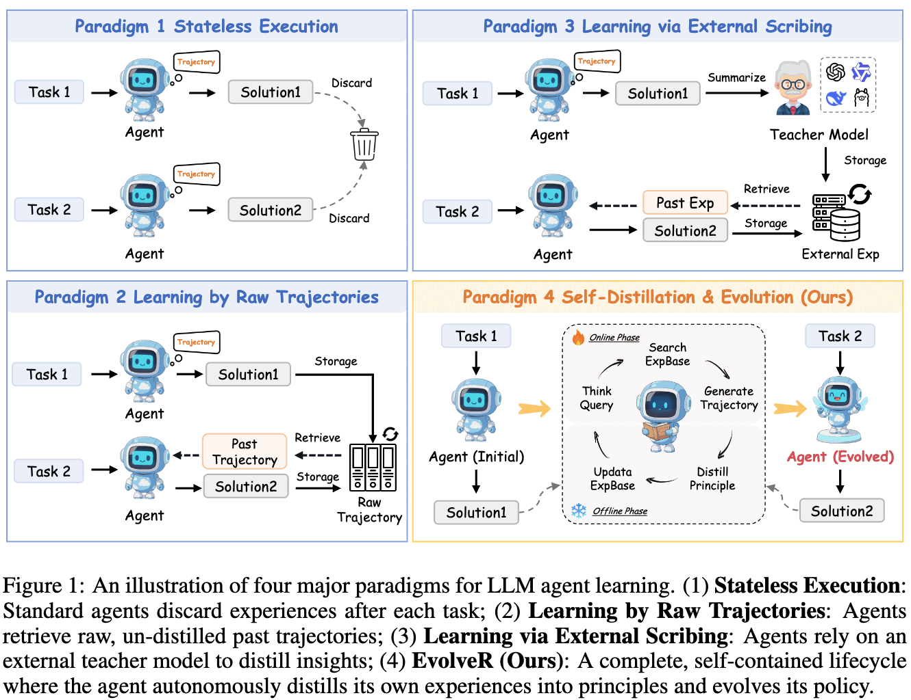

- 핵심 질문: **experience를 context로만 쓰지 말고, experience를 잘 활용하는 policy 자체를 학습시킬 수 있는가?**

# 2. Contribution

- **Experience-Driven Self-Evolution Paradigm** 제안: online interaction / offline self-distillation / policy evolution을 하나의 closed-loop lifecycle로 통합
- **Dynamic experience curation 시스템**
  - agent 자신이 principle을 추출하는 self-distillation
  - semantic deduplication, merge, metric score 기반 quality control(pruning)까지 포함한 maintenance pipeline
- Qwen2.5 0.5B~7B, 7개 QA benchmark에서 검증
  - 3B 기준 avg EM **0.382** (Search-R1-instruct 0.325 대비 +5.7pp), 7B 기준 **0.417** (0.385 대비 +3.2pp)
  - **3B 규모에서는 self-distill이 GPT-4o-mini teacher-distill보다 좋음** $\to$ "cognitive alignment"가 중요하다는 주장

# 3. Related Works

- **Continual learning / self-evolving agent**: CL은 task 경계가 정해진 상태에서 forgetting 방지에 집중. Reflexion, Generative Agents 등은 raw trajectory나 reflection을 memory로 쓰지만 장기적인 추상 전략 distillation을 위한 설계는 아님
- **LLM agent + RL**: ReAct, Reflexion은 prompt 기반 stateless. ExpeL은 trajectory 재사용은 하지만 policy는 안 바뀜. Search-R1, O2-Searcher, AutoRefine은 RL로 search tool 사용을 학습하지만 *외부 지식과의 상호작용*만 최적화하고 *자기 경험*을 통한 개선은 다루지 않음

# 4. Method: EvolveR Lifecycle

EvolveR experience lifecycle 전체 구조: Online/Offline phase, Search ExpBase, Update ExpBase

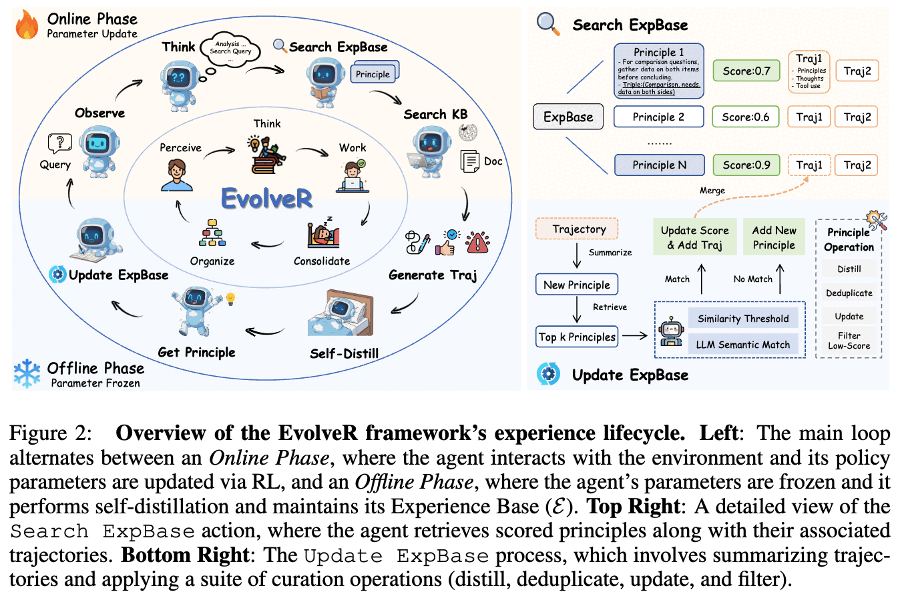

## 4.1 Action space

- agent의 action은 3가지 (+ `<think>`)
  - `<search experience>`: 내부 experience base $\mathcal{E}$에서 관련 principle을 retrieve (top-$k_e$=3)
  - `<search knowledge>`: 외부 검색엔진에서 사실 정보 retrieve (top-$k_d$=3)
  - `<answer>`: 최종 답 출력 후 종료

## 4.2 Offline Experience Self-Distillation (parameter frozen)

**Principle 추출**
- agent 자신의 policy $\pi_\theta$에게 expert persona prompt를 주고 trajectory를 분석시킴
  - 성공 trajectory $\to$ **guiding principle**, 실패 trajectory $\to$ **cautionary principle**
- 형식(Mem0, G-Memory에서 영감): 한 문장 description + structured triple 리스트
  - 예: "For comparison questions, gather data on both items before concluding." / (Comparison, needs, data on both sides)

**Deduplication & Integration** (2단계)
1. **같은 문제에서 나온 principle끼리** dedup: GRPO sampling으로 비슷한 trajectory가 많이 나오므로, $\pi_\theta$로 pair-wise semantic equivalence를 체크해 cluster당 하나만 남김
2. **기존 $\mathcal{E}$와 매칭**: embedding(BGE-M3) 유사도로 후보를 찾고, $\pi_\theta$가 Yes/No로 semantic equivalence 판정

$$
\mathcal{E} \leftarrow
\begin{cases}
\mathcal{E} \cup \{p_{cand}\} & \text{if } \max_{p \in \mathcal{E}} \text{sim}(p_{cand}, p) < \theta_{sim} \\
\text{Merge}(\mathcal{E}, p^*, \tau_{src}) & \text{otherwise}
\end{cases}
$$

- $\theta_{sim}=0.85$, $p^* = \arg\max_p \text{sim}(p_{cand}, p)$. Merge는 새 trajectory $\tau_{src}$를 기존 principle $p^*$에 근거로 연결 $\to$ 중복 없이 기존 principle을 강화

**Quality Control via Dynamic Scoring**
- principle마다 사용 횟수 $c_{use}$, 성공 횟수 $c_{succ}$ 추적

$$
s(p) = \frac{c_{succ}(p) + 1}{c_{use}(p) + 2}
$$

- $s(p) < \theta_{prune}$ (=0.3)인 principle은 주기적으로 삭제

## 4.3 Online Interaction

- Think-Act-Observe loop 안에서 agent가 언제든 `<search experience>`를 호출 가능
- retrieve된 principle $P_k$는 사실 정보가 아니라 **heuristic guidance** $\to$ 이후 `<think>`와 `<search knowledge>` query를 바꿈
- online phase의 또 다른 역할: principle에 guided된 고품질 trajectory $\tau_{new}$를 생성 $\to$ 다음 offline distillation의 입력이 됨 (virtuous cycle)

## 4.4 Policy Evolution (RL)

**Reward**: $R(\tau) = w_o R_{outcome}(\tau) + w_f R_{format}(\tau)$, $w_o=1.0$, $w_f=0.1$
- **Outcome reward**: $R_{outcome}(\tau) = \text{EM}(a_{pred}, a_{gold})$ (binary, sparse)
- **Format reward**: $R_{format}(\tau) = \mathbb{I}(\tau_{complete}) \cdot \frac{R_{think}(\tau) + R_{search}(\tau)}{2}$
  - $\mathbb{I}(\tau_{complete})$: `<think>`, search(종류 무관), `<answer>`가 최소 1번씩 있어야 1
  - $R_{think}$: think 횟수 1회 0.2 $\to$ 6회 1.0, 8회 초과 시 0.5로 cap (과도한 reasoning 억제)
  - $R_{search}$: diversity score(experience+knowledge 둘 다 쓰면 0.5, 하나만 0.2) + 추가 search당 0.1 bonus (최대 0.5)

**Optimization**: GRPO ($G=8$, $\epsilon=0.2$, $\beta=0.001$)

$$
J_{GRPO}(\theta) = \mathbb{E}_{\tau \in D}\left[\sum_{t=1}^{|\tau|} \min\left(\rho_t(\theta)\hat{A}_t, \text{clip}(\rho_t(\theta), 1-\epsilon, 1+\epsilon)\hat{A}_t\right) - \beta D_{KL}[\pi_\theta \| \pi_{ref}]\right]
$$

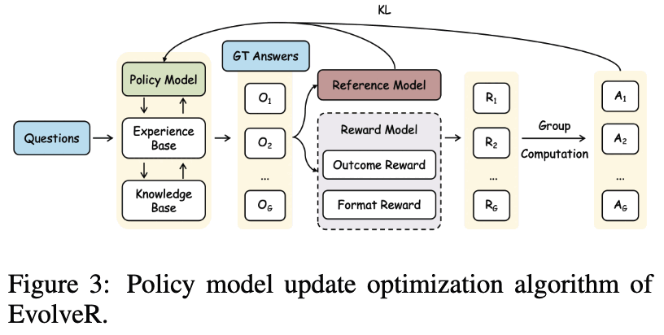

- 핵심 포인트: trajectory가 retrieve된 principle에 conditioned되어 있으므로, GRPO는 일반 reasoning policy가 아니라 **"자기 distilled principle을 어떻게 활용할지"**를 학습
- retrieve된 `<information>`, `<experience>` token은 loss masking

## 4.5 구현 디테일

- **Cold-start**: GPT-4o로 NQ/HotpotQA 약 700개 샘플에 대해 format 맞는 trajectory 생성 $\to$ LoRA SFT (3 epoch, lr 1e-4)
- **RL**: batch 128 prompts × 8 trajectories, lr 1e-6, warm-up 20 step, Verl + vLLM, 8×A100
- Experience Base는 Milvus로 구현, embedding은 BGE-M3
- 3B 전체 학습(cold-start + GRPO) 약 **39.4시간** (8×A100 80GB)

# 5. Experiments

## 5.1 Setup

- **In-domain** (experience base 구축에 train split 사용): NQ, HotpotQA
- **Out-of-domain**: TriviaQA, PopQA, 2WikiMultiHopQA, Musique, Bamboogle
- **Baseline**: Direct, CoT, RAG, IRCoT, Search-o1 / SFT, Rejection Sampling / R1-base·instruct(검색 없이 RL), Search-R1-base·instruct
- **Metric**: Exact Match (EM)

## 5.2 Main Results

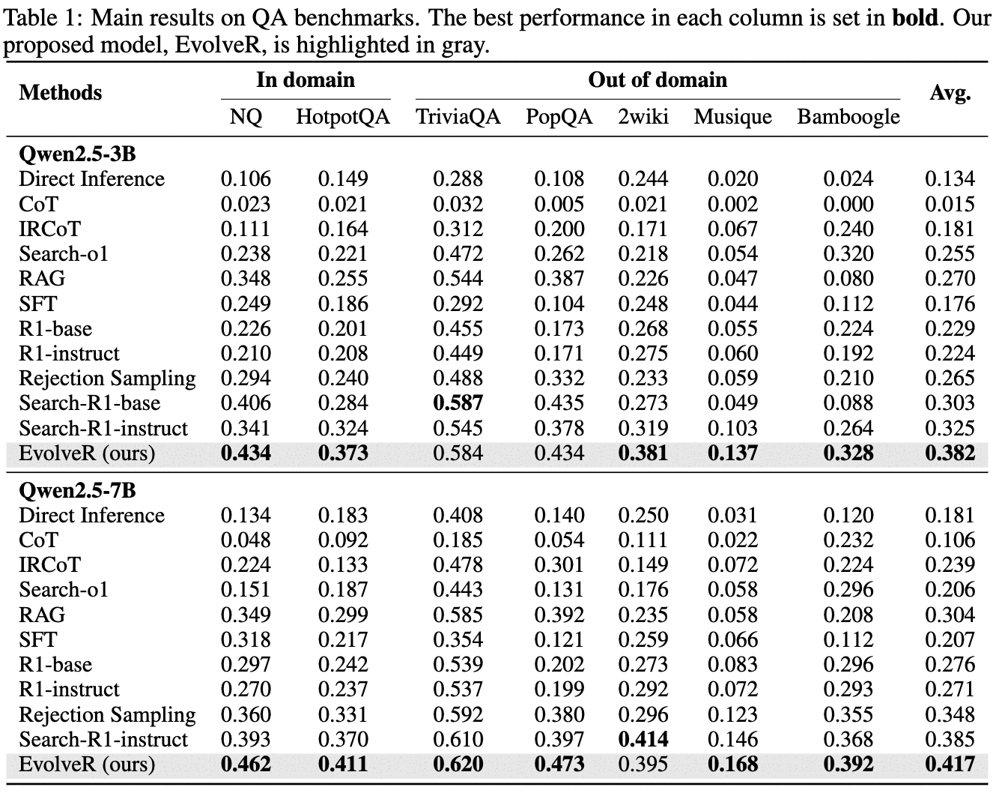

- 3B: avg 0.325 $\to$ 0.382 (+5.7pp), 7B: 0.385 $\to$ 0.417 (+3.2pp)
- 특히 multi-hop OOD(2wiki, Musique, Bamboogle)에서 3B 기준 개선폭이 큼
- 다만 모든 칸에서 1등은 아님
  - 3B TriviaQA(0.584 vs Search-R1-base 0.587), PopQA(0.434 vs 0.435)는 근소하게 밀림
  - 7B 2wiki는 Search-R1-instruct(0.414)보다 낮음(0.395)

## 5.3 Model Scale

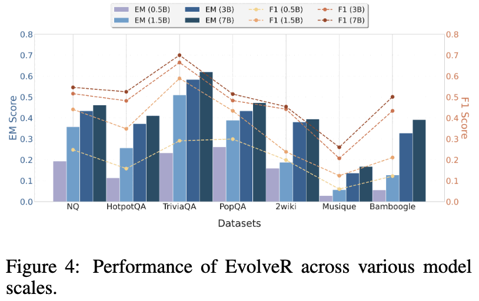

- avg EM: 0.5B **0.150** $\to$ 1.5B **0.270** $\to$ 3B **0.382**로 단조 증가

## 5.4 Ablations

### Self-distill vs Teacher-distill (GPT-4o-mini)

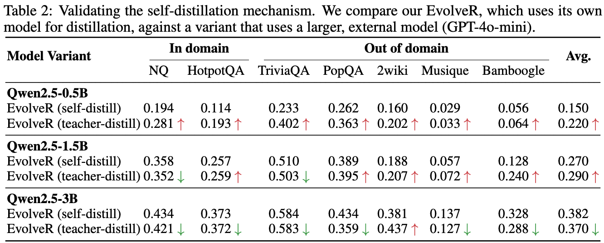

- 작은 모델은 자기 distillation 능력이 부족해 외부 teacher가 유리
- **3B에서 역전** $\to$ 모델이 충분히 강해지면 자기 policy에서 나온 principle이 더 잘 맞음 ("cognitive alignment")

### Experience retrieval의 역할

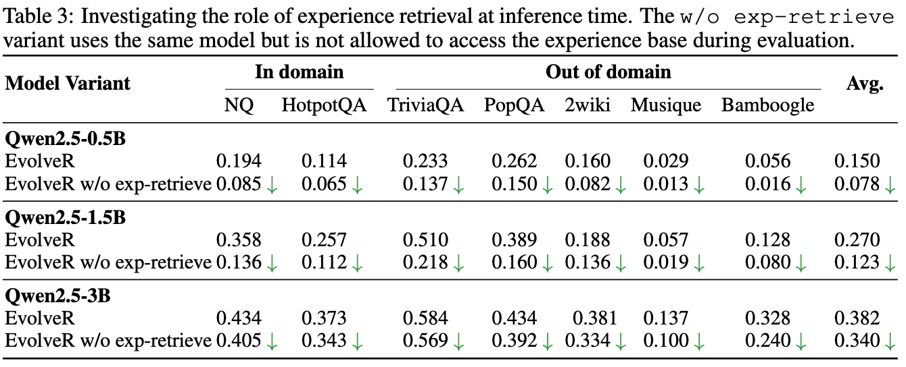

- 동일한 RL 학습을 거친 모델에서 inference 때만 experience base 접근을 막음
  - 0.5B: 0.150 $\to$ 0.078 / 1.5B: 0.270 $\to$ 0.123 / 3B: 0.382 $\to$ 0.340
- 작은 모델일수록 retrieval 의존도가 훨씬 큼 (1.5B는 절반 이하로 하락)

### Component-level attribution (3B)

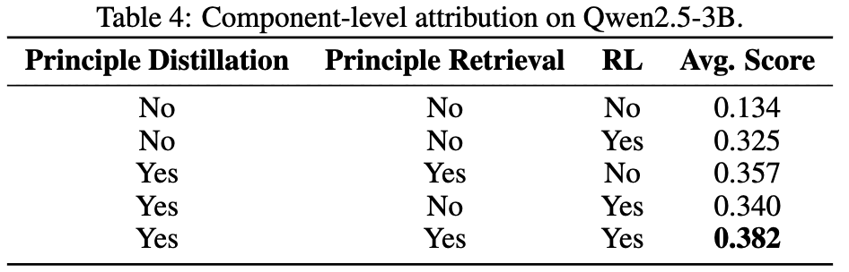

- RL만으로도 크게 오르지만(0.325) 부족
- retrieval 추가: 0.340 $\to$ 0.382 (+4.2pp)
- RL 추가: retrieval만 있는 설정 0.357 $\to$ 0.382 (+2.5pp)
- $\to$ retrieval은 reasoning guidance를 주고, RL은 그 guidance를 잘 쓰도록 policy를 최적화하는 상보 관계

### Memory configuration (3B)

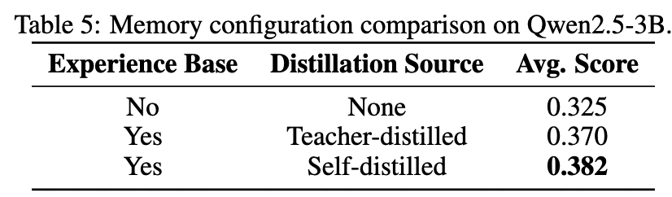

- No experience base 0.325 / Teacher-distilled 0.370 / Self-distilled **0.382**
- experience base가 있는 것 자체보다 **어떻게 구성했는지**가 중요

### SFT vs RL (Appendix)

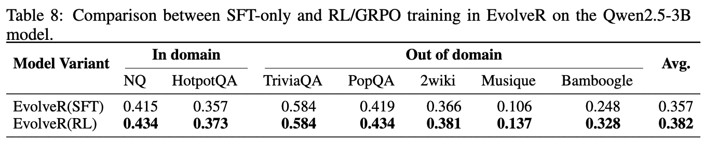

- 같은 성공 trajectory로 SFT만 하면 0.357, GRPO는 0.382 (약 7% 상대 향상)
- SFT는 성공 trajectory의 표면적 action sequence만 따라함. GRPO는 실패 trajectory까지 써서 "무엇을 피해야 하는지"도 학습

### Experience absorption (Appendix)

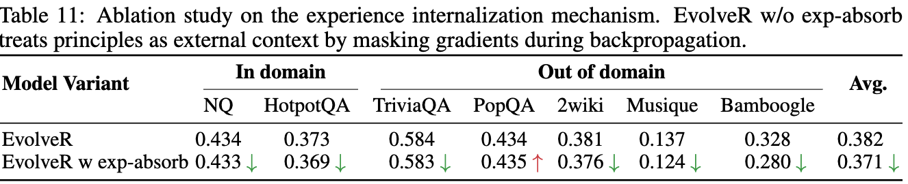

- `<experience>` token의 loss masking을 풀어 principle을 weight에 직접 흡수시키면 0.382 $\to$ 0.371로 오히려 하락
- top-k 중 무관한 principle까지 학습되어 noise가 됨 $\to$ relevance를 가중하는 별도 메커니즘이 필요

## 5.5 Principle Quality & Scalability

**Principle 품질 manual annotation (100개)**

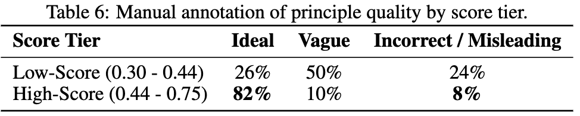

- low-score tier의 주된 실패 유형은 *틀린* 규칙보다 *모호한* 조언(50%)
- metric score가 실제 품질과 잘 대응 $\to$ score 기반 pruning이 유효

table17 첨부 (low-score 제거 principle vs high-score 유지 principle 예시)

- Low(0.25, 제거): "여러 principle을 쓸 때 중복이 없도록 하라" $\to$ 일반적인 meta-statement
- High(0.80, 유지): "시리즈 내 캐릭터 관계를 판단할 때 캐릭터 인식만으로 배우를 가정하지 말고 검증된 배역 정보로 확인하라" $\to$ 구체적 pitfall + 교정 전략

**Long-term scalability (3B, 6개 benchmark의 10% validation subset)**

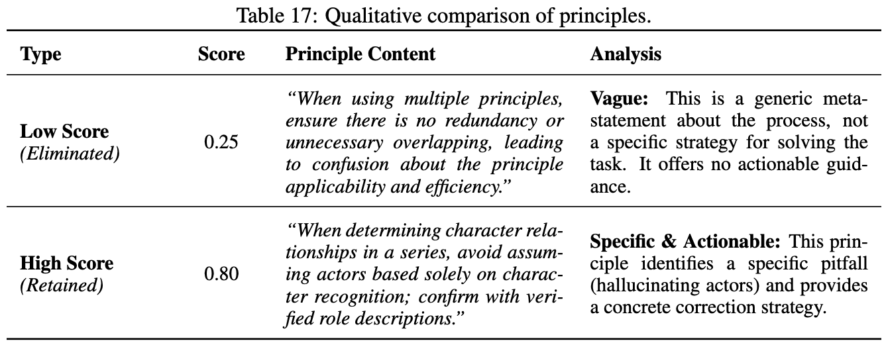

- 약 5만 개까지 늘어도 latency 0.20s로 무시 가능, 성능은 45k에서 peak 후 소폭 하락(collapse는 없음)

**Hyperparameter / 학습 dynamics (Appendix)**

$\theta_{prune}$ sensitivity, Qwen2.5-1.5B

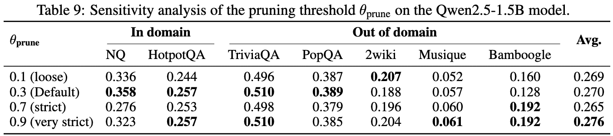

- $\theta_{prune} \in \{0.1, 0.3, 0.7, 0.9\}$ $\to$ avg 0.269 / 0.270 / 0.265 / 0.276로 robust

RL 학습 중 trajectory당 think / search_knowledge / search_experience 횟수 변화

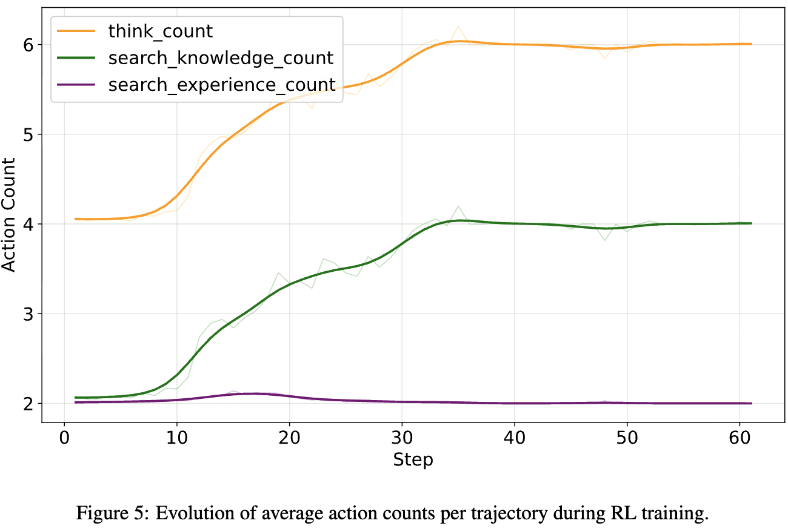

- 학습 진행에 따라 think, search knowledge 횟수가 늘다가 수렴(experience search ≈2, knowledge search ≈4, think ≈6)

생성 시점 interval별 principle 평균 metric score / usage count

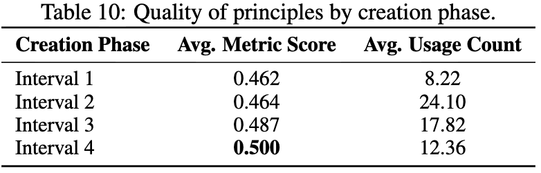

- 후반에 생성된 principle일수록 평균 score가 높음 (Interval 1: 0.462 $\to$ Interval 4: 0.500) $\to$ distillation 능력 자체가 개선된다는 주장

EvolveR rollout case: Pinkerton Detective Agency 질문

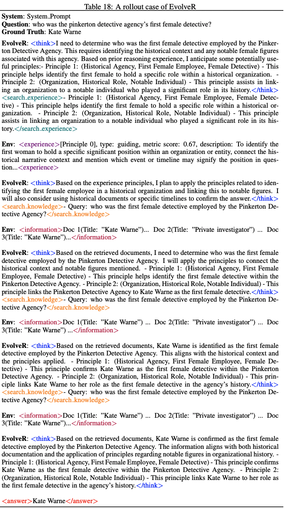

# 6. Conclusion & Limitations

- **Conclusion**
  - experience를 (1) agent 스스로 principle로 distill하고 (2) 정리·평가·pruning하며 (3) 그걸 활용하는 policy를 RL로 학습하는 closed-loop lifecycle 제안
  - search-augmented QA에서 Search-R1 등 RL agent baseline 대비 일관된 개선
- **저자들이 밝힌 Limitations**
  - self-distillation 품질이 base model 능력에 묶여 있음 $\to$ 작은 모델은 evolutionary ceiling이 낮음 (0.5B/1.5B에서는 teacher가 더 좋음)
  - QA 외 태스크(embodied, creative generation 등)로의 일반화는 미검증
  - curation이 있어도 진정한 lifelong learning 규모에서의 계산 효율은 열린 문제
  - 스스로 principle을 진화시키는 agent는 reward가 value-aligned되지 않으면 바람직하지 않은 전략을 학습할 수 있음 (safety)
- **개인적으로 느낀 한계**
  - 평가가 EM 기반 QA에 한정. "strategic principle"이라고 하지만 실제 principle은 retrieval 전략 수준의 heuristic이 대부분
  - format reward가 `<search experience>` 사용 자체를 보상 $\to$ experience retrieval 효과의 일부는 reward shaping으로 강제된 측면이 있음
  - Table 4의 RL-only(0.325)는 Search-R1-instruct의 수치와 동일 $\to$ 동일 조건 재실행인지 baseline 수치 재사용인지 불명확
  - cold-start 데이터는 GPT-4o로 생성 $\to$ 완전한 "self" 진화라고 보긴 어려움
  - Table 7은 10% validation subset 기준이라 노이즈 가능성 있음

# Takeaways

- **Experience를 context로만 쓰지 말고, experience를 *쓰는 법*을 RL로 학습시키는 것**이 핵심 아이디어. retrieval과 RL이 상보적(Table 4)
- principle = 한 문장 description + triple, 그리고 **Laplace smoothed 성공률 기반 scoring/pruning**은 간단하지만 실제 품질과 잘 대응(Table 6) $\to$ ACE의 helpful/harmful counter와 유사한 발상
- **Self-distill vs teacher-distill은 모델 규모에 따라 역전** $\to$ 충분히 강한 모델이면 자기 policy에 맞는 principle이 외부 teacher보다 유용
- retrieve된 principle을 weight에 직접 흡수시키는 건 noise 때문에 오히려 손해 $\to$ principle은 context로 두고 *활용 policy*만 학습하는 편이 안전
- experience base가 5만 개까지 커져도 latency·성능 모두 안정적 $\to$ dedup + scoring 조합이 장기 누적에 robust
